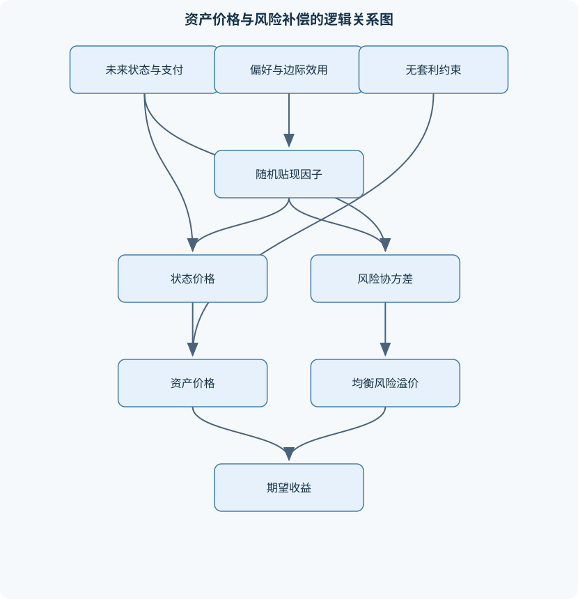
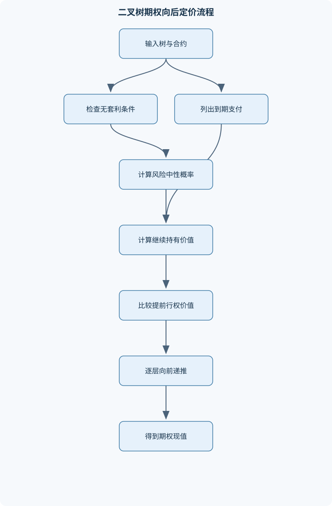

# 资产定价

## 一、课程整体知识框架

### 课程边界与先修知识

《资产定价》研究金融资产在不确定性、跨期选择、市场交易与均衡条件下如何定价，以及风险、投资组合和市场不完备如何影响资产价格与收益。课程涵盖状态证券与无套利定价、偏好与期望效用、均值—方差组合、资本资产定价模型、随机贴现因子、消费型资产定价、跨期均衡、固定收益证券与期权的基本定价、泡沫及实证检验。先修知识包括微积分、线性代数、概率论与统计学、基础微观经济学、金融市场与现金流贴现；回报率、条件期望、协方差矩阵、拉格朗日优化和基本回归应能够熟练运用。课程重点是定价逻辑与模型边界，不等同于完整的金融计量、衍生品数值方法、公司融资或投资实务课程。





### 1. 课程对象、核心问题与先修基础

资产定价研究的核心问题是：在未来现金流具有不确定性、支付时间不同、投资者能够交易并承担风险的条件下，当前价格如何由无套利、偏好、市场均衡和信息结构共同决定。设证券 $j$ 在未来状态 $s$ 下的支付为 $x_j(s)$，其支付向量为 $x_j\in\mathbb{R}^S$；状态 $s$ 的真实概率为 $\pi_s$，满足 $\pi_s\geq 0$ 且 $\sum_{s=1}^S\pi_s=1$。价格不仅取决于支付的期望大小，还取决于支付发生时的状态是否具有较高的边际价值，以及该支付是否能够被其他证券复制。

课程先修内容包括微积分、线性代数、概率论与统计学、基础微观经济学、金融市场和现金流贴现。计算中需要熟悉简单收益率 $r_i$、总收益因子 $R_i=1+r_i$、期望 $E[\cdot]$、方差 $\operatorname{Var}(\cdot)$、协方差 $\operatorname{Cov}(\cdot,\cdot)$、条件期望和矩阵二次型。资产定价中的“收益”通常是无量纲比例；价格和现金流以货币单位表示；状态价格 $q_s$表示当前购买未来状态 $s$ 中一单位货币支付所需的货币金额。不同期限的利率必须明确计息单位，例如年利率不能直接与月度现金流混用。

资产定价不等同于公司融资、完整的金融计量学、衍生品数值方法或投资实务。课程重点是价格—支付—风险之间的逻辑联系：先判断现金流能否复制，再判断市场是否无套利；若不能完全复制，则需要引入偏好、随机贴现因子、均衡或风险补偿模型。

### 2. 资产、状态与无套利基础

#### 2.1 状态支付、交易组合与矩阵表示

有限状态单期市场中，设有 $S$ 个未来状态、$J$ 种证券。支付矩阵 $X\in\mathbb{R}^{S\times J}$ 的第 $s$ 行第 $j$ 列为 $x_j(s)$，证券价格向量为 $p\in\mathbb{R}^J$。若持有组合 $\theta\in\mathbb{R}^J$，则当前成本为 $\theta^{\mathsf T}p$，未来支付向量为 $X\theta$。

状态证券是在某一状态支付 $1$、其他状态支付 $0$ 的理想化证券。若状态 $s$ 的状态价格为 $q_s$，则任意证券都可按各状态支付分解为状态证券组合，其价格满足

$$
p_j=\sum_{s=1}^{S}q_sx_j(s),
$$

矩阵形式为

$$
p=X^{\mathsf T}q.
$$

这里 $q=(q_1,\ldots,q_S)^{\mathsf T}$。若所有状态价格均为正，通常对应较强的无套利要求；若允许某些状态价格为零，则需要区分严格无套利、弱无套利等不同定义，不能简单把“非负”与“严格为正”混为一谈。

复制关系是无套利定价的基础。若两个组合 $\theta$ 和 $\theta'$ 满足

$$
X\theta=X\theta',
$$

但 $\theta^{\mathsf T}p\neq {\theta'}^{\mathsf T}p$，则买入成本较低的组合、卖出成本较高的组合即可获得初始净收入，并在所有状态下支付相同，因此构成套利。由此，复制支付必须具有唯一价格。

#### 2.2 完备市场、不完备市场与冗余证券

若支付矩阵的列空间能够张成全部 $\mathbb{R}^S$，则任意状态支付都可由交易证券复制，市场称为完备。有限状态下，完备性要求 $\operatorname{rank}(X)=S$，因此通常需要 $J\geq S$，但“证券数量不少于状态数量”只是必要条件，不是充分条件。例如两种证券的支付向量若线性相关，即使 $J=S=2$，仍不能复制全部状态支付。

若 $\operatorname{rank}(X)<S$，则市场不完备，某些支付无法复制。此时无套利通常只能限定状态价格集合，而不能确定唯一的 $q$。不过对于已交易证券，所有可行状态价格都必须满足 $X^{\mathsf T}q=p$，因此交易证券价格仍需保持一致。冗余证券不会扩大支付张成空间；若新增证券的支付向量属于原有支付向量的线性张成空间，它可能改善交易便利性，但不会增加可复制的支付集合。

### 3. 风险、偏好与期望效用

#### 3.1 彩票、期望效用与风险厌恶

风险资产可表示为不同状态下具有不同支付的随机变量。期望效用理论用效用函数 $u(c)$评价财富或消费 $c$，并以

$$
E[u(c)]=\sum_{s=1}^S\pi_su(c_s)
$$

表示彩票的价值。冯·诺依曼—摩根斯坦效用表示需要连续性、独立性和完备传递性等偏好条件；效用函数在正仿射变换下表示同一偏好，即 $a u(c)+b$（其中 $a>0$）不改变选择排序。

若 $u''(c)<0$，投资者具有风险厌恶。对均值相同的两个财富结果，风险厌恶者偏好确定结果，因为由詹森不等式：

$$
E[u(c)]\leq u(E[c]).
$$

确定性等价 $CE$ 满足

$$
u(CE)=E[u(c)].
$$

若随机财富的期望为 $E[c]$，风险溢价可定义为

$$
\operatorname{RP}=E[c]-CE.
$$

它是为消除风险而愿意放弃的确定性财富，单位与财富相同。风险厌恶越强、结果波动越大，通常风险溢价越高，但这一结论依赖效用曲率和分布结构。

#### 3.2 随机占优与圣彼得堡悖论

若随机变量 $A$ 的累计分布函数在所有财富水平上都不高于 $B$，且至少一处严格更低，则 $A$ 一阶随机占优于 $B$。所有单调递增效用函数都偏好 $A$。二阶随机占优允许部分风险厌恶效用函数参与判断，通常通过累计分布函数的积分比较。随机占优不依赖某一个具体效用函数，但判别条件较强，不能替代完整的偏好估计。

期望值不是一般定价规则。若一个彩票具有极小概率获得极大支付，其期望支付可能发散或极高，但投资者未必愿意支付同样高的价格。圣彼得堡悖论说明，单纯使用期望货币值忽略了边际效用递减、支付上限、财富约束和概率认知等因素。风险资产价格需要考虑状态支付的边际效用价值，而不能只比较 $E[x]$。

### 4. 均值—方差组合选择

设组合权重向量为 $w$，满足预算约束 $\mathbf{1}^{\mathsf T}w=1$；证券期望收益向量为 $\mu$，协方差矩阵为 $\Sigma$。组合期望收益和方差分别为

$$
E[r_p]=w^{\mathsf T}\mu,
$$

$$
\operatorname{Var}(r_p)=w^{\mathsf T}\Sigma w.
$$

若允许卖空，$w_i$可以为负；若禁止卖空，则要求 $w_i\geq0$。协方差矩阵必须至少半正定，否则某些向量会产生负方差，说明输入数据不具备有效协方差结构。

在给定目标收益 $\bar\mu$ 时，全局最小方差组合由下列问题确定：

$$
\min_w\quad w^{\mathsf T}\Sigma w
$$

满足

$$
\mathbf{1}^{\mathsf T}w=1,\qquad \mu^{\mathsf T}w=\bar\mu.
$$

若 $\Sigma$ 正定且没有额外不等式约束，拉格朗日一阶条件给出唯一解。令

$$
A=\mathbf{1}^{\mathsf T}\Sigma^{-1}\mathbf{1},\quad
B=\mathbf{1}^{\mathsf T}\Sigma^{-1}\mu,\quad
C=\mu^{\mathsf T}\Sigma^{-1}\mu,\quad
D=AC-B^2,
$$

则有效前沿的方差为

$$
\sigma_p^2=\frac{A\bar\mu^2-2B\bar\mu+C}{D}.
$$

该公式要求 $\Sigma$可逆且 $D>0$。若资产期望收益完全相同或收益向量与全一向量线性相关，可能出现 $D=0$，此时不能直接套用公式。禁止卖空时，最优解可能落在边界，必须使用带不等式约束的二次规划。

加入无风险资产后，若无风险总收益因子为 $R_f=1+r_f$，所有有效风险资产组合与无风险资产之间形成资本配置线。切点组合由风险资产的相对价格、期望收益和协方差决定；投资者的风险厌恶主要决定无风险资产与共同风险组合之间的配置比例，而不必决定切点组合内部的相对权重。若投资者可借贷且具有同质预期，均衡中共同风险组合可对应市场组合。

### 5. 随机贴现因子与风险溢价

一期随机贴现因子 $M_{t+1}$是将未来随机支付转换为当前价格的随机权重。对未来总收益 $R_{t+1}$，资产价格关系可写为

$$
p_t=E_t[M_{t+1}x_{t+1}],
$$

或对已支付价格归一化的资产写为

$$
1=E_t[M_{t+1}R_{t+1}].
$$

无风险资产满足

$$
1=E_t[M_{t+1}R_f],
$$

因此在 $R_f$确定时，

$$
E_t[M_{t+1}]=\frac{1}{R_f}.
$$

由 $E[MR]=E[M]E[R]+\operatorname{Cov}(M,R)$，可得

$$
E[R]-R_f
=
-\frac{\operatorname{Cov}(M,R)}{E[M]}.
$$

因此，与贴现因子正协方差的资产在投资者不需要很高的平均风险补偿，甚至可能具有较低的平均收益；它在“坏状态”支付少，边际价值较高，价格相对高。确定性贴现因子只能按照时间和无风险利率贴现，不能处理风险支付的状态差异。

在有限状态无套利市场中，可以通过重新加权真实概率构造等价鞅测度，使贴现后的价格成为鞅。风险中性概率不是实际概率，而是用于无套利定价的调整概率；只有在特殊条件下二者才相同。定价核的识别通常不唯一，因为有限资产价格只对定价核的有限维投影提供约束。市场不完备、样本有限和代理变量选择都会扩大识别集合。

### 6. 资本资产定价模型与均衡

CAPM建立在若干理想化假设上：投资者只关心均值和方差；可按同一无风险利率借贷；具有同质预期；资产可交易且市场出清；不存在税收、交易成本和卖空限制等摩擦。投资者的最优风险资产组合都落在同一个切点组合上，均衡中该组合与市场组合一致。

设市场组合收益为 $r_m$，资产 $i$ 的贝塔为

$$
\beta_i=\frac{\operatorname{Cov}(r_i,r_m)}
{\operatorname{Var}(r_m)}.
$$

由市场组合有效性，沿有效边界移动的局部收益—风险关系可推出

$$
E[r_i]-r_f
=
\beta_i\big(E[r_m]-r_f\big).
$$

资本市场线描述有效组合的期望收益与总标准差之间的关系；证券市场线描述单个资产或组合的期望超额收益与贝塔之间的关系。二者不能混淆。贝塔是相对于市场组合的系统性协方差风险，不是资产的总波动率。可通过分散化消除的个别风险，在理想均衡中不必获得风险补偿。

CAPM经验检验通常包括时间序列回归估计贝塔、横截面回归估计市场风险价格和截距。实际检验会受到市场组合不可直接观测、贝塔估计误差、样本选择、非同步交易、因子遗漏和异常收益等影响。经验关系不等于模型已被证明，也不能自动解释因果机制。

### 7. 消费型资产定价与跨期选择

消费者在多个时期选择消费路径。设时点 $t$ 和 $t+1$ 的消费为 $c_t,c_{t+1}$，跨期效用为

$$
u(c_t)+\beta E_t[u(c_{t+1})],
$$

其中 $\beta\in(0,1)$为跨期贴现因子。若预算约束允许购买总收益为 $R_{t+1}$的资产，且最优解为内点，则一阶条件给出

$$
1=E_t\left[
\beta\frac{u'(c_{t+1})}{u'(c_t)}R_{t+1}
\right].
$$

因此消费型随机贴现因子为

$$
M_{t+1}
=
\beta\frac{u'(c_{t+1})}{u'(c_t)}.
$$

该推导要求消费非负、效用可微、预算约束可行、最优选择满足内点条件，并且期望存在。若存在借贷约束、角点解或不可交易风险，欧拉方程可能只表现为不等式或只适用于可交易方向。

CRRA效用可写为

$$
u(c)=
\begin{cases}
\dfrac{c^{1-\gamma}-1}{1-\gamma},&\gamma\neq1,\\
\ln c,&\gamma=1,
\end{cases}
$$

其中 $\gamma>0$为相对风险厌恶系数。此时 $u'(c)=c^{-\gamma}$，随机贴现因子为

$$
M_{t+1}
=
\beta\left(\frac{c_{t+1}}{c_t}\right)^{-\gamma}.
$$

消费增长较低的状态具有较高边际效用，因此在这些状态支付较多的资产价格较高、预期收益可能较低。消费型模型的现实困难包括消费数据测量误差、个体消费与总消费的差异、低频数据导致样本量有限、习惯形成和流动性约束，以及模型参数对风险溢价的敏感性。

### 8. 跨期市场、动态定价与泡沫

多期资产定价必须使用条件信息。若 $M_{t+1}$是从 $t$到 $t+1$的一期贴现因子，则从 $t$到 $T$的累计贴现因子为

$$
M_{t,T}=\prod_{\tau=t}^{T-1}M_{\tau+1}.
$$

不能把一期随机贴现因子直接当作多期因子。资产价格递推为

$$
P_t=E_t\left[
M_{t+1}(D_{t+1}+P_{t+1})
\right],
$$

其中 $D_{t+1}$为下一期现金流。反复代入可得

$$
P_t
=
E_t\left[
\sum_{\tau=t+1}^{T}M_{t,\tau}D_\tau
+
M_{t,T}P_T
\right].
$$

前一项是基本价值，后一项是贴现终值。要把终值项设为零，必须额外施加终端条件，例如某种无泡沫条件；仅凭递推方程不能自动排除泡沫。若存在满足齐次递推关系的非零价格过程，则它可能表现为理性泡沫，但是否允许取决于无界性、横截条件和均衡可行性。

### 9. 固定收益证券定价

零息债券在 $T$ 期支付一单位货币，价格记为 $P(t,T)$。若使用到期收益率 $y$并按每期复利，间隔为 $n$期，则

$$
P(t,T)=\frac{1}{(1+y)^n},
\qquad
y=P(t,T)^{-1/n}-1.
$$

票息债券的价格是各期现金流按对应期限即期利率折现之和：

$$
P_t=\sum_{k=1}^{n}\frac{C_k}{(1+s_k)^k},
$$

其中 $C_k$为第 $k$期现金流，$s_k$为相应期限的即期利率。到期收益率是使所有现金流按同一收益率折现后等于价格的内部收益率，不一定等于任一期即期利率。

由价格对收益率求导可定义麦考利久期和修正久期。小幅收益率变化 $\Delta y$下，

$$
\frac{\Delta P}{P}\approx-D_{\mathrm{mod}}\Delta y.
$$

考虑二阶项后，

$$
\frac{\Delta P}{P}
\approx
-D_{\mathrm{mod}}\Delta y
+\frac12 Conv(\Delta y)^2.
$$

久期是局部一阶敏感度，凸性用于修正曲率误差。大幅利率变化、现金流随利率变化、嵌入式期权和信用风险都会削弱该近似。信用债价格还取决于违约概率、违约回收支付和风险补偿；信用利差不应机械解释为纯粹的违约概率。

### 10. 期权与无套利复制

欧式看涨期权到期支付为

$$
(S_T-K)^+,
$$

看跌期权到期支付为

$$
(K-S_T)^+,
$$

其中 $(z)^+=\max(z,0)$。在单期二叉树中，标的现价为 $S_0$，上、下状态价格为 $S_u,S_d$，期权支付为 $C_u,C_d$。用 $\Delta$单位标的和 $B$单位无风险资产复制期权：

$$
\Delta S_u+BR_f=C_u,
$$

$$
\Delta S_d+BR_f=C_d.
$$

解得

$$
\Delta=\frac{C_u-C_d}{S_u-S_d},
\qquad
B=\frac{S_uC_d-S_dC_u}{R_f(S_u-S_d)}.
$$

期权价格为 $C_0=\Delta S_0+B$。若

$$
S_d<R_fS_0<S_u,
$$

则风险中性概率

$$
q^*=\frac{R_fS_0-S_d}{S_u-S_d}
$$

位于 $(0,1)$，并且

$$
C_0=\frac{q^*C_u+(1-q^*)C_d}{R_f}.
$$

风险中性概率不是实际上涨概率。多期二叉树从到期节点开始向前递推；美式期权每个节点都要比较立即行权价值与继续持有价值。动态对冲假定可按需要再平衡，但现实中存在跳跃风险、交易成本、离散交易、流动性约束和波动率估计误差。

### 11. 实证分析、市场不完备与模型边界

实证资产定价首先需要明确总收益、超额收益和无风险利率的定义。样本均值、方差和协方差是总体矩的估计，受样本长度、异常值和非平稳性影响。市场模型可写为

$$
r_{i,t}-r_{f,t}
=
\alpha_i+\beta_i(r_{m,t}-r_{f,t})+\varepsilon_{i,t}.
$$

时间序列检验关注单个资产的 $\alpha_i$是否为零；横截面检验关注不同资产的平均超额收益是否由贝塔或因子暴露解释。二者使用的数据结构、误差处理和解释对象不同。模型比较应考察定价误差、样本外表现、稳健标准误和经济意义，不能只看样本内拟合优度。

市场不完备时，不可复制支付可能对应多个一致价格；交易约束、卖空限制、流动性风险和融资约束会改变可行组合集合。异质信念使投资者对概率、风险和预期收益的判断不同；套利限制则可能使错定价在一段时间内持续。模型结论对状态概率、效用曲率、市场组合代理、利率结构和数据测量都敏感。因此，任何估值结论都必须说明理想模型、现实摩擦和适用边界。

## 二、章节和模块划分

### 核心知识覆盖清单

本清单用于检查正文是否覆盖本课程的主要知识模块：

- **资产、状态与无套利基础**：证券支付向量及状态依存现金流、状态价格与状态证券的含义、交易组合、线性张成与可复制性、市场完备与不完备的区别、无套利条件与线性定价关系、单期证券市场的矩阵表示、冗余证券与不改变张成空间的条件。
- **风险、偏好与期望效用**：风险资产收益与彩票的表示、期望效用及冯·诺依曼—摩根斯坦偏好、风险厌恶与效用函数曲率、确定性等价与风险溢价、一阶与二阶随机占优的判别、期望效用对风险选择的作用、圣彼得堡悖论与期望值定价的局限。
- **均值—方差组合选择**：组合权重、期望收益与协方差矩阵、投资组合方差的矩阵表达、全局最小方差组合、有效前沿及其可行条件、无风险资产与切点组合、资本配置线与风险厌恶下的最优配置、卖空限制及其对前沿的影响。
- **随机贴现因子与风险溢价**：随机贴现因子的定义与经济含义、资产价格等于贴现支付期望的条件、无风险利率与贴现因子的关系、协方差定价式及风险溢价解释、确定性贴现与随机贴现的差异、等价鞅测度与风险中性定价的联系、定价核存在条件及其识别限制。
- **资本资产定价模型与均衡**：市场出清与投资者最优化、分离定理与共同风险资产组合、资本市场线与证券市场线、市场组合及系统性风险、贝塔系数与资产风险溢价、CAPM假设与均衡推导、CAPM经验检验及模型风险。
- **消费型资产定价**：跨期消费选择与预算约束、欧拉方程及边际效用定价、边际替代率与随机贴现因子、相对风险厌恶与消费风险暴露、CRRA效用下的风险补偿、消费平滑与资产需求、消费型模型的现实偏差与识别难题。
- **跨期市场与动态定价**：多期现金流的逐期贴现、信息树与条件状态价格、动态完备市场与跨期预算约束、一期随机贴现因子的连乘、时间偏好与跨期边际替代率、长期投资组合选择的基本结构、基本价值、终端条件与理性泡沫。
- **固定收益证券定价**：零息债券价格与到期收益率、票息债券现金流逐期折现、即期利率与远期利率、收益率曲线及其无套利约束、久期与价格对利率变动的敏感性、凸性对久期近似误差的修正、信用风险、违约支付与信用利差。
- **期权与无套利复制**：看涨与看跌期权支付结构、单期二叉树的复制组合、风险中性概率的推导与适用条件、多期二叉树的向后递推、美式期权提前行权比较、动态对冲与再平衡、波动率、期限与期权价值的方向关系。
- **资产定价的实证分析**：总收益与超额收益的构造、样本均值、方差与协方差估计、市场模型与贝塔估计、时间序列检验与横截面检验的区别、定价误差与模型比较、因子暴露和风险溢价解释、样本选择、测量误差与数据挖掘风险。
- **市场不完备、流动性与模型边界**：不可复制支付与多重定价可能、交易约束与可行组合变化、流动性风险及其价格影响、异质信念与投资者需求差异、套利限制与错定价持续条件、模型假设、现实摩擦与解释范围、估值结论对状态概率和偏好的敏感性。


### 1. 教材章节组织与模块衔接

课程可按以下顺序组织：第一章建立状态证券、支付向量、复制和无套利框架；第二章引入彩票、期望效用、风险厌恶和随机占优；第三章在均值—方差假设下研究组合优化；第四章用随机贴现因子统一表达资产定价；第五章从投资者最优与市场出清推导CAPM；第六章从跨期消费选择推导消费型定价；第七章扩展到多期信息树和泡沫；第八章研究债券与利率风险；第九章研究期权复制与二叉树；第十章进行实证检验；第十一章讨论不完备市场、流动性和模型边界。

各章的逻辑关系是：无套利说明价格不能违背复制关系，但通常不能单独决定所有不可复制资产的价格；偏好说明投资者为什么愿意持有风险；组合理论说明协方差如何影响风险；随机贴现因子将无套利和偏好统一为 $p=E[Mx]$；CAPM和消费型模型分别从市场均衡与跨期最优解释 $M$；债券和期权是这些原则在特定现金流结构中的应用；实证分析检验这些关系在数据中的近似程度。

### 2. 代表性算法与分析流程

#### 2.1 单期状态价格与无套利检验

**输入：**支付矩阵 $X$、价格向量 $p$，以及状态价格非负或严格为正的约束。

**输出：**状态价格解集、可复制支付价格和套利诊断。

**过程：**

1. 构造线性方程 $X^{\mathsf T}q=p$。
2. 检查方程是否有解，并检查 $q_s\geq0$或 $q_s>0$。
3. 若解唯一，市场在状态支付方向上具有唯一状态价格；若解不唯一，报告市场不完备或存在价格核识别不足。
4. 对待定组合 $\theta$计算支付 $X\theta$和成本 $\theta^{\mathsf T}p$。
5. 对两个支付相同的组合比较成本；若价格不同，则低价买入、高价卖出形成套利。
6. 终止条件是线性系统求解完成且所有约束检查通过。

该流程适用于有限状态、线性支付、无交易成本的单期市场。稠密矩阵消元的计算量随矩阵维度呈多项式增长；实际数据中还需考虑矩阵病态导致的数值误差。

#### 2.2 均值—方差有效前沿

**输入：**期望收益 $\mu$、协方差矩阵 $\Sigma$、目标收益 $\bar\mu$、预算约束以及卖空限制。

**输出：**组合权重、组合收益、方差和有效前沿。

**过程：**

1. 检查 $\Sigma$是否对称、半正定；若非正定，先排查数据或估计问题。
2. 构造目标函数 $w^{\mathsf T}\Sigma w$。
3. 加入 $\mathbf{1}^{\mathsf T}w=1$和 $\mu^{\mathsf T}w=\bar\mu$。
4. 无卖空限制时用拉格朗日一阶条件求解；有卖空限制时使用二次规划。
5. 改变 $\bar\mu$并重复求解，连接所有可行的最小方差点。
6. 验证每个结果满足预算、收益和不等式约束，并检查不存在更低方差的可行组合。

若目标收益超出可行范围，问题无解；若协方差矩阵奇异，可能存在多个最优组合。

#### 2.3 二叉树期权向后定价

**输入：**$S_0$、上涨因子 $u$、下跌因子 $d$、无风险总收益因子 $R_f$、执行价格 $K$、期限期数 $N$及期权类型。

**输出：**各节点期权价格、对冲比率、初始期权价值以及美式期权的行权节点。

**过程：**

1. 验证无套利条件 $d<R_f<u$。
2. 生成各期标的价格节点。
3. 在到期节点计算看涨支付 $(S_T-K)^+$或看跌支付 $(K-S_T)^+$。
4. 计算风险中性概率 $q^*=(R_f-d)/(u-d)$，或在每个节点直接解复制方程。
5. 从末期向前递推：
   $$
   C_t=\frac{q^*C_u+(1-q^*)C_d}{R_f}.
   $$
6. 美式期权在每个节点比较继续持有价值与立即行权价值。
7. 终止于根节点，输出初始价格。

标准二叉树节点数为 $O(N^2)$。该算法适用于给定离散树模型，不自动适用于跳跃过程、连续交易成本或无法动态复制的市场。

```python
# Python：有限状态下求解状态价格的示意程序
import numpy as np

def state_prices(X, p, tolerance=1e-10):
    """
    X: S x J 支付矩阵
    p: J 维价格向量
    返回：最小二乘解、残差、是否满足非负约束
    """
    X = np.asarray(X, dtype=float)
    p = np.asarray(p, dtype=float)

    # 求解 X.T q = p；lstsq 也适用于方程超定或欠定的情形
    q, residuals, rank, singular_values = np.linalg.lstsq(
        X.T, p, rcond=None
    )
    error = np.linalg.norm(X.T @ q - p)

    feasible = error <= tolerance and np.all(q >= -tolerance)

    return {
        "state_prices": q,
        "pricing_error": error,
        "rank": rank,
        "nonnegative_feasible": feasible
    }

X = np.array([
    [1.0, 0.0],
    [0.0, 1.0]
])
p = np.array([0.6, 0.3])

result = state_prices(X, p)
print(result)
```

该程序只能检查有限状态线性定价关系，不能由数值解自动证明现实市场不存在套利。若支付矩阵病态，需报告条件数和容差；若存在交易成本、保证金要求或卖空限制，还应把这些约束明确加入套利判定。

### 3. 代表性例题及逐步解答

#### 例题一：状态价格与复制

**题干：**有两个状态和两种证券。证券1支付向量为 $(1,0)^{\mathsf T}$，价格为 $0.6$；证券2支付向量为 $(0,1)^{\mathsf T}$，价格为 $0.3$。求状态价格，判断市场是否完备，并求支付向量 $(2,3)^{\mathsf T}$的价格。

**分析与解答：**支付矩阵为单位矩阵，因此

$$
q_1=0.6,\qquad q_2=0.3.
$$

两个状态支付向量线性独立，秩为 $2$，所以市场完备。支付 $(2,3)^{\mathsf T}$可由持有 $2$单位证券1和 $3$单位证券2复制，价格为

$$
p=2(0.6)+3(0.3)=2.1.
$$

**结果验证：**复制组合在状态1支付 $2$、状态2支付 $3$，与目标支付完全相同。若该资产价格不是 $2.1$，就可买入低价复制组合并卖出高价资产。

**变式：**若两种证券支付分别为 $(1,1)^{\mathsf T}$和 $(2,2)^{\mathsf T}$，支付矩阵秩为 $1$，市场不完备；只有与 $(1,1)$同方向的支付能够复制，状态价格一般不唯一。

#### 例题二：两资产最小方差组合

**题干：**资产A、B的波动率分别为 $10\%$和 $20\%$，相关系数为 $0.2$。求使方差最小且权重和为1的组合权重。

**分析与解答：**协方差为

$$
\operatorname{Cov}(A,B)=0.2(0.1)(0.2)=0.004.
$$

方差为 $\sigma_A^2=0.01$、$\sigma_B^2=0.04$。令A权重为 $w$，B权重为 $1-w$，则

$$
\sigma_p^2
=w^2(0.01)+(1-w)^2(0.04)+2w(1-w)(0.004).
$$

展开并求导：

$$
\frac{d\sigma_p^2}{dw}
=0.02w-0.08(1-w)+0.008(1-2w).
$$

令导数为零，得

$$
0.096w-0.072=0,
\qquad
w=0.75.
$$

因此A占 $75\%$，B占 $25\%$。

**结果验证：**二阶导数为正，说明是最小值；权重和为1，且均为非负，满足禁止卖空条件。

**变式：**若相关系数上升到 $1$，分散化效果显著减弱；若两资产完全正相关且波动率不同，最小方差组合可能通过卖空低波动方向实现更复杂的结果，因此必须说明是否允许卖空。

#### 例题三：随机贴现因子与风险溢价

**题干：**某资产总收益为 $R$，无风险总收益为 $R_f$，随机贴现因子为 $M$。已知 $E[M]=1/R_f$。推导资产的期望超额收益。

**分析与解答：**资产定价要求

$$
1=E[MR].
$$

利用协方差分解：

$$
1=E[M]E[R]+\operatorname{Cov}(M,R).
$$

代入 $E[M]=1/R_f$：

$$
1=\frac{E[R]}{R_f}+\operatorname{Cov}(M,R).
$$

整理得

$$
E[R]-R_f
=
-\frac{\operatorname{Cov}(M,R)}{E[M]}.
$$

**结果验证：**若 $\operatorname{Cov}(M,R)<0$，资产在边际效用较低的状态支付较多，要求正的平均超额收益；若协方差为正，平均风险补偿可能较低。

**变式：**不能把 $M$与真实概率混同。$M$是状态依赖贴现权重，不是概率分布。

#### 例题四：CAPM要求收益

**题干：**无风险简单收益率为 $3\%$，市场组合期望收益为 $9\%$，某资产贝塔为 $1.4$。求CAPM下的要求期望收益。若该资产实际期望收益为 $12\%$，如何解释？

**分析与解答：**

$$
E[r_i]
=
r_f+\beta_i(E[r_m]-r_f)
=
0.03+1.4(0.09-0.03)
=0.114.
$$

因此要求收益为 $11.4\%$。实际期望收益 $12\%$高于模型要求值 $11.4\%$，对应正的定价误差：

$$
\alpha_i=12\%-11.4\%=0.6\%.
$$

**结果验证：**资产贝塔大于1，承担的市场协方差风险高于市场平均水平，因此要求风险溢价应为市场风险溢价的 $1.4$倍。

**变式：**若实际收益低于 $11.4\%$，只能说在该样本和模型下出现负定价误差，不能直接断言资产必然被高估，因为贝塔估计误差和模型遗漏都可能造成该结果。

#### 例题五：债券久期与凸性

**题干：**某债券价格为 $100$，修正久期为 $4$，凸性为 $30$。若收益率上升 $0.5\%$，用久期和凸性估计价格变化。

**分析与解答：**令 $\Delta y=0.005$，则

$$
\frac{\Delta P}{P}
\approx
-4(0.005)+\frac12(30)(0.005)^2.
$$

计算得

$$
\frac{\Delta P}{P}
\approx -0.02+0.000375=-0.019625.
$$

因此价格变化约为

$$
\Delta P\approx100(-0.019625)=-1.9625,
$$

估计新价格约为 $98.0375$。

**结果验证：**价格下降符合固定现金流债券在收益率上升时的局部方向；凸性项为正，说明单纯久期近似通常会高估价格下降幅度。

**变式：**若债券含可赎回条款，利率变化还可能改变现金流本身，不能只使用固定现金流的久期和凸性。

#### 例题六：二叉树看涨期权

**题干：**标的现价为 $100$，一期后上涨至 $120$或下跌至 $80$，无风险总收益因子为 $1.05$，执行价格为 $100$。求欧式看涨期权价格和对冲比例。

**分析与解答：**到期支付为

$$
C_u=20,\qquad C_d=0.
$$

复制比例为

$$
\Delta=\frac{20-0}{120-80}=0.5.
$$

由下行状态方程：

$$
0.5(80)+1.05B=0,
$$

得

$$
B=-\frac{40}{1.05}\approx-38.095.
$$

期权价格为

$$
C_0=0.5(100)-38.095\approx11.905.
$$

风险中性概率为

$$
q^*=\frac{1.05(100)-80}{120-80}
=\frac{25}{40}=0.625.
$$

验证：

$$
C_0=\frac{0.625(20)+0.375(0)}{1.05}
\approx11.905.
$$

**变式：**若 $R_fS_0$不在 $[S_d,S_u]$之间，则风险中性概率不在 $[0,1]$，说明给定树和无风险资产存在套利矛盾，不能继续使用该定价公式。

### 4. 实验与项目流程

#### 4.1 项目一：构建均值—方差有效前沿

**输入数据：**至少两种风险资产的同期收益率序列、无风险利率和投资约束。收益率必须统一为简单收益率或统一为对数收益率，不能混用。

**步骤：**

1. 检查缺失值、异常值、日期对齐和收益率单位。
2. 计算样本均值向量 $\hat\mu$和样本协方差矩阵 $\hat\Sigma$。
3. 在允许卖空和禁止卖空两种设定下，分别求解多个目标收益对应的最小方差组合。
4. 记录权重、组合收益、标准差和约束是否满足。
5. 用样本外期间重新计算组合表现，比较样本内与样本外差异。

**评价标准：**预算约束和卖空约束均满足；协方差矩阵半正定；每个目标收益的结果确实在可行组合中具有最低方差；报告不能只展示图表，还应解释估计误差和约束影响。

**排错方法：**若方差为负，检查协方差矩阵；若权重极端，检查资产高度相关、样本量不足或矩阵病态；若目标收益无解，检查其是否超出资产收益的可行范围；若样本外表现骤变，检查过拟合和参数不稳定。

#### 4.2 项目二：二叉树美式期权定价

**输入数据：**$S_0$、$u$、$d$、$R_f$、执行价格 $K$、期限期数 $N$和期权类型。

**步骤：**

1. 验证 $d<R_f<u$。
2. 生成所有节点标的价格。
3. 在末期计算期权内在价值。
4. 向前递推继续持有价值。
5. 对美式期权逐节点比较立即行权价值和继续持有价值，记录较大者。
6. 输出根节点价格、对冲比例和提前行权节点。
7. 改变 $N$、波动幅度和利率，进行敏感性分析。

**评价标准：**无套利条件通过；节点支付与期权定义一致；美式期权价值不低于对应欧式期权价值；增加树的期数后价格应在合理范围内趋于稳定；结果能解释利率、期限、执行价格和波动率变化的方向。

**排错方法：**若风险中性概率不在 $[0,1]$，检查上涨、下跌因子与无风险收益率；若看涨期权价格为负，检查复制方程符号；若美式看跌期权价格低于立即行权价值，检查节点比较顺序；若树价随期数剧烈跳动，检查节点合并、时间单位和折现次数。

### 5. 典型笔试问题与解答思路

#### 问题一：为什么复制支付必须具有唯一价格？

解答思路：设两种组合支付完全相同但价格不同，买入低价组合、卖出高价组合，初始获得无风险收入，未来支付相互抵消，因此构成套利。该结论要求可以按相应方向交易，且暂不考虑交易成本和融资约束。

#### 问题二：证券数量不少于状态数量是否保证市场完备？

解答思路：不保证。完备性要求支付矩阵列向量张成 $\mathbb{R}^S$，关键是秩而不是证券数量。支付向量线性相关时，即使证券很多，也可能只能复制低维支付空间。

#### 问题三：推导两资产组合方差。

解答思路：从 $r_p=w_1r_1+w_2r_2$出发，使用方差的双线性展开：

$$
\operatorname{Var}(r_p)
=w_1^2\sigma_1^2+w_2^2\sigma_2^2
+2w_1w_2\operatorname{Cov}(r_1,r_2).
$$

重点说明协方差项决定分散化效果。

#### 问题四：为什么风险中性概率不是实际概率？

解答思路：风险中性概率通过状态价格重新加权，使资产价格等于按无风险利率折现的期望支付；实际概率描述真实状态发生频率。二者的差异由风险补偿或状态价格体现。

#### 问题五：推导随机贴现因子风险溢价公式。

解答思路：从 $1=E[MR]$开始，使用 $E[MR]=E[M]E[R]+\operatorname{Cov}(M,R)$，再利用无风险资产条件 $E[M]=1/R_f$，整理得到

$$
E[R]-R_f=-\frac{\operatorname{Cov}(M,R)}{E[M]}.
$$

#### 问题六：资本市场线和证券市场线有何区别？

解答思路：资本市场线的横轴是总风险标准差，只适用于有效组合；证券市场线的横轴是贝塔，适用于单个资产或任意组合的均衡期望收益关系。前者是组合层面的风险—收益关系，后者是系统性风险定价关系。

#### 问题七：为什么消费型模型中的随机贴现因子与边际效用有关？

解答思路：消费者在两个时期之间重新分配一单位资源，当前损失的边际效用等于未来获得支付的贴现边际效用期望，因此由欧拉方程得到

$$
M_{t+1}=\beta u'(c_{t+1})/u'(c_t).
$$

需说明内点解和可行消费条件。

#### 问题八：为什么排除泡沫需要终端条件？

解答思路：跨期递推会产生现金流基本价值和贴现终值项。除非另行规定终端价格的贴现项趋于零，否则终值项可能保留。有限现金流不意味着终值自动为零，必须说明横截条件或其他排除泡沫的假设。

### 6. 典型面试问题、参考答案与追问要点

#### 问题一：如何判断一个资产是否被错误定价？

参考答案：先统一价格、现金流和无风险利率的时间单位，再选择定价模型，计算模型价格或定价误差。若使用CAPM，可估计贝塔并比较实际平均超额收益与 $\beta$乘以市场风险溢价的差异。

深入追问要点：解释模型误差、贝塔估计误差、样本外验证、交易成本和流动性折价，不能把回归截距直接当作确定套利收益。

#### 问题二：为什么低流动性资产可能要求更高收益？

参考答案：低流动性使投资者难以及时交易或在压力状态变现，且流动性风险可能与市场下跌共同出现。若该风险无法通过简单分散消除，投资者会要求额外补偿。

深入追问要点：区分买卖价差、价格冲击、融资流动性和市场流动性；说明流动性溢价不是所有时期都固定不变。

#### 问题三：如何解释贝塔？

参考答案：贝塔是资产收益与市场收益的协方差除以市场收益方差，表示资产对市场共同波动的暴露，不等于总波动率。

深入追问要点：说明高特质波动率未必带来高均衡收益；讨论市场组合代理误差和滚动窗口估计稳定性。

#### 问题四：债券收益率上升时价格为什么下降？

参考答案：对固定现金流债券，价格是各期现金流除以贴现因子的和。收益率上升提高每期折现分母，因此价格下降。久期给出局部一阶敏感度，凸性修正二阶误差。

深入追问要点：说明浮动利率债券、含期权债券、信用利差变化和大幅利率变动时不能机械套用固定现金流结论。

#### 问题五：期权动态对冲为什么不能保证现实中完全复制？

参考答案：理想复制需要连续交易、无交易成本、可按任意价格融资、波动率模型正确且标的价格路径连续。现实中存在跳跃、离散再平衡、价差、流动性和参数误差。

深入追问要点：讨论对冲误差来源、伽马风险、波动率微笑以及压力情景下的流动性风险。

#### 问题六：时间序列检验和横截面检验有什么区别？

参考答案：时间序列检验在每个资产上研究因子暴露和定价截距；横截面检验研究不同资产的平均收益是否与暴露或贝塔相关。

深入追问要点：说明误差变量相关、估计贝塔误差、双重排序、稳健标准误和样本外检验。

#### 问题七：如果市场不完备，资产还能定价吗？

参考答案：可以得到一致的价格区间或多个风险调整价格，但不能仅靠无套利确定唯一价格。需要进一步使用偏好、均衡、最小鞅测度、流动性假设或其他选择原则。

深入追问要点：解释不可复制现金流、状态价格不唯一以及交易约束如何扩大价格集合。

#### 问题八：如何发现资产定价实证中的数据挖掘？

参考答案：预先规定变量、样本期和检验方法，区分训练样本与验证样本，报告多重检验和经济显著性，并进行不同样本、因子定义和权重方法的稳健性分析。

深入追问要点：讨论幸存者偏差、前视偏差、退市收益缺失、非同步交易和代理变量选择。

### 7. 知识点易错边界

1. 把期望支付按无风险利率折现当作普遍定价公式；有风险支付必须进行风险调整。
2. 把证券数量多等同于市场完备；决定因素是支付矩阵的秩。
3. 把状态价格非负和严格为正视为同一条件；应先说明套利定义。
4. 把均值—方差有效性推广到任意偏好和任意分布；均值、方差充分性需要额外条件。
5. 把资本市场线与证券市场线混淆；二者的风险度量和适用对象不同。
6. 把贝塔当作总风险；贝塔只刻画相对市场的系统性协方差风险。
7. 把风险中性概率当作真实概率；风险中性概率是无套利表示中的调整权重。
8. 把一期随机贴现因子当作多期累计因子；多期因子是逐期因子的条件乘积。
9. 忽视条件期望的信息集；动态定价必须使用当时可获得的信息。
10. 把到期收益率当作所有期限的即期利率；票息债券的到期收益率是单一折现率的等价表示。
11. 把久期近似当作大幅利率变化下的精确价格；凸性只能进行局部二阶修正。
12. 认为美式期权总会提前行权；应比较立即行权价值与继续持有价值。
13. 认为动态对冲没有成本且能够完全消除风险；跳跃、离散交易和流动性都会造成误差。
14. 认为有限现金流自动意味着没有泡沫；必须检查贴现终值和终端条件。
15. 把回归截距当作确定性套利；统计误差、模型遗漏和交易成本可能使其无法交易获利。
16. 忽略样本外检验和数据挖掘；样本内显著不代表关系稳定。
17. 把流动性风险、信用风险和市场风险混为一谈；三者对应的现金流和补偿机制不同。
18. 忽视卖空、融资和保证金约束；约束会改变可行组合和套利定义。

### 8. 岗位任务与课程知识的对应关系

资产定价或投资研究分析师通常需要整理现金流和收益数据，建立CAPM、因子模型或随机贴现框架，产出估值报告、定价误差分析和风险解释。验收标准包括口径一致、公式可复核、假设明确、结果具有样本外或情景稳健性。

投资组合与风险分析师需要计算协方差矩阵、有效前沿、贝塔、久期和压力情景，产出组合风险报告、风险预算和再平衡建议。验收重点是约束条件正确、风险指标可追溯、极端情景下结果不出现明显逻辑矛盾。

固定收益研究员需要建立零息曲线、计算票息债券价格、收益率、久期和凸性，并分析信用利差和违约支付。验收标准包括现金流时点正确、折现频率统一、价格与收益率方向关系正确，并对含期权和信用变化的债券标明模型边界。

衍生品定价与交易支持分析师需要使用二叉树或复制组合计算期权价值、对冲比率和提前行权边界，产出定价表、敏感度和对冲误差分析。验收标准包括无套利条件通过、节点递推正确、欧式与美式规则区分明确，并披露波动率、流动性和离散再平衡风险。

量化研究员和金融经济学研究助理需要进行收益构造、因子暴露估计、时间序列与横截面回归、模型比较和稳健性检验。验收标准包括避免前视偏差和幸存者偏差，正确处理缺失和退市数据，报告统计显著性与经济显著性，并明确结论只适用于相应样本、资产集合和模型设定。

## 三、核心概念的详细解释

### 3.1 资产、状态与无套利

#### 3.1.1 状态支付与交易组合

设未来只有有限个状态 $s=1,\ldots,S$。证券 $j$ 在状态 $s$ 的支付为 $x_j(s)$，其支付向量为 $x_j\in\mathbb{R}^S$。若投资者持有组合 $\theta\in\mathbb{R}^J$，则组合当前成本为

$$
p^{\mathsf T}\theta
$$

未来支付向量为

$$
X\theta,
$$

其中 $X$ 是 $S\times J$ 的支付矩阵，第 $s$ 行第 $j$ 列为 $x_j(s)$。允许卖空时，$\theta_j$ 可以为负；禁止卖空时，通常要求 $\theta_j\geq 0$。交易约束会改变可行支付集合，因此也会改变套利和定价结论。

状态证券是理想化的证券：它在状态 $s$ 支付一单位货币，在其他状态支付零。状态价格 $q_s$ 表示当前为未来状态 $s$ 中的一单位货币支付的价格。若所有状态证券都可交易，则证券 $j$ 的支付可以分解为

$$
x_j=\sum_{s=1}^S x_j(s)e_s,
$$

其中 $e_s$ 是第 $s$ 个单位向量。因此其价格应满足

$$
p_j=\sum_{s=1}^S q_sx_j(s),
$$

矩阵形式为

$$
p=X^{\mathsf T}q.
$$

状态价格不是状态发生的真实概率。真实概率为 $\pi_s$，而状态价格还包含时间价值和状态边际价值。若无风险总收益因子为 $R_f$，且一单位货币在所有状态支付一单位，则

$$
1=R_f^{-1}
$$

是该无风险支付的价格；相应地，若该支付由状态证券组成，则

$$
\sum_{s=1}^S q_s=\frac{1}{R_f}.
$$

#### 3.1.2 无套利、复制与市场完备

套利组合通常要求初始成本不大于零、所有状态支付不小于零，并且至少一个状态支付严格为正；若初始成本为负，则投资者还获得初始收入。若存在两个组合 $\theta$ 和 $\theta'$ 满足

$$
X\theta=X\theta',
$$

但

$$
p^{\mathsf T}\theta\neq p^{\mathsf T}\theta',
$$

则买入价格较低的组合、卖出价格较高的组合，未来支付完全抵消而获得无风险收益。因此，可复制支付必须具有唯一价格。

市场完备要求交易证券的支付向量张成整个状态支付空间。有限状态下，条件为

$$
\operatorname{rank}(X)=S.
$$

这意味着通常需要 $J\geq S$，但证券数量不少于状态数量并不充分。例如两个证券的支付向量分别为 $(1,1)^{\mathsf T}$ 和 $(2,2)^{\mathsf T}$，虽然有两个证券和两个状态，但两列线性相关，市场仍不完备。若 $\operatorname{rank}(X)<S$，状态价格方程可能有多个解；这些解对所有可交易证券给出相同价格，但对不可复制的支付可能给出不同价值。

### 3.2 偏好、风险与期望效用

#### 3.2.1 风险厌恶与确定性等价

投资者对彩票的偏好可用期望效用表示：

$$
U(W)=E[u(W)],
$$

其中 $W$ 是财富或消费，$u(\cdot)$ 是严格递增的效用函数。冯·诺依曼—摩根斯坦期望效用表示要求偏好满足完备性、传递性、连续性和独立性等条件。它说明投资者比较的是效用的期望，而不是简单比较货币支付的期望。

若 $u''(W)<0$，则投资者风险厌恶。对均值为 $\mu$、方差为 $\sigma^2$ 的小风险 $\varepsilon$，在 $W=\mu+\varepsilon$ 附近作二阶泰勒展开：

$$
E[u(W)]\approx u(\mu)+u'(\mu)E[\varepsilon]
+\frac{1}{2}u''(\mu)E[\varepsilon^2].
$$

当 $E[\varepsilon]=0$ 时，

$$
E[u(W)]\approx u(\mu)+\frac{1}{2}u''(\mu)\sigma^2.
$$

由于 $u''(\mu)<0$，方差增加会降低期望效用。绝对风险厌恶系数为

$$
A(W)=-\frac{u''(W)}{u'(W)},
$$

相对风险厌恶系数为

$$
R(W)=-\frac{Wu''(W)}{u'(W)}.
$$

确定性等价 $CE$ 满足

$$
u(CE)=E[u(W)].
$$

若风险厌恶，詹森不等式给出

$$
u(E[W])\geq E[u(W)],
$$

因此 $CE\leq E[W]$。风险溢价定义为

$$
RP=E[W]-CE,
$$

它是投资者为消除风险愿意放弃的确定性财富。该定义依赖于效用函数和财富分布，不能仅由方差单独决定。

#### 3.2.2 随机占优与期望值定价的局限

若随机变量 $W_1$ 一阶随机占优于 $W_2$，则对所有递增效用函数都有

$$
E[u(W_1)]\geq E[u(W_2)].
$$

若其累积分布函数分别为 $F_1,F_2$，一种判别方式是

$$
F_1(w)\leq F_2(w)
$$

对所有 $w$ 成立，且至少一处严格不等。二阶随机占优进一步限制投资者为风险厌恶者，比较的是分布左尾和整体风险，而不仅是逐点收益。

把资产价格写成期望支付除以无风险利率，即

$$
p=\frac{E[x]}{R_f},
$$

只有在支付风险与贴现无关，或风险已经被适当调整时才成立。圣彼得堡悖论说明单纯使用期望货币支付可能得到无界价值，但现实投资者的效用通常有边际效用递减、财富约束和参与成本，因此不能把无限期望值直接解释为无限价格。

### 3.3 均值—方差组合选择

#### 3.3.1 组合收益与风险

设 $w$ 为各资产权重向量，满足

$$
\mathbf{1}^{\mathsf T}w=1.
$$

资产期望收益向量为 $\mu$，协方差矩阵为 $\Sigma$。组合收益的期望和方差分别为

$$
E[r_p]=w^{\mathsf T}\mu,
$$

$$
\operatorname{Var}(r_p)=w^{\mathsf T}\Sigma w.
$$

协方差矩阵必须是半正定的，才能保证任意组合方差非负；若 $\Sigma$ 正定，则无约束最小方差问题通常有唯一解。

全局最小方差组合求解

$$
\min_w \frac12 w^{\mathsf T}\Sigma w
\quad
\text{s.t.}\quad \mathbf{1}^{\mathsf T}w=1.
$$

拉格朗日函数为

$$
\mathcal{L}
=\frac12w^{\mathsf T}\Sigma w-\lambda(\mathbf{1}^{\mathsf T}w-1).
$$

一阶条件为

$$
\Sigma w-\lambda\mathbf{1}=0,
$$

因此

$$
w=\lambda\Sigma^{-1}\mathbf{1}.
$$

代入预算约束得到

$$
w_{\mathrm{GMV}}
=
\frac{\Sigma^{-1}\mathbf{1}}
{\mathbf{1}^{\mathsf T}\Sigma^{-1}\mathbf{1}}.
$$

若还要求组合期望收益为 $\bar\mu$，则增加约束 $\mu^{\mathsf T}w=\bar\mu$。在允许卖空且 $\Sigma$ 可逆时，可用拉格朗日法求得有效前沿。若禁止卖空，最优解可能落在边界，不能直接使用无约束闭式公式。

#### 3.3.2 无风险资产、资本配置线与切点组合

若存在无风险总收益因子 $R_f$，无风险资产收益方差为零，投资者把财富分配给无风险资产和某一风险组合 $T$。设风险资产权重总和为 $a$，则组合期望收益为

$$
E[r_p]=r_f+a(E[r_T]-r_f),
$$

组合标准差为

$$
\sigma_p=|a|\sigma_T.
$$

在风险资产有效组合中，选择夏普比率

$$
\frac{E[r_T]-r_f}{\sigma_T}
$$

最大的切点组合，可得到资本配置线。风险厌恶程度决定投资者选择多少风险资产，但在经典条件下，不同投资者持有相同的风险资产组合，即分离定理。卖空限制、借贷利率不同、税收和交易成本会破坏这一简单分离。

### 3.4 随机贴现因子与风险溢价

#### 3.4.1 定价式和协方差分解

一期随机贴现因子 $M_{t+1}$ 满足

$$
p_t=E_t[M_{t+1}x_{t+1}],
$$

其中 $p_t$ 和 $x_{t+1}$ 的单位均为货币，$M_{t+1}$ 的单位为“当前货币/未来货币”。若以总收益因子表示，资产价格等于当前价格乘以收益：

$$
1=E_t[M_{t+1}R_{t+1}].
$$

无风险资产满足

$$
1=E_t[M_{t+1}R_f],
$$

因此

$$
E_t[M_{t+1}]=\frac{1}{R_f}.
$$

将定价式展开为协方差形式：

$$
1=E_t[M]E_t[R]+\operatorname{Cov}_t(M,R).
$$

于是

$$
E_t[R]
=
\frac{1-\operatorname{Cov}_t(M,R)}{E_t[M]}.
$$

利用 $R_f=1/E_t[M]$，得到

$$
E_t[R]-R_f
=
-\frac{\operatorname{Cov}_t(M,R)}{E_t[M]}.
$$

因此，若资产在边际效用高、贴现因子高的状态中支付较多，其与 $M$ 的协方差为正，所需平均风险溢价可能较低；若资产恰好在坏状态支付较少，则协方差为负，投资者要求更高的平均收益。

#### 3.4.2 风险中性测度与识别限制

若定义概率调整后的密度

$$
\frac{dQ}{dP}
=
\frac{M}{E[M]},
$$

则在满足正性和可积性条件时，

$$
p=\frac{1}{R_f}E^Q[x].
$$

这就是风险中性定价形式。风险中性概率不是现实世界概率 $\pi_s$，而是把状态价格重新归一化后的概率权重。它适合无套利定价，但不能直接用于预测真实发生概率或估计实际平均收益。

同一组资产价格通常不能唯一识别随机贴现因子。若市场不完备，存在多个 $M$ 对所有可交易资产都满足定价方程；若只观察有限资产价格，未被交易资产上的贴现因子变化无法从数据中识别。

### 3.5 CAPM 与消费型资产定价

#### 3.5.1 CAPM 的经济逻辑

经典 CAPM 假设包括：投资者具有均值—方差偏好；能够以相同无风险利率借贷；资产可交易且没有税收、交易成本和卖空限制；投资者对期望收益、方差和协方差有同质预期；市场达到均衡。市场出清意味着所有投资者持有的风险资产总和等于市场组合。

有效组合的优化条件表明，任意资产的风险补偿只取决于其与市场组合的协方差：

$$
E[r_i]-r_f
=
\beta_i\bigl(E[r_m]-r_f\bigr),
$$

其中

$$
\beta_i
=
\frac{\operatorname{Cov}(r_i,r_m)}
{\operatorname{Var}(r_m)}.
$$

贝塔不是资产总风险。若资产的个别波动与市场不相关，其总方差可能很大，但在完全分散的均衡框架中不必获得额外风险补偿。

资本市场线描述有效组合的期望收益与总标准差关系；证券市场线描述单个资产的期望收益与市场贝塔关系。两者的横轴不同，不能混用。

#### 3.5.2 消费欧拉方程

代表性消费者在预算约束下选择消费和资产持有。若效用为

$$
E_t\sum_{\tau=0}^{\infty}\beta^\tau u(c_{t+\tau}),
$$

且选择一期资产 $i$，则内点最优条件为

$$
u'(c_t)p_{i,t}
=
\beta E_t[u'(c_{t+1})x_{i,t+1}].
$$

两边除以 $u'(c_t)p_{i,t}$，定义总收益因子 $R_{i,t+1}=x_{i,t+1}/p_{i,t}$，得到

$$
1
=
E_t\left[
\beta\frac{u'(c_{t+1})}{u'(c_t)}
R_{i,t+1}
\right].
$$

因此消费型随机贴现因子为

$$
M_{t+1}
=
\beta\frac{u'(c_{t+1})}{u'(c_t)}.
$$

该推导要求最优解为内点、消费为正、效用可微、资产收益可积，并且预算约束和无套利条件成立。若存在借贷约束、角点消费或不可交易收入风险，欧拉方程可能只表现为不等式。

CRRA 效用可写为

$$
u(c)=
\begin{cases}
\dfrac{c^{1-\gamma}}{1-\gamma},&\gamma\neq1,\\[4pt]
\ln c,&\gamma=1,
\end{cases}
$$

其中 $\gamma>0$ 是相对风险厌恶系数。此时

$$
M_{t+1}
=
\beta
\left(\frac{c_{t+1}}{c_t}\right)^{-\gamma}.
$$

消费增长较高时边际效用较低，消费型模型要求资产在消费增长低的状态中支付较多，才能具有保险价值。

### 3.6 跨期定价、固定收益与期权

#### 3.6.1 多期定价与泡沫

多期资产价格满足逐期递推：

$$
P_t
=
E_t\left[
M_{t+1}(P_{t+1}+D_{t+1})
\right],
$$

其中 $D_{t+1}$ 是下一期现金股利或现金流。反复代入得到

$$
P_t
=
E_t\left[
\sum_{k=1}^{T-t}
\left(\prod_{\ell=1}^{k}M_{t+\ell}\right)D_{t+k}
+
\left(\prod_{\ell=1}^{T-t}M_{t+\ell}\right)P_T
\right].
$$

前一项是基本价值，后一项是贴现终值。只有在明确的终端条件下，例如

$$
\lim_{T\to\infty}
E_t\left[
\left(\prod_{\ell=1}^{T}M_{t+\ell}\right)P_T
\right]=0,
$$

才能排除泡沫。价格不爆炸并不自动意味着终值项为零。

#### 3.6.2 债券价格、收益率、久期与凸性

零息债券在 $T$ 期支付面值 $F$，若到期收益率按每期复利为 $y$，则价格为

$$
P=\frac{F}{(1+y)^T}.
$$

票息债券每期支付 $C_t$，价格为

$$
P=\sum_{t=1}^{T}\frac{C_t}{(1+y_t)^t},
$$

其中 $y_t$ 是对应期限的即期利率。若使用单一到期收益率 $y$ 表示同一价格，则

$$
P(y)=\sum_{t=1}^{T}\frac{C_t}{(1+y)^t}.
$$

到期收益率是等价折现率，不等于每个期限的即期利率。由价格对收益率求导：

$$
\frac{dP}{dy}
=
-\sum_{t=1}^{T}
\frac{tC_t}{(1+y)^{t+1}}.
$$

修正久期为

$$
D_{\mathrm{mod}}
=
-\frac{1}{P}\frac{dP}{dy}.
$$

小幅收益率变化 $\Delta y$ 下，

$$
\frac{\Delta P}{P}
\approx
-D_{\mathrm{mod}}\Delta y.
$$

二阶展开加入凸性：

$$
\frac{\Delta P}{P}
\approx
-D_{\mathrm{mod}}\Delta y
+\frac12\operatorname{Convexity}(\Delta y)^2,
$$

其中

$$
\operatorname{Convexity}
=
\frac{1}{P}\frac{d^2P}{dy^2}.
$$

该近似要求现金流结构不因利率变化而改变。含赎回权、提前偿付权或信用质量变化的债券，必须同时重新估计现金流和贴现率。

#### 3.6.3 二叉树期权定价

单期二叉树中，标的当前价格为 $S_0$，上涨和下跌后价格分别为 $S_u,S_d$，无风险总收益因子为 $R_f$。期权在两个状态支付 $C_u,C_d$。复制组合由持有 $\Delta$ 单位标的和 $B$ 单位无风险债券构成：

$$
\Delta S_u+BR_f=C_u,
$$

$$
\Delta S_d+BR_f=C_d.
$$

相减得

$$
\Delta=\frac{C_u-C_d}{S_u-S_d},
$$

再代回可得 $B$，期权当前价格为

$$
C_0=\Delta S_0+B.
$$

定义风险中性概率

$$
q=\frac{R_fS_0-S_d}{S_u-S_d},
$$

则

$$
C_0=\frac{1}{R_f}
\left[qC_u+(1-q)C_d\right].
$$

无套利要求

$$
S_d<R_fS_0<S_u,
$$

等价于 $0<q<1$。风险中性概率只用于定价表示，不等于上涨状态的真实概率。多期树从到期支付开始，逐节点向后折现；美式期权每个节点还要比较继续持有价值与立即行权价值：

$$
V_t=\max\{V_t^{\mathrm{exercise}},V_t^{\mathrm{continue}}\}.
$$

### 3.7 实证分析与市场边界

实证资产定价首先要明确总收益、超额收益、无风险利率和市场组合的频率口径。时间序列回归通常检验资产收益是否由因子暴露解释；横截面回归则检验贝塔或因子暴露是否对应风险价格。回归截距显著不为零只能说明在给定样本和误差结构下存在定价误差，不能直接证明无风险套利。

现实市场中存在交易成本、卖空限制、保证金约束、非同步交易、流动性风险、信用风险和异质信念。不可复制支付可能具有多个无套利价格；流动性较差的资产可能要求额外补偿；套利者即使发现错定价，也可能因融资和持仓期限限制而无法立即消除错定价。模型结论必须说明真实概率、偏好、信息集、交易约束和样本范围。

## 四、重要定义、公式、定理和推导

### 专业审校补充：关键定义与适用边界

关键边界是汉森—雅各布森（Hansen–Jagannathan）界：若无风险资产总收益为 $R_f>0$，超额收益向量为 $R^e$，存在平方可积随机贴现因子 $M$ 满足 $E[M R^e]=0$ 且 $E[M]=1/R_f$，则任意可交易组合的夏普比率都受限于 $$\frac{\sigma(M)}{E[M]}\geq\frac{|E[R_p^e]|}{\sigma(R_p^e)}.$$ 其中 $\sigma(M)$ 是贴现因子的标准差，右侧是任意组合的绝对夏普比率；取所有可行组合的最大值，得到市场夏普比率所对应的下界。它说明高风险溢价与低波动的资产组合，要求定价核具有足够大的波动，否则不存在能够同时满足无套利定价关系的 $M$。该结论是总体矩条件，不等于样本内回归拟合优度，也不唯一识别贴现因子的经济来源。若市场不完备，满足条件的 $M$ 可能有多个；若存在交易成本、卖空限制或无风险资产不可自由借贷，应在实际可行组合集合内计算界。条件信息下还可对每个信息集建立条件界，但不能把无条件界直接解释为动态市场的充分检验。


### 4.1 代表性定理与计算流程

#### 4.1.1 单期状态价格求解流程

**输入：**支付矩阵 $X$、价格向量 $p$，以及非负或严格正状态价格约束。  
**输出：**状态价格解集、市场是否完备、复制关系和套利诊断。

过程如下：

1. 根据证券支付和价格建立方程 $X^{\mathsf T}q=p$。
2. 判断 $\operatorname{rank}(X)$。若秩为 $S$，状态支付可被张成；若低于 $S$，市场不完备。
3. 求解线性方程组，并检查 $q_s\geq0$ 或 $q_s>0$。
4. 若方程无解，检查是否存在交易组合 $\theta$ 使 $X\theta\geq0$ 且 $p^{\mathsf T}\theta\leq0$，并至少一处严格不等。
5. 若有多个解，说明不同状态价格对不可交易支付给出不同估值，但对可交易证券的价格一致。

该流程适用于有限状态、线性支付和无交易成本市场。稠密矩阵消元的计算量通常随矩阵维度呈多项式增长；其经济解释仍需结合卖空和融资约束。

#### 4.1.2 均值—方差有效前沿流程

**输入：**期望收益向量 $\mu$、协方差矩阵 $\Sigma$、目标收益 $\bar\mu$、预算约束及卖空限制。  
**输出：**组合权重、期望收益、方差和有效性判断。

先构造目标函数 $w^{\mathsf T}\Sigma w$，加入

$$
\mathbf{1}^{\mathsf T}w=1,\qquad
\mu^{\mathsf T}w=\bar\mu.
$$

无卖空约束时使用拉格朗日一阶条件；有 $w_j\geq0$ 时采用二次规划，检查每个不等式约束是否满足。遍历可行的 $\bar\mu$ 得到有效前沿。若 $\Sigma$ 非半正定，通常意味着数据处理或估计存在问题，不能直接解释为可行风险矩阵。

#### 4.1.3 二叉树期权向后递推流程

**输入：**$S_0$、上涨因子 $u$、下跌因子 $d$、$R_f$、执行价格 $K$、期限 $N$ 和期权类型。  
**输出：**所有节点价值、初始期权价格、对冲比率和提前行权节点。

1. 检查无套利条件 $dR? $。若价格写成 $S_u=uS_0,S_d=dS_0$，应检查
   $$
   S_d<R_fS_0<S_u.
   $$
2. 在末期计算看涨期权支付 $(S_T-K)^+$，看跌期权支付 $(K-S_T)^+$。
3. 从末期向前，对每个节点计算
   $$
   V_t=\frac{qV_u+(1-q)V_d}{R_f}.
   $$
4. 美式期权还需计算立即行权价值并取两者较大值。
5. 用相邻节点价值计算对冲比率，并检查复制组合是否再现上下状态支付。

标准 $N$ 期二叉树节点数为 $O(N^2)$。离散跳跃、交易成本和流动性约束会使精确动态复制失效。

```python
# 语言：Python
# 功能：单标的欧式看涨期权的二叉树向后定价
def european_call_binomial(S0, u, d, Rf, K, N):
    if not (d * S0 < Rf * S0 < u * S0):
        raise ValueError("不满足单期无套利条件")
    q = (Rf - d) / (u - d)

    values = []
    for j in range(N + 1):
        ST = S0 * (u ** j) * (d ** (N - j))
        values.append(max(ST - K, 0.0))

    for step in range(N, 0, -1):
        new_values = []
        for j in range(step):
            value = (q * values[j + 1] +
                     (1 - q) * values[j]) / Rf
            new_values.append(value)
        values = new_values

    return values[0]
```

代码的输入价格和执行价格使用同一货币单位，$u,d,R_f$ 是无量纲总收益因子，$N$ 是整数期数。该代码只适用于欧式看涨期权和给定的离散二叉树，不包含股息、提前行权、随机利率或交易成本。

### 4.2 代表性例题

#### 例题一：状态价格与完备性

**题干：**有两个状态和两个证券，支付矩阵为

$$
X=
\begin{pmatrix}
1&2\\
2&1
\end{pmatrix},
\qquad
p=
\begin{pmatrix}
1.4\\
1.6
\end{pmatrix}.
$$

求状态价格并判断市场是否完备。

**解答：**状态价格满足

$$
q_1+2q_2=1.4,
\qquad
2q_1+q_2=1.6.
$$

第一式乘以 $2$ 后减去第二式：

$$
3q_2=1.2,
\qquad q_2=0.4.
$$

代入第一式得

$$
q_1=0.6.
$$

支付矩阵行列式为 $1-4=-3\neq0$，因此秩为 $2$，市场完备。两个状态价格均为正，且任意两状态支付都可复制。验证第一种证券价格：

$$
0.6\times1+0.4\times2=1.4.
$$

若把第二种证券价格改为 $1.8$，方程将不再有同一组状态价格解，可能产生套利，具体仍需寻找非零组合并检查其状态支付。

#### 例题二：最小方差组合

**题干：**两种资产的期望收益为 $0.08,0.12$，协方差矩阵为

$$
\Sigma=
\begin{pmatrix}
0.04&0.01\\
0.01&0.09
\end{pmatrix}.
$$

求全局最小方差组合。

**解答：**先求

$$
\Sigma^{-1}
=
\frac{1}{0.0035}
\begin{pmatrix}
0.09&-0.01\\
-0.01&0.04
\end{pmatrix}.
$$

因此

$$
\Sigma^{-1}\mathbf{1}
=
\frac{1}{0.0035}
\begin{pmatrix}
0.08\\
0.03
\end{pmatrix}.
$$

归一化后

$$
w_1=\frac{0.08}{0.11}\approx0.7273,
\qquad
w_2=\frac{0.03}{0.11}\approx0.2727.
$$

组合期望收益为

$$
0.7273(0.08)+0.2727(0.12)\approx0.0909.
$$

组合方差为

$$
w^{\mathsf T}\Sigma w\approx0.03455.
$$

标准差约为 $0.1859$。若禁止卖空，本题解满足非负约束；若加入目标收益高于 $0.0909$，需要重新求解带目标收益约束的有效组合。

#### 例题三：CAPM 要求收益

**题干：**无风险收益率为 $3\%$，市场期望收益率为 $9\%$，某资产贝塔为 $1.2$。求 CAPM 要求收益；若实际期望收益为 $11\%$，判断定价误差方向。

**解答：**

$$
E[r_i]
=
r_f+\beta_i(E[r_m]-r_f).
$$

代入得

$$
E[r_i]
=
0.03+1.2(0.09-0.03)
=0.102.
$$

要求收益为 $10.2\%$。实际期望收益为 $11\%$，高于模型要求收益 $0.8$ 个百分点，因此在模型成立且贝塔估计准确时，资产表现为正的定价误差。该结论不是无条件套利结论，因为误差可能来自估计误差、遗漏因子或交易成本。

#### 例题四：消费型随机贴现因子

**题干：**$\beta=0.96$，CRRA 参数 $\gamma=2$，当前消费 $c_t=100$，下一期消费在两个等概率状态下分别为 $110$ 和 $90$。求两个状态的随机贴现因子。

**解答：**CRRA 随机贴现因子为

$$
M_{t+1}
=
0.96
\left(\frac{c_{t+1}}{100}\right)^{-2}.
$$

高消费状态：

$$
M_u
=
0.96(1.1)^{-2}
\approx0.7934.
$$

低消费状态：

$$
M_d
=
0.96(0.9)^{-2}
\approx1.1852.
$$

低消费状态的边际效用较高，因此贴现因子较大。无风险资产的定价条件要求

$$
1=E[M R_f],
$$

所以

$$
R_f=\frac{1}{E[M]}
=
\frac{1}{0.5(0.7934+1.1852)}
\approx1.0108.
$$

该结果只是在消费型模型和内点欧拉方程成立时的模型含义，不是对现实无风险利率的直接预测。

#### 例题五：债券久期近似

**题干：**一只两期债券每期支付 $5$，第二期另支付面值 $100$，到期收益率为 $10\%$。求价格、修正久期，并估计收益率上升 $1$ 个百分点时的价格变化。

**解答：**价格为

$$
P=\frac{5}{1.1}+\frac{105}{1.1^2}
\approx91.32.
$$

麦考利久期为现金流现值加权时间：

$$
D_M
=
\frac{1\cdot 5/1.1+2\cdot105/1.1^2}{P}
\approx1.95.
$$

修正久期为

$$
D_{\mathrm{mod}}=\frac{D_M}{1.1}\approx1.77.
$$

若 $\Delta y=0.01$，一阶近似为

$$
\frac{\Delta P}{P}\approx-1.77(0.01)=-0.0177.
$$

因此价格约下降 $1.77\%$，即下降约 $1.62$ 个货币单位。该估计适合小幅平行收益率变动；较大变动时应加入凸性并重新逐期折现。

### 4.3 实验与项目流程

#### 实验一：有效前沿与卖空限制

**输入数据：**至少两种风险资产的同期收益序列，计算样本均值向量和样本协方差矩阵；同时准备无风险收益率序列。  
**步骤：**

1. 统一收益频率和价格调整口径。
2. 计算样本期望收益、协方差矩阵和相关系数。
3. 在允许卖空条件下求解多个目标收益的最小方差组合。
4. 增加 $w_j\geq0$ 约束，重新求解。
5. 比较两种前沿的收益、波动率、权重和边界资产。

**评价标准：**权重和为一，目标收益约束满足，方差非负；无卖空解不能出现负权重；结果应能解释协方差而不仅是单项波动率。  
**排错方法：**若协方差矩阵非半正定，检查重复数据、缺失值和收益率口径；若权重极端，检查样本长度、近共线性和是否误把价格变化当成收益率。

#### 实验二：CAPM 时间序列与横截面检验

**输入数据：**多个资产或组合的总收益、无风险收益和市场组合总收益。  
**步骤：**

1. 构造超额收益 $r_{i,t}-r_{f,t}$ 和市场超额收益 $r_{m,t}-r_{f,t}$。
2. 对每个资产估计
   $$
   r_{i,t}-r_{f,t}
   =
   \alpha_i+\beta_i(r_{m,t}-r_{f,t})+\varepsilon_{i,t}.
   $$
3. 使用估计贝塔进行横截面回归，检验贝塔是否对应共同风险价格。
4. 报告截距、贝塔、标准误、样本内拟合和样本外预测。
5. 改变样本区间、资产分组和权重方法进行稳健性比较。

**评价标准：**收益、无风险利率和市场因子的频率一致；不能使用未来信息形成组合；同时报告统计显著性和经济显著性；定价误差应进行样本外验证。  
**排错方法：**若贝塔异常，检查非同步交易和市场因子时点；若截距显著，检查遗漏因子、异方差、误差相关和双重排序；若样本外结果崩溃，检查数据挖掘和样本选择。

### 4.4 典型笔试问题与解答思路

#### 问题一：为什么市场不完备时状态价格不唯一？

因为 $\operatorname{rank}(X)<S$，方程 $X^{\mathsf T}q=p$ 的未知数多于独立约束，可能存在多个解。它们对可交易支付给出相同价格，但对不可复制支付的估值不同。

#### 问题二：为什么期望收益不能直接用于定价？

因为不同状态的边际效用和时间价值不同。一般定价式是 $p=E[Mx]$，只有当 $M$ 与支付独立或风险已经被调整时，才可简化为确定性贴现。

#### 问题三：CAPM 中贝塔为什么不是总风险？

贝塔是资产与市场收益的协方差除以市场方差，只度量市场共同波动。可通过分散化消除的个别风险在经典均衡中不产生独立风险价格。

#### 问题四：风险中性概率与真实概率有何区别？

风险中性概率由状态价格归一化得到，使贴现后的期望支付等于价格。真实概率描述状态发生频率；二者只有在特定条件下才相同。

#### 问题五：久期近似何时失效？

收益率变化较大、收益率曲线非平行移动、债券现金流随利率变化、债券含期权或信用质量变化时，一阶久期近似可能严重失真。

#### 问题六：如何排除理性泡沫？

不能仅凭价格递推公式排除。必须给出终端条件，证明贴现终值项趋于零；若终端条件不成立，价格可包含满足齐次递推关系的泡沫项。

#### 问题七：欧拉方程为什么可能表现为不等式？

借贷约束、消费非负约束或资产持仓边界会导致角点最优。此时投资者不能沿任意方向微调持仓，内点一阶条件不再以等式成立。

#### 问题八：时间序列检验和横截面检验有何区别？

时间序列检验估计每个资产对因子的暴露及截距；横截面检验研究不同资产的平均收益是否由暴露解释。前者关注动态回归，后者关注跨资产风险价格。

### 4.5 面试问题与深入追问要点

#### 面试问题一：如何判断一个定价结果是否由套利机会支持？

先检查现金流是否可复制，再检查初始成本和所有状态支付。若存在零成本、非负支付且至少一状态严格为正的组合，才构成套利。追问时应说明卖空、融资和交易成本会改变套利定义。

#### 面试问题二：如何解释一个资产贝塔很高但收益不高？

可能存在估计误差、市场组合代理错误、遗漏因子、样本期特殊性或非线性风险。不能只根据点估计断言模型失败，应检查标准误、滚动贝塔和样本外结果。

#### 面试问题三：如何给一只票息债券定价？

先列出每个支付时点和现金流，再使用即期利率逐期折现；若需要到期收益率，则求使单一收益率折现价格等于市场价格的数值解。追问时需说明信用风险、期权条款和利率曲线形状。

#### 面试问题四：如何验证二叉树期权价格？

检查 $S_d<R_fS_0<S_u$，由上下状态支付解复制组合，再验证复制组合在两个状态的支付分别等于期权支付。若无法验证，通常是风险中性概率、折现因子或节点价格使用错误。

#### 面试问题五：随机贴现因子具有何种经济含义？

它衡量未来一单位支付在当前的边际价值。坏状态通常边际效用高，若资产在坏状态支付，则与贴现因子正相关，具有保险性质，所需平均收益可能较低。

#### 面试问题六：为什么样本内因子显著不代表可交易？

样本内关系可能来自数据挖掘、前视偏差、幸存者偏差或交易成本忽略。需要样本外检验、换样本、控制换手率和考虑容量限制。追问还应讨论因子收益是否被风险补偿或行为需求解释。

#### 面试问题七：如何处理市场不完备下的不可复制资产？

先给出无套利价格区间或多个等价鞅测度，再引入偏好、效用、流动性或最小方差对冲等额外原则选择估值。不能把某一模型价格称为唯一客观价格。

#### 面试问题八：如何向非技术人员解释债券价格与利率的反向关系？

固定现金流的现值等于未来现金流除以贴现因子。利率上升会提高分母，使同一组未来现金流的当前价值下降；期限越长，现金流受贴现变化影响通常越大。含期权或信用变化的债券还需重新判断现金流是否固定。

### 4.6 具体易错点

1. 把真实概率 $\pi_s$ 当作状态价格 $q_s$。  
2. 把证券数量多于状态数量直接等同于市场完备。  
3. 忽略支付矩阵的秩和线性相关性。  
4. 把状态价格非负与严格为正混为一谈。  
5. 把均值—方差有效性推广到任意偏好和任意分布。  
6. 把资本市场线与证券市场线混用。  
7. 把贝塔当作资产总波动率。  
8. 把风险中性概率当作真实状态概率。  
9. 把一期随机贴现因子和多期累计贴现因子混用。  
10. 忽略欧拉方程成立所需的内点和可行消费条件。  
11. 把票息债券到期收益率当作所有期限的即期利率。  
12. 把久期近似当作大幅利率变化下的精确结果。  
13. 认为美式期权必然提前行权。  
14. 认为动态对冲能够无成本、连续且完全消除风险。  
15. 认为价格递推中的终值项自动为零。  
16. 把回归截距显著不为零直接解释为无风险套利。  
17. 忽略退市、幸存者偏差、前视偏差和非同步交易。  
18. 把流动性风险、信用风险和市场风险视为同一种风险。

### 4.7 岗位任务与知识产出

资产定价或投资研究分析师需要整理现金流和收益数据，估计 CAPM 或多因子模型，产出估值报告、风险解释和定价误差分析；验收标准是数据口径一致、假设可复核、结论具有稳健性。

投资组合与风险分析师需要计算协方差矩阵、有效前沿、贝塔、久期和压力情景，产出组合风险报告和风险预算；验收重点是约束条件正确、权重可追踪、极端情景下结果符合经济逻辑。

固定收益研究员需要建立即期利率曲线，计算债券价格、收益率、久期、凸性和信用利差；验收标准是现金流时点、复利频率和利率单位一致，并明确含期权债券的模型边界。

衍生品定价与交易支持分析师需要构造复制组合、二叉树和对冲比率，产出期权价格、敏感度和对冲误差；验收重点是无套利条件、节点递推、提前行权规则和交易成本披露均正确。

量化研究员和金融经济学研究助理需要进行收益构造、因子暴露估计、时间序列与横截面回归、样本外检验和稳健性分析；验收标准是避免数据泄露，报告统计与经济显著性，并明确结论适用的样本和模型范围。

## 五、算法、流程和实现思路

### 方法与流程覆盖索引

下列方法或流程应在正文中说明输入、步骤、适用条件、结果检查和边界：

- 单期状态价格与无套利检验：输入支付矩阵$X$、价格向量$p$及状态概率或可行约束；输出可行状态价格、复制关系和套利诊断。建立方程$p=X^{\mathsf T}q$，检查线性一致性及状态价格非负条件；若无解则检查价格是否违反无套利，若有多个解则报告市场不完备导致的不唯一。终止条件为方程求解并完成约束检查；线性代数计算量由矩阵维度决定，稠密消元通常为多项式复杂度。该流程适用于有限状态、线性支付且暂不建模交易成本的市场。
- 均值—方差有效前沿求解：输入期望收益向量$\mu$、协方差矩阵$\Sigma$、目标期望收益及预算约束；输出满足约束的最小方差权重及对应风险。构造二次目标$w^{\mathsf T}\Sigma w$，在$\mathbf{1}^{\mathsf T}w=1$和$\mu^{\mathsf T}w=\bar\mu$下使用拉格朗日条件求解；遍历可行目标收益得到前沿。检查协方差矩阵的半正定性、解的可行性及是否包含卖空约束。终止于约束满足且一阶条件成立；无额外约束时矩阵求解为多项式复杂度，加入大量不等式约束时采用二次规划。
- CAPM横截面检验流程：输入多个资产或组合的超额收益时间序列及市场超额收益；先用时间序列回归估计各资产贝塔，再用横截面回归估计市场风险价格与截距，比较定价误差及统计不确定性。检查样本期间一致性、超额收益定义、标准误和相关误差结构。终止于预先设定的模型检验与稳健性检查；主要计算由回归求解决定。结论仅针对样本、资产集合和检验设定，不直接证明模型普遍成立。
- 二叉树期权向后定价：输入初始标的价格、上下行因子、无风险总收益因子、执行价格、期限和期权类型；先验证无套利条件$d<R_f<u$，构造末期节点支付，再逐期按风险中性概率折现期望支付。美式期权每个节点同时比较立即行权价值与继续持有价值。输出节点价格及初始价值；终止于根节点。$N$期单标的标准二叉树的节点运算量为$O(N^2)$，适用于给定离散树模型，不自动适用于跳跃或连续交易成本市场。
- 债券利率风险分析：输入现金流、支付时点、贴现率及小幅利率冲击；按各期贴现因子计算价格、修正久期与凸性，再用久期—凸性近似估计价格变动，并与重新逐期折现的精确重估比较。终止于近似误差达到分析要求或情景集合计算完毕；对单只债券计算量与现金流期数线性相关。该近似对较大利率变动、现金流随利率变化或含复杂期权条款的债券须谨慎使用。





### 5.1 单期状态价格与无套利检验流程

#### 5.1.1 输入、输出与适用条件

该流程适用于有限状态、单期、线性支付的市场。输入包括支付矩阵 $X\in\mathbb{R}^{S\times J}$、证券价格向量 $p\in\mathbb{R}^{J}$，以及可选的状态概率 $\pi$、无风险总收益因子 $R_f$ 和交易约束。输出包括状态价格解 $q$、市场完备性判断、复制组合价格以及潜在套利诊断。

状态价格方程为

$$
p=X^{\mathsf T}q.
$$

其中 $q_s$ 的单位是“当前货币/未来状态货币”。若某一证券在状态 $s$ 支付一单位货币，在其他状态支付零，则其价格就是 $q_s$。状态概率 $\pi_s$ 是真实概率，不等同于 $q_s$。若无风险证券当前价格为 $1$、未来各状态支付均为 $R_f$，则

$$
1=R_f\sum_{s=1}^{S}q_s,
$$

因此

$$
\sum_{s=1}^{S}q_s=\frac{1}{R_f}.
$$

#### 5.1.2 计算步骤与判定逻辑

第一步，检查矩阵维度和现金流单位。支付矩阵必须有 $S$ 行、$J$ 列，价格向量必须有 $J$ 个元素，所有利率必须转换为与支付期限一致的频率。

第二步，计算 $\operatorname{rank}(X)$。若 $\operatorname{rank}(X)=S$，则交易证券张成整个状态支付空间，市场完备；若秩小于 $S$，市场不完备。证券数量 $J\geq S$ 并不能保证完备，因为支付向量可能线性相关。

第三步，求解 $X^{\mathsf T}q=p$。若解不存在，且允许任意正负交易头寸，价格通常违反线性无套利关系；但若存在卖空限制或其他交易约束，不能仅凭无解就断言存在可实施套利，还要检查约束下的套利组合。

第四步，检查状态价格的符号。严格正的状态价格通常支持较强的无套利结论；若某些状态价格为零，需明确采用的是哪一种套利定义。不能把非负状态价格自动解释为所有状态都具有正的定价权重。

第五步，检查复制关系。若目标支付 $y\in\mathbb{R}^S$ 满足 $X\theta=y$，则其复制价格为

$$
p_y=p^{\mathsf T}\theta.
$$

若另一组合 $\theta'$ 也满足 $X\theta'=y$，则无套利要求

$$
p^{\mathsf T}\theta=p^{\mathsf T}\theta'.
$$

否则，买入便宜组合、卖出昂贵组合，未来支付完全抵消，形成套利。

#### 5.1.3 不变量、终止条件与复杂度

计算过程中保持的核心不变量是：每个候选组合的状态支付都由 $X\theta$ 准确表示，价格都由 $p^{\mathsf T}\theta$ 表示。终止条件是线性方程已求解、秩已判断、状态价格符号和复制一致性均已检查。稠密矩阵采用高斯消元或分解方法时，主要计算量通常为多项式复杂度；但复杂度不能替代经济判断，因为约束、近似数据和数值误差可能改变套利诊断。

#### 5.1.4 伪代码实现

```python
import numpy as np

def state_price_check(X, p, tolerance=1e-10):
    """
    X: S×J 支付矩阵
    p: J 维证券价格向量
    返回秩、状态价格的一组最小二乘解、残差和完备性判断
    """
    X = np.asarray(X, dtype=float)
    p = np.asarray(p, dtype=float)

    if X.ndim != 2:
        raise ValueError("支付矩阵必须是二维矩阵")
    S, J = X.shape
    if p.shape != (J,):
        raise ValueError("价格向量维度必须等于证券数量")

    rank = np.linalg.matrix_rank(X, tol=tolerance)
    q, residuals, _, _ = np.linalg.lstsq(X.T, p, rcond=None)
    residual = np.linalg.norm(X.T @ q - p)

    return {
        "rank": rank,
        "complete": rank == S,
        "state_price_one_solution": q,
        "pricing_residual": residual,
        "nonnegative_within_tolerance": np.all(q >= -tolerance)
    }
```

该代码返回的是最小二乘意义下的一组解，不应把小残差直接当作无套利证明。若市场不完备，最小二乘解只是众多可能状态价格中的一个；还需要结合非负性、无风险约束和交易限制进行进一步分析。

### 5.2 均值—方差有效前沿求解

#### 5.2.1 优化问题

设组合权重为 $w\in\mathbb{R}^J$，证券期望收益向量为 $\mu$，协方差矩阵为 $\Sigma$。若权重和为一，组合期望收益和方差分别为

$$
E[r_p]=w^{\mathsf T}\mu,
$$

$$
\operatorname{Var}(r_p)=w^{\mathsf T}\Sigma w.
$$

给定目标收益 $\bar\mu$，全局最小方差问题为

$$
\min_w\quad w^{\mathsf T}\Sigma w
$$

满足

$$
\mathbf{1}^{\mathsf T}w=1,\qquad
\mu^{\mathsf T}w=\bar\mu.
$$

其中 $\mathbf{1}$ 是全一向量。若允许卖空，$w_i$ 可为负；若禁止卖空，还需加入 $w_i\geq0$。

#### 5.2.2 无卖空时的解析结构

当 $\Sigma$ 正定且没有不等式约束时，构造拉格朗日函数

$$
\mathcal{L}
=w^{\mathsf T}\Sigma w
-\lambda(\mathbf{1}^{\mathsf T}w-1)
-\gamma(\mu^{\mathsf T}w-\bar\mu).
$$

一阶条件为

$$
2\Sigma w-\lambda\mathbf{1}-\gamma\mu=0,
$$

因此

$$
w=\frac{1}{2}\Sigma^{-1}
(\lambda\mathbf{1}+\gamma\mu).
$$

令

$$
A=\mathbf{1}^{\mathsf T}\Sigma^{-1}\mathbf{1},\quad
B=\mathbf{1}^{\mathsf T}\Sigma^{-1}\mu,\quad
C=\mu^{\mathsf T}\Sigma^{-1}\mu,
$$

$$
D=AC-B^2.
$$

由两个约束条件可得

$$
\lambda'=\frac{C-B\bar\mu}{D},\qquad
\gamma'=\frac{A\bar\mu-B}{D},
$$

其中 $\lambda'$、$\gamma'$吸收了原式中的常数因子，最终权重为

$$
w=\Sigma^{-1}
\left(\lambda'\mathbf{1}+\gamma'\mu\right).
$$

要求 $\Sigma$ 至少半正定，且目标收益必须处于可行范围。样本协方差矩阵接近奇异时，直接求逆会造成权重极端放大，此时应使用稳定分解、正则化或约束优化。

#### 5.2.3 加入无风险资产

若存在无风险资产，其总收益为 $R_f$，风险资产组合为 $T$，则资本配置线可写为

$$
E[r_p]=r_f+\alpha\sigma_p,
$$

其中 $\alpha$ 是切点组合的夏普比率，$\sigma_p$ 是组合收益的标准差。若投资者具有均值—方差偏好，或收益分布满足使均值和方差足以描述选择的条件，投资者会在无风险资产与切点风险组合之间配置财富。风险厌恶程度主要影响风险资产总配置比例，不必改变所有投资者共同持有的切点风险组合。

### 5.3 随机贴现因子与消费型定价流程

#### 5.3.1 一期定价方程

若资产当前价格为 $p_t$，下一期支付为 $x_{t+1}$，随机贴现因子为 $M_{t+1}$，则定价方程为

$$
p_t=E_t[M_{t+1}x_{t+1}].
$$

若以当前价格归一化，资产总收益因子为 $R_{t+1}$，则

$$
1=E_t[M_{t+1}R_{t+1}].
$$

无风险资产满足

$$
1=E_t[M_{t+1}R_f],
$$

因此

$$
R_f=\frac{1}{E_t[M_{t+1}]}.
$$

对任意资产，有

$$
E_t[R_{t+1}]-R_f
=-\frac{\operatorname{Cov}_t(M_{t+1},R_{t+1})}
{E_t[M_{t+1}]}.
$$

推导方法是将乘积期望展开：

$$
E_t[MR]=E_t[M]E_t[R]+\operatorname{Cov}_t(M,R)=1,
$$

再利用 $R_fE_t[M]=1$ 整理得到结果。若资产在贴现因子较低的状态中支付较多，则其与 $M$ 的协方差通常为负，要求较高的平均超额收益；这表示资产在投资者边际价值低的状态中支付，不能提供良好保险。

#### 5.3.2 消费型随机贴现因子

代表性消费者最大化

$$
E_t\sum_{k=0}^{\infty}\beta^k u(c_{t+k}),
$$

其中 $c_t$ 是消费，$\beta\in(0,1)$ 是跨期贴现因子。若预算约束和最优解满足内点条件，对一项总收益为 $R_{t+1}$ 的资产，欧拉方程为

$$
1=E_t\left[
\beta\frac{u'(c_{t+1})}{u'(c_t)}R_{t+1}
\right].
$$

因此

$$
M_{t+1}
=\beta\frac{u'(c_{t+1})}{u'(c_t)}.
$$

若采用 CRRA 效用

$$
u(c)=\frac{c^{1-\gamma}-1}{1-\gamma},
\qquad \gamma\neq1,
$$

则

$$
u'(c)=c^{-\gamma},
$$

从而

$$
M_{t+1}
=\beta\left(\frac{c_{t+1}}{c_t}\right)^{-\gamma}.
$$

这里 $\gamma$ 是相对风险厌恶系数，同时也是消费增长风险对边际效用变化的敏感程度。在角点消费、借贷约束、不可交易收入或代表性消费者假设不成立时，简单欧拉方程可能需要改写为不等式或更一般的条件。

### 5.4 债券与期权的无套利计算流程

#### 5.4.1 债券逐期折现、收益率与久期

若债券在时点 $t_k$ 支付现金流 $CF_k$，对应即期总贴现因子为 $D(0,t_k)$，则价格为

$$
P=\sum_{k=1}^{n}CF_kD(0,t_k).
$$

若用统一到期收益率 $y$ 表示同一价格，则在每年复利一次的约定下

$$
P=\sum_{k=1}^{n}\frac{CF_k}{(1+y)^k}.
$$

到期收益率是等价单一贴现率，不等同于每个期限的即期利率。对价格关于收益率求导，得到修正久期

$$
D_{\mathrm{mod}}
=-\frac{1}{P}\frac{\partial P}{\partial y}.
$$

小幅收益率变动 $\Delta y$ 下，

$$
\frac{\Delta P}{P}
\approx-D_{\mathrm{mod}}\Delta y.
$$

二阶修正引入凸性：

$$
\frac{\Delta P}{P}
\approx-D_{\mathrm{mod}}\Delta y
+\frac{1}{2}C(\Delta y)^2,
$$

其中 $C$ 为相应复利约定下的凸性。该近似假定现金流结构不因利率变化而改变；含嵌入期权、浮动现金流或信用评级变化的债券不满足这一简单前提。

#### 5.4.2 单期二叉树期权定价

设标的当前价格为 $S_0$，下一期上涨至 $S_u$、下跌至 $S_d$，无风险总收益因子为 $R_f$。欧式看涨期权到期支付为

$$
C_u=(S_u-K)^+,\qquad
C_d=(S_d-K)^+.
$$

构造持有 $\Delta$ 单位标的和 $B$ 单位无风险资产的复制组合：

$$
\Delta S_u+B R_f=C_u,
$$

$$
\Delta S_d+B R_f=C_d.
$$

两式相减得

$$
\Delta=\frac{C_u-C_d}{S_u-S_d}.
$$

再代回任一方程求 $B$，期权当前价格为

$$
C_0=\Delta S_0+B.
$$

定义风险中性概率

$$
q^*=\frac{R_f-S_d}{S_u-S_d},
$$

则

$$
C_0=\frac{1}{R_f}
\left[q^*C_u+(1-q^*)C_d\right].
$$

无套利要求

$$
S_d<R_f<S_u,
$$

从而 $0<q^*<1$。$q^*$不是现实世界上涨概率，而是使折现后的支付满足无套利关系的调整概率。多期二叉树从到期节点开始逐层向前递推；美式期权在每个节点比较立即行权价值与继续持有价值，取较大者。

### 5.5 五个综合例题

#### 例题一：有限状态状态价格

**题干：** 两个状态、两个证券的支付矩阵和价格为

$$
X=
\begin{pmatrix}
1&2\\
2&1
\end{pmatrix},
\qquad
p=
\begin{pmatrix}
1.2\\
1.3
\end{pmatrix}.
$$

求状态价格并判断市场完备性。

**分析与解答：** 状态价格满足

$$
q_1+2q_2=1.2,
\qquad
2q_1+q_2=1.3.
$$

由第一式得 $q_1=1.2-2q_2$，代入第二式：

$$
2(1.2-2q_2)+q_2=1.3,
$$

$$
2.4-3q_2=1.3,
\qquad q_2=\frac{1.1}{3}\approx0.3667.
$$

因此

$$
q_1=1.2-2(0.3667)\approx0.4667.
$$

两个状态价格均为正。支付矩阵行列式为

$$
\det(X)=1\times1-2\times2=-3\neq0,
$$

所以秩为 $2$，市场完备。

**结果验证：** 第一种证券价格为 $0.4667+2(0.3667)=1.2$，第二种证券价格为 $2(0.4667)+0.3667\approx1.3$。

**变式：** 若两列支付向量线性相关，状态价格通常不唯一；此时只能对可复制支付确定价格。

#### 例题二：两资产组合风险

**题干：** 资产一和资产二的期望收益分别为 $8\%$、$12\%$，波动率分别为 $10\%$、$20\%$，相关系数为 $0.25$。求权重 $w$ 投资于资产一、$1-w$ 投资于资产二时的组合方差。

**解答：** 协方差为

$$
\operatorname{Cov}(r_1,r_2)
=0.10\times0.20\times0.25=0.005.
$$

组合方差为

$$
\sigma_p^2
=w^2(0.10)^2+(1-w)^2(0.20)^2
+2w(1-w)(0.005).
$$

展开得

$$
\sigma_p^2
=0.01w^2+0.04(1-2w+w^2)+0.01w(1-w).
$$

整理后

$$
\sigma_p^2=0.04-0.07w+0.04w^2.
$$

令导数为零：

$$
-0.07+0.08w=0,
$$

得到

$$
w=0.875.
$$

组合期望收益为

$$
E[r_p]=0.875(0.08)+0.125(0.12)=0.085.
$$

**验证：** 二阶导数为 $0.08>0$，因此是方差最小点。若禁止卖空，该权重在可行区间 $[0,1]$ 内；若无约束求得负权重，则必须区分允许卖空和禁止卖空两种结果。

**变式：** 相关系数接近 $1$ 时分散化效果减弱；相关系数为负时，最小方差可能显著下降。

#### 例题三：CAPM要求收益

**题干：** 无风险收益率为 $3\%$，市场组合期望收益率为 $9\%$，某资产贝塔为 $1.4$。求 CAPM 要求收益率。

**解答：**

$$
E[r_i]-r_f
=\beta_i(E[r_m]-r_f).
$$

代入得

$$
E[r_i]=0.03+1.4(0.09-0.03)
=0.03+0.084=0.114.
$$

因此要求收益率为 $11.4\%$。若该资产实际期望收益率为 $13\%$，其相对 CAPM 的定价误差为 $1.6$ 个百分点；但这不是无风险套利，因为期望收益率本身具有不确定性，且模型可能遗漏风险因子。

**变式：** 贝塔为负时，资产可能提供市场下跌时的保险，因此其要求平均收益可能低于无风险收益率。

#### 例题四：消费型随机贴现因子

**题干：** 当前消费为 $c_t=100$，下一期消费为 $c_{t+1}=110$，$\beta=0.96$，CRRA 参数 $\gamma=2$。计算随机贴现因子。

**解答：**

$$
M_{t+1}
=0.96\left(\frac{110}{100}\right)^{-2}.
$$

因为

$$
(1.1)^{-2}=\frac{1}{1.21}\approx0.82645,
$$

所以

$$
M_{t+1}\approx0.96\times0.82645\approx0.7934.
$$

若某资产只有一个确定的总收益因子 $R$，其欧拉方程要求

$$
1=E_t[M_{t+1}R]=0.7934R,
$$

因此模型隐含的确定性总收益因子约为

$$
R\approx1.2604.
$$

**验证：** 当未来消费增长时，边际效用下降，贴现因子低于单纯的时间贴现因子 $\beta$。这体现了消费状态对资产定价的影响。

**变式：** 若未来消费低于当前消费，边际效用上升，能够在低消费状态支付的资产可能具有较低风险溢价。

#### 例题五：二叉树看涨期权

**题干：** 标的现价 $S_0=100$，下一期上涨至 $120$、下跌至 $90$，执行价格 $K=100$，无风险总收益因子 $R_f=1.05$。求欧式看涨期权价格和对冲比例。

**解答：** 期权支付为

$$
C_u=(120-100)^+=20,\qquad
C_d=(90-100)^+=0.
$$

对冲比例为

$$
\Delta=\frac{20-0}{120-90}=\frac{2}{3}.
$$

由下行状态复制方程：

$$
\frac{2}{3}\times90+1.05B=0,
$$

得到

$$
B=-\frac{60}{1.05}\approx-57.1429.
$$

期权价格为

$$
C_0=\frac{2}{3}\times100-57.1429\approx9.5238.
$$

风险中性概率为

$$
q^*=\frac{1.05-0.90}{1.20-0.90}=0.5.
$$

验证：

$$
C_0=\frac{1}{1.05}[0.5(20)+0.5(0)]
\approx9.5238.
$$

**变式：** 若 $R_f$ 不在 $0.90$ 与 $1.20$ 之间，则风险中性概率不在 $(0,1)$ 内，说明给定价格和树结构存在无套利问题。

### 5.6 实验与项目流程

#### 5.6.1 项目一：有效前沿与约束敏感性分析

**输入数据：** 多个资产的同步收益率序列、无风险收益率、投资权重上下限、是否允许卖空的设定。

**步骤：**

1. 统一收益频率和时间区间，检查缺失值、异常值和退市处理。
2. 计算样本均值向量 $\hat\mu$ 和协方差矩阵 $\hat\Sigma$。
3. 检查 $\hat\Sigma$ 是否半正定；若接近奇异，比较直接求解和正则化结果。
4. 在不同目标收益下求最小方差组合。
5. 分别计算允许卖空、禁止卖空和设置单资产上限时的有效前沿。
6. 比较权重、组合波动率、收益和夏普比率。
7. 使用滚动窗口或样本外数据检查权重稳定性。

**评价标准：** 权重满足全部约束；组合收益和方差能由矩阵公式复算；前沿不应出现被另一个组合同时在收益和风险上支配的点；样本外结果应报告而不能只展示样本内最优值。

**排错方法：** 若权重极端，检查协方差矩阵条件数、收益率频率、异常收益和是否错误使用价格而非收益；若禁止卖空后收益约束无解，检查目标收益是否超出可行区间；若组合方差为负，通常是协方差矩阵计算或数值精度错误。

#### 5.6.2 项目二：二叉树期权与对冲误差

**输入数据：** 标的初始价格、上下行因子、无风险总收益因子、期限、执行价格、期权类型和再平衡频率。

**步骤：**

1. 检查每期树是否满足 $d<R_f<u$。
2. 生成末期标的价格和期权支付。
3. 对欧式期权逐层向后折现；对美式期权逐节点比较立即行权价值和继续持有价值。
4. 记录各节点期权价格、对冲比例和风险中性概率。
5. 通过复制组合验证每个节点的上下状态支付。
6. 改变期限、波动幅度和执行价格，观察期权价格变化。
7. 若引入离散再平衡或随机跳跃，比较理论价格和对冲组合实际结果。

**评价标准：** 根节点价格与复制价格一致；风险中性概率处于 $[0,1]$；美式期权节点选择满足立即行权与继续持有的比较规则；对冲误差、交易次数和交易成本均被报告。

**排错方法：** 若价格出现负值，检查无套利条件和折现因子；若美式期权价值低于欧式期权，检查节点取值规则；若树的节点数与递推结果不一致，检查上涨、下跌因子是否按总收益因子而非简单收益率使用；若对冲误差异常，检查再平衡时点和标的价格单位。

## 六、概念之间的关系与对比

### 6.1 无套利、偏好、均衡与随机贴现因子的关系

无套利首先约束价格之间的内部一致性。若两个组合具有相同支付，必须具有相同价格；这是复制定价和状态价格表示的基础。无套利通常不能单独确定不可复制资产的唯一价格，因为不完备市场中存在多个状态价格或多个等价鞅测度。

偏好模型进一步说明投资者如何评价不同状态中的财富。期望效用通过边际效用把状态支付转化为定价权重；消费型模型中的随机贴现因子

$$
M_{t+1}=\beta\frac{u'(c_{t+1})}{u'(c_t)}
$$

就是跨期边际替代率。均衡模型再加入市场出清条件，使个体最优需求与资产供给相容。CAPM 是在无风险借贷、同质预期、可交易资产和市场出清等条件下得到的特殊均衡结果，不是所有随机贴现因子的唯一形式。

### 6.2 状态价格、随机贴现因子与风险中性概率

状态价格 $q_s$以当前货币表示每个状态的一单位支付价格。若真实概率为正，可定义有限状态下的随机贴现因子

$$
M(s)=\frac{q_s}{\pi_s}.
$$

于是

$$
p=\sum_s q_sx(s)
=\sum_s\pi_sM(s)x(s)
=E[Mx].
$$

状态价格强调状态支付分解，随机贴现因子强调支付与状态边际价值的协方差关系。风险中性概率则是在无套利条件下重新加权真实概率，使资产价格能够写成无风险利率下的期望贴现。它不必等于真实概率，也不直接描述投资者对状态发生的主观信念。

在市场完备时，状态价格或风险中性测度通常具有唯一性；在市场不完备时，多个状态价格可能对所有可交易资产给出相同价格，但对不可复制支付给出不同估值。由此，风险中性定价的形式不能掩盖市场不完备带来的价格区间问题。

### 6.3 均值—方差、CAPM 与随机贴现因子的对比

| 理论或工具 | 核心风险刻画 | 主要结论 | 关键条件 | 主要边界 |
|---|---|---|---|---|
| 均值—方差 | 组合方差和协方差 | 有效前沿、最小方差组合 | 偏好或分布使均值和方差足够描述选择 | 非正态分布下可能忽略偏度、尾部风险 |
| CAPM | 与市场组合的协方差贝塔 | $E[r_i]-r_f=\beta_i(E[r_m]-r_f)$ | 无风险借贷、同质预期、市场出清等 | 市场组合不可完全观测，经验贝塔不稳定 |
| 随机贴现因子 | 与 $M$ 的协方差 | $E[R]-R_f=-\operatorname{Cov}(M,R)/E[M]$ | 存在可行的定价核 | $M$ 的识别通常不唯一，样本估计误差大 |
| 消费型定价 | 消费边际效用和消费增长 | $M=\beta u'(c_{t+1})/u'(c_t)$ | 代表性消费者、可交易性和最优条件 | 消费数据平滑、测量误差和非交易收入会影响检验 |

CAPM 可以视为随机贴现因子框架中的特殊线性表示。当市场组合是均衡中的有效风险组合时，市场组合协方差足以解释横截面风险溢价；若存在额外风险因子或市场组合代理误差，单一贝塔关系就可能失效。

### 6.4 资本市场线与证券市场线

资本市场线描述有效组合的期望收益与总波动率关系：

$$
E[r_p]=r_f+
\frac{E[r_m]-r_f}{\sigma_m}\sigma_p.
$$

它的横轴是总风险 $\sigma_p$，适用对象是无风险资产与有效风险组合构成的组合。证券市场线描述单个资产或任意组合的期望收益与市场贝塔关系：

$$
E[r_i]=r_f+\beta_i(E[r_m]-r_f).
$$

它的横轴是系统性风险 $\beta_i$，不是总波动率。一个资产可能总波动率很高，但若其波动主要是可分散的个别风险，贝塔并不一定高；在理想 CAPM 均衡中，这类个别风险不获得额外风险补偿。

### 6.5 完备市场与不完备市场

完备市场要求所有相关状态支付都能由交易证券复制。其优点是无套利通常能给出唯一价格；其缺点是现实市场中往往不满足，尤其是存在跳跃、信用事件、流动性状态和不可交易收入时。

不完备市场中，不能复制的支付可能有多个无套利价格。交易约束会进一步改变结果：禁止卖空、融资上限、保证金要求和交易成本都会缩小可行组合集合，使某些理论套利无法实施。此时估值可能表现为价格区间，而不是单一数值。流动性不足还可能使同一现金流因交易成本、变现速度和市场冲击而具有不同报价。

### 6.6 固定收益证券与期权的区别

固定收益证券通常先给定现金流，再用即期利率或状态价格折现。零息债券只有一个到期支付，价格与到期收益率关系较直接；票息债券包含多个支付，其到期收益率只是把多期现金流压缩为一个等价贴现率。久期是局部一阶利率敏感度，凸性是二阶修正，均假定现金流结构和信用状态不发生突变。

期权的支付取决于标的价格，因此现金流本身具有非线性。无套利复制需要标的和无风险资产共同交易；二叉树中的对冲比例随节点变化，动态再平衡是定价逻辑的一部分。美式期权还要在每个节点比较立即行权与继续持有，不能用欧式期权公式直接替代。

### 6.7 跨期贴现与泡沫

多期资产价格可递推写为

$$
P_t=E_t[M_{t+1}(P_{t+1}+D_{t+1})],
$$

其中 $D_{t+1}$ 是下一期现金流。反复代入得到

$$
P_t
=
E_t\left[
\sum_{j=1}^{T}
M_{t+1}\cdots M_{t+j}D_{t+j}
+
M_{t+1}\cdots M_{t+T}P_{t+T}
\right].
$$

第一项是有限期现金流的基本价值，第二项是贴现终值项。只有在明确的终端条件下，例如贴现终值在极限中趋于零，才能排除泡沫。价格不爆炸、现金流有限或模型递推成立，都不能自动推出终值项消失。理性泡沫的关键在于价格项自身满足齐次递推，同时不违反投资者预期和市场定价关系。

### 6.8 实证检验中的时间序列与横截面

时间序列检验通常考察某资产或组合的超额收益是否能由因子收益解释，例如

$$
r_{i,t}-r_{f,t}
=\alpha_i+\beta_i^{\mathsf T}f_t+\varepsilon_{i,t}.
$$

其中 $\alpha_i$ 是样本定价误差，不能直接等同于确定性套利。横截面检验则考察不同资产的平均收益是否随估计贝塔或因子暴露变化，例如

$$
\bar r_i=\lambda_0+\lambda^{\mathsf T}\hat\beta_i+\eta_i.
$$

前者重点是单个资产的动态解释和截距，后者重点是风险暴露与平均收益的关系。两类检验都受到估计误差、资产组合形成方式、因子代理变量、样本选择、幸存者偏差和数据挖掘影响。统计显著不等于经济显著，样本内关系也不等于样本外稳定关系。

### 6.9 具体易错点

1. 把真实概率 $\pi_s$ 当作状态价格 $q_s$。  
2. 把证券数量不少于状态数量当作市场完备的充分条件。  
3. 忽略支付矩阵的秩和支付向量的线性相关性。  
4. 将状态价格非负与严格为正混为一谈。  
5. 把所有有风险支付都按无风险利率折现。  
6. 把均值—方差结论推广到任意偏好和任意收益分布。  
7. 将资本市场线与证券市场线混用。  
8. 把贝塔解释为资产总风险。  
9. 把风险中性概率当作现实世界概率。  
10. 把一期随机贴现因子与多期累计贴现因子混用。  
11. 忽略条件期望所依赖的信息集。  
12. 把到期收益率当作所有期限的即期利率。  
13. 把久期近似视为大幅利率变化下的精确结果。  
14. 认为美式期权总会提前行权。  
15. 认为动态对冲能够无成本、连续且完全消除风险。  
16. 认为价格递推中的终值项自动为零。  
17. 把回归截距显著不为零直接解释为可交易套利。  
18. 忽略退市收益、前视偏差、非同步交易和幸存者偏差。  
19. 把流动性风险、信用风险与市场风险当成同一种风险。  
20. 忽略卖空、融资、保证金和交易成本对套利可行性的影响。

### 6.10 典型笔试问题与解答思路

#### 问题一：为什么复制支付必须具有唯一价格？

设两个组合支付相同但价格不同。买入低价组合、卖出高价组合，初始获得正收入，未来各状态支付相互抵消，因此形成套利。结论依赖于两组合均可交易、交易头寸允许实施且不存在阻止套利的约束。

#### 问题二：如何判断有限状态市场是否完备？

构造支付矩阵 $X$，计算其秩。若 $\operatorname{rank}(X)=S$，交易支付张成全部状态空间，市场完备；若秩小于 $S$，存在不可复制支付，市场不完备。证券数量只是维度条件，不是秩条件。

#### 问题三：推导随机贴现因子的风险溢价公式。

从

$$
1=E[MR]
$$

出发，将乘积期望写为

$$
E[M]E[R]+\operatorname{Cov}(M,R)=1.
$$

利用无风险资产满足 $R_fE[M]=1$，整理得到

$$
E[R]-R_f=-\frac{\operatorname{Cov}(M,R)}{E[M]}.
$$

#### 问题四：CAPM 中为什么个别风险不获得补偿？

在允许充分分散且投资者持有市场组合的均衡中，个别风险可以通过组合分散；只有与市场组合共同变动的风险无法通过持有市场组合消除，因此其协方差贝塔进入均衡风险溢价。

#### 问题五：为什么债券价格通常与收益率反向变动？

固定现金流债券价格是各期现金流除以贴现因子的总和。收益率上升提高每期分母，使每项现值下降，价格因此下降。该结论对固定现金流债券的局部比较成立；若信用、现金流或期权行权行为同时变化，需重新估值。

#### 问题六：为什么风险中性概率不是真实概率？

风险中性概率是对真实概率进行定价权重调整后的概率表示，其作用是使所有可交易资产的折现期望符合无套利价格。真实概率描述状态发生频率或信念，风险中性概率还包含风险补偿和状态边际价值。

#### 问题七：如何解释市场不完备下的多重价格？

若某现金流不能由交易证券复制，不同状态价格向量可能对已有证券给出相同价格，却对该现金流给出不同价格。因此无套利只能限制价格集合；唯一估值需要偏好、均衡、流动性或其他额外条件。

#### 问题八：为什么不能自动排除理性泡沫？

多期递推会产生贴现现金流项和贴现终值项。除非额外假设终值项收敛于零，否则终值项可能代表泡沫成分。有限现金流或价格不立即爆炸都不足以证明该项为零。

### 6.11 典型面试问题与回答要点

#### 问题一：如何向非技术人员解释随机贴现因子？

参考答案：它可以理解为“不同状态下的一单位未来货币在今天值多少钱”。在资源紧张、消费较低的状态，未来货币通常更有价值，贴现因子较高；在资源充足状态，贴现因子较低。

追问要点：说明它不是固定利率；解释其与边际效用、保险价值和风险溢价的关系。

#### 问题二：如何判断一个回归发现是否具有投资价值？

参考答案：除统计显著外，还要检查交易成本、换手率、容量、样本外表现、风险暴露和数据挖掘。必须使用可获得时点的数据，处理退市收益，并比较策略收益是否只是承担了未控制的风险。

追问要点：说明经济显著与统计显著的区别，讨论稳健标准误和多重检验。

#### 问题三：为什么组合风险分析不能只看单个资产波动率？

参考答案：组合风险还取决于资产之间的协方差。两个高波动资产若相关性低，组合风险可能小于单独持有；两个低波动资产若高度同向，组合仍可能集中暴露于共同风险。

追问要点：说明协方差估计不稳定、压力情景下相关性可能上升。

#### 问题四：如何解释久期和凸性？

参考答案：久期是价格对利率变化的一阶敏感度，告诉我们小幅利率变化下价格大约下降多少；凸性是二阶修正，帮助提高较大变动下的近似精度。

追问要点：说明含期权债券的有效久期、现金流变化和大幅冲击下的模型限制。

#### 问题五：如何处理市场不完备下的衍生品估值？

参考答案：先寻找可复制部分，再使用无套利价格区间、最小鞅测度、偏好模型或情景分析。不能假设存在唯一风险中性概率后直接给出唯一价格。

追问要点：说明交易成本、跳跃风险、流动性风险和对冲误差。

#### 问题六：CAPM 失效是否意味着贝塔没有用？

参考答案：不意味着。贝塔仍可作为市场共同波动风险的描述指标，但单一贝塔可能不足以解释所有预期收益，需要加入规模、价值、流动性、期限或其他因子，并进行样本外检验。

追问要点：区分模型失效、代理变量误差和统计检验功效不足。

#### 问题七：如何检查一个期权定价模型的实现是否正确？

参考答案：先检查无套利边界，再用复制组合验证节点支付，比较欧式和美式价格关系，进行期限、波动率和执行价格方向测试，并与极端情形进行交叉验证。

追问要点：说明离散再平衡、跳跃、交易成本和参数校准误差。

#### 问题八：如果模型给出的价格与市场报价不同，如何判断错定价？

参考答案：先核对现金流、利率频率、分红、信用、流动性、交易成本和报价时点，再检查模型假设与参数。模型价与市场价的差异可能是风险补偿或模型遗漏，不应直接视为套利。

追问要点：说明可交易性、卖空限制、保证金和价格冲击如何阻止套利。

### 6.12 岗位任务、使用知识与验收标准

资产定价或投资研究分析师的实际任务包括整理现金流、构造总收益和超额收益、估计 CAPM 或因子模型、解释定价误差。产出通常是估值报告、风险暴露表和模型比较结果。验收标准是收益口径统一、假设明确、计算可复核，并报告样本外和稳健性结果。

投资组合与风险分析师需要估计协方差矩阵、计算有效前沿、贝塔、夏普比率和压力情景。产出包括组合风险报告、风险预算和再平衡分析。验收标准是权重满足约束，风险指标可追溯，极端情景下结果具有经济解释。

固定收益研究员需要构建即期利率曲线，计算债券价格、到期收益率、久期、凸性和信用利差。产出包括债券估值表和利率敏感性报告。验收标准是现金流时点、复利频率和利率单位一致，并区分固定现金流债券、含期权债券和信用风险债券。

衍生品定价与交易支持分析师需要建立二叉树、计算复制组合、对冲比例和提前行权边界。产出包括节点定价表、敏感度和对冲误差分析。验收标准是无套利条件通过、欧式与美式规则区分正确，并披露再平衡频率、交易成本和流动性限制。

量化研究员需要进行收益构造、因子暴露估计、时间序列回归、横截面回归和样本外检验。产出包括研究代码、回归表、稳健性分析和策略评估。验收标准是不存在前视偏差和幸存者偏差，数据处理可复现，统计显著性与经济显著性分开报告。

信用风险分析师需要分析违约支付、信用利差和流动性补偿。产出包括信用估值、情景损失和利差分解。验收标准是明确违约状态、回收率、现金流中断和市场流动性假设，不能将信用利差全部解释为纯粹的违约概率补偿。

## 七、典型例题和应用场景

### 专业审校补充：综合例题

题干：年无风险总收益为 $R_f=1.02$。某风险资产的年超额收益均值为 $6\%$、标准差为 $15\%$。判断一个均值为 $E[M]=1/R_f$、标准差为 $0.20$ 的候选随机贴现因子能否为该市场定价，并进一步考虑两种风险资产。分析：资产定价要求 $E[M R^e]=0$。由协方差不等式，任何可定价超额收益组合都必须满足 $\sigma(M)/E[M]\geq |E[R_p^e]|/\sigma(R_p^e)$。第一步，单一资产的夏普比率为 $0.06/0.15=0.40$。第二步，候选贴现因子的相对波动率为 $0.20/(1/1.02)=0.204$，小于 $0.40$。因此它不可能同时满足该资产的欧拉方程；这不是说资产一定存在无风险套利，而是说候选 $M$ 的风险调整能力不足。第三步，若有两种资产，其超额收益均值向量为 $\mu=(0.06,0.04)^{\mathsf T}$，协方差矩阵为 $$\Sigma=\begin{pmatrix}0.0225&0.009\\0.009&0.01\end{pmatrix}.$$ 无卖空且允许线性组合时，最大平方夏普比率为 $\mu^{\mathsf T}\Sigma^{-1}\mu$。计算得 $\Sigma^{-1}\mu=(4.1667,2.5)^{\mathsf T}$，故最大平方夏普比率为 $0.06\times4.1667+0.04\times2.5=0.35$，最大夏普比率为 $\sqrt{0.35}\approx0.5916$。相应切点权重按向量归一化，约为 $(0.625,0.375)$。于是贴现因子的相对标准差至少为 $0.5916$，绝对标准差至少为 $0.5916/1.02\approx0.5800$。原候选值 $0.20$ 更明显违反界。结果验证：候选贴现因子的相对波动率低于可交易组合夏普比率，违反柯西—施瓦茨推出的必要条件。变式：若禁止卖空，应将切点组合限制为非负权重，最大夏普比率可能下降；此时应重新在受限组合集合中优化，不能继续使用无约束的 $\mu^{\mathsf T}\Sigma^{-1}\mu$ 作为界。


### 典型题型与应用覆盖索引

建议通过下列题型或应用检查概念是否能够迁移：

- 有限状态市场有三个状态、两种证券：给定支付矩阵与市场价格，求状态价格方程的解集，判断市场是否完备，并检查是否存在非负状态价格；若有一组复制组合，计算其价格并验证无套利。
- 两种风险资产的期望收益、波动率与相关系数已知：给定总财富和目标收益，逐步计算协方差矩阵、最小方差权重、组合期望收益与标准差，并比较允许和禁止卖空时的解。
- 给定无风险利率、市场组合期望超额收益和某资产贝塔：计算CAPM要求收益；再给出资产实际期望收益，判断定价误差方向，并说明该结论依赖的模型假设。
- 给定两期消费、CRRA效用参数和跨期贴现因子：逐步计算边际效用、随机贴现因子及一个有风险资产的欧拉方程两侧，判断给定价格是否满足模型定价关系。
- 给定一个含票息债券的现金流表和期限结构：逐期折现求价格，反求到期收益率，并用久期和凸性估算收益率小幅上升时的价格变化，与精确重估对照。
- 给定一时期二叉树中的标的现价、上涨和下跌价格、无风险利率及看涨期权执行价：解复制方程，求对冲比例、无风险头寸、期权现值和风险中性概率，并验证上下状态支付。
- 给定多期树的节点价格与美式看跌期权条款：先求末期支付，再逐层比较提前行权价值与折现后的继续持有价值，标出行权节点并解释边界变化。
- 给定一个具有有限现金流序列且带终值的资产定价方程：将价格拆为现金流基本价值与贴现终值项，计算不同终端条件下的价值差异，说明终端条件改变的经济含义。


### 7.1 有限状态市场：状态价格、复制与市场完备性

#### 例题一：由支付矩阵求状态价格并判断无套利

设未来有两个状态，三种证券的支付矩阵和当前价格分别为

$$
X=
\begin{pmatrix}
1&2&0\\
1&0&2
\end{pmatrix},
\qquad
p=
\begin{pmatrix}
1.2\\
1.6\\
0.9
\end{pmatrix}.
$$

其中支付单位和价格单位均为货币。状态价格为 $q=(q_1,q_2)^{\mathsf T}$，应满足

$$
X^{\mathsf T}q=p.
$$

由前两种证券得到

$$
q_1+q_2=1.2,
$$

$$
2q_1=1.6.
$$

因此

$$
q_1=0.8,\qquad q_2=0.4.
$$

第三种证券由状态价格给出的理论价格为

$$
p_3=0q_1+2q_2=0.8.
$$

但市场价格为 $0.9$，两者不一致。因为第三种证券的支付向量 $(0,2)^{\mathsf T}$ 可以由第一、第二种证券复制：设组合权重为 $\theta_1,\theta_2$，则

$$
\theta_1
\begin{pmatrix}
1\\1
\end{pmatrix}
+
\theta_2
\begin{pmatrix}
2\\0
\end{pmatrix}
=
\begin{pmatrix}
0\\2
\end{pmatrix}.
$$

第二行给出 $\theta_1=2$，第一行给出 $2+2\theta_2=0$，所以 $\theta_2=-1$。复制组合成本为

$$
2(1.2)-1(1.6)=0.8.
$$

因此应买入价格为 $0.8$ 的复制组合、卖出市场价格为 $0.9$ 的第三种证券，初始获得 $0.1$，未来支付完全抵消，构成套利。

本题说明：证券数量多于状态数量并不代表价格无套利；关键是复制关系和支付矩阵的秩。若支付矩阵秩为 $S$，有限状态市场通常完备；若秩低于 $S$，不可复制支付的价格可能不唯一。

#### 变式与边界

若第三种证券价格改为 $0.8$，三种证券之间存在冗余，但不产生套利。若只有第一种证券，两个状态的支付相同，市场不完备；此时可以为可交易证券找到多个状态价格，只要它们满足 $q_1+q_2=1.2$ 且符合相应符号约束。

### 7.2 均值—方差组合选择与卖空限制

#### 例题二：两种风险资产的最小方差组合

两种风险资产的期望收益分别为 $8\%$ 和 $12\%$，波动率分别为 $10\%$ 和 $20\%$，相关系数为 $0.25$。设资产一权重为 $w$，资产二权重为 $1-w$。

协方差为

$$
\operatorname{Cov}(r_1,r_2)
=0.25(0.10)(0.20)=0.005.
$$

组合方差为

$$
\sigma_p^2
=w^2(0.10)^2+(1-w)^2(0.20)^2
+2w(1-w)(0.005).
$$

展开得

$$
\sigma_p^2=0.04w^2-0.07w+0.04.
$$

令一阶导数为零：

$$
\frac{\mathrm d\sigma_p^2}{\mathrm dw}=0.08w-0.07=0,
$$

所以全局最小方差权重为

$$
w^*=\frac{0.07}{0.08}=0.875.
$$

即资产一占 $87.5\%$，资产二占 $12.5\%$。组合期望收益为

$$
E[r_p]=0.875(0.08)+0.125(0.12)=0.085,
$$

即 $8.5\%$。组合方差为

$$
\sigma_p^2
=0.875^2(0.01)+0.125^2(0.04)
+2(0.875)(0.125)(0.005)
=0.008875,
$$

标准差约为

$$
\sigma_p\approx9.42\%.
$$

若要求组合期望收益为 $10\%$，则有

$$
0.08w+0.12(1-w)=0.10,
$$

解得 $w=0.5$。此时组合波动率由原方差公式计算。若禁止卖空，解必须满足 $0\leq w\leq1$；若无约束的最小方差权重超出该区间，则约束下的最优解可能落在边界上。

#### 分析边界

均值—方差方法把投资者偏好压缩为期望收益和方差，只有在二次效用或收益服从适合的椭圆分布等条件下，这种压缩才具有充分性。存在偏度、厚尾或极端损失时，仅比较均值和方差可能低估尾部风险。

### 7.3 随机贴现因子与风险溢价

#### 例题三：检验给定价格是否符合随机贴现因子

设一期随机贴现因子在两个状态下分别为 $M=(0.9,1.1)$，某风险资产的总收益因子为 $R=(1.2,0.8)$，两个状态真实概率均为 $0.5$。假设该资产当前价格为 $1$，则其单位持有的价格条件为

$$
1=E[MR].
$$

计算两状态的乘积：

$$
M_1R_1=0.9\times1.2=1.08,
$$

$$
M_2R_2=1.1\times0.8=0.88.
$$

因此

$$
E[MR]=0.5(1.08)+0.5(0.88)=0.98.
$$

给定价格 $1$ 不满足该随机贴现因子定价关系。若要使价格为 $1$，可以提高某一状态的支付、调整贴现因子，或重新检查概率与价格单位。

若无风险总收益因子为 $R_f=1.05$，无风险资产必须满足

$$
1=E[MR_f]=R_fE[M].
$$

所以无套利一致的平均贴现因子应为

$$
E[M]=\frac{1}{1.05}\approx0.9524.
$$

随机贴现因子与收益的协方差定价式为

$$
E[R]-R_f=-\frac{\operatorname{Cov}(M,R)}{E[M]}.
$$

本例中，贴现因子较高的状态对应风险资产收益较低，通常意味着 $\operatorname{Cov}(M,R)<0$，因此该资产要求正的平均风险补偿。经济含义是：资产在投资者边际效用较高、因而更有价值的状态支付较少，投资者需要额外收益补偿。

### 7.4 CAPM 与消费型资产定价

#### 例题四：CAPM 要求收益与定价误差

无风险简单收益率为 $3\%$，市场组合期望收益率为 $9\%$，某资产的贝塔为 $1.4$。CAPM 要求的期望收益率为

$$
E[r_i]=r_f+\beta_i\bigl(E[r_m]-r_f\bigr).
$$

代入得

$$
E[r_i]=0.03+1.4(0.09-0.03)=0.114,
$$

即 $11.4\%$。

若该资产的实际期望收益为 $13\%$，则相对于 CAPM 的定价误差为

$$
\alpha_i=0.13-0.114=0.016,
$$

即 $1.6$ 个百分点。正的 $\alpha$ 表示在该模型和样本口径下，资产平均收益高于其贝塔风险所要求的收益，但不自动等于无风险套利。交易成本、卖空限制、估计误差和模型遗漏都可能使该差异无法被无风险实现。

#### 例题五：消费欧拉方程

设跨期效用为

$$
U(c_t,c_{t+1})=u(c_t)+\beta E_t[u(c_{t+1})],
$$

其中 $0<\beta<1$。消费者选择资产持有量，使预算约束可行。若资产总收益因子为 $R_{t+1}$，内点最优条件为

$$
u'(c_t)=\beta E_t[u'(c_{t+1})R_{t+1}].
$$

两边除以 $u'(c_t)$，得到

$$
1=E_t[M_{t+1}R_{t+1}],
$$

其中

$$
M_{t+1}=\beta\frac{u'(c_{t+1})}{u'(c_t)}.
$$

若采用 CRRA 效用

$$
u(c)=\frac{c^{1-\gamma}}{1-\gamma},
\qquad \gamma>0,\ \gamma\neq1,
$$

则

$$
u'(c)=c^{-\gamma},
$$

从而

$$
M_{t+1}
=\beta\left(\frac{c_{t+1}}{c_t}\right)^{-\gamma}.
$$

消费增长较低时，边际效用较高，贴现因子较大。一个在消费低增长时仍能提供较高收益的资产，能够在不利状态提供保险，因而要求的平均风险补偿可能较低；反之，收益与消费增长正相关的资产通常在边际效用低时支付较多，需要更高平均收益才能被持有。

### 7.5 固定收益证券：价格、收益率、久期与凸性

#### 例题六：票息债券定价与久期近似

某债券面值为 $100$，每年支付票息 $6$，剩余三年到期。三年期结构给出的年复利即期利率分别为 $4\%、5\%、6\%$。债券价格为

$$
P=\frac{6}{1.04}
+\frac{6}{1.05^2}
+\frac{106}{1.06^3}.
$$

逐项计算：

$$
\frac{6}{1.04}\approx5.769,
\qquad
\frac{6}{1.05^2}\approx5.442,
$$

$$
\frac{106}{1.06^3}\approx89.078.
$$

因此

$$
P\approx100.289.
$$

到期收益率 $y$ 是使下式成立的单一利率：

$$
100.289=\frac{6}{1+y}
+\frac{6}{(1+y)^2}
+\frac{106}{(1+y)^3}.
$$

它一般需要数值求根；到期收益率不是三个即期利率的简单平均。

若使用统一收益率 $y$ 折现，麦考利久期为

$$
D_M=
\frac{\sum_{t=1}^{T}t\frac{CF_t}{(1+y)^t}}{P},
$$

修正久期为

$$
D_{\mathrm{mod}}=\frac{D_M}{1+y}.
$$

收益率发生小幅变化 $\Delta y$ 时，

$$
\frac{\Delta P}{P}\approx-D_{\mathrm{mod}}\Delta y.
$$

加入凸性后，

$$
\frac{\Delta P}{P}
\approx
-D_{\mathrm{mod}}\Delta y
+\frac12 C(\Delta y)^2,
$$

其中

$$
C=\frac{1}{P}\sum_{t=1}^{T}
\frac{t(t+1)CF_t}{(1+y)^{t+2}}.
$$

久期给出一阶方向和敏感度，凸性修正二阶误差。对含嵌入式期权、浮动现金流或信用状态变化的债券，现金流本身可能随利率或信用条件变化，不能直接套用固定现金流公式。

### 7.6 二叉树期权定价与提前行权

#### 例题七：单期看涨期权的复制定价

标的资产当前价格为 $S_0=100$，一期后上涨至 $S_u=120$，下跌至 $S_d=90$。无风险总收益因子为 $R_f=1.05$，执行价格为 $K=100$。看涨期权末期支付为

$$
C_u=(120-100)^+=20,
\qquad
C_d=(90-100)^+=0.
$$

构造持有 $\Delta$ 单位标的资产并借入 $B$ 货币的复制组合：

$$
120\Delta+1.05B=20,
$$

$$
90\Delta+1.05B=0.
$$

相减得

$$
30\Delta=20,
\qquad
\Delta=\frac23.
$$

代回第二式：

$$
90\left(\frac23\right)+1.05B=0,
$$

所以

$$
B=-\frac{60}{1.05}\approx-57.143.
$$

负的 $B$ 表示借入资金。期权价格为复制组合的当前成本：

$$
C_0=100\left(\frac23\right)-57.143\approx9.524.
$$

风险中性概率为

$$
q=\frac{R_fS_0-S_d}{S_u-S_d}
=\frac{105-90}{120-90}=0.5.
$$

于是

$$
C_0=\frac{qC_u+(1-q)C_d}{R_f}
=\frac{0.5(20)+0.5(0)}{1.05}
\approx9.524.
$$

这里的 $q$ 是无套利定价中的风险中性概率，不是标的资产真实上涨概率。无套利要求

$$
S_d<R_fS_0<S_u,
$$

即 $90<105<120$。若条件不成立，复制或风险中性概率会失去正常经济含义，并可能出现套利。

美式期权在每个节点都要比较立即行权价值和继续持有价值：

$$
V_t=\max\{\text{立即行权价值},\text{继续持有价值}\}.
$$

不能仅因期权具有美式条款就断定一定提前行权。

### 7.7 跨期定价、终值与泡沫

#### 例题八：基本价值与终端价格项

设资产价格满足一期定价关系

$$
P_t=E_t[M_{t+1}(D_{t+1}+P_{t+1})],
$$

其中 $D_{t+1}$ 是下一期现金流。递推 $T$ 期可得

$$
P_t
=
E_t\left[
\sum_{j=1}^{T}
M_{t,t+j}D_{t+j}
+
M_{t,t+T}P_{t+T}
\right],
$$

其中累计贴现因子为

$$
M_{t,t+j}=\prod_{k=1}^{j}M_{t+k}.
$$

第一项是有限期限现金流的基本价值，第二项是终端价格项。只有在明确的横截条件下，例如

$$
\lim_{T\to\infty}E_t[M_{t,t+T}P_{t+T}]=0,
$$

才能排除终端项并得到无限期基本价值。单纯把价格写成折现现金流之和，不能自动证明不存在泡沫。若存在满足齐次递推关系的额外价格成分，它可能不对应当前可观察现金流，却仍满足局部定价方程。

### 7.8 资产定价实证应用场景

实证研究通常先构造总收益因子 $R_{i,t}=1+r_{i,t}$ 和超额收益 $r_{i,t}-r_{f,t}$，再根据问题选择时间序列回归或横截面回归。时间序列回归用于估计某资产对市场或因子的暴露，例如

$$
r_{i,t}-r_{f,t}
=
\alpha_i+\beta_i(r_{m,t}-r_{f,t})+\varepsilon_{i,t}.
$$

横截面回归则考察不同资产的平均收益是否与估计出的风险暴露相关。两类回归回答的问题不同，不能将时间序列的高 $R^2$ 直接解释为横截面定价成功。

经验结论必须同时检查统计显著性、经济显著性、样本外表现和交易可行性。退市收益缺失会造成幸存者偏差，使用未来信息构造因子会造成前视偏差，非同步交易会扭曲贝塔估计，变量筛选过多会提高数据挖掘风险。

## 八、实验、实践和项目相关知识

### 专业审校补充：实践任务

任务：用一组资产收益数据检验随机贴现因子的波动性是否满足汉森—雅各布森界。输入材料包括至少三种资产的同期总收益序列、同期无风险总收益序列、资产名称和支付频率；所有收益必须统一为同一期间的总收益，样本量、缺失值和退市处理规则须记录。步骤如下：先计算每期超额收益 $R_t^e=R_t-R_{f,t}$，得到样本均值向量 $\hat\mu$ 和协方差矩阵 $\hat\Sigma$；再在允许卖空与禁止卖空两种设定下，分别求解最大样本夏普比率。无卖空时可用 $\hat\mu^{\mathsf T}\hat\Sigma^{-1}\hat\mu$，但必须先检查协方差矩阵是否正定；有卖空限制时使用二次规划或网格搜索。随后计算无条件界 $\hat\sigma(M)\geq \widehat{SR}_{\max}/\overline{R_f}$，并将其与一个候选贴现因子的样本标准差比较。输出应包括数据口径表、均值和协方差矩阵、两种约束下的组合权重、最大夏普比率、贴现因子波动率下界、候选模型是否满足界以及对结果不确定性的说明。评价标准是单位和频率一致、权重满足约束、矩阵计算可复核、无卖空条件未被误用，并明确该结果是样本描述而非总体定理检验。排错时，若协方差矩阵奇异，应检查重复资产、样本过少和缺失值插补；若出现异常巨大权重，应检查收益率百分数与小数混用、协方差缩放和卖空限制；若无风险收益被误作简单利率，应先转换为相同期间的总收益因子。


### 8.1 算法一：单期状态价格与套利诊断

#### 输入与输出

输入为支付矩阵 $X$、价格向量 $p$、可选的交易约束和容差参数。输出包括 $\operatorname{rank}(X)$、状态价格解、方程残差、市场完备性以及复制组合的一致性判断。

#### 操作步骤

1. 检查 $X$ 的行数是否等于状态数 $S$，列数是否等于证券数 $J$，并统一价格和支付的货币单位。
2. 计算支付矩阵秩。秩为 $S$ 时，交易支付张成全部状态空间；否则报告市场不完备。
3. 求解
   $$
   X^{\mathsf T}q=p.
   $$
4. 计算残差
   $$
   e=X^{\mathsf T}q-p.
   $$
   若 $\|e\|$ 大于预设数值容差，检查价格矛盾或数据录入错误。
5. 对候选复制支付 $y$ 求解 $X\theta=y$，并比较 $p^{\mathsf T}\theta$ 与独立估值。
6. 若存在交易约束，使用约束优化而不能直接依据无约束线性方程判断套利。

核心不变量是每个组合的未来支付始终由 $X\theta$ 表示。终止条件是方程、秩、符号和复制检查全部完成。稠密线性代数求解通常为多项式复杂度，适用于有限状态、单期、线性支付市场，不适用于包含交易成本、价格冲击和复杂动态约束的完整市场。

### 8.2 算法二：均值—方差有效前沿

#### 输入与输出

输入为期望收益向量 $\mu$、协方差矩阵 $\Sigma$、预算约束、目标收益和卖空限制。输出为组合权重 $w$、组合期望收益和组合方差。

#### 操作步骤

在目标收益为 $\bar\mu$ 时，求解

$$
\min_w\quad w^{\mathsf T}\Sigma w
$$

满足

$$
\mathbf 1^{\mathsf T}w=1,
\qquad
\mu^{\mathsf T}w=\bar\mu.
$$

无卖空限制且 $\Sigma$ 正定时，可以使用拉格朗日乘子得到线性方程组；遍历一组可行的 $\bar\mu$ 即可得到有效前沿。若要求 $w_i\geq0$，则问题成为带不等式约束的二次规划。

评价标准包括：权重满足预算和目标收益约束；$\Sigma$ 至少半正定；组合方差非负；在同一目标收益下不存在方差更低的可行组合。常见排错方法是检查协方差矩阵是否因缺失数据、重复列或样本过少而非半正定，检查收益率是否把百分数 $5$ 与小数 $0.05$ 混用，并检查卖空约束是否被错误地忽略。

### 8.3 算法三：债券利率风险分析流程

#### 输入与输出

输入为现金流序列、支付时点、即期利率或到期收益率、利率冲击情景。输出为债券价格、到期收益率、麦考利久期、修正久期、凸性以及近似和精确重估的差异。

#### 操作步骤

1. 列出所有现金流和支付时点，确认票息频率与利率复利频率一致。
2. 使用对应期限即期利率逐期折现，计算精确价格。
3. 通过求根方法反推出到期收益率。
4. 计算久期和凸性。
5. 对每个利率冲击 $\Delta y$，分别计算
   $$
   \frac{\Delta P}{P}\approx-D_{\mathrm{mod}}\Delta y+\frac12C(\Delta y)^2
   $$
   和重新逐期折现得到的精确价格变化。
6. 报告近似误差，并判断误差来自利率变动幅度、现金流结构还是利率曲线非平行移动。

验收标准是利率上升时固定现金流债券价格通常下降，久期近似在小幅冲击下应接近精确结果，凸性修正通常能够改善局部近似。对含提前赎回权、回售权、浮动票息或信用状态变化的债券，必须标注固定现金流假设不再完全成立。

### 8.4 算法四：二叉树期权向后递推

#### 输入与输出

输入为初始标的价格 $S_0$、上涨因子 $u$、下跌因子 $d$、无风险总收益因子 $R_f$、执行价格 $K$、期限期数 $N$ 和期权类型。输出为各节点期权价值、初始价格及美式期权的提前行权节点。

#### 操作步骤

先检查无套利条件

$$
d<R_f<u.
$$

风险中性概率为

$$
q=\frac{R_f-d}{u-d}.
$$

在末期节点计算看涨或看跌支付：

$$
C_T=(S_T-K)^+,
\qquad
P_T=(K-S_T)^+.
$$

从末期向前递推。欧式期权节点价值为

$$
V_t=\frac{qV_u+(1-q)V_d}{R_f}.
$$

美式期权则为

$$
V_t=\max\left\{\text{立即行权价值},
\frac{qV_u+(1-q)V_d}{R_f}\right\}.
$$

每个节点的验证条件是：复制组合能够同时匹配上涨和下跌支付；美式期权价值不低于立即行权价值；看涨和看跌价格满足相应无套利边界。标准单标的 $N$ 期二叉树节点数量为 $O(N^2)$。该流程适用于给定离散树、无交易成本或交易成本已被忽略的模型，不能自动处理跳跃过程和连续变化的流动性。

### 8.5 实验项目一：比较 CAPM 的时间序列与横截面表现

#### 项目目标与输入数据

选取若干资产或投资组合的月度总收益、无风险收益和市场组合总收益，构造超额收益。必须明确样本期间、收益频率、资产纳入规则和缺失值处理方式。

#### 实验步骤

1. 计算
   $$
   r_{i,t}^{e}=r_{i,t}-r_{f,t},
   \qquad
   r_{m,t}^{e}=r_{m,t}-r_{f,t}.
   $$
2. 对每个资产进行时间序列回归：
   $$
   r_{i,t}^{e}=\alpha_i+\beta_i r_{m,t}^{e}+\varepsilon_{i,t}.
   $$
3. 记录 $\hat\alpha_i$、$\hat\beta_i$、标准误和残差特征。
4. 使用估计贝塔解释资产平均超额收益，进行横截面回归：
   $$
   \bar r_i^e=\lambda_0+\lambda_1\hat\beta_i+\eta_i.
   $$
5. 比较 $\lambda_0$、$\lambda_1$ 与 CAPM 的理论含义，报告定价误差。
6. 更换样本期、资产分组方式和市场代理变量，进行稳健性分析。

#### 评价标准

评价不能只看回归 $R^2$。应同时检查截距是否接近零、市场风险价格符号是否符合理论、定价误差的经济大小、标准误处理是否合理，以及样本外表现是否稳定。若资产收益存在共同误差，横截面标准误不能简单按独立观测处理。

#### 排错方法

若贝塔符号异常，检查总收益与超额收益是否混用、市场收益是否重复扣除无风险利率；若结果异常显著，检查是否使用未来信息、是否遗漏退市收益、是否只保留存活资产；若结果在不同样本期反转，应报告结构不稳定，而不是选择最有利的期间。

### 8.6 实验项目二：债券曲线与利率压力测试

#### 项目目标与输入数据

建立一组不同期限的零息或近似零息债券价格、票息债券现金流和相应市场报价，统一复利频率和计息单位。

#### 实验步骤

1. 从零息债券价格计算贴现因子：
   $$
   P(0,T)=\frac{1}{(1+y_T)^T}
   $$
   适用于年复利、面值为一的零息债券。
2. 计算即期利率和远期利率，检查相邻期限之间是否存在明显无套利矛盾。
3. 用即期利率给票息债券逐期折现。
4. 反求到期收益率，并与报价比较。
5. 计算久期和凸性。
6. 设置平行上移、平行下移和短端非平行变化三类情景，比较久期—凸性近似与精确重估。
7. 对信用债增加违约支付或信用利差变化情景，区分利率风险和信用风险。

#### 评价标准与排错

价格必须等于现金流按期限折现之和；固定现金流债券的收益率上升通常导致价格下降；小幅利率冲击下近似误差应小于大幅冲击下误差。若价格方向错误，优先检查利率正负号、现金流时点、票息频率和折现指数。若不同债券反推出的曲线存在明显跳跃，应检查报价时点、流动性差异和信用风险，而不能直接将全部差异解释为无套利机会。

### 8.7 课程常见笔试问题与解答思路

#### 问题一：为什么复制支付必须具有唯一价格？

解答思路：设两个组合支付相同但价格不同，买入低价组合、卖出高价组合，未来支付抵消且初始获得净收入，因此违反无套利。关键条件是两组合均可交易，且卖空和交易结算没有阻碍。

#### 问题二：市场完备的判定条件是什么？

解答思路：有限状态下检查 $\operatorname{rank}(X)=S$。证券数量 $J\geq S$ 只是必要条件；支付向量线性相关时市场仍不完备。市场不完备意味着某些状态支付不可复制，状态价格可能不唯一。

#### 问题三：为什么不能把期望支付按无风险利率折现？

解答思路：有风险支付在不同状态的边际价值不同。一般定价式为 $p=E[Mx]$，而非 $E[x]/R_f$。只有支付确定，或其风险已被适当调整，才可直接使用无风险贴现。

#### 问题四：推导随机贴现因子下的风险溢价关系。

解答思路：由 $1=E[MR]$ 和无风险资产 $1=E[M]R_f$，将 $E[MR]$ 分解为 $E[M]E[R]+\operatorname{Cov}(M,R)$，整理得到

$$
E[R]-R_f=-\frac{\operatorname{Cov}(M,R)}{E[M]}.
$$

#### 问题五：CAPM 中贝塔为什么不是总风险？

解答思路：贝塔为

$$
\beta_i=\frac{\operatorname{Cov}(r_i,r_m)}{\operatorname{Var}(r_m)}.
$$

它只度量资产与市场组合共同波动的部分。可通过充分分散消除的个别风险在理想均衡中不获得风险补偿，但现实约束可能使个别风险也影响价格。

#### 问题六：为什么债券价格与收益率通常反向变化？

解答思路：固定现金流价格为各期现金流除以贴现因子之和。收益率上升提高分母，故价格下降。久期给出一阶敏感度，凸性给出二阶修正；含期权或信用变化的债券不能机械套用。

#### 问题七：风险中性概率是否是真实概率？

解答思路：不是。风险中性概率是将风险调整纳入概率权重后的定价工具，只要求在该测度下贴现资产价格为鞅。只有在特殊条件下，它才可能与真实概率相同。

#### 问题八：为什么递推定价不能自动排除泡沫？

解答思路：多期递推包含贴现终端价格项。只有明确证明终端项在极限中消失，才能得到基本价值表达式。若缺少横截条件，满足齐次价格递推的额外成分仍可能存在。

### 8.8 面试问题、参考答案与深入追问

#### 问题一：你如何解释随机贴现因子的经济含义？

参考答案：它表示不同状态下未来一单位货币对当前投资者的边际价值。边际效用高的状态通常具有较高贴现因子，因此资产在这些状态支付越多，越具有保险性质，所需平均收益可能越低。

深入追问要点：说明 $M_{t+1}$ 与消费边际效用的关系，区分真实概率、状态价格和风险中性概率。

#### 问题二：如果市场报价与模型价格不同，你会怎样排查？

参考答案：先核对现金流、价格时点、利率频率、分红和信用状态，再检查参数、交易成本、流动性和卖空限制，最后进行模型替代和样本外验证。价格差异不应直接认定为套利。

深入追问要点：解释不可复制现金流、模型风险和套利限制。

#### 问题三：如何判断一个组合优化结果是否可信？

参考答案：检查协方差矩阵的半正定性、权重约束、输入收益率单位和样本稳定性，再进行权重扰动、滚动窗口和压力测试。若权重对微小输入变化极度敏感，应报告估计风险而非只展示最优解。

深入追问要点：说明卖空限制、正则化和协方差估计误差。

#### 问题四：久期和凸性在风险管理中分别做什么？

参考答案：久期衡量价格对收益率的小幅变化的一阶敏感度，凸性衡量曲率并修正大于一阶近似的误差。两者都基于现金流和利率结构假设，不能替代含期权债券的完整重估。

深入追问要点：解释有效久期、非平行曲线变化和信用利差冲击。

#### 问题五：如何验证二叉树期权程序？

参考答案：先验证 $d<R_f<u$，再检查每个节点的复制支付；对欧式期权比较风险中性递推和复制组合；对美式期权逐节点比较行权与继续持有价值，并测试波动率、期限和执行价格改变时的方向关系。

深入追问要点：说明离散再平衡、跳跃风险、交易成本和参数校准误差。

#### 问题六：CAPM 的经验失败应如何解读？

参考答案：可能表示单一市场因子不足，也可能来自市场代理变量、测量误差、样本选择或统计功效不足。应加入候选因子并进行样本外、不同分组和不同标准误设定下的稳健性检验。

深入追问要点：区分统计显著性、经济显著性和可交易性。

#### 问题七：市场不完备时还能否进行资产估值？

参考答案：可以，但通常不能仅靠无套利得到唯一价格。可以给出无套利价格区间，或引入偏好、均衡、最小鞅测度、流动性假设和情景权重。

深入追问要点：说明不可复制支付、多重状态价格和交易约束如何改变价格集合。

#### 问题八：如何发现实证研究中的数据挖掘？

参考答案：预先确定变量、样本期和检验方法，区分训练样本与验证样本，记录所有尝试，控制多重检验，并报告不同因子定义、权重方法和样本期下的稳健性。

深入追问要点：讨论幸存者偏差、前视偏差、退市收益缺失和非同步交易。

### 8.9 常见易错点与边界条件

1. 把真实概率 $\pi_s$ 当作状态价格 $q_s$。  
2. 把证券数量不少于状态数量当作市场完备的充分条件。  
3. 忽略支付矩阵秩，未检查支付向量是否线性相关。  
4. 将状态价格非负与严格为正混为一谈。  
5. 把均值—方差有效性推广到任意偏好和任意收益分布。  
6. 把资本市场线误写成证券市场线，混淆总波动率和贝塔。  
7. 把贝塔解释为资产的全部风险。  
8. 将风险中性概率解释为真实上涨概率。  
9. 混用一期随机贴现因子和多期累计贴现因子。  
10. 在消费欧拉方程中忽略内点解、可行消费和信息集条件。  
11. 把到期收益率当作所有期限的即期利率。  
12. 将久期近似当成大幅利率变动下的精确重估。  
13. 认为美式期权一定提前行权。  
14. 认为动态对冲没有交易成本、跳跃风险和再平衡误差。  
15. 认为终端价格项自动为零，因而自动排除了泡沫。  
16. 把回归截距显著不为零直接解释为可实现套利。  
17. 忽略退市、幸存者偏差、前视偏差和非同步交易。  
18. 将流动性风险、信用风险和市场风险视为同一种风险。  
19. 在利率、收益率和现金流频率不一致时直接进行折现。  
20. 在市场不完备或存在交易约束时，仍机械使用唯一风险中性价格。  

### 8.10 岗位关联：实际任务、知识使用与产出验收

资产定价或投资研究分析师需要构造现金流、总收益和超额收益，估计 CAPM 或多因子模型，形成估值报告、风险暴露表和定价误差分析。验收标准包括数据口径一致、假设明确、公式可复核，并报告样本外和稳健性结果。

投资组合与风险分析师需要估计协方差矩阵、求解有效前沿、计算贝塔、久期和压力情景，产出组合风险报告、风险预算和再平衡分析。验收标准是权重满足约束，风险指标可追溯，极端情景下结果具有经济解释。

固定收益研究员需要构建即期利率曲线，计算债券价格、到期收益率、久期、凸性和信用利差，产出债券估值表和利率敏感性报告。验收标准是现金流时点、复利频率、收益率单位一致，并明确含期权债券和信用债的模型边界。

衍生品定价与交易支持分析师需要建立二叉树、计算复制组合、期权价值和对冲比率，产出节点定价表、敏感度报告和对冲误差分析。验收标准是无套利条件通过，欧式与美式规则区分正确，并披露再平衡频率、交易成本和流动性限制。

量化研究员需要进行收益构造、因子暴露估计、时间序列与横截面回归、样本外检验和稳健性分析，产出研究代码、回归表、模型比较和风险解释。验收标准是不存在明显前视偏差和幸存者偏差，数据处理可复现，统计显著性与经济显著性分开报告。

信用风险分析师需要分析违约支付、回收率、信用利差和流动性补偿，产出信用估值、情景损失和利差分解。验收标准是明确违约状态、现金流中断、回收假设和市场流动性约束，不能把信用利差全部解释为纯粹的违约概率补偿。

## 九、常见错误和易混淆内容

### 重点易错项核对清单

复习和回答问题时应逐项检查以下边界：

- 把期望支付按无风险利率折现误认为普遍定价公式；有风险支付通常需要风险调整，或使用随机贴现因子、状态价格及等价风险中性方法。
- 把市场完备等同于证券数量不少于状态数量；关键是支付向量是否张成状态支付空间，证券数量多也可能线性冗余。
- 状态价格非负与严格为正的条件混为一谈；允许零价格状态通常对应严格无套利与弱无套利条件的差异，须明确采用何种套利定义。
- 把均值—方差有效性当成对任意偏好都成立；只有在特定分布或偏好条件下，均值和方差才能充分概括选择。
- 混淆资本市场线与证券市场线；前者描述有效组合的收益—总风险关系，后者描述单个资产的期望收益—贝塔关系。
- 把贝塔解释为资产总风险；贝塔刻画相对市场组合的系统性协方差风险，个别风险不必获得均衡风险补偿。
- 把风险中性概率当成真实发生概率；它是特定无套利定价表示中的调整概率，只有在额外条件下才与真实概率一致。
- 把一期随机贴现因子与多期累计贴现因子混用；多期因子由各期贴现因子沿路径相乘，并且条件信息集随时间变化。
- 把收益率上升时债券价格下降当作不依赖条件的局部结论；对含期权、浮动现金流、信用变化或复杂利率结构的证券，须重新评估现金流和贴现率。
- 把久期近似当作大幅利率变化下的精确价格；久期是局部一阶敏感度，凸性修正也不能消除模型与现金流结构误差。
- 把动态对冲视为无成本、连续且永远精确；现实中存在离散再平衡、跳跃风险、交易成本、流动性约束和参数误差。
- 把不爆炸或终端项消失视为泡沫不存在的自动结论；排除泡沫依赖明确的终端条件与模型假设。
- 把回归得到的因子关系当作因果定律或模型已被验证；估计误差、样本选择、共同冲击、代理变量和多重检验会影响经验结论。


### 9.1 把真实概率、状态价格、随机贴现因子和风险中性概率混为一谈

真实概率 $\pi_s$ 描述状态 $s$ 发生的客观或主观可能性，满足 $\pi_s\geq 0$ 且 $\sum_s\pi_s=1$。状态价格 $q_s$ 表示当前购买未来状态 $s$ 中一单位货币支付的价格，单位是“当前货币/未来货币”，通常不满足概率加总为 $1$。若无风险总收益因子为 $R_f$，则一单位无风险支付的价格为

$$
\sum_{s=1}^S q_s=\frac{1}{R_f}.
$$

随机贴现因子 $M$ 是按真实概率表示定价时的状态依赖贴现权重，满足

$$
p=E[Mx].
$$

若真实概率为 $\pi_s$，则有限状态下可写为 $q_s=\pi_s M_s$。风险中性概率则是把状态价格重新归一化后的概率：

$$
\widetilde{\pi}_s=R_f q_s,
$$

因为 $\sum_s\widetilde{\pi}_s=1$。因此，风险中性概率反映的是无套利定价权重，不必等于真实发生概率。只有在风险中性世界、风险补偿恰好为零等特殊情形下，二者才可能一致。

### 9.2 把“证券数量多”当成市场完备

市场完备的关键不是证券数量，而是支付向量的张成空间。若支付矩阵为 $X\in\mathbb{R}^{S\times J}$，有限状态市场通常在

$$
\operatorname{rank}(X)=S
$$

时完备。即使 $J\geq S$，若证券支付向量线性相关，仍不能复制所有状态支付。例如两个证券的支付向量分别为 $(1,1)^{\mathsf T}$ 和 $(2,2)^{\mathsf T}$，两者方向相同，支付矩阵秩为 $1$，无法独立区分两个状态。

相反，证券数量少于状态数量时，也可能对某个特定支付实现复制。完备性是关于所有状态支付的整体性质；某一资产可复制，不代表整个市场完备。

### 9.3 混淆无套利、严格无套利与状态价格符号

若存在状态价格向量 $q$ 满足

$$
p=X^{\mathsf T}q,
$$

且所有 $q_s>0$，通常可支持较强的无套利结论。若只有 $q_s\geq 0$，某些状态价格为零，则部分状态支付可能没有正的定价权重，必须结合所采用的套利定义判断。不能简单地说“状态价格非负，所以所有套利都不存在”。

此外，若存在卖空限制、融资限制或交易成本，价格方程的线性关系未必直接给出可实施套利。理论上某个高价证券可以被低价组合复制，但若低价组合中的某个证券不能卖空、不能借入或交易规模受限，套利可能无法执行。

### 9.4 把期望支付按无风险利率折现

一般资产价格不是

$$
p=\frac{E[x]}{R_f}.
$$

随机贴现因子定价式为

$$
p=E[Mx].
$$

若以总收益因子 $R=x/p$ 表示，则

$$
1=E[MR].
$$

有无风险资产时，$1=E[MR_f]$，因此 $E[M]=1/R_f$。进一步可得风险溢价关系

$$
E[R]-R_f=-\frac{\operatorname{Cov}(M,R)}{E[M]}.
$$

如果资产在投资者最需要消费、边际效用较高的状态下支付较多，则其与 $M$ 的协方差可能为正，平均收益要求反而可能较低；如果资产在坏状态支付较少、与 $M$ 负相关，则需要较高的平均收益作为补偿。

### 9.5 混淆均值—方差有效性与一般期望效用

均值—方差方法只用期望收益和方差描述组合，适用于投资者效用可由这两个统计量充分刻画的情形，例如收益服从正态分布，或投资者具有二次效用等特殊条件。对一般非正态收益，偏度、尾部风险和极端损失可能影响偏好，两个组合即使均值和方差相同，也可能具有不同效用。

组合收益的矩阵表达为

$$
E[r_p]=w^{\mathsf T}\mu,
\qquad
\operatorname{Var}(r_p)=w^{\mathsf T}\Sigma w,
$$

其中 $w$ 是组合权重，$\mu$ 是期望收益向量，$\Sigma$ 是协方差矩阵。若存在精确线性相关，$\Sigma$ 可能只有半正定而非正定，最小方差解可能不唯一；若样本协方差估计不稳定，理论最优权重也可能对数据扰动极其敏感。

### 9.6 混淆资本市场线、证券市场线与有效前沿

资本市场线描述有效组合的期望收益与总风险，即通常以标准差 $\sigma_p$ 为横轴。无风险资产和切点风险组合存在时，资本配置线具有线性形式：

$$
E[r_p]=r_f+\frac{E[r_T]-r_f}{\sigma_T}\sigma_p.
$$

证券市场线描述单个资产或组合的期望收益与市场贝塔之间的关系：

$$
E[r_i]-r_f=\beta_i\bigl(E[r_m]-r_f\bigr),
$$

其中

$$
\beta_i=\frac{\operatorname{Cov}(r_i,r_m)}
{\operatorname{Var}(r_m)}.
$$

资本市场线使用总波动率，证券市场线使用系统性协方差风险。一个资产可以有较高总波动率，但如果其波动主要是可分散的个别风险，贝塔未必高。

### 9.7 把贝塔解释为总风险或因果关系

贝塔是相对于市场组合的线性协方差暴露，不是资产风险的全部，也不自动表示因果关系。若资产收益与市场收益同步变化，可能是共同宏观冲击造成，也可能是市场组合代理变量不完整。CAPM 中个别风险不获得均衡风险补偿，是因为在可分散、无交易摩擦且投资者持有市场组合的条件下，个别风险可以被分散；现实中若存在流动性约束、集中持仓或不可分散的行业风险，这一结论可能失效。

### 9.8 忽略欧拉方程的条件

消费型资产定价中，代表性投资者最大化

$$
E_t\left[\sum_{k=0}^{\infty}\beta^k u(c_{t+k})\right]
$$

时，内点最优的一阶条件给出

$$
M_{t+1}=\beta\frac{u'(c_{t+1})}{u'(c_t)},
\qquad
1=E_t[M_{t+1}R_{t+1}].
$$

该结论要求消费可行、预算约束成立、偏好具有足够的可微性，并且考虑的是内点解。如果存在借贷限制、非负消费约束或角点解，简单的一阶条件可能需要加入不等式约束和互补松弛条件。CRRA 效用

$$
u(c)=\frac{c^{1-\gamma}}{1-\gamma}
$$

对应相对风险厌恶系数 $\gamma$，但高估计的 $\gamma$ 并不能自动解决消费增长波动过低与资产风险溢价过高之间的识别问题。

### 9.9 混淆一期随机贴现因子和多期累计贴现因子

从 $t$ 到 $t+1$ 的一期因子为 $M_{t+1}$；从初始时点到 $T$ 的累计因子通常是逐期乘积：

$$
M_{0,T}=M_1M_2\cdots M_T.
$$

在随机环境中，各期因子依赖当时的信息，不能将每期无条件期望简单相乘代替累计定价。多期资产价格需要条件期望和信息集：

$$
P_t=E_t[M_{t+1}(P_{t+1}+D_{t+1})].
$$

反复代入可得到基本现金流价值与终端价格项，但终端项是否消失必须由额外终端条件保证，不能仅凭“贴现”二字自动排除泡沫。

### 9.10 混淆即期利率、远期利率和到期收益率

零息债券价格 $P(0,T)$ 与到期收益率的关系取决于复利约定。若按年复利，单一到期收益率 $y_T$ 满足

$$
P(0,T)=\frac{1}{(1+y_T)^T}.
$$

票息债券的到期收益率是使所有票息和本金按同一利率折现后等于市场价格的内部收益率：

$$
P=\sum_{t=1}^{T}\frac{C_t}{(1+y)^t}.
$$

它不等于每个期限的即期利率。若各期即期总收益因子为 $R_1,\ldots,R_T$，固定现金流价格应逐期折现：

$$
P=\sum_{t=1}^{T}\frac{C_t}{R_1R_2\cdots R_t}.
$$

远期利率由不同期限即期利率之间的无套利关系隐含得到，也不等于对未来短期利率的无偏预测。

### 9.11 把久期近似当作精确重估

债券价格对收益率的一阶近似为

$$
\frac{\Delta P}{P}\approx-D_{\mathrm{mod}}\Delta y,
$$

其中 $D_{\mathrm{mod}}$ 是修正久期，$\Delta y$ 是以相同复利单位表示的收益率变动。二阶凸性修正为

$$
\frac{\Delta P}{P}
\approx-D_{\mathrm{mod}}\Delta y
+\frac12 C(\Delta y)^2.
$$

久期是局部一阶敏感度，适用于固定现金流和较小收益率变动。大幅利率冲击、非平行收益率曲线变化、信用利差变化、浮动现金流或含期权债券都可能使该近似失真。含期权债券还可能出现现金流期限随利率变化的情况，此时应使用有效久期并重新估值。

### 9.12 把美式期权看成必然提前行权

美式期权价格在每个节点都应比较立即行权价值与继续持有价值。例如看跌期权在节点 $t$ 的立即行权价值为

$$
(K-S_t)^+.
$$

若继续持有价值为将下一期节点价值按无套利方式折现所得的 $C_t^{\mathrm{hold}}$，则

$$
C_t^{\mathrm{American}}
=\max\left((K-S_t)^+,C_t^{\mathrm{hold}}\right).
$$

只有当立即行权价值不低于继续持有价值时才提前行权。对无分红股票的美式看涨期权，提前行权通常缺乏经济吸引力，但这不是所有标的、所有分红制度和所有融资条件下的普遍结论。

### 9.13 把风险中性定价和真实世界预测混用

在一时期二叉树中，标的价格从 $S_0$ 变为 $uS_0$ 或 $dS_0$，无风险总收益因子为 $R_f$。无套利要求

$$
d<R_f<u.
$$

风险中性概率为

$$
\widetilde p=\frac{R_f-d}{u-d},
$$

满足 $0<\widetilde p<1$。期权价格可写为

$$
C_0=\frac{1}{R_f}
\left[\widetilde p C_u+(1-\widetilde p)C_d\right].
$$

这里的 $\widetilde p$ 是定价权重，不是预测股票上涨概率。若用真实概率代入，除非同时加入正确的风险补偿，否则一般不能得到无套利价格。

### 9.14 把动态对冲视为无成本且完全可靠

二叉树复制组合在理想模型中假设可以按节点交易、无交易成本、价格变化符合给定树结构，并能及时再平衡。现实中存在离散调整、跳跃风险、买卖价差、保证金约束、流动性风险和模型参数误差。即使初始对冲比例正确，下一期价格若跳出设定树，组合也可能产生残余风险。因此，期权定价、对冲比率和实际盈亏必须分开评价。

### 9.15 把终端项消失等同于不存在泡沫

多期资产价格递推为

$$
P_t=E_t[M_{t+1}(D_{t+1}+P_{t+1})].
$$

反复展开至 $T$ 可得

$$
P_t=
E_t\left[\sum_{k=1}^{T}M_{t,t+k}D_{t+k}\right]
+
E_t[M_{t,t+T}P_{t+T}].
$$

第一项是有限期基本现金流价值，第二项是贴现终值项。若令 $T\to\infty$ 后终值项收敛为零，才可得到纯基本价值表示。若存在满足递推关系但不由有限现金流解释的正价格项，且该项在贴现后仍不消失，则可能构成理性泡沫。排除泡沫需要明确终端条件，例如贴现终值收敛条件，不能仅由理性预期自动推出。

### 9.16 把经验回归显著性当作定价定律

时间序列回归通常检验资产收益是否能由因子暴露解释，例如

$$
r_{i,t}-r_{f,t}
=\alpha_i+\beta_i^{\mathsf T}f_t+\varepsilon_{i,t}.
$$

横截面回归则研究平均收益是否与估计的因子暴露相关。时间序列截距接近零，不等于模型已经被证明；横截面风险价格显著，也不等于因子一定代表真实风险。估计误差、因子构造、资产分组、异方差、自相关、共同误差、样本选择和多重检验都会影响结论。

尤其要防止前视偏差、幸存者偏差、退市收益遗漏和非同步交易。样本内发现的高收益关系还可能只是数据挖掘结果，必须进行样本外检验、替代因子定义和不同样本期间的稳健性分析。

### 9.17 混淆流动性风险、信用风险和市场风险

信用风险来自违约支付低于合同承诺，信用利差通常还包含风险厌恶、流动性和不确定性补偿。流动性风险来自无法以接近理论价格迅速交易，或交易本身会显著冲击价格。市场风险则是利率、股票价格、汇率或其他系统变量变动造成的价值波动。一个债券价格下跌可能同时由无风险利率上升、违约概率上升和买卖价差扩大造成，不能把全部变化归为单一风险来源。

### 9.18 忽略交易约束和市场不完备

卖空限制、借贷上限、保证金要求、交易成本和投资者持仓限制会改变可行组合集合。无套利结论必须针对实际可执行的交易策略表述。市场不完备时，不可复制支付通常没有唯一无套利价格；可以得到一组一致价格、上下界或依赖偏好的估值。若模型强行选择一个风险中性概率，必须说明该选择依据和相应的残余风险。

## 十、笔试重点、题型和解题方法

### 专业审校补充：笔试题型

一是随机贴现因子边界推导题：给定 $E[M]=1/R_f$、某个超额收益组合的均值和标准差，要求从 $E[M R_p^e]=0$ 出发，用协方差分解和柯西—施瓦茨不等式推导 $\sigma(M)/E[M]\geq |E[R_p^e]|/\sigma(R_p^e)$，再判断候选 $M$ 是否可行。解题关键是记住超额收益的定价矩条件，并区分标准差、方差和相对波动率；常见失分点是把真实概率当作贴现因子、漏掉绝对值，或把无风险利率 $r_f$ 与总收益因子 $R_f=1+r_f$ 混用。二是动态欧拉方程题：给定两期消费、效用函数和多个资产回报，要求写出 $M_{t+1}=\beta u'(c_{t+1})/u'(c_t)$，验证每个资产是否满足 $1=E_t[M_{t+1}R_{i,t+1}]$，并解释某个资产定价误差的方向。关键是使用条件期望和信息集 $\mathcal F_t$，不能把未来状态概率无条件平均；常见失分点是边际效用比写反、遗漏时间偏好因子，或把不满足欧拉方程直接称为无风险套利。三是泡沫与终端条件论述计算题：给定价格递推式和股利现金流，要求区分基本价值与满足齐次递推关系的泡沫项，并说明何种终端条件可排除泡沫。关键是逐期展开价格方程，明确终端项为贴现后的预期价格，而不是凭直觉置零；常见失分点是把有限期模型的终端清算价值与无限期模型的横截条件混同，或把价格偏离基本价值自动解释为套利。


### 10.1 状态价格与复制定价题

#### 典型题型

给定有限状态支付矩阵 $X$ 和价格向量 $p$，求状态价格、判断完备性，或判断某一证券是否被复制以及是否存在套利。

#### 解题步骤

第一步写出维度。$X$ 为 $S\times J$，状态价格 $q$ 为 $S\times1$，价格向量 $p$ 为 $J\times1$。第二步建立

$$
X^{\mathsf T}q=p.
$$

第三步计算 $\operatorname{rank}(X)$，判断市场是否完备。第四步检查 $q$ 的符号和无风险资产约束。第五步若题目给出目标支付 $y$，求

$$
X\theta=y
$$

并计算复制价格 $p^{\mathsf T}\theta$。若市场价格不同，则构造“买入低价、卖出高价”的组合，并逐状态验证未来支付为零。

#### 易失分点

不能把 $q_s$ 当作真实概率；不能只比较期望收益而不比较各状态支付；不能仅凭证券数量判断完备性；若存在卖空限制，必须检查复制组合的负权重是否允许。

### 10.2 均值—方差组合优化题

#### 典型题型

给定 $\mu$、$\Sigma$ 和权重约束，求全局最小方差组合、目标收益下的有效组合，或比较允许卖空与禁止卖空的结果。

#### 解题步骤

组合收益和方差分别为

$$
E[r_p]=w^{\mathsf T}\mu,
\qquad
\sigma_p^2=w^{\mathsf T}\Sigma w.
$$

若只要求预算约束 $\mathbf{1}^{\mathsf T}w=1$，可用拉格朗日函数

$$
\mathcal L=w^{\mathsf T}\Sigma w
-2\lambda(\mathbf{1}^{\mathsf T}w-1)
$$

求一阶条件：

$$
2\Sigma w-2\lambda\mathbf 1=0.
$$

若还要求目标收益 $\mu^{\mathsf T}w=\bar\mu$，则加入第二个乘子。求解后必须检查权重和、目标收益和方差。若禁止卖空，需检查 $w_i\geq0$；无约束解出现负权重时，不能直接作为受限市场答案，应改用带不等式约束的二次规划或比较边界组合。

#### 反例与边界

若 $\Sigma$ 非正定，理论公式可能无法直接使用；若某两资产完全相关，协方差矩阵可能奇异。样本估计得到的协方差矩阵还可能因样本量不足而不稳定，导致极端权重。

### 10.3 CAPM 推导与计算题

#### 典型题型

给定无风险收益率、市场期望收益和资产贝塔，计算要求收益；或从均衡条件推导证券市场线。

#### 计算方法

CAPM 关系为

$$
E[r_i]-r_f
=
\beta_i\bigl(E[r_m]-r_f\bigr).
$$

例如 $r_f=3\%$、$E[r_m]=9\%$、$\beta_i=1.2$，则

$$
E[r_i]=3\%+1.2(9\%-3\%)=10.2\%.
$$

若资产实际期望收益为 $8\%$，则相对于 CAPM 的定价误差为 $-2.2$ 个百分点。它表示在模型条件下实际收益低于要求收益，不能直接说存在无风险套利。

#### 推导要点

CAPM 需要无风险借贷、投资者同质预期、资产可交易、收益均值和协方差可比较、市场出清等条件。投资者在均值—方差框架下选择最优组合，所有投资者持有同一个切点风险组合；市场出清后，该共同风险组合成为市场组合。单个资产的边际风险贡献与市场组合协方差相关，得到证券市场线。

### 10.4 随机贴现因子与协方差定价题

#### 典型题型

由

$$
1=E[MR_i]
$$

推导无风险利率、风险溢价或协方差表达式。

#### 解题步骤

对无风险资产，

$$
1=E[MR_f]=R_fE[M],
$$

因此

$$
E[M]=\frac1{R_f}.
$$

对风险资产，

$$
1=E[M R_i]
=E[M]E[R_i]+\operatorname{Cov}(M,R_i).
$$

代入 $E[M]=1/R_f$，得到

$$
E[R_i]-R_f
=
-\frac{\operatorname{Cov}(M,R_i)}{E[M]}.
$$

若 $\operatorname{Cov}(M,R_i)<0$，则资产平均超额收益为正；这表示资产在边际效用较低的状态支付较多，在坏状态保护不足，需要风险补偿。

#### 常见错误

把 $E[M R_i]$ 写成 $E[M]E[R_i]$，忽略协方差；把 $M$ 与真实概率混同；将简单收益率 $r_i$ 和总收益因子 $R_i=1+r_i$ 混用。

### 10.5 消费型资产定价题

#### 典型题型

给定两期消费、效用函数和资产收益，求随机贴现因子并检验欧拉方程。

#### 解题步骤

若效用为 CRRA：

$$
u(c)=\frac{c^{1-\gamma}}{1-\gamma},
\qquad
u'(c)=c^{-\gamma},
$$

则

$$
M_{t+1}
=
\beta\frac{c_{t+1}^{-\gamma}}{c_t^{-\gamma}}
=
\beta\left(\frac{c_{t+1}}{c_t}\right)^{-\gamma}.
$$

再计算每个状态的 $M_{t+1}R_{t+1}$，按真实概率加总：

$$
E_t[M_{t+1}R_{t+1}].
$$

若结果等于 $1$，给定价格和收益符合模型欧拉方程；若不等于 $1$，可通过价格、消费路径、概率或效用参数的变化解释差异。不能只比较平均消费增长和平均资产收益，必须逐状态或条件期望计算。

### 10.6 固定收益证券定价与利率风险题

#### 典型题型

给定现金流和即期利率，逐期折现求价格；反求到期收益率；计算久期、凸性并估计利率冲击下的价格变化。

#### 解题步骤

若第 $t$ 期现金流为 $C_t$，第 $t$ 期即期总贴现因子为 $D_t$，则

$$
P=\sum_{t=1}^{T}C_tD_t.
$$

若使用年复利即期利率 $y_t$，则

$$
D_t=(1+y_t)^{-t}.
$$

反求到期收益率时，解

$$
P=\sum_{t=1}^{T}\frac{C_t}{(1+y)^t}.
$$

通常需要数值求根，因为 $y$ 未必有简单闭式解。之后计算修正久期和凸性，用

$$
\frac{\Delta P}{P}
\approx-D_{\mathrm{mod}}\Delta y
+\frac12C(\Delta y)^2.
$$

最后必须用新的收益率逐期重新折现，与近似值比较误差。

#### 易错点

现金流频率、收益率复利频率和久期单位必须一致。到期收益率上升导致价格下降，是固定现金流债券的局部一般关系；若信用等级、提前偿还概率或期权行权改变，现金流本身也可能变化。

### 10.7 二叉树期权定价题

#### 典型题型

给定 $S_0$、上涨因子 $u$、下跌因子 $d$、无风险总收益因子 $R_f$、执行价格 $K$ 和期限，求欧式或美式期权价格、复制组合和风险中性概率。

#### 解题步骤

先检验

$$
d<R_f<u.
$$

若不满足，风险中性概率不在 $(0,1)$ 内，通常说明树参数存在套利。满足条件时，

$$
\widetilde p=\frac{R_f-d}{u-d}.
$$

在到期节点计算看涨期权支付

$$
C_T=(S_T-K)^+,
$$

看跌期权支付

$$
P_T=(K-S_T)^+.
$$

然后从末期向前递推：

$$
V_t=\frac{\widetilde p V_u+(1-\widetilde p)V_d}{R_f}.
$$

美式期权每一节点改为

$$
V_t=\max\{\text{立即行权价值},\text{继续持有价值}\}.
$$

若求复制组合，设持有 $\Delta$ 单位标的和 $B$ 单位无风险资产，解

$$
\Delta S_u+B R_f=V_u,
\qquad
\Delta S_d+B R_f=V_d.
$$

### 10.8 实证资产定价题

#### 典型题型

给定资产和市场收益数据，要求构造超额收益、估计贝塔、比较模型定价误差或解释时间序列回归与横截面回归差异。

#### 解题步骤

先统一频率和单位，构造

$$
r_{i,t}^{e}=r_{i,t}-r_{f,t}.
$$

时间序列回归可写为

$$
r_{i,t}^{e}=\alpha_i+\beta_i r_{m,t}^{e}+\varepsilon_{i,t}.
$$

贝塔估计为

$$
\widehat\beta_i
=
\frac{\widehat{\operatorname{Cov}}(r_i^e,r_m^e)}
{\widehat{\operatorname{Var}}(r_m^e)}.
$$

随后检查截距、标准误、残差相关性和样本外表现。横截面检验则关注平均收益是否与贝塔或因子暴露相关，不能用时间序列回归的显著性直接替代横截面定价检验。

### 10.9 面试问题与参考回答

#### 问题一：资产价格为什么不能只由期望现金流决定？

参考答案：因为不同状态的现金流具有不同边际价值。一般定价式是 $p=E[Mx]$，而不是 $E[x]/R_f$。若现金流主要发生在投资者边际效用高的坏状态，其价格可能较高、要求收益较低；若主要发生在好状态，要求收益可能较高。

深入追问要点：说明状态价格、协方差定价式和风险中性概率的区别。

#### 问题二：市场不完备时，如何估值一个不可复制证券？

参考答案：无套利通常只能给出价格集合或上下界，不能保证唯一价格。可以使用偏好均衡、多个等价鞅测度、最小方差对冲、情景分析或流动性调整，但必须报告选择原则和剩余风险。

深入追问要点：解释交易限制为何使理论套利不能执行，以及状态价格不唯一的线性代数原因。

#### 问题三：CAPM 中为什么只有贝塔获得风险补偿？

参考答案：在允许充分分散、无交易摩擦且投资者持有市场组合的理想条件下，个别风险可以通过分散消除，只有与市场组合共同波动的系统性风险不能被分散。因此预期超额收益与市场贝塔相关。

深入追问要点：讨论市场组合不可完全观测、投资者存在约束以及多因子风险的影响。

#### 问题四：如何解释随机贴现因子的经济含义？

参考答案：随机贴现因子把未来不同状态的支付转换为当前价值。消费型模型中，

$$
M_{t+1}=\beta\frac{u'(c_{t+1})}{u'(c_t)},
$$

消费低、边际效用高的状态具有较高贴现权重。资产若在这些状态支付较多，对投资者具有保险价值，所需风险溢价可能较低。

深入追问要点：说明定价核的识别限制、测量误差和消费数据频率问题。

#### 问题五：久期和凸性如何用于风险管理？

参考答案：久期度量价格对小幅平行利率变动的一阶敏感度，凸性提供二阶修正。对给定现金流债券，可用

$$
\frac{\Delta P}{P}\approx-D_{\mathrm{mod}}\Delta y+\frac12C(\Delta y)^2
$$

快速估计价格变化。但非平行曲线、信用变化和含期权结构需要更完整的重估。

深入追问要点：解释有效久期、关键期限久期及为什么大幅冲击下要进行情景重估。

#### 问题六：为什么风险中性概率不是实际上涨概率？

参考答案：风险中性概率是为使所有可交易资产按无风险利率折现后满足无套利关系而构造的概率权重。它已经包含风险调整，通常不同于投资者对真实上涨概率的预测。

深入追问要点：说明真实概率、状态价格与风险中性概率之间的转换关系。

#### 问题七：如何检查期权定价代码或模型是否正确？

参考答案：先检查无套利边界、看涨看跌支付和节点价格；再验证复制组合在上下状态均能复制期权支付；然后检查期限、波动率和执行价格变化的方向关系，并将欧式价格与美式价格进行比较。最后用极端情形和小规模手算结果交叉验证。

深入追问要点：讨论离散再平衡、跳跃、分红、交易成本和数值误差。

#### 问题八：模型价格与市场价格不同时，是否存在套利？

参考答案：不能直接下结论。应先核对现金流、估值时点、利率曲线、分红、信用、波动率、买卖价差、融资成本和卖空可行性。若交易策略在所有状态下可执行、净成本非正且无风险获利，才可称为套利；单纯模型差异可能反映风险补偿或模型遗漏。

深入追问要点：说明模型风险、流动性折价和保证金约束如何造成持久价差。

#### 问题九：为什么样本内显著的因子关系可能失效？

参考答案：可能存在数据挖掘、变量选择偏差、样本期特殊性、幸存者偏差、前视偏差和参数不稳定。应预先规定检验方案，使用样本外数据，报告多重检验影响，并比较不同因子定义和样本分组。

深入追问要点：区分统计显著性、经济显著性和交易后成本收益。

#### 问题十：流动性风险如何进入资产定价？

参考答案：流动性风险不仅影响交易成本，还可能使资产在需要出售时只能以较低价格成交。如果流动性恶化与投资者财富下降同时发生，该风险具有系统性，投资者可能要求额外流动性溢价。不能把所有收益差异都解释为违约风险。

深入追问要点：说明买卖价差、价格冲击、非交易性资产和流动性共同波动的测量问题。

### 10.10 综合岗位题：如何把课程知识用于实际任务

#### 资产定价或投资研究分析

实际任务包括整理现金流、构造总收益和超额收益、估计 CAPM 或多因子模型、分析定价误差。使用的知识包括状态价格、随机贴现因子、贝塔、回归和模型边界。主要产出是估值报告、风险暴露表和模型比较。验收标准是数据口径一致、假设可复核、模型价与市场价差异有解释，并报告样本外或情景稳健性。

#### 投资组合与风险分析

实际任务包括估计协方差矩阵、计算有效前沿、配置风险资产、分析贝塔和压力情景。使用均值—方差优化、资本配置线、因子暴露、久期和凸性。产出包括组合风险报告、风险预算和再平衡方案。验收标准是权重满足投资限制，风险指标可追溯，卖空、融资和交易成本假设明确。

#### 固定收益研究

实际任务包括构建即期利率曲线、计算债券价格、到期收益率、久期、凸性和信用利差。使用逐期贴现、远期利率无套利关系、现金流敏感度和违约支付模型。产出是债券估值表、利率情景分析和信用风险报告。验收标准是现金流时点和复利频率一致，价格与利率方向正确，并区分无风险利率、信用利差和流动性溢价。

#### 衍生品定价与交易支持

实际任务包括建立二叉树、计算期权价格、复制组合、对冲比率和提前行权边界。使用无套利复制、风险中性概率、向后递推和美式期权比较规则。产出是节点定价表、敏感度、对冲方案和对冲误差报告。验收标准是 $d<R_f<u$ 等无套利条件通过，节点支付能够被复制，欧式与美式处理正确，并披露再平衡、跳跃和交易成本风险。

#### 量化研究与金融经济学研究

实际任务包括构造收益、估计因子暴露、开展时间序列和横截面检验、比较模型并进行样本外评估。使用贝塔估计、协方差分析、回归、定价误差和稳健性检验。产出包括可复核代码、回归表、模型比较和经济解释。验收标准是避免前视偏差和幸存者偏差，缺失和退市数据处理透明，统计显著性与经济显著性分开报告。

#### 信用风险分析

实际任务包括分析违约状态、回收率、信用利差和流动性补偿，估算不同情景下的债券价值和损失。使用状态依存支付、随机贴现、风险中性定价和现金流重估。产出包括信用估值、压力损失和利差分解。验收标准是明确违约支付、回收假设和流动性约束，不能将全部信用利差机械解释为违约概率，也不能把模型估值直接等同于可交易价格。

## 十一、面试重点、追问方向和回答要点

### 专业审校补充：面试追问

问题一：汉森—雅各布森界对资产定价模型有什么作用？参考回答：它不是直接告诉我们唯一的随机贴现因子，而是给出必要条件。若市场中存在夏普比率很高的可交易组合，任何能够定价这些资产的贴现因子都必须具有足够大的相对波动；若候选模型的贴现因子波动不足，即使某些资产的欧拉方程看似成立，模型也不能整体解释市场。深入追问：为什么不能据此识别唯一模型？回答要点是市场不完备时存在多个定价核，界只约束其波动下限；还需结合偏好、消费、条件信息和交易约束。问题二：如何区分无条件和条件资产定价检验？参考回答：无条件检验使用总体关系 $E[M R^e]=0$，考察平均意义上的定价；条件检验要求 $E_t[M_{t+1}R_{t+1}^e]=0$ 对当前信息集成立，更强地要求模型在不同经济状态下都能定价。深入追问：条件检验为什么可能更难？回答要点是条件变量选择、样本量、参数随时间变化和估计误差都会影响结果；无条件关系成立并不能推出每个信息集下的条件关系成立。


### 11.1 如何用一句话概括资产定价的核心逻辑

#### 参考回答

资产定价的核心是：在给定信息、交易机会和投资者偏好的条件下，资产当前价格等于未来状态依赖现金流的风险调整现值。无套利要求可复制的支付必须具有唯一价格；随机贴现因子、状态价格和风险中性概率提供了不同的价格表示；均衡模型进一步解释风险补偿为何与市场风险、消费风险或其他系统性风险有关。

有限状态单期市场中，证券支付矩阵为 $X$，价格向量为 $p$，状态价格向量为 $q$，无套利定价关系为

$$
p=X^{\mathsf T}q.
$$

若资产支付为随机变量 $x$，存在随机贴现因子 $M$ 时，

$$
p=E[Mx].
$$

若以总收益因子 $R=x/p$ 表示，则

$$
1=E[MR].
$$

这说明资产价格不是简单由 $E[x]$ 决定，而取决于支付发生在哪些状态，以及这些状态在定价中的权重。

#### 深入追问要点

需要进一步区分真实概率 $\pi_s$、状态价格 $q_s$、随机贴现因子 $M$ 和风险中性概率。有限状态下有

$$
q_s=\pi_s M_s,
$$

若无风险总收益因子为 $R_f$，则风险中性概率可写为

$$
\widetilde{\pi}_s=R_fq_s.
$$

风险中性概率是无套利定价中的调整权重，不必等于真实概率。若市场不完备，状态价格和风险中性概率可能不唯一，但所有可复制支付的价格仍必须一致。

### 11.2 如何判断一个市场是否无套利、完备或不完备

#### 参考回答

先将每种证券的状态支付列成支付矩阵 $X\in\mathbb{R}^{S\times J}$，再检查价格方程

$$
p=X^{\mathsf T}q.
$$

若存在满足相应符号约束的状态价格，通常说明价格与线性无套利关系一致。若 $\operatorname{rank}(X)=S$，则证券支付张成全部状态支付空间，市场完备；若秩小于 $S$，市场不完备，某些状态支付不能由交易证券复制。

“证券数量不少于状态数量”只是可能完备的必要条件，不是充分条件。例如两个证券的支付向量分别为 $(1,1)^{\mathsf T}$ 和 $(2,2)^{\mathsf T}$，虽然证券数和状态数相同，但支付向量线性相关，秩只有 $1$，不能区分两个状态。

若两个组合 $\theta$ 和 $\theta'$ 满足

$$
X\theta=X\theta',
$$

但

$$
p^{\mathsf T}\theta\neq p^{\mathsf T}\theta',
$$

则买入低价组合、卖出高价组合即可使未来支付抵消并获得确定性收益，因此复制支付必须具有唯一价格。

#### 深入追问要点

需要说明交易约束会改变结论。若禁止卖空、限制融资或存在交易成本，理论上的价格差异未必能转化为可执行套利。此时应在约束集合内寻找套利组合，而不能仅根据无约束线性方程判断。

还要区分状态价格非负和严格为正。严格正的状态价格通常支持更强的无套利结论；若某些状态价格为零，则必须明确采用的套利定义及允许的支付边界。

### 11.3 为什么期望支付不能普遍按无风险利率折现

#### 参考回答

普遍正确的定价关系是

$$
p=E[Mx],
$$

而不是

$$
p=\frac{E[x]}{R_f}.
$$

若资产总收益因子为 $R$，则

$$
1=E[MR].
$$

无风险资产满足

$$
1=E[MR_f]=R_fE[M],
$$

所以

$$
E[M]=\frac{1}{R_f}.
$$

利用协方差分解，

$$
E[MR]=E[M]E[R]+\operatorname{Cov}(M,R)=1,
$$

可得

$$
E[R]-R_f
=-\frac{\operatorname{Cov}(M,R)}{E[M]}.
$$

因此，资产收益与随机贴现因子正相关时，其平均风险补偿可能较低；若在边际效用较低的好状态支付较多，通常需要更高的平均收益补偿。

#### 深入追问要点

如果资产支付是确定的，或者资产与随机贴现因子之间的风险关系已被某种复制组合完全处理，确定性折现才可能适用。对有风险债券、股票和期权，必须考虑支付状态、违约风险、流动性和期限结构。

### 11.4 如何解释均值—方差模型、CAPM 与贝塔

#### 参考回答

均值—方差模型用期望收益和收益协方差矩阵选择组合。组合期望收益和方差分别为

$$
E[r_p]=w^{\mathsf T}\mu,
\qquad
\operatorname{Var}(r_p)=w^{\mathsf T}\Sigma w.
$$

在预算约束 $\mathbf{1}^{\mathsf T}w=1$ 和目标收益约束 $\mu^{\mathsf T}w=\bar{\mu}$ 下，求解二次规划即可得到有效前沿。若协方差矩阵正定且允许卖空，问题通常有唯一的内部解；禁止卖空时需要加入 $w_i\geq0$，最优解可能落在边界。

加入无风险资产后，有效组合可写为无风险资产与某个风险资产组合的线性组合。资本配置线描述有效组合的期望收益与总波动率关系；资本市场线是在市场组合均衡成立时的特殊资本配置线。

CAPM 的证券市场线为

$$
E[r_i]-r_f
=\beta_i\bigl(E[r_m]-r_f\bigr),
$$

其中

$$
\beta_i
=\frac{\operatorname{Cov}(r_i,r_m)}
{\operatorname{Var}(r_m)}.
$$

贝塔衡量资产相对市场组合的系统性协方差风险，不等于资产的总波动率。可通过分散化消除的个别风险通常不获得均衡风险补偿。

#### 深入追问要点

CAPM 依赖无风险借贷、投资者同质预期、投资者只关心均值和方差、资产可交易、市场组合可观测且市场出清等假设。经验检验中，贝塔估计误差、市场组合代理不完整、非同步交易、样本选择和遗漏因子都可能导致模型表现不佳。模型失效不等于贝塔完全没有描述价值，而是说明单一市场因子可能不足以解释横截面收益。

### 11.5 如何从消费选择推导随机贴现因子

#### 参考回答

代表性投资者在预算约束下选择当前和未来消费。若跨期效用为

$$
u(c_t)+\beta E_t[u(c_{t+1})],
$$

购买资产需要减少当前消费，并获得未来总收益因子 $R_{t+1}$。内点最优条件为

$$
u'(c_t)=\beta E_t[u'(c_{t+1})R_{t+1}].
$$

两边除以 $u'(c_t)$，得到

$$
1=E_t[M_{t+1}R_{t+1}],
$$

其中

$$
M_{t+1}
=\beta\frac{u'(c_{t+1})}{u'(c_t)}.
$$

因此随机贴现因子就是跨期边际替代率。若采用 CRRA 效用

$$
u(c)=\frac{c^{1-\gamma}}{1-\gamma},
$$

则

$$
M_{t+1}
=\beta\left(\frac{c_{t+1}}{c_t}\right)^{-\gamma}.
$$

消费增长较低时，边际效用较高，未来支付在定价中更有价值。

#### 深入追问要点

欧拉方程需要内点解、消费为正、效用可微、预算约束可行，并要求相关期望存在。现实中，消费数据平滑、测量误差、耐用品和非交易性收入、有限参与和借贷约束都会削弱模型识别。不能仅凭消费型模型给出的欧拉方程就断言实际价格一定满足该关系。

### 11.6 如何说明固定收益证券的定价与利率风险

#### 参考回答

零息债券在时点 $t$ 支付一单位货币，期限为 $T$，其价格记为 $P(t,T)$。若使用年复利到期收益率 $y(t,T)$，则

$$
P(t,T)=\frac{1}{(1+y(t,T))^{T-t}}.
$$

票息债券价格等于各期现金流按相应期限即期利率逐期折现之和：

$$
P_t=\sum_{k=1}^{n}\frac{C_k}{(1+s_{t,k})^k},
$$

其中 $C_k$ 是第 $k$ 期现金流，$s_{t,k}$ 是相应期限的即期利率，利率单位必须与现金流频率一致。

收益率上升时，固定现金流的现值下降。修正久期给出小幅收益率变化下的近似：

$$
\frac{\Delta P}{P}
\approx-D_{\mathrm{mod}}\Delta y.
$$

若考虑二阶项，则

$$
\frac{\Delta P}{P}
\approx-D_{\mathrm{mod}}\Delta y
+\frac12\mathcal{C}(\Delta y)^2,
$$

其中 $\mathcal{C}$ 为凸性。久期和凸性是局部近似，对大幅利率变化、现金流随利率变化或含提前赎回权的债券不能视为精确结果。

#### 深入追问要点

需要区分到期收益率、即期利率和远期利率。到期收益率是将所有现金流等价地用一个收益率折现的内部收益率，不等于每个期限的即期利率。信用债还需考虑违约支付、回收率、信用利差和流动性溢价，不能把信用利差全部解释为违约概率补偿。

### 11.7 如何解释二叉树期权定价和风险中性概率

#### 参考回答

设标的当前价格为 $S_t$，下一期上涨至 $uS_t$，下跌至 $dS_t$，无风险总收益因子为 $R_f$。若期权在两个状态下的支付为 $C_u$ 和 $C_d$，复制组合由标的头寸 $\Delta$ 和无风险头寸 $B$ 构成：

$$
\Delta uS_t+BR_f=C_u,
$$

$$
\Delta dS_t+BR_f=C_d.
$$

两式相减得到

$$
\Delta=\frac{C_u-C_d}{S_t(u-d)}.
$$

若无套利条件为

$$
d<R_f<u,
$$

则风险中性概率

$$
q=\frac{R_f-d}{u-d}
$$

满足 $0<q<1$。期权价格可写为

$$
C_t=\frac{1}{R_f}
\left[qC_u+(1-q)C_d\right].
$$

$q$ 不一定是标的真实上涨概率，而是使风险调整后支付满足无套利定价的概率。

#### 深入追问要点

多期二叉树从末期支付开始逐节点向前递推；美式期权在每个节点都比较立即行权价值与继续持有价值。动态对冲并不意味着现实中能够无成本、连续且准确地复制，因为存在跳跃、离散再平衡、交易成本、买卖价差、流动性约束和参数误差。

### 11.8 如何进行资产定价的实证检验

#### 参考回答

首先明确收益定义，包括价格收益、总收益和超额收益，并统一频率、无风险利率和时间戳。其次估计资产对市场或因子的暴露，例如时间序列回归：

$$
r_{i,t}-r_{f,t}
=\alpha_i+\beta_i(r_{m,t}-r_{f,t})+\varepsilon_{i,t}.
$$

然后可进行横截面检验，比较估计贝塔与平均超额收益之间的关系。时间序列检验关注单个资产或组合的 $\alpha_i$ 是否接近零；横截面检验关注风险暴露是否能够解释不同资产之间的平均收益差异，二者不能混为一谈。

#### 深入追问要点

必须检查样本选择、退市收益、幸存者偏差、前视偏差、非同步交易、测量误差和数据挖掘。除统计显著性外，还要考察经济显著性、交易成本、换手率、容量和样本外稳定性。回归中显著的截距不自动等于可实现套利，因为套利还受到融资、卖空、流动性和模型不确定性的限制。

### 11.9 市场不完备、流动性和泡沫问题如何处理

#### 参考回答

市场不完备时，并非所有支付都能由交易资产复制，因此无套利通常只能给出一组可行价格、价格区间或多重状态价格。若存在交易成本、卖空限制、保证金约束和价格冲击，理论上的错定价可能持续存在。

动态资产定价可递推为

$$
P_t=E_t\left[M_{t+1}(X_{t+1}+P_{t+1})\right].
$$

反复展开后，价格可以分解为未来现金流的基本价值与贴现终值项。要排除泡沫，必须额外施加终端条件，例如要求贴现后的终值项趋于零；不能因为资产有有限现金流，就自动断言不存在泡沫。若终端项不消失，价格可能包含不由当前基本现金流解释的部分。

#### 深入追问要点

需要区分基本价值、理性泡沫、流动性溢价和模型误差。泡沫判断依赖信息集、贴现因子、终端条件和市场结构；现实中还存在异质信念、短期交易需求和套利者融资约束，因此价格偏离基本价值未必能立即被套利消除。

## 十二、与岗位技能和实际工作的关联

### 12.1 资产定价或投资研究分析师

#### 典型任务

实际工作通常包括整理资产现金流、构造总收益和超额收益、选择市场或因子基准、估计贝塔与定价误差，并比较 CAPM、消费型模型或多因子模型。对单个证券，需要先核对现金流时点和货币单位，再判断现金流能否复制；不能复制时，需明确采用的风险补偿或贴现因子假设。

#### 主要产出与验收标准

主要产出包括估值报告、风险暴露表、模型比较表和情景分析。验收时应检查：

1. 价格、现金流、收益率和利率频率相互一致；
2. 总收益因子 $R=1+r$ 与简单收益率 $r$ 没有混用；
3. 无风险利率、市场收益和超额收益口径明确；
4. 模型假设、样本期和资产集合完整披露；
5. 估值结论经过参数扰动、样本外或替代模型检验；
6. 模型价格与市场价格的差异没有被直接等同于套利机会。

### 12.2 投资组合与风险分析师

#### 典型任务

需要估计期望收益向量 $\mu$、协方差矩阵 $\Sigma$，计算组合风险、贝塔、有效前沿和风险预算。在目标收益为 $\bar{\mu}$、预算约束为 $\mathbf{1}^{\mathsf T}w=1$ 时，基本优化问题为

$$
\min_w w^{\mathsf T}\Sigma w
$$

满足

$$
\mu^{\mathsf T}w=\bar{\mu}.
$$

如果禁止卖空，还需加入 $w_i\geq0$；如果存在行业、杠杆或集中度限制，还需加入相应不等式约束。

#### 主要产出与验收标准

主要产出包括组合风险报告、风险贡献表、压力测试和再平衡建议。验收重点是：

- 协方差矩阵为半正定或经过合理处理；
- 权重满足投资限制，且总权重、杠杆和现金头寸可追溯；
- 区分总波动率、系统性风险、流动性风险和集中度风险；
- 对期望收益和协方差估计误差进行敏感性分析；
- 压力情景下组合损失方向与经济逻辑一致；
- 不把均值—方差最优解解释为对任意投资者都最优。

### 12.3 固定收益研究员

#### 典型任务

固定收益研究包括零息债券定价、即期利率曲线构建、远期利率推导、票息债券估值、久期和凸性分析，以及信用利差分解。对债券现金流 $C_k$，应按支付时点使用相应贴现率计算：

$$
P_t=\sum_{k=1}^{n}C_kD(t,t_k),
$$

其中 $D(t,t_k)$ 是从时点 $t$ 到支付时点 $t_k$ 的贴现因子。

信用债还需建立违约状态下的支付，例如正常状态支付合同现金流，违约状态支付回收金额或重组后的现金流。信用利差可能同时包含预期违约损失、风险补偿、流动性溢价和模型误差。

#### 主要产出与验收标准

产出包括债券估值表、收益率曲线、久期—凸性报告和信用情景分析。验收标准包括：

- 现金流日期、计息频率和复利规则正确；
- 到期收益率与即期利率没有混用；
- 价格随收益率变化的方向正确；
- 对大幅利率变化进行精确重估，而非只使用久期近似；
- 含期权债券使用有效久期或情景重估；
- 信用利差没有被机械地全部解释为违约概率。

### 12.4 衍生品定价与交易支持分析师

#### 典型任务

需要检查期权支付结构，建立单期或多期二叉树，计算复制组合、风险中性概率、期权价值和对冲比率。单期模型首先验证

$$
d<R_f<u.
$$

然后用末期支付进行向后递推。美式期权在每个节点比较

$$
\text{立即行权价值}
\quad\text{与}\quad
\text{继续持有价值}.
$$

实际对冲还要根据标的价格变化不断调整头寸。

#### 主要产出与验收标准

主要产出包括期权定价表、节点支付、对冲头寸、敏感度和对冲误差报告。验收标准是：

- 看涨、看跌支付定义正确；
- 无套利条件和边界检查通过；
- 复制组合在上下状态的支付均与期权支付一致；
- 风险中性概率未被误解为真实概率；
- 欧式和美式期权递推规则分开处理；
- 披露离散再平衡、跳跃风险、交易成本、流动性和参数误差。

### 12.5 量化研究员和金融经济学研究助理

#### 典型任务

工作流程通常包括数据清洗、收益构造、因子合并、时间序列回归、横截面回归、模型比较和样本外检验。时间序列检验可估计单个资产的 $\alpha_i$ 与 $\beta_i$；横截面检验则考察资产平均收益是否随估计风险暴露变化。

研究中必须避免将未来信息用于过去决策，处理退市收益和缺失数据，识别非同步交易与微观结构噪声，并对因子定义、排序方法、样本期和权重方法进行稳健性比较。

#### 主要产出与验收标准

产出包括可复核代码、数据字典、回归表、因子暴露图表和样本外评估。验收标准包括：

- 数据处理步骤、时间窗口和筛选条件可追溯；
- 超额收益和无风险利率口径一致；
- 标准误考虑异方差、自相关或横截面相关；
- 统计显著性与经济显著性分开报告；
- 不把样本内拟合优度当作样本外预测能力；
- 报告数据挖掘、多重检验和代理变量误差风险。

### 12.6 信用风险分析师

#### 典型任务

信用风险分析师需要评估违约状态、回收率、违约时点、信用利差和流动性风险对证券价值的影响。状态依存支付框架可以表示正常状态和违约状态下的不同现金流，再结合状态价格或风险调整贴现因子进行估值。

分析中应分别处理：

- 违约发生概率与违约损失率；
- 合同现金流与违约后实际回收现金流；
- 信用风险与无风险利率风险；
- 违约补偿与流动性补偿；
- 模型估值与实际可交易报价之间的差异。

#### 主要产出与验收标准

产出包括信用估值、利差分解、压力损失和回收率敏感性分析。验收时应确认违约状态定义清晰、回收假设可复核、现金流中断处理一致，并说明估值对状态概率、贴现因子、流动性和交易约束的敏感性。

### 12.7 跨岗位通用的资产定价工作流程

#### 输入与分析步骤

一个可复核的实际定价流程通常包括：

1. 明确资产、估值时点、现金流、支付状态和信息集；
2. 统一价格、现金流、利率和收益率的单位与频率；
3. 判断现金流是否可复制，并检查支付矩阵的秩；
4. 选择无套利、随机贴现、均衡或实证模型；
5. 写出模型假设、交易约束和边界条件；
6. 计算基准价值、风险暴露和敏感度；
7. 进行利率、波动率、信用、流动性和终端条件情景分析；
8. 比较市场价格与模型价格，区分风险补偿、模型误差和可交易套利；
9. 对样本内结果进行样本外、替代参数和替代模型检验。

#### 最终验收标准

最终报告不应只给出一个价格数字，还应包含现金流表、定价公式、参数来源口径、关键假设、风险暴露、敏感性结果、模型局限和可执行性判断。对于市场不完备或存在交易摩擦的资产，应报告价格区间、情景结果或对冲误差，而不能在缺少条件时声称存在唯一精确价格。
