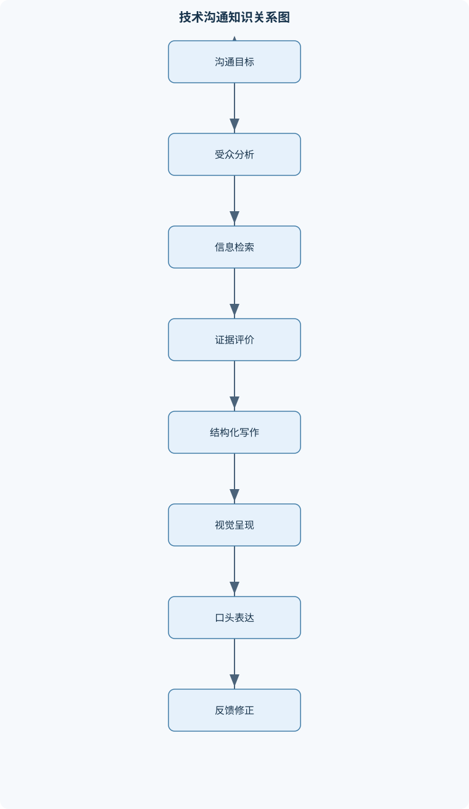
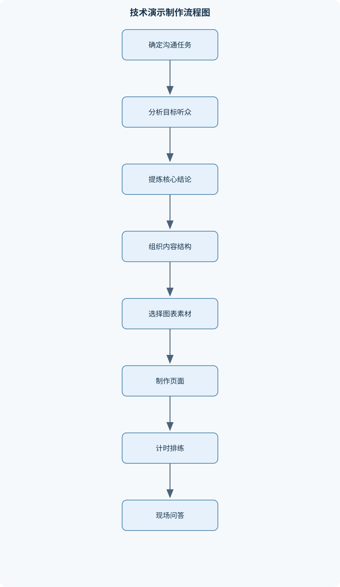

# 面向信息技术的沟通技巧

## 一、课程整体知识框架

### 课程边界与先修知识

本课程研究信息技术场景中的有效沟通，重点处理技术人员如何获取、分析、组织、表达、展示和协作传递技术信息。内容覆盖信息检索与评价、学术和技术写作、技术报告结构、演示文稿设计、技术演讲、问答沟通、团队协作和反馈改进。课程强调沟通目标、受众特征、信息准确性、逻辑结构、视觉呈现和现场表达之间的关系，不把课程扩展为普通口才训练、文学写作、心理治疗、企业管理或具体软件操作培训。先修知识包括基本计算机与网络使用能力、常用办公软件操作能力、基础阅读理解能力，以及对程序、系统、数据或工程项目的基本认识。





### 1. 课程对象、定义与边界

面向信息技术的沟通，是技术人员围绕程序、系统、数据、工程项目或技术问题，向特定受众传递事实、解释、方法、结果和建议，并确认受众是否理解、据此作出判断或采取行动的过程。它不等同于一般口才训练：表达流畅不能弥补证据不足，演示美观不能替代论证完整，团队气氛良好也不能代替任务、责任和决策的明确。课程同样不以文学修辞、心理治疗、企业管理或某种办公软件的操作为主要对象；工具使用只服务于信息组织和传递。

一项沟通至少包含发送者、接收者、信息、渠道和反馈。发送者负责界定问题、组织信息并选择表达方式；接收者带着自己的知识基础、关注点和决策权限解释信息；信息可以是事实、解释、方法、结果或建议；渠道可以是报告、演示、演讲、即时消息或会议；反馈则是提问、误解、评价和实际行为结果。信息并非从发送者到接收者的无损搬运：术语陌生、背景缺失、图表误读、渠道受限或注意力不足，都可能使原意被遗漏或扭曲。

### 2. 目标、受众与渠道之间的关系

有效沟通从目标出发，而不是从材料堆积出发。目标应描述受众完成的可观察行动，例如理解某项性能差异、判断方案是否满足约束，或批准一个明确范围的后续测试。若目标仅写成“介绍系统”，便无法确定哪些信息必须保留，也难以判断沟通是否成功。设 $A$ 为沟通目标集合，$U$ 为受众集合，$I$ 为待传递的信息集合，$C$ 为沟通渠道，则材料组织要回答的问题是：哪些 $I$ 能支持特定 $U$ 完成 $A$，以及何种 $C$ 能可靠地传递这些信息。

受众分析至少区分专业背景、已有知识、当前需求和决策权限。知识基础较少的受众通常需要背景、术语定义和具体例子；专业受众通常更需要方法、证据、比较条件和适用限制。对同一技术结论，开发者可能关注实现细节和异常条件，管理决策者可能关注成本、风险和交付影响，使用者则可能关注操作后果。受众调整不是降低事实标准，而是改变解释顺序、细节深度和证据呈现方式。

渠道选择受目标、信息复杂度、交互需求和保存要求约束。书面报告适合完整论证、细节核查与留存；演示文稿适合突出结构、关系和重点，但不能承载全部背景材料；口头演讲适合即时解释和现场互动，受时间与听觉记忆限制；即时消息适合短小、明确的协调信息，不适合承载未经整理的复杂论证；会议适合共同澄清、比较方案与形成决策，但需要议程和记录保证结果可追踪。渠道没有脱离情境的绝对优劣，复杂任务常需组合渠道，例如以简报引入结论、以报告提供证据、以会议确认分歧和行动项。

### 3. 信息准确性、证据与沟通闭环

技术信息的准确性包括事实本身正确、术语使用一致、单位和条件完整，以及结论不超出证据支持范围。一个性能数值若没有测试环境、数据规模、测量口径和比较基准，可能无法复核，也不能直接推广到其他系统。$E$ 表示证据集合，可以包括数据、实验结果、技术资料、图表和可复核记录。结论的可信度取决于证据与结论的对应关系、证据来源的质量以及验证条件是否适用；重复转述同一来源不构成独立交叉验证。

沟通应形成闭环，记作 $L$：先设定目标，组织并传递信息，再确认理解，收集反馈，并据此修正信息或表达。$R$ 表示受众反馈。若反馈显示受众误解了术语，修正重点应是定义、语境和例子；若受众找不到重点，应调整结构与视觉层级；若受众不接受结论，应检查证据、推理和限制条件，而不是用更多装饰掩盖问题。只有发送内容、没有理解确认和后续修正的单向表达，不能证明沟通有效。

可以用一个概念关系式概括材料取舍：

$$
I_{\text{保留}}=\{i\in I\mid i\text{直接支持 }A,\ \text{适合 }U,\ \text{且有相应证据}\}
$$

这里的集合关系不是数值计算公式，而是用于筛选信息的逻辑条件；$I_{\text{保留}}$ 是最终保留的信息子集。它要求信息同时服务目标、适合受众并有证据支撑。它不能用来计算沟通效果，也不能保证任何受众必然理解；实际效果仍须结合反馈检验。

### 4. 从检索到表达的知识工作链

课程把技术沟通视为一条连续工作链：界定问题与受众，形成可检索的信息需求，检索并评价资料，阅读、记录和组织证据，构造技术论证，选择书面或口头渠道进行表达，收集反馈并改进。每一步都会限制后续步骤的质量。问题界定模糊时，关键词容易过宽；来源评价不足时，写作可能把宣传性主张误作事实；论证结构断裂时，演示文稿即使排版统一也无法支撑结论；没有现场反馈时，报告中的歧义可能持续存在。

信息检索的目标不是取得尽可能多的结果，而是找到足以回答问题、可验证且适用的材料。网页搜索适合发现线索，专业数据库适合按领域、资料类型或索引规则进行检索；二者覆盖范围不同，检索结果不能直接等同于全部事实。来源判断要分别考察权威性、相关性、时效性、证据透明度和适用范围。检索记录应保留问题、关键词、检索式、时间和筛选理由，以便复查；记录不能消除数据库覆盖不足或资料本身偏差。

技术写作把论点、论据和推理关系显式化。典型技术报告以问题和需求为起点，说明目标与范围，再交代方法和实现过程，呈现结果与证据，最后讨论适用限制并得出结论。这个次序表达的是论证依赖关系，不是不可变的版式模板：问题定义决定需要实现什么，目标决定采用什么方法，方法产生结果，结果支持结论，限制条件规定结论能推广到哪里。若缺少指标、基线或实验条件，单独陈述“性能提升”就无法让读者判断提升幅度及其可信度。

### 5. 口头表达、视觉呈现与团队协作

演示文稿是论证结构的视觉载体，不是报告全文的缩小版。每页应有主要信息单元，文字、图表、颜色和动画应帮助受众识别层级、比较数据或理解变化。视觉信噪比是设计判断概念，表示与目标相关的信息相对于装饰和干扰信息的状况，不是有固定单位的物理量。没有固定的数值阈值；同一元素在一张页面上可能是重点提示，在另一张页面上则可能成为干扰。判断标准是它是否支持当前页面的理解任务。

图表类型应由数据结构和比较目的决定。时间序列通常适合表现变化趋势，类别对比通常适合表现数值差异，构成图适合在组成部分与整体关系明确时表达比例。无论采用哪种图表，都需标明变量、坐标轴、单位和必要的数据来源；截断坐标、三维效果、过多颜色或不恰当的比例表达，可能夸大差异或掩盖变化。图形不能替代解释，演讲者仍需说明读者应关注何种关系及其对结论的意义。

技术演讲要在时间约束下安排信息。设 $T$ 为可用演讲时间，单位为分钟；$T$ 受会议安排约束，内容量则还受受众认知负荷和讲解速度限制。$T$ 本身不能推出固定的合适页数或字数，因此不存在适用于所有主题的统一比例公式。短时演讲应优先保留问题、核心方案、关键证据和结论，把次要背景与扩展细节转入书面材料或备份页面。开场要让受众知道问题是什么，主体按论证关系展开，结尾要重申结论及其适用范围，并给出明确的后续行动或待决事项。

仪态、声音和现场表达服务于信息理解。目光接触有助于判断注意力和建立交流，但不应僵硬地盯住个别听众；站姿和移动应稳定、必要，不应以频繁走动替代解释；声音音量、语速、重音和停顿应让关键概念可辨。照读投影文字会使口头信息重复页面内容，降低现场解释的价值。紧张时，充分计时排练、熟悉设备和准备转场提示，比临场增加无关动作更能减少失误。幽默和语气还须考虑场合与文化差异，不能以冒犯或贬低受众换取注意力。

问答是检验表达是否充分的重要环节。回答前应听完问题，必要时澄清或复述；回答时先给结论，再提供依据和条件。遇到范围过大的问题，应说明已验证的范围与尚未覆盖的部分；遇到不确定问题，应明确不确定性、当前依据和后续核查方式，不能把猜测包装成事实。尖锐问题应按内容处理而非视作人身攻击。回答后确认是否解决了提问；需会后补充时，应记录问题、责任人和反馈时间。

团队沟通关注共同理解、任务责任和可追踪交付。共享资料需要明确命名、版本、权限和维护责任，多人协同编辑需要约定谁修改什么以及如何确认变更；异步消息应把背景、请求和期望回应写清楚。会议前明确议程和材料，会议中区分事实、意见、决策与未决问题，会议后记录负责人、交付物和完成条件。版本控制意识不仅是工具操作，更是避免不同成员基于不同资料作出相互冲突判断的协作规范。

### 6. 适用范围与先修基础

本课程适用于需要检索、解释、撰写、展示或协作传递技术信息的学习与工作情境，涉及软件开发、数据分析、产品设计、测试、系统分析、技术支持、技术文档、技术培训和项目协调等任务。共同要求是把技术内容准确地转化为受众可检查、可讨论、可据以行动的信息；岗位不同，受众、渠道和验收标准也不同。课程不保证某一种模板或表达风格适合所有组织与项目，正式交付仍须遵循项目约定和适用规范。

学习本课程需要基本计算机与网络使用能力、常用办公软件操作能力、基础阅读理解能力，以及对程序、系统、数据或工程项目的基本认识。这些先修能力用于操作沟通工具、理解技术材料并辨认基本对象；它们不等于已经具备来源评价、证据推理、受众分析或现场表达能力。课程讨论的原则应依据具体受众、任务、时限和资料条件使用，不以统一格式取代判断。

## 二、章节和模块划分

### 核心知识覆盖清单

本清单用于检查正文是否覆盖本课程的主要知识模块：

- **技术沟通的目标与受众分析**：技术沟通的定义与边界、信息发送者与接收者、沟通目标的类型、受众知识水平分析、受众需求与决策任务、技术信息的准确性、沟通渠道的选择、反馈与沟通闭环。
- **信息检索与检索策略**：信息需求的形式化、关键词拆分与扩展、同义词与专业术语、布尔逻辑检索、短语精确检索、站点与文件类型限定、搜索引擎工作边界、检索结果排序与筛选、网页信息与专业数据库、检索记录与可复现性。
- **信息评价、文献阅读与知识管理**：来源权威性判断、时效性与适用范围、事实与观点区分、证据链与交叉验证、摘要和关键词定位、结构化快速阅读、文献分类与标签、引文关系与追踪、知识卡片与笔记、信息版权与合理使用。
- **技术写作的结构与论证**：技术写作的读者导向、标题与摘要设计、问题背景与需求、目标与范围界定、方法与实现过程、结果与证据呈现、讨论、限制与结论、段落主题句、论点、论据与推理、术语一致性与语言精确性。
- **学术写作规范与常见缺陷**：学术写作与技术报告区别、抄袭与不当改写、引用与改述、图表编号与标题、数据来源说明、前后一致性检查、逻辑跳跃识别、冗余和空泛表述、错别字与格式错误、修改意见的分层表达。
- **演示文稿的信息设计**：演示目标与核心结论、页面层级结构、材料结构与故事线、文字与图形的转换、图表类型选择、视觉信噪比、字体、颜色与对比度、留白与版式平衡、动画的解释功能、模板与一致性控制。
- **技术演讲的流程与节奏**：开场与问题引入、内容筛选、时间预算、重点模块安排、技术故事的组织、结论先行与递进展开、注意力变化与节奏、停顿和节奏变化、演讲设备与环境检查、总结与行动指引。
- **仪态、声音与现场表达**：专业着装与环境准备、目光接触、站姿与移动、开放式手势、声音音量、语速与停顿、重音与语气变化、紧张状态管理、幽默与文化边界、避免照读投影文字。
- **问答、异议与高压沟通**：问题的分类、澄清不完整问题、重复问题的技巧、证据型回答、不确定信息的表达、尖锐问题的回应、范围外问题的处理、回答后的确认、礼貌与情绪控制、会后补充与记录。
- **团队协作与技术会议**：团队沟通角色、任务与责任分配、共享资料管理、多人协同编辑、会议议程、会议纪要、版本控制意识、异步沟通规范、冲突识别与协商、交付物验收标准。
- **综合技术沟通项目**：技术主题选择、问题与受众定义、资料检索与证据筛选、报告提纲设计、演示文稿制作、技术演讲排练、同伴反馈、修改与版本迭代、现场展示、项目复盘。


### 1. 技术沟通的目标与受众分析

本模块建立共同分析框架。沟通目标应落到受众能够完成的判断或行动，而非发送者希望讲述的内容量。分析受众时，区分其已有知识、需求、关注问题与决策权限；这些因素共同决定定义解释的深浅、证据的类型和结论的表达方式。技术准确性要求同时说明结论成立的条件，避免把局部测试结果写成普遍规律。渠道选择则要考虑互动需要、细节复杂度和记录要求。模块以反馈闭环收束：只有通过提问、复述、决策或后续行为确认理解，发送者才有依据判断目标是否达成。

### 2. 信息检索与检索策略

检索从信息需求形式化开始。将主题拆分为对象、属性、条件和时间范围，再区分哪些是已知、哪些仍需证据。关键词集合 $K$ 包括核心概念、同义词、专业术语、限定词和排除词；检索式 $Q$ 由关键词、逻辑运算符和范围限定组成。常见构造方式是用 OR 连接同一概念的不同说法，用 AND 连接不同概念组，必要时用引号检索固定短语，并通过范围条件收窄结果。过宽的词会引入大量无关资料，过强的限定可能漏掉不同术语表达的相关资料，因此检索应根据初步结果迭代。

搜索引擎并不覆盖全部网页或专业资料，其排序也不等同于权威性排序；专业数据库则受其学科范围、收录规则和检索字段限制。站点或文件类型限定可减少筛选范围，却不能证明内容真实。有效检索应记录所用词组、检索条件和筛选理由，并在发现领域术语后更新检索式。停止条件不是“结果很多”，而是核心问题已有适当资料支持，新增检索不再明显改变证据范围，且重要结论仍可追溯和核查。

### 3. 信息评价、文献阅读与知识管理

候选资料要分别评价来源身份、相关性、发布时间、适用范围、证据透明度与可复核性。来源看似权威但讨论对象不同，仍可能不适用于当前问题；资料较新也不自动意味着方法可靠。事实、作者观点和读者推断应分开记录，避免把解释当成测量结果。关键结论应追溯到原始数据、方法或直接证据；多个页面若只是重复同一来源，不构成独立交叉验证。

结构化阅读先用标题、摘要和关键词判断资料与问题的关系，再根据章节结构定位方法、证据、结果和限制，最后细读支撑关键结论的部分。摘要可帮助定位，却不能替代正文中对样本、条件和方法的检查。知识管理通过分类、标签、知识卡片和笔记保留“资料说了什么、证据是什么、适用边界在哪里”，并区分原文摘录、改述和个人评价。引文关系可帮助追踪概念与后续讨论，但被引用本身不等于结论正确。版权与合理使用要求尊重作品归属，引用和改述都应清楚标记信息来源，不把他人表达当作自己的原创内容。

### 4. 技术写作的结构与论证

读者导向的技术写作先回答读者要解决什么问题，再安排背景和细节。标题应限定主题，摘要应压缩问题、方法、主要结果与结论，不能只写泛泛的研究动机。正文通常交代问题背景、目标范围、方法过程、结果证据、讨论限制和结论。章节之间应能沿推理链连接：目标说明为何采用某方法，方法说明结果如何产生，结果说明结论凭什么成立，讨论解释结论在何种条件下适用。

段落应围绕一个主要功能展开，主题句标明该段重点，后续句子提供解释、证据或限定。论点是需要支持的判断，论据是数据、观察或可靠资料，推理说明论据为何支持论点。缺少推理时，读者可能看得到数据却无法判断它与结论的关系。术语、缩写、单位和时间范围应保持一致；同一概念换用多个名称会造成歧义，未定义缩写则增加理解成本。精确表达不是堆砌术语，而是让对象、条件、动作和结果可辨认。

### 5. 学术写作规范与常见缺陷

学术写作与技术报告都要求论据和推理清晰，但侧重点可能不同：学术写作通常强调研究问题、方法、证据与学术讨论的关系；工程技术报告还可能强调需求、设计约束、实现过程、交付结果和运行风险。两者的具体格式依任务和发布规范而定，不能仅凭标题判断其内容性质。

抄袭包括未经恰当标示地使用他人文字或思想；改写时只替换少数词语而保留原句结构，也不能消除归属问题。图表需有编号、标题和必要说明，数据来源与测量条件应让读者知道数字代表什么。前后一致性检查应覆盖术语、单位、符号、图表编号和结论范围。逻辑跳跃常见于从单次测试推导普遍结论、从相关性推断因果，或没有比较基准便宣称改进。冗余和空泛表述会遮住关键信息；修改意见宜指出问题位置、原因和可执行的改法，而不只作笼统评价。错别字和格式错误虽不必然推翻论证，却会增加阅读阻力，也可能使数值、单位或专名被误认。

### 6. 演示文稿的信息设计

页面序列 $P$ 应由演示目标和核心结论组织，每页承担一个主要信息单元。材料结构可以从问题引入，沿方案、证据和限制展开，也可以先给结论再递进说明；选择取决于受众和沟通目的，但受众应能识别各部分之间的逻辑关系。长段落通常不适合投影阅读，可转为关系图、步骤图、表格或简明要点，同时保留必要的条件和单位，避免将复杂信息过度简化。

图表要匹配变量类型和比较任务。趋势、类别差异、分布和组成比例所需的图形并不相同；坐标范围、类别次序、单位和图例都影响解释。视觉信噪比用于判断页面元素是否支持理解，不是固定分数。字体、颜色、对比度、留白和对齐应形成可辨层级；颜色还需考虑投影环境与色觉差异。动画仅在解释顺序、变化过程或对象关系时使用。模板一致性能减少视觉变化带来的干扰，却不能补救错误数据或断裂逻辑。

### 7. 技术演讲的流程与节奏

演讲准备先明确受众、任务和核心结论，再选择可在时间内讲清的内容。时间预算围绕重点分配，不能把所有书面细节平均压缩后照读。问题引入应建立听众理解技术内容所需的背景，主体按论证链展开，结尾总结结论与限制，并指出需要听众作出的决定或后续行动。技术故事指技术问题如何出现、方案如何回应、证据如何检验，而不是虚构情节。

节奏取决于内容难度、信息密度和听众反应。复杂概念后留出停顿，关键结论用重音或结构提示突出；反复加速容易损害理解，长时间停顿则可能使听众失去线索。演讲前要检查设备、文件显示、声音和演示切换，准备设备不可用时仍可说明核心内容的方案。计时排练用于发现超时位置和转场问题，不应只靠临场删掉结论或关键证据来缩短时长。

### 8. 仪态、声音与现场表达

专业着装和环境准备应与场合相适应，目的在于避免无关因素干扰沟通，不存在脱离场合的统一服装要求。目光接触用于建立交流并观察反馈，不是持续凝视；站姿应稳定，移动应有明确目的，手势应辅助指示结构或关系。声音需要足以覆盖场地，语速应允许受众理解术语和数据；重音、语调和停顿帮助区分重点与补充说明。

紧张状态可能使语速加快、呼吸变浅或记忆提取困难，预演、熟悉开场与转场、准备关键词提示可降低这些影响。幽默是否合适取决于场景、受众和文化边界，不应损害专业尊重。投影页面用于辅助听众，而不是供演讲者逐字朗读；讲者应提供页面之外的解释，指出证据含义、推理关系与适用条件。

### 9. 问答、异议与高压沟通

问题可涉及事实、方法、依据、限制、比较或超出当前范围的主题。先听完整问题，再判断是否有歧义；复述或澄清能避免回答错对象。证据型回答先给直接结论，再说明依据、条件和限制。问题涉及尚未验证的范围时，应区分已知、推断和未知；没有把握时，说明当前能支持的结论及后续核查方式，不凭印象补造数据。

尖锐问题应被拆解为可回答的技术主张，礼貌并不意味着回避分歧，情绪控制也不意味着承认没有证据的结论。对范围外问题，可说明与当前工作边界的关系，并提出合理的转交或后续补充。回答后确认对方的问题是否解决；需要会后查证时，记录问题内容、所需证据、负责人和回复安排，以免承诺停留在口头层面。

### 10. 团队协作与技术会议

团队沟通需要明确角色、任务和交付责任。任务分配应把工作对象、完成条件和依赖关系说清楚；共享资料应有可识别的版本、命名、权限与维护约定。多人协同编辑时，成员需能区分提议、已接受的修改和待审核内容。异步沟通应包含必要背景、明确请求和预期回复时间，避免让接收者猜测上下文。

会议议程要服务于会议目标，例如同步进展、解决分歧或作出决策。讨论时区分事实、观点、假设和决策，会议纪要记录结论、未决问题、责任人、交付物与截止条件。冲突应回到需求、证据、约束和风险上比较，不能将技术异议混同于个人否定。交付物验收标准应可检查，例如指定功能、指标、文档内容或测试条件；“基本完成”“效果不错”不足以构成可复核的验收条件。

### 11. 综合技术沟通项目

综合项目把前述环节应用于一个明确的技术主题。首先界定待解决的问题、受众及其决策任务，继而形成信息需求并检索证据；筛选资料后建立报告提纲，确保问题、目标、方法、结果和限制相互对应。随后将报告重点转换为演示页面，按时间排练技术演讲，收集同伴对准确性、逻辑、可读性和表达的反馈，再进行版本迭代。

项目展示应能说明为何选择该问题、哪些资料支撑关键判断、结论适用到什么范围，以及还有哪些未决事项。复盘要根据反馈定位问题：概念误解对应定义和例子，证据质疑对应来源或方法说明，重点不清对应结构调整，超时对应内容取舍与节奏安排。修改须保留版本记录和变更理由，使团队能够判断哪些意见已采纳、哪些未采纳以及原因。

## 三、核心概念的详细解释

### 1. 技术沟通的定义、目标与边界

面向信息技术的沟通，是技术人员围绕程序、系统、数据、工程项目或技术问题，向特定受众传递事实、解释、方法、结果和建议，并确认受众是否理解、据此作出判断或采取行动的过程。其核心不是“把知道的内容全部说出来”，而是使合适的信息通过合适的渠道，在给定条件下支持受众完成明确任务。

沟通通常包含发送者、接收者、信息、渠道和反馈五个基本要素。发送者负责界定问题、组织材料和控制表达；接收者依据自己的专业背景、已有知识和实际需求解释信息；信息可以是事实、方法、数据、结论或建议；渠道可以是技术报告、演示文稿、口头演讲、会议或即时消息；反馈则包括提问、误解、评价和实际行动结果。沟通并不是信息的无损复制，术语差异、背景缺失、视觉误读、注意力下降和渠道限制都会造成信息损失。

沟通目标应描述受众可观察的判断或行动，而不应只写“介绍某系统”“讲解某技术”。例如，“使项目成员确认接口变更的影响并领取测试任务”比“介绍接口设计”更能指导材料取舍。目标可分为以下几类：

1. **说明型目标**：使受众理解概念、流程、架构或现象。
2. **分析型目标**：使受众比较方案、识别原因或判断风险。
3. **决策型目标**：使有权限的受众批准、否决或选择方案。
4. **执行型目标**：使受众按照明确步骤完成配置、测试或协作任务。
5. **反馈型目标**：使受众指出疑问、限制、错误或改进方向。

技术沟通不等同于普通口才训练，也不等同于文学写作、心理治疗、企业管理或某种办公软件的操作培训。表达流畅不能弥补证据不足；页面美观不能代替论证完整；团队关系和谐也不能代替任务、责任和验收标准的明确。

### 2. 受众分析与信息取舍

受众集合记为 $U$。对受众的分析至少包括四个维度：专业背景、已有知识、关注问题和决策权限。专业背景决定受众熟悉哪些术语和工作流程；已有知识决定需要多少基础解释；关注问题决定其愿意投入注意力的内容；决策权限决定沟通应当导向理解、建议还是正式批准。

同一项技术内容面对不同受众时，信息重点应发生变化。例如，开发人员通常关心接口、异常处理、复杂度和兼容性；数据分析人员关心数据来源、指标定义、样本和误差；项目协调人员关心依赖关系、进度和交付风险；管理决策者更关心成本、收益、风险和可选方案。受众调整并不意味着降低事实标准，而是改变解释顺序、细节深度和证据呈现形式。

信息集合记为 $I$，沟通目标集合记为 $A$。可保留的信息应同时满足三个条件：能够直接支持目标、适合受众理解、具有相应证据。可写成集合筛选关系：

$$
I_{\text{保留}}=\{i\in I\mid i\text{直接支持 }A,\ i\text{适合 }U,\ i\text{具有相应证据}\}
$$

该表达式是逻辑筛选关系，不表示对信息进行数值计算。它不能自动判断信息质量，仍需人工分析“直接支持”“适合”和“具有证据”的具体含义。一个材料即使技术上正确，如果与当前决策无关，也可能属于沟通噪声。

### 3. 信息准确性、证据链与可信度

技术信息的准确性至少包括四层含义：

- **事实准确**：描述的系统行为、数据或事件与实际情况一致。
- **概念准确**：术语、缩写和分类使用符合其定义。
- **条件完整**：给出结论成立所需的环境、数据规模、时间范围和约束。
- **推理适度**：结论不超出证据能够支持的范围。

例如，“系统响应时间为 100 毫秒”是不完整的技术表述。还应说明测量对象、请求类型、并发量、硬件环境、统计口径以及是平均值、中位数还是某个分位数。没有这些条件，受众无法判断该数值能否与另一系统比较。

证据集合记为 $E$，信息源记为 $S$。一个可靠结论应能够追溯到来源、数据、方法和适用条件。证据数量多不等于证据质量高：多篇材料若都直接转述同一个未经验证的说法，不能视为独立交叉验证。来源评价通常考察权威性、相关性、时效性和可验证性四个维度。

- **权威性**关注发布者是否具备相应专业能力、责任身份和资料维护能力。
- **相关性**关注资料是否真正回答当前问题，而不是仅仅包含相同关键词。
- **时效性**关注资料是否适用于当前技术环境、政策环境或版本条件。
- **可验证性**关注作者是否说明数据、方法、测试条件和推理过程。

厂商宣传材料可能适合说明产品功能或官方支持范围，但通常不能单独证明性能优越；技术报告可能提供实施条件和项目结果，但其结论未必适用于所有系统；方法明确的研究论文可能适合支持方法有效性的讨论，但也必须检查实验环境与当前任务是否相近。

### 4. 信息需求与检索策略

信息检索不是随意输入一个主题词，而是把沟通任务转化为一组可检索、可验证的问题。信息需求应拆分为对象、属性、条件和时间范围。例如，“多人在线文档协作风险”可拆分为：

- 对象：多人协作、在线文档；
- 属性：权限、版本、冲突、审计；
- 条件：小型团队、异步协作；
- 结果：风险类型、发生条件、控制措施。

关键词集合记为 $K$，检索式记为 $Q$。关键词可以包括核心概念、同义词、专业术语、限定词和排除词。布尔检索的基本结构是：

- 用 `OR` 连接同义词或近义表达；
- 用 `AND` 连接不同概念组；
- 用引号锁定固定短语；
- 用减号排除明显无关主题；
- 在适用时加入站点、文件类型、时间或语言限制。

例如，较宽的检索式可以表达为：

```text
("online collaborative document" OR "real-time document collaboration")
AND (permission OR access control OR versioning)
AND (risk OR conflict OR audit)
```

较窄的检索式可以进一步加入“小型团队”或“异步协作”等条件。宽检索有利于发现术语和线索，但会产生大量无关结果；窄检索便于筛选，却可能因术语不同而遗漏资料。搜索结果排序通常受到相关性、时间、来源和平台规则影响，因此结果靠前不等于事实更可靠，结果数量多也不等于检索质量高。

搜索引擎适合发现网页线索、官方说明和初步术语；专业数据库更适合检索特定类型的研究、专利、标准或技术资料。任何检索工具都有覆盖边界，检索结果只能说明“该工具发现了哪些资料”，不能直接等同于“全部事实”。

### 5. 文献阅读、知识管理与版权边界

结构化快速阅读应先定位资料的功能，再决定是否深入。标题和摘要可帮助判断主题与研究目的，关键词可用于确认概念范围，目录和小标题可揭示论证结构，方法和结果部分用于核查证据，限制部分用于判断结论边界。摘要适合初步筛选，不能替代对关键方法、数据和限制的阅读。

知识管理的基本单位可以是知识卡片。每张卡片至少记录：

1. 资料的识别信息；
2. 要解决的问题；
3. 核心结论；
4. 支撑结论的证据；
5. 适用条件和限制；
6. 与其他资料的关系；
7. 自己提出的疑问或待验证点。

分类和标签应服务于后续检索，例如按“权限控制”“性能测量”“会议决策”分类，而不是只按资料来源分类。引文关系可以帮助追踪概念来源、方法改进和争议观点，但引用数量多不代表观点必然正确。

信息使用还受到版权和学术规范约束。引用他人观点、数据、图表或具有独创性的表达时，应明确区分原文、改述和自己的分析。改写不是简单替换几个词；如果保留原文的句法结构和论证表达，仍可能构成不当改写。合理使用需要考虑使用目的、使用比例、内容性质以及对原作品市场价值的影响，不能把“公开可见”理解为“可以任意复制”。

### 6. 技术写作的结构与论证

技术写作强调读者导向、结构清晰、术语准确和证据可追溯。技术报告常见结构包括标题、摘要、背景、问题、目标、范围、方法、结果、讨论、限制和结论。不同报告可调整章节名称，但不能破坏基本推理关系。

标题应准确说明对象、问题或任务范围，不应使用“某技术研究”“系统优化分析”这类过于宽泛的标题。摘要应在较短篇幅内交代问题、方法、主要结果和结论，不能只写背景介绍。背景用于解释问题为什么重要，目标用于说明本次工作要回答什么，范围用于明确没有处理什么内容。

一个技术报告的论证关系可以表示为：

$$
\text{问题定义}\rightarrow\text{目标}\rightarrow\text{方法}\rightarrow\text{结果}\rightarrow\text{结论}
$$

方法必须能够产生与目标对应的结果，结果必须足以支撑结论，限制条件则决定结论能推广到什么范围。如果报告只有算法名称而没有输入数据、基线、实验条件和评价指标，便不能构成有效论证。

段落通常围绕一个主要功能组织。主题句先说明本段中心，后续句子提供解释、证据、例子或限定条件。一个段落同时塞入背景、方法、结果和主观评价，容易造成逻辑跳跃。技术语言应避免“非常高效”“显著提升”“全面解决”等没有条件的绝对化表述，宜改为“在指定数据集和测试条件下，某指标有所改善”。

### 7. 学术写作与技术报告的区别

学术写作通常更强调研究问题、理论或方法贡献、证据规范和学术对话；技术报告更强调工程背景、实施过程、结果应用、风险和决策支持。二者都要求准确、可验证和引用规范，但写作重点不同。

学术写作中，不能把观点当作事实，把摘要当作完整证据，也不能把多个来源拼接成似乎独立的结论。技术报告中，不能只记录“做了什么”，还应说明为什么做、依据是什么、结果如何评价、存在什么限制以及下一步行动是什么。

图表应有编号、标题、单位和数据来源说明。横轴、纵轴和图例必须使读者能够独立解释图表。折线图适合表现按时间或有序变量变化的趋势；条形图适合比较不同类别或方案；构成图适合表示部分与整体的关系。三维效果、过多颜色和截断坐标可能夸大差异或制造错误印象。

修改意见可分层表达：

- **事实层**：数值、术语、来源和单位是否正确；
- **逻辑层**：论点、论据和推理是否连贯；
- **结构层**：章节、段落和页面层级是否合理；
- **表达层**：句子是否清楚、简洁和一致；
- **格式层**：编号、字体、图表和引用格式是否统一。

先修正事实和逻辑，再处理表达和格式。若结论本身证据不足，仅修改措辞并不能解决问题。

### 8. 演示文稿的信息设计

演示文稿页面序列记为 $P$。每页应围绕一个主要信息单元组织，例如一个结论、一组对比或一条因果关系。页面不是报告的缩小版，也不是演讲者的逐字稿。完整报告适合保存细节，演示文稿适合帮助受众在有限时间内理解结构、重点和证据。

页面设计应先确定核心结论，再安排问题、证据和解释。常用结构包括：

1. 问题引入；
2. 现状或基线；
3. 方案或方法；
4. 关键结果；
5. 限制与风险；
6. 结论和行动指引。

文字和图形的选择取决于信息关系。步骤关系可用流程图表达，类别比较可用条形图，时间变化可用折线图，构成关系可用构成图，系统组件关系可用结构图。不能为了视觉效果强行把所有内容画成图，也不能用装饰性图片占据主要空间。

“信噪比”是演示设计中的评价概念，表示有助于理解目标的信息与装饰性或干扰性信息之间的相对关系，不是固定物理量。无关动画、复杂背景、过多颜色、重复标题和无意义图标都会降低信噪比。动画只有在能够说明顺序、变化、因果或局部展开时才有解释价值。

### 9. 技术演讲、仪态与声音

技术演讲应在有限时间内完成信息筛选、结构组织、口头表达和现场反馈。可用演讲时间记为 $T$，单位为分钟。$T$越短，越应优先保留问题、核心方案、关键证据和结论；背景、次要实现细节和扩展讨论可以压缩到书面材料或备份页面。

技术演讲常用的时间结构是：

- 开场：提出问题、场景或冲突；
- 主体：按问题—方案—证据顺序展开；
- 结尾：重申结论、说明边界并给出行动指引。

讲者应避免逐字照读投影文字。页面呈现结构，口头表达补充因果、条件、证据解释和例子。目光接触应在页面、听众和提示信息之间自然切换；站姿应稳定，移动应有明确目的；手势应辅助指示层级、方向或比较关系。

声音表达包括音量、语速、停顿、重音和语气。数据、术语和结论通常需要适当放慢并加重音。停顿可以帮助受众处理复杂信息，也可以标示段落转换。紧张时容易语速加快、呼吸变浅、频繁查看页面，因此应熟悉开场、转场和结论，并准备关键词提示。幽默要考虑场景、文化和专业边界，不能损害受众尊严或掩盖技术问题。

### 10. 问答、异议与不确定性表达

技术问答首先要判断问题类型。常见类型包括事实问题、方法问题、证据问题、限制问题、比较问题和范围外问题。面对不完整问题，应先澄清对象、条件和所要求的结论。复述问题可以确认双方理解一致，例如：“您的问题是，在并发量增加时，该优化方法是否仍能保持相同的效果，对吗？”

证据型回答可采用“结论—依据—条件—限制”的顺序。对不确定内容，应明确区分已知、推断和未知。例如：“在当前测试条件下可以确认的是……；根据已有结果可以推测……；但尚未验证的是……”。这种表达比强行给出绝对结论更可靠。

尖锐问题不应被理解为个人攻击，应拆分为可回答的技术主张。对范围外问题，可以说明其与当前项目的关系，指出当前材料不能支持什么，并提出后续核查或转交方式。回答后应确认是否解决了提问；若需会后补充，应记录问题、所需证据、负责人和回复时间。

### 11. 团队协作、会议与反馈闭环

团队技术沟通需要明确角色、任务、依赖关系和交付物。任务不能只写“负责测试”或“跟进接口”，而应说明测试对象、覆盖范围、输出格式、完成条件和截止时间。共享资料应有版本、命名、权限和维护约定。多人协同编辑时，要区分建议、已采纳修改和待审核内容。

会议前应发送议程、背景材料和待决策事项。会议中应区分事实、观点、假设、风险和决策。会议纪要至少记录：

- 已确认的事实；
- 已作出的决策；
- 未解决的问题；
- 每项行动的负责人；
- 交付物；
- 截止条件或检查标准。

异步沟通应包含必要背景、明确请求和预期回复时间。冲突处理应回到需求、证据、约束和风险，而不是归结为个人能力或态度。验收标准应可检查，例如“在指定数据集上完成三类测试并提交结果表”，而不是“基本完成”“效果不错”。

反馈构成沟通闭环，记为 $L$。完整闭环包括目标设定、信息组织、传递、理解确认、反馈收集和修正。若受众误解概念，应修改定义、顺序和例子；若受众找不到重点，应调整结构和视觉层级；若受众不相信结论，应补充证据或明确限制，而不是增加装饰。

## 四、重要定义、公式、定理和推导

### 专业审校补充：关键定义与适用边界

技术沟通中的“有效”不能等同于“表达流畅”或“对方表示同意”，而应定义为：在明确的任务、受众、证据和渠道条件下，受众能够准确完成预期判断或行动，并且结果不超出证据支持范围。可采用“主张—证据—条件—行动”映射检查：每个主张都要有对应证据，证据要注明时间、对象、方法或版本等条件，行动建议要说明适用范围。技术沟通还必须区分事实、推断、建议和不确定信息。例如，“系统在某次测试中响应时间下降”是结果事实；“该优化适合所有系统”是未经证明的外推。若受众因表达生动而产生错误判断，即使沟通者语言流畅，也不能判定为有效。反例是把厂商宣传中的“高性能”直接改写成“性能优于其他方案”：前者是宣传性主张，后者需要统一指标、测试条件和对照对象。该边界适用于报告、演示、会议和即时沟通，不要求每次交流都提供完整研究证明，但关键决策必须保留可追溯的证据和限制说明。


### 1. 沟通闭环的形式化表达

设：

- $A$ 为沟通目标集合；
- $U$ 为受众集合；
- $I$ 为待传递的信息集合；
- $C$ 为沟通渠道；
- $E$ 为证据集合；
- $R$ 为受众反馈；
- $L$ 为完整沟通闭环。

一次沟通可抽象为：

$$
L=(A,U,I,C,E,R)
$$

其基本过程为：

$$
A\rightarrow I\rightarrow C\rightarrow U\rightarrow R\rightarrow I'
$$

其中 $I'$ 表示根据反馈修正后的信息组织。该关系说明，沟通结果不是发送动作结束时确定的，而是在受众理解和反馈之后才能评价。

若目标没有定义，便无法判断信息是否相关；若受众没有分析，便无法决定解释深度；若渠道不匹配，信息可能无法被完整接收；若没有反馈，发送者无法知道受众是否完成了预期判断或行动。因此，沟通闭环的必要条件是目标、受众、信息、渠道和反馈之间存在对应关系。

### 2. 信息需求分析流程

**输入**：主题、沟通任务和预期受众。  
**输出**：可检索的问题集合、关键词表和证据要求。

**步骤：**

1. 写出沟通最终要回答的问题；
2. 将问题拆分为对象、属性、条件和时间范围；
3. 区分已知信息、未知信息和待验证假设；
4. 建立核心概念、同义词、专业术语和排除词表；
5. 判断每个问题需要事实、数据、方法、观点还是案例；
6. 为每个问题规定可接受的证据类型和验证方式；
7. 检查每个问题是否能够对应至少一种资料类型。

**终止条件**：每个问题都能说明“要找什么”“为什么找”“用什么资料验证”。

**适用条件**：技术调研、报告准备、演讲选题和项目需求澄清。

**排错方法**：若检索结果过多，检查问题是否过宽、排除条件是否不足；若结果过少，检查是否过度限定、是否遗漏同义词；若资料很多但不能支持结论，检查是否把背景资料误当成证据。

### 3. 布尔检索构造流程

**输入**：核心概念、同义词、限定条件和排除条件。  
**输出**：检索式 $Q$。

可将关键词分为概念组：

$$
K=K_1\cup K_2\cup \cdots \cup K_n
$$

同一概念组内部通常使用 `OR`，不同概念组之间使用 `AND`：

$$
Q=(k_{11}\ \text{OR}\ k_{12})\ \text{AND}\ (k_{21}\ \text{OR}\ k_{22})
$$

例如，寻找在线协作文档的权限风险：

```text
("online document collaboration" OR "collaborative document")
AND (permission OR "access control")
AND (risk OR security)
NOT marketing
```

这里引号用于固定短语，`OR` 扩展同义表达，`AND` 交叉限制主题，`NOT` 排除明显无关内容。检索式不是一次完成的。运行初检后，应观察高相关结果中的新术语，再决定是否加入关键词。

**终止条件**：结果与问题高度相关、数量可筛选，并且关键概念没有明显遗漏。

**适用边界**：布尔检索适合网页和数据库初检，但不同平台对运算符、通配符和字段限定的支持可能不同，不能假设所有平台的语法完全一致。

### 4. 来源评价流程

**输入**：候选资料集合。  
**输出**：保留、补充验证或排除的资料清单。

评价步骤如下：

1. 确认作者、机构、发布时间和发布渠道；
2. 判断资料是否直接回答当前问题；
3. 检查资料适用的技术版本、时间范围和对象；
4. 查找数据、方法、实验条件或推理依据；
5. 分辨事实、作者观点、宣传性表述和个人推测；
6. 检查是否存在利益关系或选择性呈现；
7. 用相互独立的资料交叉验证关键结论；
8. 标注可使用的结论和不能外推的范围。

若资料缺少方法与证据，可以作为术语线索或背景材料，但不宜单独支撑关键结论。若多份资料都引用同一原始来源，它们不是独立证据。若来源较旧，应判断旧资料中的概念是否仍适用于当前版本和环境。

### 5. 技术报告提纲生成流程

**输入**：问题、受众、证据和交付要求。  
**输出**：报告提纲。

**步骤：**

1. 用一句话写出核心结论；
2. 反推该结论所需的关键证据；
3. 根据问题确定目标和范围；
4. 说明方法、输入数据、条件和评价指标；
5. 安排结果，使其逐项对应目标；
6. 在讨论中解释结果、比较方案并说明限制；
7. 在结论中区分已证实内容、合理推断和未解决问题；
8. 删除不服务于沟通目标的材料。

报告的逻辑可用下式表达：

$$
\text{结论有效性}\Leftarrow
\text{结果可靠性}\land
\text{方法适切性}\land
\text{问题定义清晰}\land
\text{条件边界明确}
$$

这里的 $\land$ 表示“同时满足”。只满足其中一项不能推出结论有效。例如，结果数据很稳定，但如果测试指标与问题无关，仍不能支持目标结论。

### 6. 演示时间与内容取舍

设可用演讲时间为 $T$，单位为分钟；每个内容单元 $i$ 的讲解时间为 $t_i$。基本时间约束为：

$$
\sum_{i=1}^{n}t_i\leq T
$$

其中 $n$ 为内容单元数。该式只表达时间上限，不代表每个内容单元应平均分配时间。核心结论、关键证据和必要限制应获得优先时间，背景和次要细节可以压缩。

一种实际分配方法是先固定开场和结尾时间，再将剩余时间分给核心模块。例如五分钟演讲可安排：

- 开场与问题：约 0.5 分钟；
- 背景和现状：约 0.8 分钟；
- 方案与方法：约 1.5 分钟；
- 关键结果：约 1.3 分钟；
- 限制、结论和行动：约 0.9 分钟。

这些数值只是示例，不是适用于所有演讲的固定标准。若受众专业程度较低，应增加术语解释；若受众专业程度较高，应减少常识铺陈，增加方法、证据和边界。

### 7. 演示页面的信息单元原则

设演示页面序列为：

$$
P=(p_1,p_2,\ldots,p_m)
$$

其中 $m$ 为页面总数。每个页面 $p_j$ 应有一个主要信息单元 $g_j$，页面设计目标是使：

$$
p_j\Rightarrow g_j
$$

即页面中的标题、文字、图表和讲解共同指向一个主要信息。如果一个页面同时包含三个没有层级关系的结论，受众难以判断重点，讲者也难以控制节奏。

页面质量不能用文字少简单衡量。删除文字后，如果受众无法理解变量、条件、比较对象和结论，页面就可能过度简化。相反，若页面包含大量与当前结论无关的图标、动画和装饰，虽然信息很多，信噪比却会下降。

### 8. 代表性算法：问答响应流程

**输入**：现场问题。  
**输出**：准确、简洁并符合边界的回答。

**过程：**

1. 听完问题，不在对方说话时抢答；
2. 判断问题属于事实、方法、证据、限制、比较还是范围外问题；
3. 问题不完整时，先澄清对象、条件和期望答案；
4. 先给直接结论，再给理由、数据或证据；
5. 明确适用条件和不能外推的范围；
6. 对未知内容说明不确定性和后续核查方式；
7. 回答后确认是否解决了对方的问题。

**不变量**：回答不得引入没有证据支持的新事实，不得把推测表达成已验证结论。

**终止条件**：问题被回答、澄清，或被合理转交并记录后续责任。

**适用条件**：技术答辩、评审、会议讨论和技术支持。

**排错方法**：若回答偏离问题，检查是否没有复述问题；若回答过于空泛，检查是否缺少证据或条件；若回答过度绝对化，检查是否忽略实验范围；若现场无法确认，应明确说明“当前材料不能支持该判断”。

### 9. 代表性算法：技术会议流程

**输入**：会议目标、参与者、议题和待决策事项。  
**输出**：会议纪要、责任分工和后续行动。

**步骤：**

1. 会前发送议程、材料和需要决策的问题；
2. 开始时确认会议目标、参与者和时间边界；
3. 对每个议题分别讨论事实、方案、风险和决策；
4. 区分已确认事项、观点、假设和未决问题；
5. 为每项行动记录负责人、交付物和截止条件；
6. 会后发布纪要并跟踪未完成事项。

**不变量**：每项议题都必须最终得到结论、负责人或明确的后续动作。

**终止条件**：没有议题处于“讨论过但无人负责、没有结论”的状态。

**适用条件**：项目协作、需求沟通、技术评审和问题排查。

**排错方法**：若会议不断重复同一问题，检查是否缺少决策权限或证据；若会后成员理解不同，检查纪要是否混淆事实和意见；若行动项长期未完成，检查交付物和截止条件是否不可检查。

### 10. 例题一：检索式设计

**题干**：需要寻找“面向小型团队的多人在线文档协作风险”，要求得到可用于技术报告的资料。

**分析**：主题包含协作对象、工具形态、团队规模和风险属性。不能只搜索“文档风险”，因为结果可能涵盖文件丢失、格式错误、版权等无关问题。

**逐步解答：**

1. 拆分概念：多人协作、在线文档、小型团队、权限、版本、冲突、审计、风险；
2. 建立同义词：`online collaborative document`、`real-time document collaboration`；
3. 形成检索式：

```text
("online collaborative document" OR "real-time document collaboration")
AND (small team OR distributed team)
AND (permission OR versioning OR conflict OR audit)
AND (risk OR security)
```

4. 先运行宽检索，记录高相关资料中的新术语；
5. 再按资料类型、时间范围或专业数据库进行窄检索；
6. 对关键结论至少寻找不同来源或不同证据类型进行验证。

**结果验证**：若结果只讨论大型企业治理，应增加 `small team` 的限定；若结果过少，应删除不必要的条件或加入同义词；若结果很多但主要是产品广告，应增加资料类型或改用专业数据库。

**变式**：若研究对象改为“教育场景下的协作文档”，应加入 `education`、`student` 或相应场景词，不能直接沿用小型团队的全部限定。

### 11. 例题二：来源评价

**题干**：有一篇厂商宣传文章、一篇项目技术报告和一篇方法明确的研究论文，要求判断三者适合支持哪些结论。

**分析**：资料的价值取决于结论类型。功能说明、实施经验和普遍性能结论需要不同证据。

**逐步解答：**

1. 厂商文章适合支持“产品具有什么功能”“官方宣称支持什么场景”，不宜单独证明性能优越；
2. 技术报告适合支持“某项目在特定环境下采用了什么方法”“实施过程中出现了哪些问题”，但不能直接推广到所有项目；
3. 方法明确的研究论文适合支持“某方法在给定实验条件下产生了什么结果”，仍需检查数据集、基线和评价指标是否适合当前任务；
4. 对三者分别记录作者身份、发布时间、方法透明度、利益关系和可复核性；
5. 对关键结论寻找独立资料或复现实验。

**结果验证**：如果厂商文章和项目报告都声称性能提升，但都引用同一测试数据，则不能把它们视为独立验证。若论文实验条件与当前系统完全不同，也不能直接外推。

**变式**：若问题变为“该产品是否具备某功能”，厂商官方资料的相关性和权威性会提高；若问题变为“该产品是否比其他产品更快”，则需要可比测试条件和独立性能证据。

### 12. 例题三：技术报告结构

**题干**：将“某软件系统的性能优化项目”整理为技术报告。

**分析**：不能直接罗列使用了哪些算法或工具，必须建立问题、指标、方法、结果和结论的推理链。

**逐步解答：**

1. 定义问题：系统在何种负载下出现响应延迟；
2. 定义指标：响应时间、吞吐量、错误率等，并说明单位和统计口径；
3. 说明基线：优化前系统的配置、数据量和测试环境；
4. 说明方法：采取了哪些优化措施，为什么选择这些措施；
5. 说明实验：测试数据、并发条件、重复次数和比较方法；
6. 呈现结果：用表格或图表比较优化前后指标；
7. 讨论限制：是否存在硬件差异、数据规模限制或未测试场景；
8. 得出结论：只在已验证条件内表达结论。

**结果验证**：如果报告只写“优化后性能明显提升”，却没有基线和指标，结论不可复核。如果只写平均响应时间而不说明异常值和负载条件，也不能判断结果是否稳定。

**变式**：若受众是管理决策者，可压缩实现细节，增加成本、风险、上线影响和回滚方案；若受众是开发人员，则应保留接口、配置和测试条件。

### 13. 例题四：段落修改

**题干**：一段文字同时写了系统背景、优化方法、实验结果和“效果非常好”的评价，要求修改。

**分析**：该段混合了不同信息功能，且主观评价缺少依据。应先拆分，再按问题到方法再到结果的顺序组织。

**逐步解答：**

1. 把背景单独放入问题定义部分；
2. 用主题句说明性能问题及其影响；
3. 在方法段说明采取的技术措施和原因；
4. 在结果段给出指标、条件和比较对象；
5. 将“效果非常好”改为有条件的结论；
6. 统一术语、时间范围和单位；
7. 删除重复形容词和没有证据的绝对表述。

**结果验证**：修改后，每段应能回答一个主要问题。读者应能找到问题、方法、结果和限制，而不需要从长句中自行猜测逻辑。

**变式**：若结果只有一次测试，不能写“稳定提升”，应写成“在本次测试条件下观察到提升”，并说明还需进一步验证。

### 14. 例题五：图表类型选择

**题干**：现有三组数据：按月份记录的访问量、不同方案的性能指标、系统中各模块的构成比例。选择合适图表并说明原因。

**逐步解答：**

1. 按月份变化的数据具有时间顺序，适合使用折线图；横轴为月份，纵轴为访问量，必须标注单位；
2. 不同方案之间的指标比较属于类别比较，适合使用条形图；类别为方案，数值轴为指标；
3. 构成比例表示部分与整体关系，可使用构成图，但类别过多时应改用排序条形图；
4. 检查是否存在截断坐标、过多颜色、三维效果和不一致单位；
5. 在图题或数据说明中注明数据来源和统计口径。

**结果验证**：若折线图的月份顺序被打乱，趋势会失去意义；若比较图使用不同量纲的指标直接并列，读者可能误解；若构成比例总和不等于整体，必须说明是否存在未列出的部分。

**变式**：若需要同时比较多个方案在多个指标上的表现，应先判断指标是否可比，必要时拆分为多个图表，而不是把所有数据塞进一张复杂图。

### 15. 例题六：五分钟技术演讲

**题干**：围绕一个信息技术工具设计五分钟技术演讲，受众为具有一般计算机使用能力但不了解该工具的项目成员。

**逐步解答：**

1. 目标：使项目成员理解工具的主要用途，并判断是否值得安排试用；
2. 开场：提出当前协作中的具体问题；
3. 核心结论：该工具在指定场景下能够改善某项协作流程，但不能解决所有权限和版本管理问题；
4. 内容安排：问题与现状、工具工作方式、试用结果；
5. 时间分配：开场约 0.5 分钟，背景约 0.8 分钟，方法和功能约 1.4 分钟，结果约 1.4 分钟，限制与行动约 0.9 分钟；
6. 页面安排：不超过能够在规定时间内清楚讲解的数量，每页只放一个主要信息；
7. 风险准备：网络或演示环境不可用时，使用静态截图和预先记录的结果；
8. 结尾：提出明确行动，例如在指定范围内进行试用并收集反馈。

**结果验证**：完整演练后，时间不得超过五分钟；若开场、结论或问答被迫删减，说明内容过多，应压缩背景和次要细节。

**变式**：若受众改为技术开发人员，应减少功能介绍，增加接口、权限模型、限制和集成成本。

### 16. 实验项目一：信息检索与来源评价

**项目任务**：围绕“在线协作文档的版本与权限风险”形成一份可复核的资料分析。

**输入数据**：一个明确的问题、初始关键词、若干网页资料、技术报告和专业资料线索。

**步骤：**

1. 写出问题、对象、属性、条件和时间范围；
2. 建立关键词、同义词和排除词；
3. 构造宽检索式和窄检索式；
4. 记录每次检索式、检索日期、结果数量和筛选理由；
5. 对候选资料评价权威性、相关性、时效性和可验证性；
6. 为每个关键结论建立“来源—证据—条件—结论”记录；
7. 标记无法验证或不能外推的内容；
8. 输出结构化综述或技术调研简报。

**评价标准**：

- 问题是否具体；
- 检索式是否覆盖同义表达；
- 关键结论是否有对应证据；
- 是否区分事实、观点、宣传和推断；
- 是否记录适用范围和检索过程；
- 结论是否超过资料支持范围。

**排错方法**：结果过多时增加对象、场景或证据类型限定；结果过少时扩展同义词并减少不必要条件；来源重复时追溯原始资料；资料只有摘要或宣传语时，不把它当作完整证据。

### 17. 实验项目二：综合技术沟通展示

**项目任务**：围绕一个明确的软件、系统或数据问题，完成报告、演示文稿、口头展示和复盘。

**输入数据**：技术主题、受众假设、可用时间 $T$、候选资料、实验或案例结果。

**步骤：**

1. 定义问题、受众和沟通目标；
2. 将目标转化为信息需求；
3. 检索并评价资料，筛选关键证据；
4. 形成包含背景、目标、方法、结果、讨论和限制的报告提纲；
5. 写出一句话核心结论；
6. 将报告重点转换为页面序列 $P$；
7. 为每页确定标题、主要信息和口头说明；
8. 完成一次不间断演练并记录超时位置；
9. 模拟设备故障和尖锐问题；
10. 根据同伴反馈修改结构、证据、视觉层级和表达；
11. 进行最终展示并保存版本记录；
12. 复盘哪些反馈导致了哪些修改。

**评价标准**：

- 问题、目标和受众是否明确；
- 方法是否足以支持目标；
- 结果是否有数据、案例或可复核记录；
- 结论是否说明条件和限制；
- 页面是否具有清晰层级和足够对比度；
- 演讲是否在 $T$ 内完成；
- 问答是否能区分已知、推断和未知；
- 团队是否明确记录负责人、交付物和验收条件。

**排错方法**：若听众不理解术语，应补充定义和例子；若听众不知道重点，应调整标题和结构；若质疑结论，应补充基线、数据和限制；若展示超时，应优先删除背景重复和次要细节，而不是压缩结论与关键证据；若团队成员对任务理解不同，应回到会议纪要、版本记录和验收标准进行核对。

## 五、算法、流程和实现思路

### 方法与流程覆盖索引

下列方法或流程应在正文中说明输入、步骤、适用条件、结果检查和边界：

- 信息需求分析流程：输入为主题、沟通任务和预期受众；输出为可检索的问题集合。过程是明确最终要回答的问题，拆分对象、属性、条件和时间范围，列出已知信息与未知信息，建立同义词和相关术语表，确定需要事实、数据、方法还是观点，最后为每个问题设定证据要求。终止条件是每个问题都能对应至少一种资料类型和验证方式。适用于技术调研、报告准备和演讲选题；复杂度可按问题数$O(n)$估计，实际工作量取决于每个问题的检索分支数。
- 布尔检索构造流程：输入为核心概念、同义词、限定条件和排除条件；输出为检索式$Q$。先用OR连接同义词，再用AND连接不同概念组，用引号锁定固定短语，用减号排除明显无关词，必要时加入站点或文件类型限定，运行后根据结果中的高频术语迭代关键词。终止条件是结果与问题高度相关且数量可筛选。适用于网页和数据库初检；复杂度不以算法运行时间衡量，主要成本是检索式迭代和结果筛选。
- 来源评价流程：输入为候选资料集合；输出为保留、补充验证或排除的资料清单。依次检查来源身份和发布机构，判断与问题的相关性，记录发布时间和适用范围，核查作者是否提供方法、数据或证据，寻找独立来源交叉验证，最后标注资料的可信等级和使用限制。终止条件是关键结论均有足够证据支持。适用于学术阅读、技术调研和事实核查；若资料数为$n$，基础筛选为$O(n)$，交叉验证成本取决于资料之间的关系。
- 技术报告提纲生成流程：输入为问题、受众、证据和交付要求；输出为包含标题、摘要、背景、目标、方法、结果、讨论和结论的提纲。先写出一句话核心结论，再反推支撑结论所需的证据，按问题到方法再到结果的因果顺序排列章节，为每节指定一个主要问题，删除不服务于目标的内容，最后检查章节之间是否存在逻辑跳跃。终止条件是每个章节都有明确作用且全文能回答最初问题。适用于开题报告、项目报告和技术总结。
- 演示文稿设计流程：输入为报告提纲、演讲时间和受众特征；输出为页面序列和讲解备注。先确定开场问题与结论，再把每个重点拆为一个页面的主要信息，选择能表达关系或比较的图表，压缩文字，设置统一字体和颜色层级，删除无关装饰，检查字号、对齐、对比度和投影可读性，最后进行完整计时演练。终止条件是页面内容能在规定时间内讲完且每页只有一个主要视觉焦点。适用于技术汇报和产品宣讲；页面数量为$m$时，检查工作量为$O(m)$。
- 技术演讲排练流程：输入为讲稿、演示文稿、时间上限和设备条件；输出为可现场执行的演讲方案。先完成一次不间断录制，记录总时长、超时位置和表达卡顿，按问题重要性重新分配时间，练习开场、转场、结论和问答，模拟设备故障与尖锐提问，再进行至少一次完整计时。终止条件是总时长不超过上限、重点内容完整、转场自然且备用方案可执行。适用于课堂汇报、项目答辩和会议报告；每轮排练成本与内容长度线性相关。
- 问答响应流程：输入为现场问题；输出为准确、简洁并符合边界的回答。先完整听完问题，必要时复述以确认理解；判断问题属于事实、方法、依据、限制还是范围外问题；直接给出结论，再说明理由或证据；对不确定内容明确说明不确定性和后续核查方式；最后确认是否回答了提问。终止条件是问题得到回答、澄清或被合理转交。适用于技术答辩、评审和会议讨论；单个问题的处理步骤为常数级，但复杂问题的证据调用成本可能较高。
- 团队技术会议流程：输入为会议目标、参与者、议题和待决策事项；输出为会议纪要、责任分工和截止条件。会前发送议程与材料，会议开始时确认目标和时间，按议题讨论事实、方案和风险，区分已决事项与待确认事项，记录负责人、交付物和截止时间，会后发布纪要并跟踪未完成事项。终止条件是每项议题都有结论、负责人或明确的后续动作。适用于项目协作和需求沟通；会议记录复杂度与议题数及参与者发言量相关。





### 1. 技术沟通任务的形式化分析流程

技术沟通不能从“准备尽可能多的材料”开始，而应从受众需要完成的判断或行动开始。设沟通目标集合为 $A$，受众集合为 $U$，待传递的信息集合为 $I$，沟通渠道集合为 $C$，证据集合为 $E$。任务分析的结果不是一篇现成文章，而是一组可检索、可验证、可组织的问题。

#### 1.1 输入、输出与处理步骤

**输入**包括技术主题、沟通任务、预期受众、时间限制和交付形式。  
**输出**包括问题集合、受众分析表、证据要求、渠道选择和材料取舍规则。

处理步骤如下：

1. **明确最终任务**：把“介绍某技术”改写为可观察的目标，例如“使项目成员判断某方案是否满足并发约束，并确认下一步测试任务”。
2. **拆分问题对象**：确定要讨论的对象是什么，如系统、算法、数据集、接口或项目流程。
3. **拆分问题属性**：明确需要了解性能、成本、可靠性、兼容性、风险、使用条件还是实施步骤。
4. **补充约束条件**：加入时间范围、适用环境、数据规模、用户群体和比较基线。
5. **区分未知信息类型**：判断未知内容属于事实、解释、方法、结果、观点还是建议。
6. **建立术语表**：列出核心概念、同义词、缩写、上位词、下位词和容易混淆的词。
7. **规定证据要求**：为每个问题指定所需证据，例如原始数据、实验记录、技术文档、标准性文件、方法明确的研究资料或多来源交叉验证。
8. **确定渠道**：需要完整论证和留存时采用报告；需要突出关系和重点时采用演示；需要现场澄清时采用会议或口头说明。
9. **形成验收条件**：规定什么结果能证明沟通完成，例如受众能复述核心结论、作出方案选择或领取明确任务。

终止条件是：每个问题都能对应至少一种资料类型、验证方式和表达渠道。若问题仍然只能写成“了解某技术”，说明任务尚未充分形式化。

#### 1.2 信息取舍的逻辑

材料筛选可以表示为：

$$
I_{\text{保留}}=\{i\in I\mid i\text{直接支持 }A,\ i\text{适合 }U,\ i\text{有相应证据}\}
$$

这里的 $i$ 表示一条信息，不带特定单位；$A$ 是目标集合；$U$ 是受众集合。该式是逻辑筛选条件，不是评价信息质量的数值公式。即使一条信息技术上正确，只要与当前目标无关，也可能造成注意力浪费。

例如，目标是让项目负责人选择两种部署方案，那么必须保留成本、风险、性能、依赖条件和实施周期；某个与选择无关的底层代码细节，即使准确，也不一定应放入主讲材料。反过来，如果目标是让开发人员完成部署，命令顺序、权限要求、异常处理和回滚步骤就成为核心信息。

### 2. 布尔检索与信息需求构造流程

#### 2.1 检索式构造

设关键词集合为 $K$，检索式为 $Q$。构造 $Q$ 时，应先进行概念分组，再进行逻辑组合。

- 同义词或同类表达之间使用 OR；
- 不同概念组之间使用 AND；
- 固定术语或完整短语使用引号；
- 明显无关的含义使用排除词；
- 必要时增加站点、文件类型、时间范围或资料类型限定。

以“面向小型团队的多人在线文档协作风险”为例，可拆分为：

- 协作对象：多人协作、团队协作、协同编辑；
- 工具形态：在线文档、云文档、实时编辑；
- 风险属性：权限、版本、审计、误修改、信息泄露；
- 场景限定：小型团队、项目协作、技术团队。

一个概念性检索式可以写成：

```text
("online document" OR "cloud document" OR "collaborative document")
AND
("team collaboration" OR "co-editing" OR "多人协作")
AND
(permission OR version OR audit OR risk)
NOT
("school assignment")
```

检索式中的英文词只是示意，实际检索应根据目标数据库或资料环境替换为相应中文、英文及专业表达。宽检索式用于发现术语和资料类型，窄检索式用于精确筛选。结果数量最多不等于结果质量最高：过宽会引入大量无关结果，过窄则可能遗漏同义表达。

#### 2.2 可复现检索记录

一次检索至少记录：

1. 问题原文；
2. 使用的检索式 $Q$；
3. 检索工具或资料类型；
4. 检索时间；
5. 筛选条件；
6. 初步结果和排除理由；
7. 最终保留资料；
8. 关键词变化及变化原因。

检索复杂度不宜简单用结果数量衡量。若初始有 $n$ 条候选资料，逐条基础筛选的工作量可近似记为 $O(n)$；但交叉验证需要比较资料之间的来源关系、数据是否独立、方法是否一致，其实际成本可能显著高于线性浏览。

### 3. 来源评价与证据链建立流程

#### 3.1 四维评价框架

对信息源 $S$ 的评价至少区分以下四个维度：

1. **权威性**：发布者是否具有与该问题相关的专业身份或组织责任。
2. **相关性**：资料是否真正回答当前问题，而不是只包含相同关键词。
3. **时效性**：资料是否适用于当前技术环境、软件版本、数据状态或政策条件。
4. **可验证性**：资料是否说明数据、方法、条件和推理过程，使他人能够复核。

此外还要检查利益关系。厂商材料适合说明产品功能、接口或官方支持范围，但不能单独证明“性能最好”或“风险最低”。技术报告若说明实验条件，适合支持特定场景下的结果；方法明确的研究资料可支持概念、方法或比较结论，但也必须检查样本、环境和外推边界。

#### 3.2 证据链表示

一个结论应能沿着以下链条追溯：

$$
\text{来源}\rightarrow\text{数据或方法}\rightarrow\text{分析过程}\rightarrow\text{结论}\rightarrow\text{适用条件}
$$

如果只有“某资料说效果很好”，而没有数据、测量方法和比较基线，则证据链不完整。多个网页重复转载同一宣传语，也不构成独立交叉验证。交叉验证要求来源之间具有一定独立性，并且能从不同角度支持同一事实或暴露潜在矛盾。

### 4. 技术报告提纲生成流程

#### 4.1 从结论反推结构

技术报告的结构不是固定的文章模板，而是由问题和论证关系决定。基本推导关系为：

$$
\text{问题}\rightarrow\text{目标}\rightarrow\text{方法}\rightarrow\text{结果}\rightarrow\text{结论}
$$

限制条件决定结论的适用边界。若问题没有定义，目标就没有对象；若方法没有说明，结果就无法解释；若结果没有指标和证据，结论就只能是意见。

生成提纲的步骤如下：

1. 写出一句话核心结论；
2. 反问：该结论需要哪些数据或证据；
3. 说明问题背景和实际影响；
4. 界定目标、范围和不处理的内容；
5. 说明方法、实验条件或分析步骤；
6. 呈现结果，并解释指标和单位；
7. 讨论结果的含义、比较对象和限制；
8. 给出有条件的结论和后续建议；
9. 检查每个章节是否服务于最初问题。

#### 4.2 段落级实现思路

技术段落通常围绕一个主要信息单元展开。较稳定的结构是“主题句—解释—证据—结论或过渡”。

例如，讨论某系统缓存优化时，不应在同一段同时混入项目背景、实现细节、实验结果和主观评价。可以拆为：

- 主题句：缓存策略旨在降低重复查询带来的响应延迟；
- 解释：说明缓存对象、失效条件和一致性要求；
- 证据：给出优化前后的指标、测试条件和数据规模；
- 结论：指出该策略在指定负载下有效，但不能直接外推到所有访问模式。

“性能显著提升”“效果很好”“大幅降低成本”等词若没有指标、基线和条件，不能构成完整技术论证。

### 5. 演示文稿设计与时间分配流程

#### 5.1 页面序列设计

设演示页面序列为 $P=(p_1,p_2,\ldots,p_m)$，其中 $m$ 为页面数量。每页应围绕一个主要信息单元组织，并具有明确的标题、视觉主体和讲解目的。

设计步骤如下：

1. 确定开场问题和核心结论；
2. 将结论拆为若干必要论点；
3. 为每个论点分配页面；
4. 根据变量类型选择图表；
5. 将长句转换为关键词、关系图或数据图表；
6. 统一字体、颜色、编号和对齐规则；
7. 删除与当前结论无关的装饰；
8. 在实际投影或缩小页面条件下检查可读性；
9. 添加讲解备注，而不是把完整讲稿塞进页面；
10. 完成计时演练。

若可用演讲时间为 $T$ 分钟，必须先保证问题、核心方案、关键证据和结论完整，再压缩背景、次要实现细节和扩展讨论。时间分配不是简单平均。例如五分钟演讲可以采用以下逻辑：

- 开场与问题：约 $0.5$ 分钟；
- 背景和目标：约 $0.8$ 分钟；
- 方法或方案：约 $1.5$ 分钟；
- 关键结果：约 $1.2$ 分钟；
- 限制与结论：约 $1.0$ 分钟。

这些数值只是组织示例，不是固定比例。实际比例取决于受众和任务，且总和必须不超过 $T$。

#### 5.2 图表选择规则

- 按时间或连续过程观察变化，适合折线图；
- 比较不同方案或类别，适合条形图；
- 表示构成比例时，可使用构成图，但类别不宜过多；
- 展示变量之间关系时，适合散点图；
- 表示流程、层级或依赖关系时，适合结构图或流程图。

图表必须有标题、坐标轴、单位、数据范围和必要的数据来源说明。三维效果、过多颜色、无意义的阴影和截断坐标可能制造视觉误读。视觉信噪比不是固定的物理量，而是“有助于理解的信息”相对于“装饰性或干扰性信息”的设计概念。

### 6. 技术演讲排练与问答响应流程

#### 6.1 演讲排练

排练流程的输入是讲稿、页面序列 $P$、时间上限 $T$ 和设备条件；输出是可现场执行的演讲方案。

1. 完成一次不间断演讲；
2. 记录总时长、卡顿、超时位置和遗漏内容；
3. 检查开场是否明确问题，转场是否说明逻辑关系；
4. 练习结论和限制条件；
5. 模拟投影故障、页面无法打开或演示数据失效；
6. 模拟尖锐问题和范围外问题；
7. 重新分配时间；
8. 再进行一次完整计时。

终止条件是总时长不超过 $T$，重点内容没有被删掉，转场自然，且没有设备时仍能通过口头说明完成最低限度的沟通。

#### 6.2 问答响应

问答流程可概括为：

1. 听完问题，不急于打断；
2. 对歧义问题进行复述或澄清；
3. 判断问题属于事实、方法、依据、比较、限制还是范围外问题；
4. 先给直接结论，再说明证据和条件；
5. 区分已知、推断和未知；
6. 对未验证内容说明核查方式和时间；
7. 询问回答是否解决了对方的问题；
8. 必要时记录会后补充事项。

例如，面对“你的方法是否适用于所有系统”，合理回答应先说明不能据此推出“所有系统都适用”，再界定已经验证的系统类型、数据规模和环境，指出未覆盖的情况，并提出补充测试方案。用“效果很好”代替适用性分析，既没有回答问题，也掩盖了证据边界。

### 7. 团队会议与交付流程

#### 7.1 会议算法

**输入**：会议目标、参与者、议题、待决策事项。  
**输出**：会议纪要、决策记录、负责人、交付物和截止条件。

流程如下：

1. 会前发送议程、背景材料和需要准备的问题；
2. 开始时确认目标、时间和决策范围；
3. 讨论时区分事实、意见、假设、方案和风险；
4. 将已决事项与未决事项分开记录；
5. 为每项行动指定负责人、交付物和完成条件；
6. 对未能解决的事项指定后续证据或确认人；
7. 会后发布纪要；
8. 跟踪行动项并在下一次会议核对状态。

终止条件是每项议题都有明确结论、负责人或后续动作。会议记录若只保留发言内容而不记录决策和责任，就不能支撑后续协作。

#### 7.2 交付物验收

验收条件应可观察、可检查。例如：

- 报告包含问题、方法、结果、限制和结论；
- 测试记录包含环境、输入、预期结果和实际结果；
- 演示页面在投影环境下文字可读；
- 会议纪要列出每个行动项的负责人和截止条件；
- 文件具有版本号、更新时间和变更说明。

“基本完成”“效果不错”“已经优化”等表述不能作为充分验收标准，因为不同成员会作出不同解释。

### 8. 代表性例题与变式

#### 例题一：构造检索策略

**题干**：寻找“面向小型团队的多人在线文档协作风险”，要求得到可筛选、可验证的资料。

**分析**：对象是在线文档协作，受众是小型团队或技术项目成员，属性包括权限、版本、审计和误修改，目标不是收集所有相关网页，而是识别风险及其控制方式。

**逐步解答**：

1. 将多人协作、在线文档、权限、版本和风险分别建立概念组；
2. 为每组加入同义词；
3. 用 OR 连接同义词，用 AND 连接不同组；
4. 先用宽检索发现专业术语；
5. 再增加团队规模、项目协作或资料类型限定；
6. 记录检索式和排除理由；
7. 对关键结论寻找独立证据。

**结果验证**：若结果主要是产品广告，说明检索式过于偏向厂商材料；若只有操作教程而没有风险分析，说明需要加入审计、权限、版本控制等属性词。

**变式**：若目标变为选择某产品，应增加功能、权限模型、审计记录和部署条件；若目标变为写学术综述，应提高方法透明度和资料可复核性要求。

#### 例题二：评价三类来源

**题干**：有一篇厂商宣传文章、一篇技术报告和一篇方法明确的研究论文，判断三者能分别支持什么结论。

**分析**：不能只按“论文优于网页”进行简单排序，而要检查结论类型是否与证据类型匹配。

**逐步解答**：

1. 厂商文章可支持产品功能、官方支持范围和使用方式；
2. 技术报告若说明环境和测试方法，可支持特定条件下的项目结果；
3. 研究论文若方法透明，可支持研究范围内的实验发现或理论分析；
4. 任何来源都不能自动证明“最优”“适用于所有系统”；
5. 对性能优越性，要求比较基线、指标、环境和数据；
6. 对风险结论，要求说明风险条件和控制措施。

**结果验证**：每个结论都应能回到来源中的具体段落、数据或方法；若只能指向标题和宣传语，证据不足。

**变式**：若厂商材料提供了详细基准测试，也只能说明其测试条件下的结果，仍需检查是否存在选择性报告和利益关系。

#### 例题三：整理性能优化报告

**题干**：将“某软件系统的性能优化项目”整理为技术报告。

**分析**：性能优化不能只罗列算法名称，必须有问题指标、基线、实验条件和结果。

**逐步解答**：

1. 定义性能问题，如响应延迟过高或吞吐量不足；
2. 定义指标及单位，例如延迟的毫秒数、吞吐量的请求数每秒；
3. 说明测量口径，是平均值、中位数还是某个分位数；
4. 记录基线系统和测试环境；
5. 说明优化方法及其作用机制；
6. 展示优化前后的结果；
7. 讨论资源开销、异常条件和未覆盖场景；
8. 给出有条件的结论。

**结果验证**：第三方读者应能根据环境、输入和步骤理解结果为何产生；若只有“优化后性能提升”，没有数值和基线，论证不成立。

**变式**：若指标从响应延迟改为成本，报告应增加资源价格、运行周期和成本计算口径，不能继续使用原有性能结论。

#### 例题四：修改混乱段落

**题干**：一段文字同时包含背景、方法、结果和主观评价，要求修改为技术报告段落。

**分析**：先识别每句话的信息功能，再按问题、方法、结果、结论的关系重新排列。

**逐步解答**：

1. 删除重复的形容词和无证据的绝对化词语；
2. 为段落补充主题句；
3. 将背景与方法分开；
4. 把实验条件放在结果之前；
5. 用具体指标替换“明显”“大幅”等模糊词；
6. 将未经验证的内容改为条件性表达；
7. 统一术语、缩写、单位和时间范围。

**结果验证**：读者只看主题句和关键数据，就能知道本段讨论什么、依据是什么、结论适用于什么条件。

**变式**：若受众是非技术决策者，应保留结果含义、风险和行动建议，减少不影响决策的实现细节。

#### 例题五：设计五分钟技术演讲

**题干**：围绕一个信息技术工具完成五分钟演讲。

**分析**：$T=5$ 分钟时，不能照读完整论文，应优先安排问题、价值、关键机制、证据和结论。

**逐步解答**：

1. 假设受众了解基本计算机使用，但不了解该工具内部机制；
2. 开场提出一个真实任务或痛点；
3. 用一句话给出核心结论；
4. 第一段解释问题和目标；
5. 第二段说明工具或方案如何解决问题；
6. 第三段展示关键证据、限制和使用条件；
7. 结尾给出明确行动指引；
8. 页面只保留每段的主要信息和图表。

**结果验证**：完整演练不超过五分钟；听众能够复述工具解决的问题、主要依据和限制；若超时，优先删除重复背景和次要细节。

**变式**：若受众改为开发人员，应增加接口、兼容性和异常处理；若受众改为项目负责人，应突出成本、风险和交付影响。

### 9. 易错点与排错规则

1. 把搜索结果数量当作信息质量。应检查相关性、证据透明度和适用范围。
2. 只使用一个来源支持关键结论。应寻找独立资料或说明无法交叉验证。
3. 把来源、观点、数据和个人推测混为一谈。应分别标记信息性质。
4. 关键词过于宽泛。应增加对象、场景、属性或资料类型。
5. 检索条件过度严格。应扩展同义词，减少非必要限制。
6. 把标题或摘要当作完整证据。应查看方法、数据和限制。
7. 技术报告只有过程，没有问题、指标和结论。应补齐论证链。
8. 背景写得过长，压缩了方法和结果。应以沟通目标重新排序。
9. 一个段落混合多个论点。应按信息功能拆分。
10. 术语、缩写、单位和时间范围前后不一致。应建立统一术语表和检查表。
11. 图表缺少标题、坐标轴或单位。应使读者能够独立解释图表。
12. 使用三维效果、过多颜色和复杂动画。应保留能帮助比较、定位或理解因果关系的视觉元素。
13. 一页投影片放入完整段落。应将页面作为视觉提纲，详细说明放在口头表达或书面材料中。
14. 演讲未按时间排练。应记录超时位置，而不是临场压缩结论。
15. 开场堆积背景，听众不知道问题和价值。应先说明任务、冲突或核心问题。
16. 盯着投影逐字朗读。应补充页面之外的解释和证据含义。
17. 面对不确定问题强行猜测。应明确已知、未知和核查方式。
18. 把尖锐问题当作个人攻击。应将问题拆成事实、条件和证据要求。
19. 会议只记录发言，不记录决策和负责人。应采用行动项表。
20. 多人协作时没有版本、权限和命名约定。应建立可追踪的共享资料规则。
21. 把模板一致性当作内容质量。统一版式只能减少干扰，不能弥补逻辑和证据缺陷。
22. 把宣传性口号当作技术结论。应追问指标、基线、条件和可复核记录。

### 10. 常见笔试问题与解答思路

#### 问题一：为什么技术沟通必须从目标而不是材料开始？

**解答思路**：目标决定受众需要完成的判断或行动，进而决定保留哪些信息、采用什么渠道和如何评价成功。先堆材料容易造成背景过长、重点不明和证据与结论脱节。

#### 问题二：如何根据受众知识水平调整解释深度？

**解答思路**：已有知识较少时增加术语定义、背景和例子；专业受众则减少常识铺陈，突出方法、指标、证据、限制和创新点。调整的是结构和细节，不是事实标准。

#### 问题三：搜索结果多是否说明检索策略好？

**解答思路**：不一定。结果数量不等于有效信息数量。应检查相关性、重复度、来源类型和能否支持当前问题。宽检索适合发现术语，窄检索适合筛选证据。

#### 问题四：厂商宣传文章能否证明产品性能优越？

**解答思路**：通常不能单独证明。它可以说明功能、接口和官方支持范围；性能结论还需要指标定义、测试环境、基线、数据和可复核方法，并注意利益关系。

#### 问题五：技术报告中“方法—结果—结论”为什么不能缺少任何一环？

**解答思路**：方法说明结果如何产生，结果说明结论的证据，结论说明结果对问题的意义。缺少方法无法复核，缺少结果无法论证，缺少结论则无法回答最初问题。

#### 问题六：什么是视觉信噪比？

**解答思路**：它表示页面中有助于理解目标的信息与装饰性、重复性或干扰性信息的相对关系，不是固定物理量。提高信噪比通常意味着删除无关元素、突出层级、改善对比度和选择匹配的图表。

#### 问题七：五分钟演讲应如何取舍内容？

**解答思路**：优先保留问题、核心方案、关键证据、限制和结论；压缩背景、次要实现细节和扩展讨论。页面数量、语速和转场必须通过完整计时验证。

#### 问题八：如何回答超出当前研究范围的问题？

**解答思路**：先说明问题与当前工作的关系，再明确已验证范围，指出没有证据覆盖的部分，提出补充测试、后续核查或合理转交方式，不能用绝对化语言回避。

#### 问题九：会议纪要至少应包含什么？

**解答思路**：应包含会议目标、已确认事实、决策、未决问题、行动项、负责人、交付物、截止条件和必要的依赖关系。只记录讨论过程不能保证后续执行。

### 11. 常见面试问题、参考答案与追问要点

#### 问题一：请说明你如何向非技术受众解释复杂系统。

**参考答案**：我会先确定受众需要作出的判断，再用受众熟悉的任务或现象引入，定义必要术语，先给结论，再用结构图、例子和有限的证据解释机制，最后说明限制。不会把底层实现细节全部搬到开场。

**深入追问要点**：如果受众提出错误理解，应回到术语定义和例子；如果受众需要批准方案，应增加成本、风险、依赖和验收条件。

#### 问题二：你如何判断一个资料是否可靠？

**参考答案**：我分别检查来源身份、与问题的相关性、发布时间和适用范围，并查看作者是否提供数据、方法和可复核记录；关键结论还会进行独立交叉验证。

**深入追问要点**：来源权威性不能替代证据透明度；资料过时时，要判断是事实失效、版本变化还是结论仍然适用。

#### 问题三：如果演示时间临时缩短，你会删什么？

**参考答案**：先保留问题、核心结论、关键证据、限制和行动指引；删除重复背景、次要实现细节和可放入备份材料的扩展内容，不会优先删除结论依据。

**深入追问要点**：删减后应重新计时，并确认受众仍能理解结论而不是只看到口号。

#### 问题四：如何应对你不知道的问题？

**参考答案**：我会先确认问题含义，说明当前能够支持的范围，明确哪些内容尚未验证，并给出核查资料、负责人和回复时间。不会为了保持流畅而猜测数据。

**深入追问要点**：若问题涉及安全、成本或交付承诺，应将其记录为风险或未决事项，而不是只做口头承诺。

#### 问题五：团队成员不同意你的技术方案，你如何处理？

**参考答案**：先区分分歧是事实、需求、约束、假设还是价值权衡，再比较数据、测试条件、风险和验收标准。若不能当场解决，就记录未决问题和补充证据。

**深入追问要点**：不能把技术异议转化为个人评价；协商结果应进入会议纪要或版本记录。

#### 问题六：你如何保证多人协同编辑不会产生混乱？

**参考答案**：我会约定文件命名、版本、权限、编辑区域、审阅状态和变更说明，并让最终版本具有明确维护者。重要修改保留记录，未经确认的提议不直接当作最终决策。

**深入追问要点**：若发生冲突，应依据最新确认版本、决策记录和变更时间处理，而不是简单覆盖他人内容。

#### 问题七：如何判断一次技术沟通是否成功？

**参考答案**：不能只看讲者是否讲完，而要看受众是否正确理解、能否复述关键结论、是否作出预期判断或行动，以及反馈中是否暴露出误解和证据疑问。

**深入追问要点**：不同目标有不同验收方式；说明型沟通可检查复述，决策型沟通可检查是否形成明确选择，执行型沟通可检查任务是否按条件完成。

#### 问题八：你如何修改一份收到负面反馈的报告？

**参考答案**：先分类反馈：概念误解、结构不清、证据不足、视觉不可读、语言或格式错误。概念问题修改定义和例子，结构问题调整顺序，证据问题补充数据或限制，视觉问题重新设置层级，最后进行版本化复核。

**深入追问要点**：不应通过增加装饰掩盖证据不足，也不能机械采纳互相矛盾的意见，应回到沟通目标和验收标准判断。

### 12. 与岗位任务的关联

#### 软件开发工程师

实际任务包括接口说明、变更通知、故障分析和代码评审沟通。需要使用受众分析、技术写作、证据链、版本控制意识和问答流程。产出包括接口文档、变更记录、技术报告和会议行动项。验收标准是术语一致、输入输出明确、异常条件完整、版本可追踪，其他成员能够据此实现或测试。

#### 数据分析师

实际任务包括指标定义、数据来源说明、分析报告和结果展示。需要使用信息评价、图表选择、数据条件说明、论证结构和受众适配。产出包括分析报告、图表、口头汇报和限制说明。验收标准是指标、单位、样本范围、计算口径和结论边界清楚，图表不能制造比例或趋势误读。

#### 产品经理与系统分析师

实际任务包括需求澄清、方案比较、范围界定和跨角色决策沟通。需要使用问题形式化、受众分析、会议流程、冲突协商和验收标准设计。产出包括需求说明、决策记录、方案对比表和行动项。验收标准是事实、假设、需求和决策分离，负责人、依赖和完成条件明确。

#### 测试工程师与技术支持工程师

实际任务包括缺陷报告、复现步骤、风险说明、客户问题澄清和会后补充。需要使用信息准确性、证据记录、问答响应和不确定性表达。产出包括缺陷单、测试报告、故障说明和回复记录。验收标准是环境、输入、预期结果、实际结果和复现条件完整，不将猜测写成已确认事实。

#### 技术文档工程师与技术培训师

实际任务包括编写操作文档、教程、培训页面和演示讲稿。需要使用受众知识分析、结构化写作、视觉设计、演讲排练和反馈闭环。产出包括用户文档、培训材料、页面序列和修订记录。验收标准是读者能够完成目标任务，术语和步骤一致，警告、前置条件和异常处理清晰。

## 六、概念之间的关系与对比

### 1. 沟通目标、受众、信息与渠道的约束关系

沟通目标决定受众要完成什么，受众特征决定应如何解释，信息集合决定提供哪些事实和证据，渠道决定信息能以何种形式被接收、保存和反馈。四者不是并列清单，而是相互约束的关系。

例如，同一组性能数据：

- 面向开发人员时，应说明测试环境、指标定义、基线和异常条件；
- 面向项目负责人时，应转化为交付风险、成本影响和方案选择依据；
- 面向使用者时，应说明实际操作体验和可感知的限制。

如果目标是形成正式决策，仅使用即时消息通常不够，因为缺少完整论证和可追踪记录；如果目标是快速确认一个小范围任务，长篇报告又可能增加沟通成本。渠道选择应服务于目标，不能把某种工具本身当成沟通质量。

### 2. 信息检索、信息评价与知识管理的区别

| 环节 | 主要问题 | 典型输出 | 常见错误 |
|---|---|---|---|
| 信息需求分析 | 究竟要回答什么 | 问题集合与证据要求 | 主题过大、目标模糊 |
| 信息检索 | 在哪里找到候选资料 | 检索式与候选资料 | 只依赖单一关键词 |
| 信息评价 | 哪些资料能够支持结论 | 保留、验证或排除清单 | 把权威性等同于正确性 |
| 知识管理 | 如何保存、分类和追踪 | 标签、知识卡片、引文关系 | 只有收藏，没有结论和限制 |
| 沟通组织 | 如何让受众理解并行动 | 报告、页面、讲稿或纪要 | 材料堆积，缺少主线 |

检索结果是候选信息，不是最终知识。知识卡片应至少记录概念或结论、证据、适用条件、来源身份、个人解释和待确认问题。只有这样，后续写作和问答时才能追溯判断依据。

### 3. 技术写作、学术写作与技术报告的关系

三者都要求准确、清晰和有证据，但使用目标不同。

| 比较维度 | 技术写作 | 学术写作 | 技术报告 |
|---|---|---|---|
| 主要目标 | 使读者理解或完成任务 | 提出、论证或交流知识主张 | 说明项目问题、方法、结果和建议 |
| 受众 | 使用者、开发者、支持人员等 | 研究共同体或专业读者 | 项目成员、评审者、决策者 |
| 重点 | 可操作性和术语清楚 | 问题意识、方法透明和规范引用 | 问题到结论的链条和交付影响 |
| 常见结构 | 任务、前置条件、步骤、异常 | 问题、文献、方法、结果、讨论 | 背景、目标、方法、结果、限制、结论 |
| 主要风险 | 步骤缺失或不可执行 | 抄袭、不当改写、证据不足 | 只有过程描述，没有指标和结论 |

学术写作与技术报告都需要引用和证据，但技术报告更强调项目约束、资源影响、实施风险和交付条件。不能因为写成正式文档，就自动获得学术性或技术可信度。

### 4. 事实、观点、推断与建议的区别

- **事实**：可由记录、数据或可靠资料核查的陈述。
- **观点**：作者对问题的评价或偏好。
- **推断**：根据已有事实和方法推导出的判断。
- **建议**：面向未来行动的方案或选择。

“系统在指定测试环境下的中位响应时间为 120 毫秒”属于带条件的事实；“该系统性能很好”是缺乏比较基准的评价；“延迟下降可能与缓存命中率提高有关”是待验证的推断；“下一步应增加低命中率场景测试”是建议。四者混写会使受众误以为意见已经被数据证明。

### 5. 书面报告、演示文稿、口头演讲与会议的对比

| 渠道 | 优势 | 局限 | 适合任务 |
|---|---|---|---|
| 书面报告 | 细节完整、便于核查和留存 | 阅读成本较高、反馈较慢 | 复杂论证、项目记录、技术分析 |
| 演示文稿 | 结构突出、便于集中注意力 | 不能承载全部细节 | 汇报重点、比较方案、展示趋势 |
| 口头演讲 | 可即时解释、具有节奏和互动 | 受时间、记忆和环境影响 | 现场说明、培训、答辩 |
| 即时消息 | 快速、适合短确认 | 上下文和留存能力有限 | 小任务协调、状态同步 |
| 技术会议 | 可共同澄清和决策 | 易发散，依赖议程与纪要 | 需求讨论、方案评审、风险处理 |

复杂沟通通常需要组合渠道。例如，报告提供证据，演示突出结论，会议解决分歧，纪要固定决策。单一渠道很难同时满足完整性、即时性、互动性和可追踪性。

### 6. 论证完整性与表达流畅性的区别

表达流畅属于传递层面的能力，论证完整属于内容和推理层面的质量。一个讲者可以语速自然、语言生动，但如果没有问题定义、证据和限制，受众仍无法判断结论是否可靠。相反，一份证据完整的报告如果结构混乱，也会降低理解效率。

因此，技术沟通应同时检查：

1. 结论是否明确；
2. 证据是否对应；
3. 推理是否连续；
4. 条件是否完整；
5. 表达是否让受众能够识别上述关系。

不能用流利语气替代数据，也不能用复杂术语制造专业感。

### 7. 解释深度与受众专业程度的关系

受众已有知识越少，越需要术语定义、背景、例子和操作后果；受众越专业，越应减少常识铺陈，突出方法、证据、边界和创新点。但这不是简单的“对初学者讲得浅，对专家讲得深”。

更准确的做法是识别受众在不同维度上的知识差异。一个受众可能熟悉网络原理，却不了解当前业务流程；也可能熟悉业务目标，却不了解性能指标。因此，解释深度应按具体概念和任务调整，而不是给整个受众贴上单一标签。

### 8. 视觉信噪比与模板一致性的区别

模板一致性主要解决格式稳定问题，例如标题位置、颜色层级和页码规则一致；视觉信噪比解决的是页面中哪些元素真正帮助理解。统一模板不能证明内容有效。

例如，一套颜色、字体和图标完全一致的页面，如果每页包含过多文字、无关图片和重复结论，视觉信噪比仍然很低。相反，简单的页面只要突出数据比较、因果关系和结论，也可能具有较高的沟通效率。

### 9. “结论先行”与“论证过程”并不矛盾

结论先行是帮助受众迅速建立方向，不是跳过证据。完整结构可以是：

1. 先说核心结论；
2. 再说明问题和判断范围；
3. 展示方法、数据或案例；
4. 解释为什么证据支持该结论；
5. 补充限制和不能外推的情况；
6. 重申行动建议。

若只说结论而不解释依据，属于口号式表达；若只讲过程而迟迟不说明结论，受众可能无法判断信息重点。

### 10. 不确定性表达与回避问题的区别

合理表达不确定性应说明：

- 哪些内容已经确认；
- 哪些内容只是基于现有证据的推断；
- 哪些内容尚未验证；
- 需要什么资料或实验才能进一步判断；
- 由谁在何时完成核查。

“目前没有数据支持这个范围，我只能确认已测试的两类环境”是负责任的边界说明；“这个问题不好说”“以后再看”则没有提供可执行的核查路径。承认限制不等于回避，关键在于是否给出证据边界和后续动作。

### 11. 反馈、评价与沟通闭环的关系

反馈 $R$ 不是对讲者的笼统好坏评价，而是判断沟通是否达到目标的证据。反馈可能表现为：

- 受众对术语的提问；
- 对同一概念产生不同理解；
- 无法找到页面重点；
- 质疑数据或方法；
- 未按要求完成后续行动。

这些反馈对应不同修改策略：

| 反馈表现 | 可能原因 | 修改方向 |
|---|---|---|
| 术语被误解 | 定义、语境或例子不足 | 增加定义和反例 |
| 受众找不到重点 | 结构或视觉层级不清 | 调整标题、顺序和重点 |
| 受众不相信结论 | 证据、方法或限制不足 | 补充基线、数据和条件 |
| 受众无法执行 | 步骤、权限或验收标准不清 | 补充操作和完成条件 |
| 会议反复讨论 | 目标、事实和决策未分开 | 重建议程和纪要 |

沟通闭环 $L$ 包括目标设定、信息组织、传递、理解确认、反馈收集和修正。没有反馈确认，发送者只能证明“说过”，不能证明“被正确理解”。

### 12. 团队协作、团队管理与技术协作的区别

本课程讨论团队中的技术信息传递，不扩展为一般企业管理。技术协作关注的是：

- 谁负责什么技术任务；
- 任务依赖如何表达；
- 资料如何共享和版本化；
- 决策如何记录；
- 交付物如何验收；
- 异议如何回到证据和约束上解决。

团队氛围、领导风格或激励机制可能影响沟通，但不是本课程的主要分析对象。即使团队关系良好，如果接口定义、负责人和截止条件不清，项目仍会出现重复劳动和交付冲突。

### 13. 资料版本、软件版本与结论适用范围

技术资料的时效性不能只用发布时间判断。还要确认：

- 资料针对哪个软件或系统版本；
- 接口、配置或运行环境是否发生变化；
- 数据是否仍具有代表性；
- 结论是否依赖特定硬件、负载或权限条件；
- 当前任务是否与原资料的使用场景一致。

因此，“资料较新”不等于“当前一定适用”，“资料较旧”也不等于“全部失效”。正确做法是将版本、环境、时间和适用条件写入证据记录和报告结论。

### 14. 理想沟通模型与现实限制

理想模型假设发送者目标清晰、受众专注、渠道稳定、信息准确、证据完整且反馈及时。现实中常存在：

- 受众知识差异；
- 时间 $T$ 受限；
- 页面投影或设备故障；
- 数据不完整；
- 资料之间相互矛盾；
- 现场问题超出范围；
- 团队成员对术语和需求理解不同。

因此，沟通设计不能只追求信息完整，还要设计压缩、备份、澄清和修正机制。理想结构是“目标—信息—证据—渠道—反馈”的闭环；现实实施则需要通过受众分析、时间预算、版本记录、备用方案和会后补充，降低信息损失与误解风险。

## 七、典型例题和应用场景

### 专业审校补充：综合例题

题干：某团队发现内部测试环境中的文件同步出现延迟。项目负责人要求你在十分钟内向三类对象沟通：开发人员需要定位问题，项目负责人需要判断是否延期，普通使用者需要知道当前应采取什么措施。现有信息包括：问题只在测试环境出现；最近一次配置变更发生在当天上午；尚未确认是否影响生产环境；已有两名测试人员报告文件显示延迟。请设计首次沟通内容并说明理由。

分析：同一事实不能直接复制给所有受众。首先要区分已确认事实、待验证假设和暂时建议；其次根据受众任务选择信息。开发人员要获得定位线索，负责人要获得风险和决策条件，使用者要获得可执行且不过度承诺的操作说明。

逐步解答：第一步建立事实清单：测试环境存在同步延迟，已有两名测试人员观察到，上午发生过配置变更；生产环境是否受影响、配置变更是否为原因，均未确认。第二步向开发人员发送：“测试环境出现文件同步延迟，已由两名测试人员复现；初步排查范围为上午的配置变更，请对比变更前后同步日志、队列状态和错误记录，并在规定时间内反馈是否能稳定复现。”这里没有把配置变更写成确定原因。第三步向项目负责人汇报：“目前证据仅覆盖测试环境，尚不能判断生产影响。建议暂缓将该配置推广到生产，并以生产模拟测试和日志对比结果作为是否延期的判断条件。”第四步向普通使用者说明：“测试环境文件可能出现同步延迟，请在提交后确认状态，重要文件暂保留本地副本；目前未确认生产环境受影响，后续将在验证后更新。”

结果验证：检查三类信息是否分别支持定位、决策和行动；检查是否明确了已知事实、未知问题、负责人和下一次反馈条件；检查是否避免“系统全面故障”“配置已确定有问题”等超出证据的表述。变式：若随后确认生产环境也受影响，应在不隐瞒影响范围的前提下增加受影响对象、临时规避措施和恢复进展，但仍不能在根因未确认时宣布最终原因。


### 典型题型与应用覆盖索引

建议通过下列题型或应用检查概念是否能够迁移：

- 检索策略例题：任务是寻找“面向小型团队的多人在线文档协作风险”。完整解答应将主题拆为多人协作、在线文档、权限、版本和风险等概念，建立同义词，构造包含短语、AND、OR和排除词的检索式，并比较宽检索、窄检索和专业数据库检索的结果差异，说明为什么搜索结果数量最多的检索式不一定最好。
- 来源评价例题：给出一篇厂商宣传文章、一篇技术报告和一篇方法明确的研究论文，要求判断三者分别适合支持哪些结论。完整解答应逐项分析相关性、时效性、作者身份、证据透明度、利益关系和可复核性，并指出宣传材料可用于了解功能但不能单独证明性能优越。
- 技术报告结构例题：将“某软件系统的性能优化项目”整理为技术报告。完整解答应先定义性能问题和指标，再说明基线、优化方法、实验条件、结果和限制，展示从问题到结论的推理链，并指出只罗列算法名称而没有实验条件不能构成有效论证。
- 段落修改例题：修改一段同时包含背景、方法、结果和主观评价的混乱文字。完整解答应先拆分信息功能，补充主题句，调整因果顺序，删除重复形容词，统一术语，并将没有证据支持的绝对化表述改为有条件的结论。
- 图表选择例题：给出一组按月份变化的数据、一组不同方案的指标对比和一组构成比例数据，要求分别选择折线图、条形图和构成图。完整解答应说明变量类型、比较目的、坐标轴和单位，并指出三维效果、过多颜色和截断坐标可能造成的误读。
- 五分钟技术演讲例题：围绕一个信息技术工具设计五分钟演讲。完整解答应给出受众假设、开场问题、核心结论、三段内容、每段时间预算、页面数量、演示风险和结尾行动指引，并说明为什么不能把完整论文逐页朗读。
- 问答应对例题：评审提出“你的方法是否适用于所有系统”。完整解答应先承认问题中的适用性边界，再说明实验或分析覆盖的条件，给出不能外推的情形，提出需要补充的验证，而不是用“效果很好”回避限制。
- 团队会议纪要例题：根据一段需求讨论记录生成结构化纪要。完整解答应区分事实、意见、决策、未决问题、负责人、交付物和截止条件，并标记需要进一步确认的术语，避免把讨论中的假设误写成最终需求。


### 1. 信息需求分析与检索式构造

#### 例题一：检索多人在线文档协作风险

**题干**：某小型技术团队准备使用多人在线文档工具，需要调研权限、版本管理和信息泄露风险。请设计检索策略，并说明如何评价结果。

**分析**：题目不是要求“搜索在线文档”，而是要求围绕特定对象、场景、属性和风险建立可验证的信息需求。检索主题至少包括四组概念：

- 对象：在线文档、云文档、协同编辑；
- 参与方式：多人协作、团队协作、实时编辑；
- 风险属性：权限、版本、审计、误修改、信息泄露；
- 使用场景：小型团队、项目协作、技术团队。

**逐步解答**：

1. 将问题改写为若干可回答的问题：
   - 多人编辑时有哪些权限类型？
   - 是否能够查看修改历史和恢复旧版本？
   - 外部共享、成员离职或链接转发会造成什么风险？
   - 哪些控制措施适合小型团队？
2. 为每组概念建立同义词。
3. 用 `OR` 连接同义词，用 `AND` 连接不同概念组，用引号锁定固定短语。
4. 先进行宽检索，了解常用术语，再进行窄检索，减少无关结果。
5. 对每条候选资料记录标题、作者或机构、发布时间、资料类型、核心结论、证据和适用范围。
6. 将“功能存在”“风险可能存在”“某措施能够降低风险”分开验证。工具宣传材料可以支持功能描述，但不能单独证明安全效果。

示意性检索式可写为：

```text
("online document" OR "cloud document" OR "collaborative document")
AND
("team collaboration" OR co-editing)
AND
(permission OR versioning OR audit OR "access control")
AND
(risk OR security OR leakage)
```

若结果过多，可以增加 `"small team"`、`project collaboration` 等限定；若结果过少，应先删除不必要的场景限定，或补充“revision history”“external sharing”等术语。

**结果验证**：合格的检索记录应能回答三个问题：检索式为何这样构造；资料为何保留或排除；最终结论能追溯到哪些来源和证据。搜索结果数量最多的检索式不一定最好，因为大量重复转载、广告和无关页面会降低有效信息比例。

**变式**：如果任务改为比较两个具体工具，应增加版本、部署方式、权限层级、审计能力和数据导出条件。若任务改为给普通用户写使用指南，则应减少学术风险讨论，增加操作后果、共享前检查和误修改恢复流程。

### 2. 来源评价与证据链判断

#### 例题二：判断不同资料适合支持的结论

**题干**：现有一篇厂商宣传文章、一篇技术报告和一篇方法说明较完整的研究论文。请判断三者分别适合支持哪些结论。

**分析**：来源评价不能只按“论文优于网页”进行机械排序，而应比较来源的相关性、权威性、时效性、证据透明度、利益关系和可复核性。不同资料适合支撑的命题不同。

**逐步解答**：

1. 厂商宣传文章通常适合支持：
   - 产品具备哪些功能；
   - 官方如何定义产品定位；
   - 产品提供哪些接口或服务承诺。
   
   它不适合单独证明“性能最优”“风险最低”或“适用于所有场景”，因为内容可能经过营销筛选，测试条件和对比基线可能不完整。
2. 技术报告适合支持：
   - 某项目采用了什么架构或方法；
   - 在特定环境下观察到哪些结果；
   - 实施过程遇到哪些问题。
   
   使用时要核查环境、数据规模、指标口径和报告是否说明失败情况。
3. 方法明确的研究论文适合支持：
   - 某方法的定义、假设和实验设计；
   - 在特定数据或条件下得到的结果；
   - 与基线方法相比的差异。
   
   仍不能把单一研究结果直接推广到所有系统，应检查样本、环境和复现实验条件。

**结果验证**：为关键结论建立“来源—证据—条件—结论”链条。例如：

| 结论 | 直接证据 | 必要条件 | 可否外推 |
|---|---|---|---|
| 工具支持历史版本恢复 | 官方功能说明和实测记录 | 使用具有版本历史的账户权限 | 可支持功能存在，不足以证明恢复过程始终可靠 |
| 某方法降低响应时间 | 对照实验数据 | 指定硬件、负载和统计口径 | 只能外推到相近环境 |
| 某方案安全性更高 | 威胁模型、测试方法和结果 | 攻击范围、配置和时间边界明确 | 不能表述为绝对安全 |

**变式**：若三份资料结论相互矛盾，应先核对定义、版本、指标、样本和实验环境，而不是按来源数量进行表决。多个资料若都转述同一原始材料，也不构成独立交叉验证。

### 3. 技术报告结构与论证链

#### 例题三：整理性能优化项目报告

**题干**：某系统在高并发条件下响应时间过长，团队完成了一项优化工作。请设计技术报告结构，避免只罗列算法名称和实现过程。

**分析**：技术报告必须建立“问题—目标—方法—结果—讨论—结论”的因果链。问题决定目标，目标决定指标和方法，方法产生结果，结果支持结论，限制条件决定结论适用边界。

**逐步解答**：

1. **问题背景**：说明系统在何种请求、并发量或数据规模下出现性能问题。
2. **目标与指标**：定义响应时间、吞吐量、错误率等指标，并说明统计口径。若响应时间用毫秒表示，应说明是平均值、中位数还是某个分位数。
3. **基线**：记录优化前版本、硬件、软件环境、数据集和测试负载。
4. **方法**：说明定位过程、具体修改、依赖条件和可能副作用。
5. **结果**：用表格或图表比较优化前后数据，并给出重复测试或误差信息。
6. **讨论**：解释为何产生改进，分析未改善的指标和可能原因。
7. **限制**：说明尚未覆盖的硬件、数据规模、异常负载和长期运行条件。
8. **结论**：只在证据范围内总结，例如“在指定负载和环境下，方案使中位响应时间下降”，而不是写成“该方案适用于所有系统”。

**结果验证**：如果报告只有“采用缓存、异步处理和索引优化”，却没有基线、实验条件和数据，则不能构成有效论证。若结果图表没有单位、样本范围和指标定义，受众也无法判断比较是否有效。

**变式**：若受众是项目负责人，应将实现细节压缩为风险和交付影响；若受众是开发人员，则应补充接口变化、异常处理、回滚方案和测试覆盖。

### 4. 段落改写与术语一致性

#### 例题四：修改混合功能段落

**题干**：将下列混乱表达改写为技术报告段落：

> 由于系统很慢，所以我们使用了缓存，效果非常好，用户体验得到了极大提升。这个方法简单、先进，而且适用于各种场景。测试显示响应时间从 800 降到了 300。我们还修改了数据库，缓存也很容易维护。

**分析**：原文同时混合背景、方法、结果和评价；“很慢”“效果非常好”“各种场景”缺少可验证标准；“响应时间”没有统计口径；缓存和数据库修改的关系不清。

**逐步解答**：

1. 删除没有证据的绝对化形容词；
2. 先写问题和测试条件；
3. 再写方法，说明缓存和数据库修改分别承担什么作用；
4. 明确数值单位和统计口径；
5. 将结论限制在测试条件内；
6. 将维护性另列为待验证事项，不能把“实现简单”直接等同于“维护成本低”。

改写示例：

> 在并发请求增加时，系统响应时间出现明显上升。项目在指定测试环境下引入缓存，并优化数据库查询。测试结果显示，在相同数据规模和负载条件下，响应时间由优化前的 800 毫秒降至 300 毫秒；该数值为测试样本的中位响应时间。结果表明，所采用的组合优化在本次测试条件下能够降低响应时间，但其对缓存一致性、缓存失效和更高负载的影响仍需进一步验证。

**结果验证**：改写后每个句子具有明确功能；数字有单位和口径；结论没有超出实验范围；“仍需验证”明确指出限制。

**变式**：若受众为非技术决策者，可在技术段落后增加一句：“该改动可能提高响应速度，但会增加缓存失效管理和数据一致性维护要求。”若受众为开发者，则需继续说明缓存键、失效策略和异常回退。

### 5. 图表选择与视觉信噪比

#### 例题五：为不同数据选择图表

**题干**：有三组数据：按月份记录的访问量、多个方案的性能指标、系统各模块占总成本的比例。请分别选择图表，并说明设计要求。

**分析与解答**：

1. **月份访问量**：横轴为时间，适合使用折线图，突出变化趋势。横轴应按时间顺序排列，纵轴标注访问量及单位。若月份间隔不等，应反映真实时间间隔。
2. **多个方案性能对比**：适合使用条形图或分组条形图。方案名称放在分类轴，性能指标放在数值轴，必须注明指标越大越好还是越小越好。若比较多个指标，应避免把单位不同的指标直接放在同一坐标轴。
3. **模块成本构成**：可使用构成条形图或比例图。若类别较多，优先使用排序后的条形图，因为过多扇区和相近颜色不利于比较。比例合计应接近 $100\%$，并说明四舍五入误差。

**边界与反例**：三维效果、渐变背景、过多颜色和装饰性图标可能增加视觉噪声；截断坐标轴会夸大差异，只有在明确标注并且不造成误导时才可使用。图表不能替代数据来源、时间范围和统计口径说明。

### 6. 五分钟技术演讲的时间预算

#### 例题六：围绕一个信息技术工具设计五分钟演讲

**题干**：面向具有基础计算机能力但不了解该工具的项目成员，用五分钟说明某协作工具是否适合团队使用。

**分析**：演讲时间记为 $T=5$ 分钟。内容必须优先保留问题、核心方案、关键证据、限制和行动指引，而不能把完整报告逐页朗读。

**逐步设计**：

- 0:00—0:30：提出团队当前的协作痛点；
- 0:30—1:00：说明演讲结论和评价标准；
- 1:00—2:20：介绍工具解决问题的主要机制；
- 2:20—3:30：展示权限、版本和协作流程的关键证据；
- 3:30—4:20：说明限制、风险和不适用场景；
- 4:20—5:00：总结建议，明确是否开展试用以及下一步负责人。

页面序列 $P$ 可控制在 5 至 7 页，每页围绕一个主要信息单元。演讲者应把细节放在口头解释或备份页面中，不应将完整段落塞进页面。

**结果验证**：完整计时后，若经常超时，应先删除重复背景、次要功能和装饰性说明，不能直接删掉结论、关键证据和限制。若演示依赖网络或登录，应准备静态截图、录屏或文字说明作为备用。

**变式**：若受众是技术人员，增加权限模型、接口和数据导出；若受众是决策者，减少操作细节，突出成本、风险、实施条件和试点验收标准。

### 7. 问答与不确定信息表达

#### 例题七：回应“方法是否适用于所有系统”

**题干**：评审提出：“你的方法是否适用于所有系统？”请给出合适回答。

**分析**：问题包含一个过强的全称假设。回答应先给边界，再给证据和未验证条件，不能用“效果很好”回避适用性问题。

**参考回答**：

> 目前不能据此断言适用于所有系统。本项目验证的是指定架构、数据规模和负载条件下的效果。现有结果支持该方法在相近条件下具有可行性，但对于不同硬件、实时性要求更高、数据分布明显变化或一致性约束更严格的系统，还需要补充测试。下一步可以按系统类型和负载范围设计分组实验，再判断能否扩大适用范围。

**结果验证**：回答包含已知结论、证据范围、不能外推的情形和后续验证方式。若对方继续追问“你为什么没有测试所有系统”，可说明研究资源和问题边界，但不能把未测试对象描述成已经验证。

### 8. 团队会议纪要与行动项

#### 例题八：从讨论记录提取可执行纪要

**题干**：会议中有人提出“下周优化接口”，有人认为“应先确认权限”，最后决定先完成需求澄清。请生成结构化纪要。

**解答**：

- **会议目标**：确定接口改动前的需求和权限确认事项。
- **已确认事实**：当前接口存在需求理解不一致；权限条件尚未明确。
- **已作决策**：先完成需求澄清和权限确认，再制定接口修改方案。
- **未决问题**：哪些角色可以调用接口；旧接口是否需要兼容；验收指标是什么。
- **负责人**：为每个问题指定具体人员或角色，不能只写“开发组”。
- **交付物**：需求确认表、权限矩阵、兼容性说明。
- **截止条件**：在约定时间前提交材料，并由相关责任人确认。
- **版本记录**：纪要应注明编写时间和修订版本。

**结果验证**：会议纪要必须区分事实、观点、决策和假设。“下周优化接口”如果没有负责人、交付物和完成条件，只能记录为建议，不能直接写成已批准任务。

## 八、实验、实践和项目相关知识

### 专业审校补充：实践任务

开展“同一技术事实的分众沟通”实验。输入材料为一段关于文件同步异常的技术记录，其中包含已确认现象、日志片段摘要、可能原因、尚未验证的假设、影响范围和临时措施；另准备三类受众卡片：开发人员、项目负责人、普通使用者，以及统一的沟通时限。

步骤：第一，个人先制作一份“主张—证据—条件—行动”表，把每条信息标记为事实、推断、建议或待验证问题。第二，分别为三类受众写一段不超过规定长度的消息，并注明渠道选择，例如缺陷跟踪记录、项目状态汇报或用户通知。第三，两人互换材料，检查对方是否把假设写成事实、是否遗漏时间范围和影响边界、是否给出可执行行动。第四，让未参与编写者阅读三段消息，要求其回答“发生了什么、我是否受影响、下一步做什么、哪些内容尚未确定”。第五依据误解结果修改并保留两个版本。

输出包括信息分类表、三类受众消息、渠道选择理由、反馈记录和修订说明。评价标准包括事实准确性、证据可追溯性、受众任务匹配、行动指引清晰度、限制条件完整性和语气适切性；若消息造成错误确定感，应扣分。排错时，若读者无法判断是否受影响，补充对象、环境和时间范围；若开发人员无法行动，补充复现条件、日志位置和验证任务；若负责人只看到技术细节，改写为风险、决策条件和下一步；若普通使用者误解根因，删除未经验证的推断并增加确认状态。


### 1. 实验一：信息检索、来源评价与知识卡片

#### 1.1 实验目标

本实验训练从沟通目标出发构造信息需求，使用关键词集合 $K$ 和检索式 $Q$ 获取候选资料，并对信息源 $S$ 和证据集合 $E$ 进行评价。实验产出不是资料数量，而是能够支持具体技术结论的证据链。

#### 1.2 输入、步骤与产出

**输入**：

- 一个技术主题；
- 预期受众和沟通目标；
- 至少三个待回答的问题；
- 初始关键词、同义词和限定条件；
- 候选网页、技术报告或专业资料。

**步骤**：

1. 将主题拆分为对象、属性、条件和时间范围。
2. 对每个问题说明需要事实、方法、数据、结果还是观点。
3. 建立关键词表，区分核心词、同义词、限定词和排除词。
4. 构造宽检索式和窄检索式，记录每次修改理由。
5. 对候选资料检查来源身份、相关性、发布时间、适用范围、方法透明度和可验证性。
6. 为每个关键结论制作知识卡片，至少包含：
   - 结论；

## 九、常见错误和易混淆内容

### 重点易错项核对清单

复习和回答问题时应逐项检查以下边界：

- 把搜索引擎结果数量当作信息质量或事实完整性
- 只使用一个来源支持关键结论
- 混淆来源、观点、数据和个人推测
- 关键词过于宽泛导致大量无关结果
- 过度限定检索条件导致遗漏同义表达
- 把摘要、标题或宣传语当作完整证据
- 技术报告只有过程描述，没有问题、指标和结论
- 将背景介绍写得过长而压缩方法与结果
- 段落缺少主题句，多个论点混在同一段
- 术语、缩写、单位和时间范围前后不一致
- 图表没有标题、坐标轴、单位或数据说明
- 用装饰性图片、复杂动画和过多颜色制造视觉噪声
- 一页投影片塞入完整段落和过多结论
- 演讲内容未按受众知识水平调整
- 把演讲稿逐字放在页面上并照读
- 没有按时间排练，导致结论和问答被迫删减


### 1. 把“表达清楚”误认为“沟通有效”

技术沟通的结果不是发送者完成表达，而是受众能够依据所传递的信息完成预定判断或行动。表达者讲得流畅、页面做得漂亮，只能说明传递环节完成，不能证明受众已经正确理解。沟通闭环 $L$ 包括目标设定、信息组织、传递、理解确认、反馈收集和修正。若缺少提问、复述、行为结果或会后确认，就不能仅凭“对方没有提问”判断沟通成功。

例如，演讲者介绍了系统接口，但听众仍不知道谁负责修改、修改后如何验收，这说明信息虽被传递，却没有支持团队行动。改进时应先明确目标，再检查受众是否能够复述结论、说明限制或执行下一步任务。

### 2. 把技术沟通等同于普通口才训练

技术沟通的核心是准确传递事实、方法、证据、结果和建议，而不是单纯训练声音洪亮、语气生动或临场幽默。口头表达能力有助于传递信息，但不能弥补指标缺失、证据不足、结论越界和逻辑断裂。

同样，技术沟通也不等于文学写作。文学写作可以强调意象、情感和审美效果；技术写作则要求术语稳定、条件明确、数据可追溯、结论可验证。技术材料中的修辞应服务于结构和理解，不能用夸张形容词代替实验结果。

### 3. 目标写得过于笼统

“介绍系统”“讲解技术”“汇报项目进展”不是充分的沟通目标，因为它们没有说明受众需要完成什么判断或行动。沟通目标集合记为 $A$，其中每个目标应尽量对应一个可观察结果，例如：

- 受众能够比较两种部署方案的成本和风险；
- 项目成员能够确认接口变更的影响范围；
- 评审者能够判断实验结果是否支持某一结论；
- 使用者能够按照步骤完成权限配置。

目标不清会导致材料无限扩张：发送者不断增加背景、功能和实现细节，却无法判断哪些内容应删除。正确做法是先写受众要作出的判断，再反推必须提供的概念、证据和限制。

### 4. 受众分析只看专业身份，不看知识和决策任务

“面向程序员”“面向管理者”仍然过于粗略。同一职业群体中也可能存在新手、实施人员、评审者和决策者。受众集合 $U$ 至少要分析专业背景、已有知识、关注问题和决策权限。

例如，开发人员可能关注接口、异常处理和兼容性；项目负责人关注依赖关系、进度和交付风险；决策者关注成本、收益和不可接受的风险。面对知识较少的受众，需要补充术语定义、背景和具体例子；面对专业受众，则应减少常识铺陈，突出方法、基线、证据和适用边界。调整解释深度不等于降低信息准确性标准。

### 5. 将搜索结果数量当作信息质量

搜索结果数量多，只表示检索工具返回了更多候选项，不表示有效信息更多。有效信息必须能够支持沟通目标，并具有可靠来源和适用条件。关键词过于宽泛，会产生大量无关页面；检索条件过多，则可能遗漏同义表达和相关资料。

搜索引擎适合发现网页线索，不等于覆盖全部学术、专利、标准或技术资料。检索结果排序还可能受到文本匹配、时间、个性化和页面传播等因素影响，不能把排序靠前直接解释为权威性更高。应记录关键词、限定条件、筛选理由和资料版本，使检索过程具有可复现性。

### 6. 关键词只使用日常词，不建立术语组

技术检索中的一个概念可能有正式术语、缩写、同义词、上位词和下位词。只使用日常表达容易漏检；只使用一个精确术语又可能造成结果过少。建立关键词集合 $K$ 时，应按概念分组：

- 对象词：系统、接口、在线文档、协同编辑；
- 属性词：权限、性能、版本、可靠性；
- 场景词：小型团队、项目协作、移动环境；
- 证据词：实验、测量、评估、比较；
- 排除词：明显无关的行业或含义。

同义词之间通常用 OR，不同概念组之间用 AND，固定术语使用短语检索。检索式 $Q$ 需要在宽检索和窄检索之间迭代，而不是一次构造后永久不变。

### 7. 把标题、摘要或宣传语当作完整证据

标题和摘要用于快速定位主题，不能替代全文方法、数据和限制条件。宣传材料可以说明产品有哪些功能或厂商如何定位产品，但通常不能单独证明性能优越、安全性更高或适用于所有场景。

评价信息源 $S$ 时，应分别检查权威性、相关性、时效性和可验证性。资料越多不一定越可靠，因为多个页面可能只是重复转载同一内容。关键结论应追溯到原始数据、方法、测试环境和适用范围。

### 8. 混淆事实、观点、推测和建议

“系统在某条件下平均响应时间为某值”属于需要证据支持的事实性陈述；“该系统设计较合理”通常包含评价；“增加缓存可能降低响应时间”属于带条件的推测或建议。若把推测写成事实，技术报告就会产生逻辑越界。

修改材料时，可把句子分解为四部分：已经观察到什么、依据是什么、推断是什么、建议采取什么行动。没有证据支持的“必然”“完全”“所有”“零风险”等绝对化词语，应改为说明条件和范围的表述。

### 9. 技术报告只有过程，没有问题和结论

技术报告不是工作日志的堆积。完整的论证链通常是：

$$
\text{问题}\rightarrow\text{目标}\rightarrow\text{方法}\rightarrow\text{结果}\rightarrow\text{结论}
$$

问题决定研究或项目为什么需要开展；目标规定要回答什么；方法说明如何获得结果；结果提供数据或观察；结论回答目标并说明适用边界。若只写“进行了测试、完成了部署、使用了某算法”，却没有指标、基线和结论，读者无法判断工作是否解决了问题。

### 10. 背景过长，方法和结果过短

背景的作用是使受众理解问题来源、重要性和约束，不是展示所有相关知识。演讲时间记为 $T$，当 $T$ 受限时，应优先保留问题、核心方案、关键证据和结论；次要背景、扩展实现和详细过程可放入书面材料或备份页面。

背景过长会造成两个后果：一是受众在进入核心内容前已经消耗大量注意力；二是方法、结果和问答被压缩。判断背景是否过多，可以逐段追问：“删除本段后，受众还能否理解问题和结论？”若能删除，应考虑压缩。

### 11. 一个段落混入多个功能

同一段同时介绍背景、说明方法、给出结果并发表评价，读者很难识别中心意思。技术段落宜围绕一个主要功能组织，首句或前两句明确主题，后面依次提供解释、证据和限定条件。

例如，可将混乱表述拆成：

1. 背景：当前系统在高并发场景下出现响应延迟；
2. 目标：评估缓存策略是否能够降低延迟；
3. 方法：在相同硬件和请求负载下比较基线与优化方案；
4. 结果：报告平均值、分位数和测量次数；
5. 解释：说明结果支持什么，不支持什么。

### 12. 术语、缩写、单位和时间范围不一致

同一对象一会儿称“用户认证模块”，一会儿称“登录服务”，若未说明二者关系，读者可能误以为是两个模块。首次出现缩写时应给出全称；同类指标应统一单位和统计口径；时间范围应明确起止时间。

“性能提高 20%”也可能产生歧义。必须说明是吞吐量增加、响应时间降低，还是错误率变化。若原指标为 $x_0$，新指标为 $x_1$，相对变化可按

$$
\frac{x_1-x_0}{x_0}\times 100\%
$$

计算，但该公式适用于 $x_0\neq 0$ 且两个指标含义、单位和测量条件一致的情况。对于“响应时间降低 20%”，应明确使用 $x_1$ 相对 $x_0$ 的变化，而不能把“降低”与“提高”混写。

### 13. 图表缺少标题、单位、坐标轴或数据来源

图表不是装饰，其任务是帮助受众比较、发现趋势、理解构成或识别关系。折线图适合表示连续时间变化，条形图适合比较离散类别，构成图适合表达部分与整体的关系。选择图表前应先确认变量类型和沟通目的。

常见错误包括：坐标轴没有单位、时间点不完整、图例颜色相近、纵轴被截断造成差异夸大、三维效果遮挡数据、使用过多颜色、没有说明样本和统计口径。图表标题应说明“展示什么关系”，而不是只写“结果图”。例如，“不同部署方案在三种负载下的平均响应时间”比“性能结果”更有信息量。

### 14. 把模板一致性误认为内容质量

统一字体、颜色、标题位置和页码有助于降低认知负担，但模板不能代替逻辑结构。每页演示页面 $P$ 都应围绕一个主要信息单元组织，标题最好直接表达结论或问题。页面文字、图形、颜色和动画若不能帮助受众理解结构、比较数据或把握重点，就属于视觉噪声。

一页放入完整报告段落、多个结论和大量小字，会降低可读性。页面不是讲稿的缩小版。演讲者应通过口头解释补充推理，页面只保留受众需要持续观察或记忆的关键信息。

### 15. 逐字朗读页面和频繁盯屏幕

投影文字与口头内容完全相同，会造成双重输入竞争：受众在阅读时无法同步处理讲解；讲者照读又容易失去目光交流和节奏。页面应提供结构、关键词、数据和图表，讲者补充背景、证据含义和适用条件。

目光接触应在听众、页面和必要的提示材料之间自然切换，而不是持续盯着某个人，也不是全程背对听众看屏幕。站姿应稳定，移动应有明确目的；手势应辅助指示层级、比较关系或时间顺序，不能用频繁走动替代内容组织。

### 16. 没有按 $T$ 排练，导致重点被删

演讲时间 $T$ 的单位为分钟，内容量必须受到时间和受众认知负荷约束。排练应至少包括一次不间断计时，并记录超时发生在哪些模块。若超时，应按“背景次要细节—重复解释—扩展案例—非必要动画”的顺序压缩，不能先删核心证据、关键限制和结论。

应为开场、主体、总结和问答预留时间。演讲中临时跳过结论会使受众无法形成完整判断，因此排练的终止条件不是“讲完所有页面”，而是“在时间上限内完成问题、核心证据、结论和行动指引”。

### 17. 面对不确定问题时强行猜测

技术问答中，未知信息应明确说明为未知，不可用猜测填补。一个规范回答可分为四步：

1. 先给出当前能够支持的直接结论；
2. 说明结论依据和已验证条件；
3. 指出尚未确认的部分和不能外推的范围；
4. 提出核查方式、负责人或会后补充安排。

“应该适用于所有系统”“效果肯定很好”属于没有边界的回答。专业性不体现在回答每个问题，而体现在知道哪些内容已经证实、哪些只是推断、哪些需要进一步验证。

### 18. 把尖锐问题理解为个人攻击

“你的方法是否适用于所有系统”表面上语气尖锐，实质上是在追问外推范围。回答应把情绪问题转换为技术问题：当前验证覆盖哪些系统、负载和条件；哪些对象没有测试；要扩大适用范围需要补充什么实验。

不应使用“你没有理解”“这个问题没有意义”等对抗性表达。礼貌回应不等于回避分歧，可以先确认问题的关键点，再给出证据和边界。若问题超出当前范围，应说明与当前工作的关系，并提出会后核查或转交方式。

### 19. 会议只记录发言，不记录决策和责任

会议纪要不应成为逐字稿。有效纪要至少区分事实、意见、假设、已作决策、未决问题、负责人、交付物和截止条件。“下周优化接口”“尽快完成测试”都不是完整行动项，因为没有负责人、验收内容和时间边界。

交付物验收标准应可检查，例如“提交接口字段变更表并通过需求负责人确认”“在指定负载下完成两轮测试并保存原始记录”。“基本完成”“效果不错”不能作为可复核的验收条件。

### 20. 多人协作时没有版本和权限约定

共享文件若没有统一命名、版本、权限和修改记录，容易出现覆盖、误删、重复编辑和责任不清。团队应区分草稿、待审核、已确认和归档状态；重要变更应记录修改人、时间、内容和理由。

多人协同编辑并不等于所有人都拥有相同权限。应根据任务区分查看、评论、编辑和确认权限。异步沟通也应包含背景、明确请求、所需产出和期望回复时间，不能只发送“看看这个”“有空处理一下”。

## 十、笔试重点、题型和解题方法

### 专业审校补充：笔试题型

一、技术沟通边界辨析题。题目方向：给出“某系统性能显著提升，适用于所有场景”及其测试说明，要求区分事实、推断、建议和过度外推，并重写为有条件的技术表述。解题关键：检查指标、对照对象、测试环境、时间范围和样本条件，判断证据能支持到哪一层。常见失分点：把测试结果直接写成普遍结论；只指出表述夸张，却没有补充适用边界；把“尚未验证”写成“结果为负”。

二、分众改写题。题目方向：给定同一项系统变更，分别面向开发人员、项目负责人和普通使用者写出通知，并说明渠道。解题关键：先确定各受众需要完成的任务，再调整术语深度、信息顺序、证据细节和行动要求；技术事实不能因受众不同而改变。常见失分点：三份文本只替换称呼；对普通使用者删除了必要风险；对开发人员没有复现条件；没有解释为什么选择会议、报告或即时消息。

三、技术问答论证题。题目方向：评审质疑“你们的结果是否证明方案一定更好”，要求组织现场回答。解题关键：先直接回答不能或只能在何种条件下成立，再说明已有证据、比较指标和未覆盖条件，最后提出补充验证。常见失分点：用“效果很好”回避问题；只讲方法不讲结果；只承认局限而不给出证据；把对方的全称问题改成容易回答的弱问题而未明确说明。


### 1. 概念辨析题：技术沟通与普通表达的区别

#### 典型问题

为什么技术人员需要学习沟通技巧？技术沟通与一般口才训练有何区别？

#### 解题思路

先给出定义，再说明组成要素和课程边界。技术沟通围绕程序、系统、数据、工程项目或技术问题，向特定受众传递事实、解释、方法、结果和建议，并确认受众是否理解和行动。它强调目标、受众、证据、结构、渠道和反馈，不以流畅、幽默或外在表现替代准确性和论证。

答案中应指出：技术沟通可以采用书面、口头、演示、即时消息和会议等渠道；其有效性取决于受众是否完成目标任务，而不是发送者是否“说过”。

### 2. 目标与受众分析题

#### 典型问题

将“介绍某云平台”改写为可观察的沟通目标，并说明不同受众下应如何取舍材料。

#### 解题方法

第一步，指出“介绍”不能直接验收。第二步，确定受众的专业背景、已有知识、关注问题和决策权限。第三步，把目标改写为判断或行动，例如“使项目负责人比较两种部署方案的成本、风险和迁移影响，并确认是否进入试点”。第四步，根据受众调整内容：

- 对开发人员，重点是接口、兼容性、异常和部署条件；
- 对项目负责人，重点是进度、依赖、风险和责任；
- 对决策者，重点是成本、收益、约束和可选方案。

常见失分点是把“面向不同受众”写成“使用不同语言”，却没有说明信息重点和证据层次如何改变。

### 3. 信息需求与布尔检索题

#### 典型问题

为“多人在线文档的权限和版本风险”构造检索式，并解释 AND、OR 和短语检索的作用。

#### 逐步解答

1. 拆分概念组：在线文档、多人协作、权限与版本、风险。
2. 为每组列出同义表达。
3. 组内用 OR，组间用 AND。
4. 对固定术语使用引号。
5. 根据结果迭代。

示意式为：

```text
("online document" OR "cloud document" OR "collaborative document")
AND
("team collaboration" OR co-editing)
AND
(permission OR versioning OR "access control")
AND
(risk OR security OR leakage)
```

OR 用于扩大同义词覆盖，AND 用于同时满足不同概念条件，短语检索用于减少词语分散匹配。若结果过多，应增加场景或资料类型限定；若结果过少，应扩展同义词并减少不必要的限制。

### 4. 信息源评价题

#### 典型问题

厂商宣传文章、技术报告和方法明确的研究资料分别适合支持什么结论？

#### 解题方法

不能简单按资料名称排列优劣，应逐项评价：

1. **相关性**：是否直接回答当前问题；
2. **权威性**：作者或机构是否具备相应专业身份；
3. **时效性**：资料版本和时间是否适用；
4. **证据透明度**：是否说明数据、方法和条件；
5. **可验证性**：是否能由他人复核；
6. **利益关系**：是否存在明显宣传目的或选择性呈现。

厂商文章可支持功能和产品定位，不宜单独证明性能优越；技术报告可支持特定项目的架构、实施过程和测试结果，但必须核查环境和指标；方法完整的研究资料可用于支持方法和结果，但仍要检查其与当前系统的适用范围。

### 5. 技术报告结构题

#### 典型问题

为什么技术报告应包含问题、目标、方法、结果、讨论和结论？缺少其中一个环节会产生什么问题？

#### 解题方法

从论证因果链回答：

- 问题说明为什么要做；
- 目标说明要回答什么；
- 方法说明如何获得证据；
- 结果说明观察到什么；
- 讨论解释结果意味着什么；
- 结论回答目标并规定适用边界。

如果只有方法而没有结果，读者无法判断工作成效；只有结果而没有方法，读者无法判断结果是否可信；只有结论而没有证据，结论不可复核；没有限制条件，结论容易被错误外推。

### 6. 段落修改题

#### 典型问题

一段文字同时包含背景、测试方法、实验结果和“效果非常好”的评价，如何修改？

#### 解题步骤

1. 标记每句话的功能；
2. 将背景、方法、结果和评价拆开；
3. 为每段补充主题句；
4. 调整顺序，使问题先于方法、方法先于结果；
5. 删除重复形容词；
6. 用数据和条件替换绝对化评价；
7. 统一术语、单位和时间范围；
8. 检查结论是否超出证据。

例如，将“效果非常好”改为“在相同硬件、请求规模和测试时长下，方案的平均响应时间低于基线；该结果尚未覆盖高并发和故障恢复场景”。这样既表达结果，也说明边界。

### 7. 图表选择题

#### 典型问题

按月份变化的数据、不同方案的指标对比和构成比例数据，分别选择什么图表？需要注意哪些误导因素？

#### 参考答案

按月份变化通常选择折线图，因为重点是时间趋势；不同方案的指标对比通常选择条形图，因为重点是类别间比较；构成比例可使用构成图，但类别较多或需要比较多个群体时，分组条形图往往比圆形图更易比较。

图表必须标明标题、坐标轴、单位、图例、数据范围和必要的数据来源说明。应避免三维效果、过多颜色和不必要的截断坐标。若纵轴截断，视觉上的差异可能大于实际差异；若比例总和不等于整体，构成图就不适用。

### 8. 演示文稿设计题

#### 典型问题

为什么一页不应放入完整段落、多个结论和大量动画？如何设计页面序列 $P$？

#### 解题思路

受众在观看页面、听取讲解和形成判断之间分配有限注意力。页面信息过多会提高认知负荷，降低视觉信噪比。设计 $P$ 时应：

1. 先确定核心结论；
2. 按问题、方案、证据、限制和结论组织页面；
3. 每页设置一个主要信息单元；
4. 用图表表现比较、趋势和构成；
5. 用标题表达该页的主要判断；
6. 删除与当前结论无关的装饰；
7. 检查字号、对比度、对齐、留白和投影可读性。

动画只有在解释顺序、变化过程或对象关系时才具有沟通功能；如果只是制造效果，就属于噪声。

### 9. 时间预算与演讲排练题

#### 典型问题

五分钟技术演讲如何安排内容？如果排练超时，哪些内容应先删减？

#### 参考解答

五分钟演讲至少应保留问题、核心方案、关键证据、结论和行动指引。可以先安排开场问题与目标，再用两到三段主体解释方案和证据，最后总结结论、限制和下一步。具体分钟分配应根据主题和受众调整，不能机械套用固定比例。

超时处理应先删除重复背景、次要实现细节、装饰动画和非关键案例；不能删除问题定义、关键证据、适用边界和结论。应至少进行一次完整计时，记录卡顿点、转场耗时和问答预留时间。

### 10. 问答应对题

#### 典型问题

评审问：“你的方法是否适用于所有系统？”应如何回答？

#### 参考答案

可采用“结论—依据—边界—后续验证”的结构：

> 当前证据只能支持该方法在已测试的系统类型、数据规模和运行条件下有效。实验未覆盖其他架构、极端负载和故障恢复场景，因此不能推断适用于所有系统。若要扩大适用范围，需要增加不同系统类型和负载条件下的对照测试，并比较相同指标。

这种回答承认适用性边界，不用“效果很好”回避问题。若无法立即给出某个条件，应明确说明需要核查的资料和预计形成的补充内容。

### 11. 团队会议纪要题

#### 典型问题

如何把“有人提议下周优化接口，另一个人要求先确认权限，最后决定先做需求澄清”整理为纪要？

#### 解题方法

将内容分成：

- 事实：当前需求和权限存在不确定性；
- 观点：有人提出直接优化接口；
- 决策：先完成需求澄清和权限确认；
- 未决问题：角色权限、接口兼容性和验收指标；
- 负责人：为每项任务指定具体人员或角色；
- 交付物：需求确认表、权限矩阵、兼容性说明；
- 截止条件：提交并由相关责任人确认；
- 版本信息：记录纪要形成和修订时间。

不能把“有人提出”直接写成“团队决定”，也不能把“下周”当作完整的截止条件。

### 12. 面试题：技术人员如何选择沟通渠道

#### 问题

面对一个技术问题，如何在报告、演示、会议和即时消息之间选择渠道？

#### 参考答案

应根据沟通目标、信息复杂度、交互需求和留存要求选择。需要完整论证、细节核查和长期留存时使用报告；需要突出结构、比较关系和现场说明时使用演示；需要共同澄清分歧并形成决策时召开会议；只需传递简短、明确的协调信息时使用即时消息。复杂任务通常组合多个渠道，例如先用演示说明结论，再用报告保存证据，最后用会议确认责任和行动项。

#### 深入追问要点

若追问“即时消息能否发送复杂技术方案”，应说明可以发送入口、摘要或链接说明，但不宜用零散消息代替完整结构、证据和版本记录。

### 13. 面试题：如何判断一个结论是否可信

#### 问题

你会从哪些方面评价技术资料和结论？

#### 参考答案

我会检查来源身份、与问题的相关性、发布时间和版本、数据与方法是否透明、结论能否复核，以及是否存在明显的宣传利益关系。随后建立“来源—数据—方法—条件—结论”的证据链，并进行独立来源交叉验证。多个页面重复同一说法，不等于存在多个独立证据。

#### 深入追问要点

若追问“权威来源是否一定正确”，应回答权威性只能提高可信度，不能免除对方法、版本、适用范围和证据的检查。

### 14. 面试题：如何把复杂技术讲给非专业受众

#### 问题

面对缺少技术背景的听众，你会怎样调整内容？

#### 参考答案

先明确受众需要作出的判断或行动，再补充必要背景、术语定义和具体例子；减少不影响当前决策的实现细节；使用能够表现关系、比较或趋势的图表；保留关键证据和限制条件。调整的是解释深度和表达顺序，不是降低准确性标准。

#### 深入追问要点

若追问“是否可以完全不讲技术细节”，应说明不能一概删除。若技术细节直接影响风险、成本或决策，就必须以受众可理解的方式保留。

### 15. 面试题：如何处理自己不知道的问题

#### 问题

现场被问到没有验证过的技术细节时，你会如何回答？

#### 参考答案

先确认问题含义，避免回答错对象；然后说明当前能够确认的内容、已有依据和适用条件；对未知部分明确表示尚未核实，不凭印象猜测；最后提出核查方式、所需资料和会后补充安排。若问题超出当前项目范围，应说明其与项目的关系，并转交给合适负责人。

#### 深入追问要点

若追问“这样会不会显得能力不足”，应说明准确界定未知范围比虚构确定答案更符合技术工作的可复核要求。专业性体现在证据意识和边界意识，而非对所有问题立即作答。

### 16. 面试题：如何处理尖锐异议

#### 问题

如果评审说“你的实验没有证明方法有效”，如何回应？

#### 参考答案

先确认对方质疑的是实验设计、指标、样本、基线还是结论范围。然后承认当前证据能够支持和不能支持的部分，说明实验条件、比较对象和测量方法。若确实存在不足，应提出补充实验或修改结论，而不是用宣传性语言回避。

#### 深入追问要点

若追问“是否应该立即反驳”，应说明技术异议应回到需求、证据、约束和风险比较，不应将其解释为个人攻击。可以维护已有结论，但必须用条件和证据维护。

### 17. 面试题：如何主持一次有效技术会议

#### 问题

你会怎样组织一次需要作出技术决策的会议？

#### 参考答案

会前明确会议目标、参与者、议程和待决策事项，提前发送必要材料；会议开始时确认目标和时间；讨论中区分事实、观点、假设和方案；对每个议题记录已决事项、未决问题、负责人、交付物和截止条件；会后发布纪要并跟踪行动项。

#### 深入追问要点

若追问“讨论发散怎么办”，应回到议题范围和决策标准，将范围外问题记录为后续事项；若缺少证据，则明确需要补充的资料和责任人，而不是在会议中凭印象投票。

### 18. 面试题：如何根据反馈修改技术材料

#### 问题

收到“内容看不懂”“重点不突出”“证据不足”等不同反馈时，如何处理？

#### 参考答案

不同反馈对应不同修改方向：

- “看不懂”通常检查术语定义、背景、例子和解释顺序；
- “重点不突出”检查结构、标题、页面层级和材料取舍；
- “证据不足”检查数据、来源、方法、基线和限制；
- “讲不完”检查时间预算、背景长度和次要细节；
- “行动不明确”检查结论、负责人、交付物和验收条件。

反馈不是简单地“多加内容”。应先判断问题发生在概念、证据、结构、视觉还是现场表达层，再进行针对性修改。

### 19. 面试题：技术岗位中的沟通产出如何验收

#### 问题

技术人员提交一份报告、演示或会议纪要时，怎样判断产出合格？

#### 参考答案

验收标准应与沟通目标对应。技术报告应能追溯问题、目标、方法、结果、讨论和结论；演示文稿应有清晰主线、可读页面、合理时间和明确结论；会议纪要应区分事实、决策、未决问题、负责人、交付物和截止条件；检索结果应记录检索式、筛选理由和证据链。

对于软件开发工程师，产出可能是接口说明、变更影响分析和测试记录，验收重点是术语一致、边界明确、版本可追踪。对于数据分析师，产出可能是指标定义、图表、分析报告和限制说明，验收重点是数据来源、统计口径、图表准确性和结论不越界。对于项目协调员，产出可能是议程、纪要、责任分工和风险清单，验收重点是行动项可执行、责任明确、截止条件可检查。

### 20. 综合题：设计一个完整的技术沟通项目

#### 典型问题

请为一个信息技术工具设计五分钟技术演讲，并说明从资料检索到现场展示的完整流程。

#### 解题步骤

1. **界定问题和受众**：说明受众已有知识、关注问题和决策权限。
2. **确定沟通目标**：写成受众可观察的判断或行动。
3. **拆分信息需求**：列出需要事实、方法、数据、比较还是建议。
4. **构造检索策略**：建立关键词集合 $K$，形成检索式 $Q$，记录筛选过程。
5. **评价证据**：检查来源、版本、方法、数据和适用范围。
6. **形成报告提纲**：按问题、目标、方法、结果、讨论、限制和结论组织。
7. **设计页面序列 $P$**：每页围绕一个主要信息单元，减少装饰和重复文字。
8. **安排时间 $T$**：保留问题、核心方案、关键证据、结论和行动指引。
9. **进行演练**：完整计时，模拟设备故障和尖锐提问。
10. **建立反馈闭环**：根据受众误解、重点不清、证据质疑或超时问题进行针对性修改。
11. **保存版本和复盘**：记录修改内容、修改理由、未解决问题和后续责任人。

#### 结果验证

合格答案不能只写“制作幻灯片并进行演讲”。必须说明受众、目标、证据、页面、时间、问答和反馈之间的关系，并明确结论的适用边界。若演讲结束后受众仍不知道应作出什么判断或采取什么行动，说明沟通目标和结尾指引尚未完成。

## 十一、面试重点、追问方向和回答要点

### 专业审校补充：面试追问

问题一：当技术负责人要求你立即对外宣布“问题已经解决”，但现有证据只表明错误率暂时下降，你会怎么处理？参考回答：我会先区分“现象缓解”和“问题解决”。可以报告当前错误率下降、观察时间和已采取措施，但不能在根因、回归风险和持续性尚未验证前宣布彻底解决。我会提出继续监测的指标、验证条件和下一次更新时间，并根据受众分别说明影响和临时措施。深入追问：如果负责人坚持使用“已解决”，回答要点是说明该措辞会制造错误预期，建议改为“当前现象已缓解，正在验证稳定性”；若必须发布，应保留验证范围、时间和可能回退条件。

问题二：团队成员认为技术报告应加入大量背景材料，而你认为会掩盖核心结论，如何沟通？参考回答：我不会直接以个人偏好否定，而会回到受众任务和报告用途，区分决策所需背景、理解术语所需背景和可放入附录的扩展材料。可保留能解释问题来源和比较标准的内容，将不影响判断的历史资料移至附录，并通过试读反馈验证读者是否能找到结论和证据。深入追问：若不同成员仍无法达成一致，回答要点是建立明确取舍标准，如是否支持目标、是否有证据、是否影响决策，并记录未决意见、负责人和后续评审条件，而不是用职位或多数意见替代论证。


### 1. 面试考查的核心能力

面向信息技术的沟通面试，重点不是考查应聘者是否“会说话”，而是考查其能否在技术情境中完成信息获取、分析、组织、表达、确认和修正。回答问题时，应把个人经历转化为可验证的沟通案例，说明当时的目标、受众、技术内容、沟通渠道、具体行动和结果。

常见考查维度包括：

1. **目标意识**：是否先明确沟通要解决的问题，而不是直接堆积技术细节。
2. **受众意识**：是否根据受众的专业背景、已有知识、关注点和决策权限调整表达。
3. **信息组织能力**：是否能按问题、方法、证据、结论和限制组织内容。
4. **技术准确性**：是否能区分事实、观点、推断和未经验证的假设。
5. **证据意识**：是否说明数据、实验、文档或其他资料的来源与适用条件。
6. **渠道选择能力**：是否能判断何时使用报告、会议、演示、即时消息或异步文档。
7. **问答和异议处理能力**：是否能澄清问题、正面回答、表达不确定性并控制范围。
8. **协作与闭环能力**：是否记录决策、负责人、交付物、截止条件和反馈修改结果。

一个完整回答可以采用“情境—目标—行动—依据—结果—复盘”的结构。情境说明问题背景；目标说明受众需要作出的判断或行动；行动说明自己如何检索、组织和表达信息；依据说明使用了哪些数据或材料；结果说明沟通是否促成决策或交付；复盘则说明哪些地方仍可改进。该结构比单纯说“我沟通能力很好”更容易体现实际能力。

### 2. 技术沟通案例的回答结构

回答技术沟通类问题时，至少应交代以下内容：

- **沟通对象**：是开发人员、测试人员、客户、管理者、普通用户还是跨部门团队；
- **受众任务**：受众需要理解什么、比较什么、批准什么或执行什么；
- **信息范围**：包含哪些事实、方法、结果和限制，哪些内容被有意省略；
- **表达渠道**：为什么选择会议、报告、演示、即时消息或共享文档；
- **证据来源**：数据如何获得，测试条件是什么，资料是否具有版本和适用范围；
- **反馈方式**：如何确认受众理解，如何处理误解、质疑或意见冲突；
- **交付结果**：是否形成决策、任务分工、文档、测试方案或后续行动；
- **局限与改进**：哪些结论不能外推，下一步如何补充验证。

例如，被问到“如何向非技术人员解释一个复杂系统”时，不能只回答“使用通俗语言”。更完整的回答应说明：先确认对方要作出的决策，再用其熟悉的业务结果说明系统作用，必要时定义核心术语；保留影响成本、风险、时间和用户体验的技术信息；用简化流程或对比表代替大段实现细节；最后请对方复述关键判断或确认下一步行动。通俗表达并不意味着删除限制条件，也不能用不准确的类比代替技术事实。

### 3. 常见面试问题与参考回答

#### 问题一：你如何准备一次技术汇报？

**参考回答**：我会先确定沟通目标和受众任务，而不是直接制作页面。随后分析受众的专业背景、已有知识、关注点和决策权限，列出需要回答的问题，检索并评价资料，建立从问题、方法、结果到结论的逻辑链。制作演示时，每页只安排一个主要信息单元，并根据可用时间 $T$ 取舍内容。最后进行完整计时，检查设备、页面可读性、转场和可能的问答。

**深入追问：如果时间不足怎么办？**

回答要点是优先保留问题、核心方案、关键证据、结论和行动指引；背景中的常识、次要实现细节和扩展讨论可以压缩、移至备份页面或另行提供书面材料。不能通过加快语速来弥补内容超量，因为过快表达会增加受众的理解负担。

#### 问题二：如何向不同专业背景的受众介绍同一项技术？

**参考回答**：技术事实和证据标准不变，但解释顺序、术语深度和重点会调整。对知识较少的受众，我会先说明问题背景、核心术语、实际影响和具体例子；对专业受众，我会减少常识铺陈，突出方法、基线、异常条件、性能数据和适用边界；对决策者，则重点说明成本、风险、收益、资源需求和可选方案。

**深入追问：如果受众中既有专家又有初学者怎么办？**

可以采用分层结构：先给出所有人都需要理解的核心结论和概念，再用主讲部分说明关键证据，把实现细节、参数和补充实验放在备份页面或书面附件中。现场应明确哪些内容是结论、哪些是深入说明，避免让不同层次的听众都被迫接受同样密度的信息。

#### 问题三：当你发现资料之间的结论不一致时，如何处理？

**参考回答**：我不会直接选择看起来更符合预期的资料，而会比较资料的对象、版本、数据规模、实验条件、指标定义和时间范围。先判断它们是否真的在回答同一个问题，再检查来源身份、方法透明度和证据可复核性。若差异无法解释，我会在报告中并列说明，标注结论的不确定性，并避免作出超出证据范围的统一结论。

**深入追问：能否用多个来源的数量来证明结论可靠？**

不能简单按来源数量判断。多个页面可能只是重复转载同一原始资料，数量增加并不形成独立交叉验证。更重要的是来源之间是否相互独立、方法是否清楚、数据是否可核查，以及结论是否与当前系统和版本匹配。

#### 问题四：如何处理技术方案评审中的尖锐质疑？

**参考回答**：我会先完整听完问题，必要时复述以确认对方质疑的是方法、证据、适用范围还是项目约束。随后先直接回答，再给出数据、实验条件或推理依据；如果问题超出当前验证范围，我会明确说明已验证内容、不能外推的情形以及需要补充的测试。质疑应被当作对方案的检查，而不是个人攻击。

**深入追问：如果对方坚持“你的方法应该适用于所有系统”怎么办？**

应明确指出“所有系统”是过强的表述，说明当前分析覆盖的系统类型、负载、环境和数据范围，再给出不适用的情形。若要扩大结论范围，需要增加不同系统、不同负载或不同配置下的验证。不能用“整体效果很好”替代适用性分析。

#### 问题五：当你不知道问题答案时，如何回应？

**参考回答**：我会区分已知、推断和未知。对于已确认的部分直接回答；对于尚未核实的内容，明确说明当前没有足够证据，不凭印象猜测；同时说明需要查阅什么资料、进行什么测试、由谁负责以及何时补充回复。若问题超出当前主题，我会解释其与当前工作的关系，并将其记录为后续事项。

**深入追问：现场是否应该尽量给出一个大致答案？**

如果大致答案可能影响技术决策，就不应把猜测包装成结论。可以给出带条件的初步判断，例如“在当前测试条件下倾向于……，但尚未验证……”，同时明确验证方法。准确表达不确定性比给出貌似完整但无法依据的答案更专业。

#### 问题六：你如何判断一份技术报告是否合格？

**参考回答**：我会先检查报告是否回答了明确问题，再检查问题、目标、方法、结果、讨论、限制和结论之间是否连贯。关键数据应说明来源、单位、时间范围、实验条件和比较基线；术语、缩写、版本和指标口径应前后一致；结论不能超出证据范围。最后检查图表标题、编号、坐标轴、单位、引用关系和排版错误。

**深入追问：如果报告内容很完整但读者仍找不到重点怎么办？**

说明信息组织可能存在问题，而不是简单增加内容。应调整标题和摘要，提前给出核心结论，压缩与目标无关的背景，重排段落主题句和图表顺序。技术报告追求可核查的完整性，但完整不等于无差别堆积所有材料。

#### 问题七：如何把一次会议转化为可执行的结果？

**参考回答**：会前发送目标、议程和必要材料；会议中区分事实、观点、假设、决策和未决问题；每个行动项记录负责人、交付物、截止时间、依赖条件和验收标准。会后发布纪要，要求相关人员确认，并跟踪未完成事项。对于尚未形成共识的内容，不能在纪要中误写成最终决定。

**深入追问：如何处理会议中的意见冲突？**

先将冲突拆分为需求差异、事实差异、约束差异和价值取舍，再分别寻找证据或决策标准。例如，一方关注性能，另一方关注维护成本，就应明确比较指标和权重，而不是把争论归结为个人偏好。无法当场解决时，应形成待验证问题、负责人和后续时间点。

#### 问题八：你如何利用反馈改进一次技术展示？

**参考回答**：我会先把反馈分类为概念理解、证据可信度、结构重点、视觉呈现、现场表达和行动指引。概念误解对应术语定义和例子；重点不清对应页面层级和材料取舍；证据质疑对应数据、方法、基线和限制；超时对应时间预算和内容压缩；行动不明确对应结论和任务安排。修改后保留版本记录，说明采纳了什么意见、为什么修改以及哪些意见暂不采纳。

**深入追问：如果同伴反馈彼此矛盾怎么办？**

先判断反馈者是否具有不同的受众位置和知识基础，再回到沟通目标和验收标准。若初学者看不懂、专家认为过于基础，可以把基础解释放在开头或备份材料，把主线重点留给方法、证据和限制。不能用“多数人喜欢”替代对目标和受众的分析。

#### 问题九：如何避免技术演讲变成照读投影文字？

**参考回答**：页面只保留标题、关键短语、数据关系和必要图表，完整解释放在口头表达中。每页应有一个主要视觉焦点，讲者说明“这页要证明什么”“数据如何支持结论”“该结论有什么限制”。排练时不逐字背诵全文，而是根据结构和关键词表达，以便现场能够适应提问和时间变化。

**深入追问：如果担心忘词怎么办？**

应准备结构化提示，包括开场句、转场句、核心数据和结论，而不是把整段讲稿缩小后放到页面上。还应熟悉问题、方法、结果和限制之间的逻辑关系。即使临时跳过一页，也应能够保持主线和结论完整。

#### 问题十：如何说明一项沟通工作的成果？

**参考回答**：成果应与目标对应，而不是只描述“完成了演讲”或“写了报告”。如果目标是支持决策，成果应包括受众作出的方案选择和决策依据；如果目标是促进开发，应包括明确的接口说明、任务分工和验收条件；如果目标是风险调研，应包括可追溯的证据链、适用范围和未决问题。还要说明通过什么方式确认受众理解，例如复述、任务领取、评审意见或后续行为。

### 4. 面试回答中的常见失分点

#### 4.1 只讲态度，不讲行动

“我很重视沟通”“我会积极协调”不能替代具体做法。应说明如何准备议程、如何建立术语表、如何确认需求、如何记录决策、如何验证结论。

#### 4.2 只讲结果，不讲证据

“项目顺利完成”“客户很满意”缺少可核查内容。应说明完成了什么交付物、解决了什么问题、采用什么验收标准，以及如何知道结果确实由沟通措施促成。

#### 4.3 把所有问题都归因于对方

技术沟通失败可能由目标不清、术语陌生、证据不足、渠道不合适或反馈缺失造成。成熟的回答应分析自己能够控制的环节，而不是笼统地说“对方不懂技术”。

#### 4.4 过度承诺或绝对化表达

“这个方案适用于所有系统”“不会出现任何问题”“只要做一次培训就能解决”都超出了通常证据能够支持的范围。应说明条件、边界和剩余风险。

#### 4.5 把工具能力冒充沟通能力

熟悉某种演示或协作工具，不等于能够确定目标、组织证据和完成沟通闭环。面试中应把工具放在任务之后说明：工具用于实现版本管理、页面组织、记录反馈或协同编辑，而不是成为回答的主体。

## 十二、与岗位技能和实际工作的关联

### 1. 软件开发工程师

软件开发中的沟通对象包括产品人员、测试人员、运维人员、其他开发者和用户。实际任务常涉及需求澄清、接口设计、代码评审、变更说明、故障复盘和技术方案评审。

课程知识的具体应用包括：

- 使用受众分析判断需求方需要业务结果、接口行为还是实现细节；
- 将模糊需求拆分为对象、属性、条件、异常和验收标准；
- 在接口文档中统一术语、字段含义、数据类型、错误处理和版本信息；
- 在技术方案中说明问题、备选方案、选择依据、风险和限制；
- 在代码评审中以事实、测试结果和维护成本讨论，而不是把技术意见表达为个人偏好；
- 在故障复盘中区分现象、原因、证据、影响范围和改进措施。

常见产出包括需求澄清记录、接口说明、技术设计文档、变更影响分析、评审意见和故障复盘报告。验收标准应包括：读者能够理解接口或方案的适用条件；关键字段、版本和异常情况没有歧义；结论有测试或记录支持；行动项有负责人和截止条件。

### 2. 数据分析师

数据分析师需要把数据、指标、方法和结论传递给不同知识层次的受众。实际工作包括指标定义、数据清洗说明、探索性分析、可视化、业务汇报和结果解释。

课程知识主要用于：

- 先明确决策问题，再决定需要哪些数据，而不是先制作大量图表；
- 说明数据来源、采集时间、样本范围、缺失值处理和指标口径；
- 根据变量类型选择折线图、条形图、散点图或构成图；
- 避免用截断坐标、过多颜色或三维效果造成误读；
- 区分相关关系、因果推断和个人解释；
- 在结论中说明样本、条件和不能外推的范围。

数据分析产出通常包括指标口径文档、分析报告、图表、演示材料和决策建议。验收时应检查图表标题、坐标轴、单位、时间范围和数据来源是否完整；分析结论是否能够追溯到数据和方法；报告是否明确说明不确定性和限制；决策者是否知道下一步行动。

### 3. 产品经理

产品经理需要在用户、开发、设计、测试和业务决策者之间转换信息。其核心沟通任务不是单纯表达产品愿景，而是把需求、优先级、约束和验收标准组织成团队能够执行的内容。

课程知识的应用包括：

- 通过访谈和资料分析区分用户陈述、真实问题、推测需求和可验证事实；
- 将需求拆分为用户场景、功能目标、非功能约束和异常情况；
- 在评审中说明需求背景、目标用户、方案比较、风险和优先级；
- 使用会议议程推动决策，避免多人讨论却没有明确结论；
- 将会议意见记录为已决事项、未决问题、负责人和后续动作；
- 为开发和测试提供可检查的验收标准，而不是“体验良好”“功能完善”等空泛表述。

产品文档、需求说明、路线讨论材料和评审纪要是主要产出。验收标准包括需求边界清晰、术语一致、优先级有依据、依赖关系明确、验收条件可执行，并且能够追踪需求变更的原因和版本。

### 4. 项目协调员与研发项目助理

项目协调工作依赖信息的准确传递和闭环跟踪。实际任务包括会议组织、进度同步、风险汇总、跨团队提醒、交付物收集和状态报告。

课程中的会议流程、异步沟通和版本控制意识可直接用于：

- 会前发送目标、议程和材料；
- 会中区分事实、意见、决定和待确认事项；
- 会后整理责任人、交付物、截止时间、依赖条件和验收标准；
- 在异步消息中补充背景、明确请求和期望回复时间；
- 对状态使用统一口径，例如未开始、进行中、待确认、已完成，而不使用“差不多”“基本完成”等模糊说法；
- 保存纪要和版本记录，避免不同成员依据不同版本开展工作。

主要产出包括项目周报、会议纪要、风险清单、任务跟踪表和交付状态报告。验收标准是：每项任务有责任主体和完成条件；延期有原因和影响；未决问题有后续动作；报告中的状态与实际记录一致。

### 5. 技术支持工程师

技术支持工程师需要将用户描述的问题转换为可诊断的技术信息，再将解决方案转化为用户能够执行的步骤。实际工作包括故障受理、问题复现、知识库编写、远程协助和升级转交。

课程知识的应用包括：

- 通过澄清问题确认系统版本、操作步骤、错误现象、发生时间和影响范围；
- 区分用户观察到的现象与支持人员推断的原因；
- 使用结构化模板记录环境、复现条件、已尝试措施和结果；
- 向非专业用户解释必要概念，但不省略会影响操作安全的条件；
- 对无法立即确认的问题说明当前结论、所需日志或测试以及后续回复安排；
- 将重复问题整理为标题明确、步骤完整、异常分支清楚的知识条目。

产出包括工单记录、故障分析、操作指南、常见问题文档和升级说明。验收标准包括用户能否按步骤完成操作、步骤是否与版本匹配、风险和回滚方法是否说明、问题是否能被其他支持人员复现或继续处理。

### 6. 测试工程师

测试工程师需要向开发人员说明缺陷，向项目人员报告质量状态，向业务人员解释测试范围和风险。沟通的关键是让缺陷和测试结论可复核。

课程知识可用于：

- 将测试对象、前置条件、输入、操作步骤、实际结果和预期结果分开记录；
- 使用准确标题描述缺陷现象，避免用“系统有问题”等笼统表述；
- 提供日志、截图、版本、环境和复现概率等证据；
- 区分已复现缺陷、偶发问题、未验证风险和推测原因；
- 在测试报告中说明覆盖范围、未覆盖内容、阻塞条件和剩余风险；
- 面对“是否可以发布”的问题时，依据严重程度、影响范围和已知限制回答，而不是简单给出绝对结论。

产出包括测试用例、缺陷报告、回归结果、测试总结和风险清单。验收标准是缺陷能够被复现或有足够证据支持；测试结论与实际覆盖范围一致；版本、环境、数据和结果可追踪；遗留风险被明确记录。

### 7. 系统分析师

系统分析师在业务需求和技术实现之间建立转换关系，需要处理流程、数据、接口、权限和约束的综合沟通。

课程内容可用于：

- 访谈不同角色并比较其需求差异；
- 将自然语言需求转化为流程、实体、属性、状态和规则；
- 对存在歧义的术语建立定义和示例；
- 在方案评审中说明需求到设计的映射关系；
- 记录未决问题和假设，防止把讨论中的推测写成最终需求；
- 通过场景、异常和边界条件验证系统分析结果。

主要产出包括需求规格、业务流程说明、数据字典、接口关系说明和影响分析。验收标准是不同角色对关键术语和流程有一致理解，需求可追溯到业务目标，异常条件和权限边界明确，设计人员能够据此开展实现和测试。

### 8. 用户体验研究员

用户体验研究员需要把用户观察、访谈记录和行为数据转化为设计团队能够理解和验证的发现。沟通时必须区分用户原话、研究观察、研究者解释和设计建议。

课程知识的应用包括：

- 明确研究问题和参与者范围；
- 设计访谈提纲，避免把引导性问题当作事实证据；
- 对观察结果进行分类和编码，记录证据与解释的对应关系；
- 在报告中说明样本、场景、方法和限制；
- 使用用户旅程、任务流程或对比图帮助受众理解行为差异；
- 避免将少数参与者的意见直接推广为所有用户的普遍结论。

产出包括研究计划、访谈记录、分析报告、问题清单和设计建议。验收标准是研究发现可追溯到原始记录，结论与样本和方法相匹配，建议能够转化为可验证的设计假设，而不是只使用“用户不喜欢”“体验不好”等空泛判断。

### 9. 技术文档工程师

技术文档工程师直接负责信息的结构化、准确性、可读性和版本维护。实际任务包括安装指南、开发文档、操作手册、变更说明和知识库条目。

课程知识可用于：

- 依据读者任务设计文档结构，而不是按作者熟悉的模块随意排列；
- 为标题、摘要、步骤、警告、示例和故障排除建立清晰层级；
- 统一术语、缩写、单位、版本和命名；
- 为图表、代码示例和数据说明提供必要上下文；
- 通过用户测试或同伴审阅检查文档是否真的支持任务完成；
- 根据反馈定位是概念、步骤、结构还是版本问题。

产出包括技术手册、接口文档、版本说明、教程和知识库文章。验收标准包括目标读者能够完成任务，步骤具有前置条件和预期结果，异常处理明确，内容与实际版本一致，引用和图表说明完整，修改具有版本记录。

### 10. 解决方案顾问与技术培训师

解决方案顾问需要将客户问题与技术方案连接起来；技术培训师则需要把技术知识组织成受众能够理解和应用的学习材料。两类岗位都要求在准确性、说服力和受众适配之间保持平衡。

解决方案顾问应：

- 先确认客户的业务目标、约束和决策标准；
- 区分客户明确提出的需求、顾问推断的问题和方案假设；
- 通过场景、架构、数据和风险说明方案价值；
- 不把宣传性语言当作性能证据；
- 明确实施范围、依赖条件、交付物和后续验证。

技术培训师应：

- 根据学员已有知识安排概念、示例和练习；
- 将复杂技术拆分为可观察的学习目标；
- 使用演示、步骤和错误案例帮助理解；
- 在培训中预留提问和反馈环节；
- 通过任务完成、复述或实践结果确认培训是否有效。

两类岗位的产出可能包括方案建议书、演示文稿、技术演示、培训材料、操作练习和问答记录。验收标准不是“讲完了全部内容”，而是受众能否理解核心结论、判断方案是否适用、完成指定任务并明确剩余限制。

### 11. 跨岗位通用的沟通验收框架

不同岗位虽然产出不同，但可以用同一组问题进行验收：

1. **目标是否清楚**：受众需要理解、判断、批准还是执行什么？
2. **受众是否匹配**：术语、细节和证据是否适合目标受众？
3. **信息是否准确**：事实、单位、版本、条件和术语是否一致？
4. **证据是否充分**：关键结论能否追溯到数据、方法、记录或可靠资料？
5. **结构是否连贯**：问题是否导向目标，目标是否对应方法，结果是否支持结论？
6. **边界是否明确**：哪些内容已经验证，哪些内容只能推断，哪些内容尚未确认？
7. **渠道是否合适**：复杂论证、现场决策和即时协调是否选择了相应渠道？
8. **行动是否可执行**：是否明确负责人、交付物、截止时间和验收条件？
9. **反馈是否闭环**：是否确认受众理解，并根据反馈完成修改或补充？
10. **版本是否可追踪**：是否能够判断材料何时修改、修改了什么以及为什么修改？

当一项技术沟通产出同时满足这些条件时，它才不仅是“表达过信息”，而是形成了可理解、可验证、可协作和可执行的工作成果。
