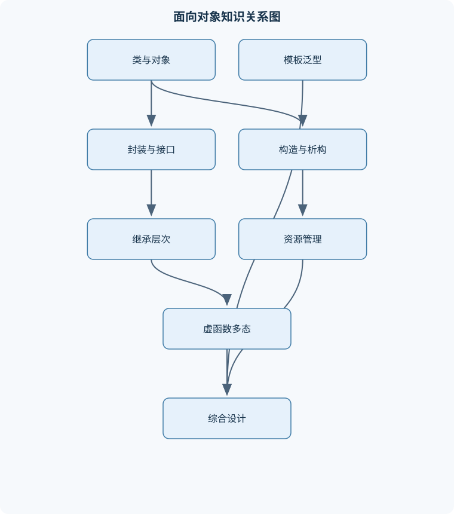
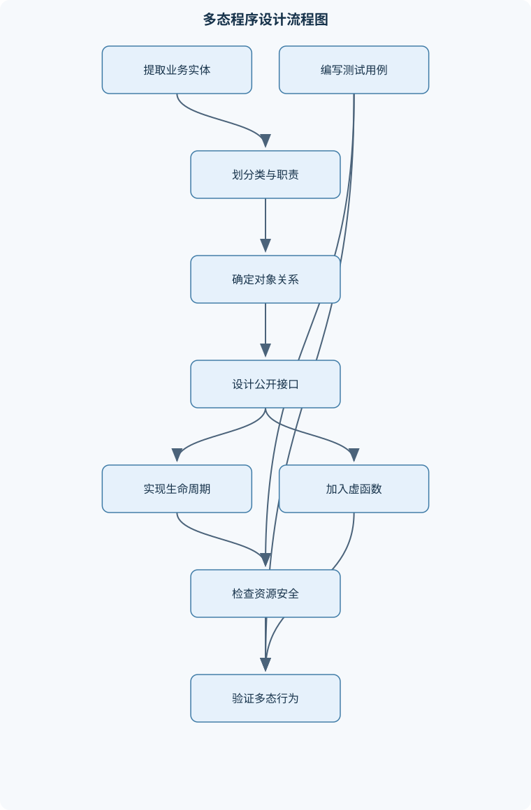

# 面向对象程序设计

## 一、课程整体知识框架

### 课程边界与先修知识

本课程以C++为实现语言，系统讲授面向对象程序设计的核心思想、语言机制、程序设计方法和资源管理原则。内容边界包括类与对象、封装、构造与析构、拷贝控制、继承、多态、虚函数、运算符重载、模板、异常处理、标准容器与迭代器、面向对象分析设计以及中小型程序实现。先修知识包括C++基本语法、变量与表达式、函数、指针与引用、数组、条件与循环、基本输入输出、编译链接的基本概念，以及一定的算法和数据结构基础。不以Python语法为课程内容，但可将类、继承、异常和迭代等概念与其他面向对象语言进行抽象比较。





### 1. 课程目标、先修基础与核心抽象

本课程以 C++ 为实现语言，研究如何把问题中的实体、状态、行为和协作关系组织成可维护的程序。类记为 $C$，对象记为 $o$；类描述对象具有哪些数据和操作，对象则是类在运行时的具体实例。成员函数调用可抽象为 $o.m()$，其中成员函数内部的隐含对象指针记为 $this$。面向对象程序并不是把所有数据简单放进结构体，而是通过公开接口限制状态的修改方式，使对象始终满足自身不变量。

面向对象思想通常围绕四个相互联系的概念展开：

- **抽象**：从需求中保留与当前问题有关的属性和行为，隐藏无关实现。例如订单对象需要编号、商品集合和金额计算，不必向调用者暴露金额存储的中间变量。
- **封装**：把数据与操作数据的函数放入同一类，并通过 `public`、`protected`、`private` 控制访问边界。封装的直接结果是，外部代码不能绕过类的检查随意破坏对象状态。
- **继承**：从已有类构造新类。基类记为 $B$，派生类记为 $D$；若 $D$ 公有继承 $B$，记为 $D\mathrel{<:}B$。继承适合表达稳定的“是一种”关系，例如圆形是一种图形，但不能仅因为两个类有相同字段就强行继承。
- **多态**：同一接口在不同对象上产生不同实现。若基类指针或引用指向派生类对象，且被调用函数在基类中声明为 `virtual`，则调用可在运行时根据动态类型选择实现。

先修知识包括变量、表达式、条件与循环、函数、数组、指针与引用、基本输入输出，以及编译和链接的初步概念。引用记为 $T\&$，常量引用记为 $const\ T\&$，指针记为 $T*$，空指针记为 `nullptr`。值传递复制实参状态，引用传递使形参成为调用者对象的别名，指针传递则显式携带地址并允许表示空状态。三者不能互相替代：需要“无对象”语义时可用指针，需要避免复制且保证对象存在时常用引用，需要独立保存一份值时使用按值传递。

### 2. C++ 程序结构与类型语义

一个较大的 C++ 程序通常分为头文件、源文件和编译单元。声明告诉编译器名称及类型，定义提供实体的完整内容；源文件分别编译后再由链接器合并。头文件中通常放类声明、函数声明和模板定义，非内联的非静态数据成员定义或普通函数定义应避免在多个编译单元中重复定义。命名空间用于避免同名冲突，作用域决定名称可见范围；局部变量可以遮蔽外层同名名称，但遮蔽不等于重载。

对象的静态类型是表达式、指针或引用在编译期声明的类型，动态类型是对象实际创建时的类型。例如：

```cpp
Base* p = new Derived;
```

此时 `p` 的静态类型是 `Base*`，其所指对象的动态类型是 `Derived`。只有通过指针或引用进行虚函数调用时，动态类型才可能影响函数选择。按值把 `Derived` 转换成 `Base` 会发生对象切片，派生类新增状态被截去，因此多态接口一般使用基类引用或指针。

`const` 有两层重要含义：`const` 对象不能调用可能修改对象状态的成员函数；`const` 成员函数承诺不修改该对象的非 `mutable` 状态。为了使常量对象可读，常常同时提供非 `const` 和 `const` 版本的下标或访问函数。控制流中的函数调用遵循参数求值、进入函数体、返回结果的过程；对表达式 $a=f(g(m))$，先完成 $g(m)$，再将其结果传给 $f$。若 $g$ 通过引用修改 $m$，修改会影响外部对象；若通过值传递，则局部修改不会直接改变调用者。

### 3. 类、对象与生命周期

类由数据成员和成员函数构成。`private` 成员只允许类本身及其友元访问，`protected` 还允许派生类访问，`public` 成员构成外部接口。访问控制是编译期约束，不能代替运行时的输入检查；例如把余额设为私有并不意味着充值金额一定合法，成员函数仍须检查金额范围。

构造函数记为 $C::C$，负责建立对象不变量；析构函数记为 $C::~C$，负责释放对象拥有的资源。构造函数没有返回类型，不能被普通方式调用来“重新构造”已经存在的对象。成员初始化列表应优先用于初始化成员，因为引用成员、常量成员和没有默认构造函数的成员只能在初始化阶段建立。实际初始化顺序由类定义决定，而不是由初始化列表书写顺序决定：

1. 先初始化基类子对象；
2. 再按照非静态数据成员在类中的声明顺序初始化；
3. 最后执行派生类构造函数体。

析构顺序完全相反。因此，若成员 `a` 先于成员 `b` 声明，即使初始化列表写成 `b(...), a(...)`，实际仍先初始化 `a`。这也是生命周期输出分析和资源释放设计的关键。

对象的存储期包括自动存储期、静态存储期和动态存储期。局部自动对象在离开作用域时析构；全局对象和静态局部对象在程序结束阶段销毁，具有静态存储期；动态对象在执行 `delete` 或由智能指针管理时销毁。相同作用域内，局部对象通常按构造的先后逆序析构；成员和基类子对象也按构造顺序逆序析构。静态对象之间跨编译单元的初始化顺序不宜作为设计依赖，避免形成初始化顺序问题。

静态数据成员属于类而不是某个对象，通常由所有对象共享；静态成员函数没有 $this$ 指针，不能直接访问非静态成员。若函数需要对象状态，就必须通过对象、指针或引用显式取得该状态。

### 4. 资源管理、拷贝控制与异常安全

资源集合记为 $R$。若对象 $o$ 拥有资源 $r$，记为 $o\owns r$。资源不仅包括动态内存，还包括文件句柄、互斥锁、数据库连接等。RAII 要求把资源获取绑定到对象构造，把资源释放绑定到对象析构。这样函数因正常返回、提前返回或抛出异常离开时，局部对象仍会自动析构。

若类含有动态字符数组，默认拷贝往往只复制指针地址，形成浅拷贝。设两个对象 $o_1,o_2$ 的指针均指向同一缓冲区，则一方析构后另一方指针悬空；两方析构还可能重复释放。安全策略有三种：深拷贝并独立拥有资源；明确共享所有权；禁止拷贝并仅允许移动或引用。规则三要求：若类需要自定义析构函数、拷贝构造函数或拷贝赋值运算符中的一个，通常应审查另外两个。规则五进一步加入移动构造和移动赋值。

拷贝构造函数记为 $C::C(const\ C\&)$，用于从一个尚未构造的对象建立新对象；拷贝赋值记为 $C::operator=(const\ C\&)$，用于把一个已经存在的对象改成另一个对象的逻辑状态。赋值必须处理自赋值，即判断 `this == &r`，或采用先构造临时副本、成功后交换资源的方式。若资源大小为 $n$，深拷贝通常需要 $O(n)$ 时间和 $O(n)$ 额外空间。

移动构造和移动赋值通过转移资源所有权减少复制，并把源对象置于可析构、可重新赋值但不应继续依赖原值的有效状态。所有权语义应明确：独占资源不能被两个对象同时释放，共享资源需要引用计数或其他共享协议，非拥有观察者不能在被观察对象销毁后继续使用。

异常安全可分为无保证、基本保证、强保证和不抛异常保证。基本保证要求失败后对象仍满足不变量且没有资源泄漏；强保证要求操作失败时状态不变；不抛异常保证要求操作不会抛出异常。构造函数中若后续成员或构造函数体抛出异常，已经成功构造的基类和成员会自动析构，但未完成构造的最外层对象不会调用完整析构函数。因此资源必须由已构造的成员对象管理，而不能依赖构造函数体末尾的手工清理。

### 5. 运算符重载、转换与临时对象

运算符重载应表达自然且一致的语义。例如有理数可重载 `*` 和 `==`，但不能让 `==` 修改对象。成员运算符适合左操作数必须是本类对象的场景；非成员运算符适合需要对称转换的场景。友元函数不是成员函数，没有隐含的 $this$ 指针，但可访问类的私有成员；只有在确实需要访问内部表示或保持对称运算时使用友元。

前置递增通常声明为 `operator++()`，修改对象后返回 `*this` 的引用；后置递增声明为 `operator++(int)`，其中 `int` 只是区分形式的哑参数。后置版本先保存旧值，再修改对象，最后返回旧值副本。若计数器在 $0,1,\ldots,5$ 上循环，执行 `++a` 后返回新状态，执行 `a++` 后表达式值仍是旧状态，二者在条件循环中的次数可能不同。

隐式构造允许单参数构造函数参与类型转换，容易产生意外转换；不希望自动转换时应使用 `explicit`。转换函数也可能使表达式产生多条可行转换路径，导致歧义或错误匹配。返回局部对象的值是安全的，返回局部对象的引用或指针则会在函数结束后悬空。逻辑相等 `$a==b$` 通常比较状态，不等同于地址相等。

### 6. 继承、虚函数与运行时类型

继承方式影响基类成员在派生类中的可访问性。公有继承表达可替换的“是一种”关系；保护继承和私有继承主要表达实现复用或受限接口，不应与公有继承混淆。派生类构造时先构造基类子对象，再构造自己的成员；析构时先析构自己的成员，再析构基类子对象。

同名函数可能是重载、覆盖或隐藏。重载要求同一作用域内参数列表不同；覆盖要求基类函数为虚函数，派生类函数签名匹配，且 `const` 等限定一致；派生类声明同名函数可能隐藏基类的其他重载，可用 `using Base::f` 恢复可见性。只有覆盖成功的虚函数才能实现运行时多态。

虚函数调用可抽象为：

$$
vptr\rightarrow vtable[slot]
$$

该模型用于解释动态分派，并不表示所有编译器必须采用相同内部实现。基类指针或引用指向派生类对象时，虚函数根据动态类型选择实现；非虚函数按静态类型绑定。若基类可能通过指针删除派生类对象，基类析构函数必须是虚函数，否则可能只执行基类析构，导致派生类资源未释放。

纯虚函数使类成为抽象类，抽象类不能直接创建对象，适合定义接口。多继承可能产生菱形继承：两个中间类共同继承同一基类，最下层可能含有两份基类子对象。虚基类使共享基类子对象只保留一份，但会增加构造责任和理解成本，只有确有共享基类状态需求时采用。

`dynamic_cast` 适用于确需运行时向下转型的多态层次。基类至少应具有虚函数；指针转换失败返回 `nullptr`，引用转换失败抛出类型相关异常。向下转型前应检查结果，不能把类型识别当成替代良好接口设计的常规手段。

### 7. 模板、异常与标准库

函数模板通过类型参数把算法与具体类型分离。模板参数推导在编译期完成，调用时要求实参类型能够支持模板体中使用的全部操作。类模板在具体使用时实例化，例如 `Triple<int>` 与 `Triple<double>` 是不同的具体类型。模板特化可为特定类型提供不同实现，非类型模板参数则允许把整数、枚举或其他编译期值作为参数。

模板中的“约束”不仅是类型名称，还包括可调用的运算符、构造方式和返回类型。例如排序模板要求元素可比较，或显式提供比较谓词。模板错误常在实例化点集中出现，定位时应从第一条真正的类型不匹配错误开始，而不是只看最后的连锁报错。模板多态是编译期多态，与虚函数的运行时多态不同。

异常由 `throw` 抛出，经 `try` 和 `catch` 匹配处理。通常按值抛出异常对象、按 `const` 引用捕获，以避免切片和不必要复制。异常沿调用栈传播时，已经构造的局部对象依次析构，这正是 RAII 提供异常安全的原因。自定义异常可按业务层次组织，但异常不应被滥用于普通分支；可预期且频繁的失败有时更适合错误码或结果对象。

标准容器包括顺序容器和关联容器。`vector` 连续存储，随机访问为常数时间，尾部追加通常均摊为 $O(1)$，扩容可能使迭代器和引用失效；`list` 适合已知位置的链表插入删除，但不支持高效随机访问；`deque` 支持两端操作和随机访问，存储不保证连续。`set` 按键组织唯一元素，`map` 按键组织键值对，通常基于有序树，查找、插入、删除为 $O(\log n)$；哈希容器的平均复杂度可能为 $O(1)$，最坏情况可退化。

迭代器区间采用半开区间 $[first,last)$，包含 `first` 指向元素，不包含 `last` 指向位置。迭代器类别决定算法能力：输入迭代器只能单向读取，前向迭代器可多次遍历，双向迭代器支持递减，随机访问迭代器支持跳跃。容器修改后必须重新判断迭代器有效性，不能继续使用已失效迭代器。

### 8. 面向对象分析、设计与综合实现

面向对象分析先从需求中识别实体、职责和协作关系，再确定类边界。组合表示整体拥有部分且部分生命周期依附整体；聚合表示较弱的整体—部分关系；关联表示对象之间存在联系但不必拥有。继承应由稳定的替换关系支持，若关系只是“使用”，通常采用组合或依赖。

设计时应优先考虑最小公开接口、明确所有权、接口与实现分离，以及依赖倒置。若 `Bill` 需要关联 `Person`，应先决定是独占对象、共享对象还是非拥有引用，再决定拷贝和析构策略。测试不仅验证正常输入，还要覆盖空字符串、自赋值、重复键、越界访问、资源获取失败、基类指针删除和异常传播等边界。

综合程序应能够处理多态业务模型、拥有动态字符数组的文本类、账单或订单对象、容器集合和异常安全资源包装。编译错误通常在语法或类型检查阶段发现，链接错误常来自声明与定义不匹配或重复定义，运行时错误可能来自越界、空指针和异常，未定义行为则不保证任何稳定结果。调试应先定位类别，再用最小测试复现，最后通过单元测试验证修复没有破坏原有接口。

## 二、章节和模块划分

### 核心知识覆盖清单

本清单用于检查正文是否覆盖本课程的主要知识模块：

- **面向对象思想与C++程序结构**：对象、类与消息传递、抽象、封装、继承、多态、源文件、头文件与编译单元、命名空间与作用域、声明、定义与链接、值、引用、指针的区别、const对象与const成员函数、控制流和函数调用语义。
- **类的定义与对象生命周期**：数据成员和成员函数、public、protected与private、构造函数与默认构造、成员初始化列表、析构函数与生命周期、静态数据成员和静态成员函数、对象的构造顺序、局部、全局和静态对象的销毁顺序。
- **资源管理与拷贝控制**：浅拷贝与深拷贝、拷贝构造函数、拷贝赋值运算符、移动构造与移动赋值、自赋值安全、规则三与规则五、RAII资源获取即初始化、动态数组和异常安全、智能指针的所有权语义。
- **运算符重载与类型转换**：成员运算符与非成员运算符、前置和后置递增运算符、算术、关系和下标运算符、输入输出运算符、友元函数的适用条件、隐式构造与显式构造、转换函数与转换风险、返回值类别和临时对象。
- **继承与类层次结构**：基类与派生类、公有、保护和私有继承、基类构造与派生类构造、派生类析构过程、成员隐藏与函数重载、虚函数和覆盖、纯虚函数与抽象类、多继承与菱形继承、虚基类的适用场景。
- **运行时多态与类型识别**：静态类型和动态类型、基类指针与基类引用、虚函数表的抽象模型、虚析构函数、对象切片、动态类型转换、typeid与运行时类型信息、接口类和替换原则。
- **函数模板与类模板**：函数模板参数推导、类模板实例化、模板特化、非类型模板参数、模板中的运算符要求、编译期多态、模板错误的定位、泛型算法的设计约束。
- **异常处理与程序健壮性**：异常对象与异常类型、try、catch和throw、异常传播过程、按值抛出与按引用捕获、异常安全保证、构造函数失败时的清理、资源管理与异常的结合、自定义异常层次、异常与错误码的适用边界。
- **标准库容器、迭代器与算法**：vector、list和deque的结构特点、set、map及键值组织、容器元素的生命周期、迭代器分类、范围访问与迭代器失效、排序、查找和遍历算法、函数对象与谓词、复杂度和空间开销、容器选择的适用条件。
- **面向对象分析、设计与实现**：需求中的实体识别、类职责与封装边界、关联、聚合与组合、继承关系的判定、接口与实现分离、依赖倒置和组合优先、对象所有权设计、类图与调用流程、测试驱动的类接口验证。
- **综合程序设计与调试**：多态业务模型实现、文本类的深拷贝实现、账单或订单对象设计、生命周期输出分析、编译错误与链接错误定位、运行时错误和未定义行为、单元测试与边界测试、内存泄漏和悬空指针排查、代码重构与可维护性。


### 1. 模块组织与递进关系

课程按“语言基础—对象生命周期—资源语义—层次结构—泛型与库—分析设计—综合实现”递进。第一模块建立程序结构、作用域、值/引用/指针和多态所需的类型基础；第二、三模块解决对象如何建立、复制、移动和销毁；第四至第六模块处理运算符、继承、虚函数和运行时类型；第七、八模块扩展到模板、异常和标准库；第九至十一模块把语言机制用于需求分析、设计、测试和调试。

### 2. 代表性分析流程

#### 2.1 对象生命周期分析流程

**输入**：类定义、对象声明、构造函数体、析构函数体和作用域。  
**过程**：

1. 确定对象存储期；
2. 列出基类子对象；
3. 按成员声明顺序列出成员构造；
4. 执行构造函数体；
5. 在作用域结束、显式释放或程序结束时按相反顺序析构。

**不变量**：处理到任一步时，已列出的对象均已完成构造且尚未被错误重复析构。若共有 $n$ 个基类和成员子对象，分析时间为 $O(n)$。终止条件是所有对象和子对象均被列出。

#### 2.2 拷贝控制审查流程

先识别每个资源及其所有者，再依次审查析构、拷贝构造、拷贝赋值、移动构造和移动赋值。对每个操作检查空资源、自赋值、异常中途失败和源对象状态。若不能定义安全复制，就显式删除拷贝操作，并提供移动或共享策略。资源成员数为 $k$ 时，审查复杂度为 $O(k)$。

#### 2.3 多态调用分析流程

先写出表达式静态类型和对象动态类型，再判断调用是否通过指针或引用；随后检查基类函数是否为 `virtual`、签名是否完全匹配。满足条件时选择动态类型实现，否则按静态类型绑定。若层次深度为 $h$，手工分析可按 $O(h)$ 进行。对象按值传递时先检查是否已发生切片。

#### 2.4 泛型算法流程

输入合法区间 $[first,last)$、迭代器类别和谓词。先确认范围有效、元素操作存在，再根据循环不变量移动迭代器并更新结果。遍历 $n$ 个元素通常为 $O(n)$，排序复杂度取决于算法。若比较操作不满足一致性，例如同一对元素比较结果前后不稳定，排序结果不具备可靠语义。

```cpp
#include <iostream>
#include <string>
#include <utility>

class MyString {
private:
    char* data_;
    std::size_t size_;

public:
    explicit MyString(const char* text = "")
        : data_(nullptr), size_(0) {
        if (text == nullptr) {
            text = "";
        }
        while (text[size_] != '\0') {
            ++size_;
        }
        data_ = new char[size_ + 1];
        for (std::size_t i = 0; i <= size_; ++i) {
            data_[i] = text[i];
        }
    }

    MyString(const MyString& other)
        : data_(new char[other.size_ + 1]), size_(other.size_) {
        for (std::size_t i = 0; i <= size_; ++i) {
            data_[i] = other.data_[i];
        }
    }

    MyString& operator=(const MyString& other) {
        if (this == &other) {
            return *this;
        }
        char* copy = new char[other.size_ + 1];
        for (std::size_t i = 0; i <= other.size_; ++i) {
            copy[i] = other.data_[i];
        }
        delete[] data_;
        data_ = copy;
        size_ = other.size_;
        return *this;
    }

    ~MyString() {
        delete[] data_;
    }

    std::size_t length() const {
        return size_;
    }

    char& operator[](std::size_t index) {
        return data_[index];
    }

    const char& operator[](std::size_t index) const {
        return data_[index];
    }

    friend bool operator==(const MyString& a, const MyString& b) {
        if (a.size_ != b.size_) {
            return false;
        }
        for (std::size_t i = 0; i < a.size_; ++i) {
            if (a.data_[i] != b.data_[i]) {
                return false;
            }
        }
        return true;
    }
};

int main() {
    MyString a("object");
    MyString b = a;
    b[0] = 'O';
    std::cout << a.length() << '\n';
    std::cout << (a == b) << '\n';

    a = a;                 // 自赋值安全
    MyString c;
    c = b;                 // 连续赋值
    std::cout << c[0] << '\n';
}
```

代码中拷贝构造分配独立缓冲区，因此修改 `b` 不会改变 `a`。赋值运算先复制右侧资源，复制成功后才释放左侧旧资源，若分配失败，左对象仍保持原状态。该示例未提供越界检查的 `at` 接口，调用者必须保证下标小于 `length()`；若需要运行时检查，应另行设计异常行为。

### 3. 代表性例题

#### 例题一：成员构造与析构顺序

**题干**：`D` 公有继承 `B`，并含有成员 `m1`、`m2`，声明顺序为 `m1` 后 `m2`。创建 `D d`，构造函数体和析构函数体均输出名称。求输出顺序。

**分析**：构造先基类，再按成员声明顺序，最后执行派生类构造函数体；析构完全逆序。

**逐步解答**：构造为 `B`、`m1`、`m2`、`D`；析构为 `D`、`m2`、`m1`、`B`。

**结果验证**：初始化列表即使写成 `m2(...) , m1(...)`，也不能改变实际顺序，因为成员声明顺序决定子对象初始化顺序。

**变式**：若 `m1` 是引用成员，则必须在初始化列表中绑定对象，不能先默认构造后赋值。

#### 例题二：浅拷贝与深拷贝

**题干**：类含有 `char* data`，默认拷贝后两个对象的 `data` 地址相同。分析析构风险并给出修复策略。

**分析**：默认拷贝复制指针值，不复制缓冲区内容，两个对象错误地表现为共同拥有同一资源。

**逐步解答**：对象 $o_1$ 复制给 $o_2$；$o_1.data=o_2.data$；任一对象析构释放资源后，另一指针悬空；另一对象析构时可能重复释放。修复为深拷贝，或改用独占智能指针并删除拷贝，或使用明确的共享所有权。

**结果验证**：深拷贝后应满足 `o1.data != o2.data` 且对应字符内容相等。

**变式**：测试空字符串、自赋值和右侧资源分配失败，确认左对象状态不被破坏。

#### 例题三：前置与后置递增

**题干**：计数器状态在 $0$ 到 $5$ 循环。分别分析 `while (++a)` 与 `while (a++)` 的输出和最终状态。

**分析**：前置版本先改变状态再返回新值；后置版本先保存旧值，再改变状态，表达式返回旧值。

**逐步解答**：初始 `a=0`。前置循环依次返回 $1,2,3,4,5,0$，输出五次，最终状态为 $0$。若从 `a=0` 开始执行后置循环，条件依次取得旧值 $0$，第一次即终止，但状态已递增为 $1$。

**结果验证**：条件判断使用的值和对象更新后的值不是同一概念，必须分别记录。

**变式**：若后置循环从 `a=3` 开始，则先输出三次，对应旧值 $3,4,5$，随后状态回到 $0$ 并停止。

#### 例题四：虚函数与对象切片

**题干**：`Base` 有虚函数 `print`，`Derived` 覆盖该函数。分别用 `Base*` 指向 `Derived`、用 `Base` 值接收 `Derived`，说明调用结果。

**分析**：指针调用保留动态对象，按值接收会建立新的基类对象。

**逐步解答**：`Base* p = new Derived; p->print()` 进行虚调用，执行 `Derived::print`。若 `Base b = derived`，只复制基类子对象，派生状态被切除，`b.print()` 调用基类版本。

**结果验证**：基类多态接口应使用引用或指针；若允许 `delete p`，`Base::~Base` 必须为虚析构函数。

**变式**：若派生类函数只改变参数列表或增加 `const`，它可能是重载或隐藏，并未覆盖基类虚函数。

#### 例题五：容器与迭代器失效

**题干**：向 `vector<int>` 追加元素后继续使用旧迭代器，判断是否安全；使用 `map` 插入重复键会发生什么。

**分析**：`vector` 扩容会移动元素，旧迭代器可能全部失效；`map` 的键唯一，普通插入不会产生第二个相同键。

**逐步解答**：若追加导致重新分配，旧迭代器不能再解引用；即使未扩容，也应依据具体操作规则判断。对 `map` 插入重复键，插入失败或返回已有键位置，不能假定覆盖；若需覆盖，应使用赋值式接口。

**结果验证**：每次可能改变容器结构的操作后重新取得迭代器，并检查插入结果。

**变式**：关联容器删除某个元素通常只使指向被删元素的迭代器失效，其他迭代器一般仍有效，但代码仍应遵守具体容器规则。

### 4. 实验与项目

#### 实验一：生命周期与多态调用跟踪

**输入数据**：设计 `Base`、`Derived`、第三层派生类，以及各类成员对象；在构造、析构和虚函数中输出对象名称。  
**步骤**：

1. 创建全局对象、静态局部对象和局部对象；
2. 通过基类指针调用虚函数；
3. 分别使用虚析构和非虚析构进行对照；
4. 按时间线记录每条输出；
5. 使用单元测试检查预期调用次数和析构顺序。

**评价标准**：能正确解释存储期、基类先构造、成员按声明顺序构造、析构逆序、虚函数动态分派及虚析构必要性。  
**排错方法**：若输出顺序错误，先检查成员声明顺序；若派生析构未输出，检查基类析构是否为 `virtual`；若调用到基类函数，检查签名和 `const` 限定是否一致。

#### 实验二：文本类与订单集合项目

**输入数据**：若干客户编号、商品名称、价格和数量，允许空名称、重复编号、删除不存在的编号。  
**步骤**：

1. 实现拥有动态字符数组的 `MyString`；
2. 完成深拷贝、拷贝赋值、相等比较和下标访问；
3. 使用 `map<int, Bill>` 按编号管理订单；
4. 用 `vector` 保存订单明细；
5. 设计正常、边界、异常和重复键测试；
6. 使用调试器或内存检查工具确认无泄漏和悬空指针。

**评价标准**：拷贝后对象互不共享可变缓冲区；订单金额不允许负数；重复编号处理规则明确；删除后不使用失效迭代器；异常发生时资源仍释放。  
**排错方法**：出现双重释放时检查析构和拷贝控制；结果金额错误时检查整数、浮点数和数量类型；查找不到订单时区分不存在键与默认插入；崩溃发生在容器修改后时检查迭代器生命周期。

## 三、核心概念的详细解释

### 1. 类、对象、抽象与封装

类 $C$ 是对一组具有共同结构和行为的对象的描述；对象 $o$ 是类在运行时的实例。类中的数据成员表示状态，成员函数表示能够对状态执行的操作。对对象 $o$ 调用成员函数可抽象写成 $o.m()$，成员函数内部的隐含对象指针为 `this`。因此，成员函数访问非静态成员时，本质上是在访问 `this->成员名`。

抽象的关键不是“把所有数据都放进类”，而是根据需求保留必要的属性和行为。例如，`BankAccount` 需要保存账户标识和余额，并提供存款、取款等操作；余额不应被外部代码直接改写，因为直接写入可能绕过“余额不能为负”等不变量。封装通过访问控制实现：

- `public` 成员构成外部可使用的接口；
- `private` 成员只能由类本身及其友元访问；
- `protected` 成员还允许派生类访问，但仍不对普通外部代码开放。

封装边界应围绕不变量设计。若类 $C$ 的合法状态集合为 $I_C$，则每个公开操作都应满足：当对象调用操作前处于 $I_C$ 中，操作正常返回后仍处于 $I_C$ 中。构造函数负责建立初始合法状态，析构函数负责释放对象拥有的资源。仅仅把数据成员声明为 `private` 并不自动形成良好封装；如果公开接口返回内部缓冲区的可写指针，外部仍可能绕过检查修改状态。

### 2. 值、引用、指针与 `const`

按值传递为函数参数建立独立对象。若函数为 `void f(T x)`，调用时通常需要用实参初始化 `x`；函数内部改变 `x` 不会直接改变调用者对象。按引用传递的形参 `T& x` 是实参的别名，不产生独立对象，适合表达“必须存在且允许修改”。`const T&` 不允许通过该引用修改对象，适合避免复制并支持只读访问。指针 `T*` 保存地址，可以为 `nullptr`，因而适合表达“可能没有对象”，但使用前必须确认指针有效。

例如：

```cpp
void add_one(int x) { ++x; }
void add_one_ref(int& x) { ++x; }
void print(const int& x) { /* 只读 */ }

int a = 3;
add_one(a);       // a 仍为 3
add_one_ref(a);   // a 变为 4
print(a);         // 不复制，也不能修改 a
```

`const` 成员函数的声明形式为：

```cpp
class Counter {
    int value = 0;
public:
    int get() const { return value; }
    void reset() { value = 0; }
};
```

`const` 成员函数承诺不修改非 `mutable` 的对象状态，因此可以由 `const Counter` 对象调用。若同时提供相同参数列表但分别带有和不带有 `const` 的成员函数，二者构成重载；调用哪个版本由对象的常量性决定。`const` 不是“编译器一定能证明函数完全没有任何副作用”，它主要约束成员状态的修改权限，函数仍可能修改外部对象或执行输入输出。

### 3. 声明、定义、作用域与编译链接

声明向编译器说明名称及其类型，定义则为实体提供完整内容或分配存储。例如：

```cpp
int sum(int, int);              // 声明
int sum(int a, int b) { return a + b; } // 定义
```

一个源文件经预处理后形成编译单元，编译器分别把编译单元转换为目标文件，链接器再解析跨文件引用。头文件适合放类声明、函数声明、常量定义和模板定义；普通非内联函数若在多个编译单元中重复定义，可能产生重复定义的链接错误。声明缺失通常导致编译错误，声明存在但定义缺失通常在链接阶段报错。

命名空间和局部作用域共同决定名称可见性。局部变量可以遮蔽外层同名名称，但遮蔽不是重载；重载要求同一作用域中函数名相同而参数列表不同。成员函数的 `const` 限定、引用限定等也会参与函数选择，但返回类型单独不同不能构成重载。

### 4. 构造、析构与对象生命周期

构造函数用于建立对象，析构函数用于结束对象生命周期。构造函数没有返回类型，析构函数名为 `C::~C`，一个类最多只有一个无参数列表意义上的析构函数。构造函数应使用成员初始化列表初始化成员：

```cpp
class Point {
    const int x;
    int y;
public:
    Point(int a, int b) : x(a), y(b) {}
};
```

实际初始化顺序不是初始化列表的书写顺序，而是：

1. 虚基类子对象；
2. 非虚基类子对象，按基类声明顺序；
3. 非静态数据成员，按成员声明顺序；
4. 执行当前类构造函数体。

派生类对象 $D$ 构造时，先构造基类 $B$ 子对象，再构造成员对象，最后执行 $D$ 的构造函数体。析构顺序完全相反：先执行派生类析构函数体，再销毁成员，最后销毁基类子对象。若成员声明顺序为 `A a; B b;`，即使构造函数写成 `: b(...), a(...)`，实际仍先构造 `a` 再构造 `b`。

对象的存储期决定生命周期：

- 自动存储期对象在进入作用域时构造，离开作用域时析构；
- 静态存储期对象通常在程序结束阶段析构；
- 动态存储期对象由 `new` 创建，通常由对应所有权对象或显式 `delete` 销毁；
- 全局对象之间跨编译单元的初始化顺序不宜依赖，复杂程序应避免通过全局对象构造函数互相访问未完成初始化的对象。

静态数据成员属于类而非某个对象，所有对象共享一份存储。静态成员函数没有 `this` 指针，不能直接访问非静态成员，因为调用它时未必存在一个确定的对象状态。

### 5. 拷贝控制、移动语义与 RAII

若类拥有动态数组、文件句柄、锁或其他资源，仅复制资源句柄通常是不安全的。例如：

```cpp
class Buffer {
    char* data;
};
```

默认拷贝可能只复制 `data` 地址，形成浅拷贝。若对象 $o_1$ 和 $o_2$ 共同持有同一地址，析构时可能两次释放同一资源，或一个对象释放后另一个对象留下悬空指针。

资源集合记为 $R$，对象拥有资源可写作 $o\owns r$。RAII 要求资源获取绑定构造、释放绑定析构：

$$
\text{构造成功}\Rightarrow o\owns r,\qquad
\text{析构执行}\Rightarrow r\text{ 被释放}.
$$

拷贝构造函数在创建新对象时从已有对象初始化，例如 `C::C(const C&)`；拷贝赋值运算符作用于两个已经存在的对象，例如 `C::operator=(const C&)`。二者不能混淆：构造对象时不是先默认构造再调用赋值运算符。

含资源类的审查应依次检查析构函数、拷贝构造、拷贝赋值、移动构造和移动赋值。传统规则三指出：若类需要自定义析构、拷贝构造或拷贝赋值中的一个，通常需要审查另外两个。规则五进一步加入移动构造和移动赋值。若类不应复制，应显式禁止拷贝，而不是让默认拷贝产生错误所有权。

移动操作转移资源而非复制资源。移动后源对象必须保持可析构、可赋值的有效状态，通常将其指针置为 `nullptr`、长度置为零。移动语义不能把源对象继续当作原值使用；它只保证源对象处于有效但值未指定状态。

赋值必须处理自赋值。安全步骤是先判断 `this == &rhs`，或者先构造右侧资源副本，再交换内部状态。若先释放左侧资源，再从右侧读取，而左右是同一对象，自赋值会导致读取已释放内存。

### 6. 运算符重载与类型转换

运算符重载应保持运算符原有的直观语义。前置递增通常写为：

```cpp
Counter& operator++();
```

它先改变对象，再返回 `*this` 的引用。后置递增通过哑参数区分：

```cpp
Counter operator++(int);
```

它保存旧值、递增对象、返回旧值副本。因而 `++c` 适合需要新状态的表达式，`c++` 表示使用旧状态后再递增。对于大型对象，前置版本通常避免额外临时副本，但这不是改变语义的理由。

二元运算符可以是成员函数或非成员函数。若左操作数需要发生隐式转换，非成员函数往往更自然。例如有理数乘法可设计为非成员函数，使整数和有理数的混合表达式具有对称性。输入输出运算符通常必须是非成员函数，因为左侧是流对象；若需要访问私有状态，可以使用受控友元，而不应把所有辅助函数都声明为友元。

隐式单参数构造函数可能使普通值自动转换为类对象；`explicit` 构造函数禁止这种隐式转换，能够减少重载歧义和意外临时对象。转换函数也可能产生相反方向的隐式转换。类型转换过多会导致表达式选择难以预测，应优先使用命名函数表达语义。

函数返回局部对象的值是安全的，因为返回的是对象值，编译器可以进行复制省略或移动；返回局部对象的引用或指针不安全，因为函数结束后局部对象已销毁。

### 7. 继承、虚函数与运行时多态

若 $D$ 公有继承 $B$，记为 $D\mathrel{<:}B$。公有继承表达“$D$ 是一种 $B$”，基类公有接口在派生类中保持可用。保护继承和私有继承改变外部可转换性，不能简单等同于公有继承。若关系主要表示代码复用而非类型替换，组合通常比继承更合适。

派生类构造时必须初始化基类子对象。派生类析构时先处理派生类自身资源，再自动销毁基类子对象。函数名相同但参数不同可能构成重载；派生类声明同名函数还可能隐藏基类所有重载。使用 `override` 能让编译器检查是否真正覆盖基类虚函数。

只有基类中声明为 `virtual` 且签名匹配的函数，才能通过基类指针或引用实现动态分派。虚函数调用可抽象为：

$$
vptr\rightarrow vtable[slot]\rightarrow D::f.
$$

这里 `vptr` 和 `vtable` 是解释动态分派的抽象模型，不是所有实现都必须采用的公开机制。多态调用的前提是表达式通过指针或引用访问对象；按值传递会发生对象切片：

```cpp
void show(Base b);       // 可能切片
void show(const Base& b); // 保留动态类型
```

如果通过 `Base*` 删除动态类型为 `Derived` 的对象，基类析构函数应为虚函数。否则可能只执行基类析构函数，派生类资源未释放。只要基类可能被多态删除，就应提供虚析构函数。

纯虚函数如 `virtual void print() const = 0;` 使类成为抽象类，抽象类不能直接创建对象，但可以定义接口并通过指针或引用使用。多继承可能产生菱形继承：两个中间类都继承同一基类，最下层对象可能包含两份基类子对象。虚基类可使共同基类只保留一份，但会增加构造规则和理解成本，应在确有共享基类子对象需求时使用。

### 8. 模板、异常与标准库

模板是编译期多态。函数模板实例化时，编译器根据实参推导模板参数，并检查模板体中使用的操作是否存在。类模板在使用具体参数时实例化。若模板函数要求类型支持 `+`、`<` 或复制，应在接口或文档中明确这些约束；模板错误常在实例化位置暴露，但根因可能位于模板定义。

异常通过 `throw` 抛出对象，沿调用栈向外寻找匹配的 `catch`。通常按值抛出、按 `const` 引用捕获：

```cpp
try {
    resource.open();
} catch (const ResourceError& e) {
    // 处理错误
}
```

按引用捕获可避免再次复制并保留多态异常类型。异常离开作用域时，已构造的局部对象按逆序析构，因此 RAII 能自动完成资源清理。异常安全保证包括：

- 无异常保证：操作不会抛出；
- 强保证：失败后程序状态保持操作前状态；
- 基本保证：失败后对象仍合法、无资源泄漏，但状态可能改变。

`vector` 连续存储，随机访问为常数时间，尾部追加通常摊销为 $O(1)$，扩容可能使迭代器和引用失效；`list` 插入删除稳定但不支持随机访问，节点额外空间较大；`deque` 支持随机访问，首尾插入通常高效。`set` 保存唯一有序键，`map` 保存键值对且键唯一，通常基于平衡树实现，查找、插入和删除为 $O(\log n)$；具体常数和实现细节仍取决于库实现。

迭代器区间采用半开区间 $[first,last)$，包含 `first` 指向的元素，不包含 `last`。算法如排序、查找、遍历通常通过迭代器与函数对象解耦容器。删除元素后，不能继续使用已经失效的迭代器；`vector` 扩容、插入和删除的失效规则必须结合具体位置判断。

## 四、重要定义、公式、定理和推导

### 专业审校补充：关键定义与适用边界

C++资源管理还应区分“规则五”和“规则零”。若类直接拥有动态内存、文件句柄或互斥锁等资源，并自行声明析构函数、拷贝构造、拷贝赋值、移动构造或移动赋值中的任意一部分，就必须审查其余特殊成员函数，明确资源的独占、共享、转移或禁止拷贝语义，这属于规则五的适用范围。若资源由vector、string、unique_ptr等已正确管理生命周期的成员表示，外层类通常不必手写析构和拷贝控制，可依赖成员的组合语义，这称为规则零。特别要注意：用户声明析构函数、拷贝构造或拷贝赋值，可能抑制隐式移动操作；因此“代码能编译”不等于对象支持高效移动。规则零并非无条件适用：成员类型必须具有所需的拷贝或移动能力，且类的不变量不能要求额外同步、日志或句柄重置。若对象含unique_ptr，默认拷贝会被删除；若含shared_ptr，默认拷贝表示共享所有权，而不是深拷贝。审查时应分别回答对象能否复制、能否移动、移动后源对象是否仍有效，以及异常发生时资源是否恰好释放一次。


### 1. 生命周期顺序定理及分析流程

对一个含基类子对象和 $n$ 个非静态成员的对象，构造过程可抽象为：

$$
B_1,\ldots,B_k
\;\rightarrow\;
M_1,\ldots,M_n
\;\rightarrow\;
C\text{ 的构造函数体}.
$$

析构过程为：

$$
C\text{ 的析构函数体}
\;\rightarrow\;
M_n,\ldots,M_1
\;\rightarrow\;
B_k,\ldots,B_1.
$$

该结论的适用条件是对象确实完成了相应构造阶段；若某个成员构造抛出异常，尚未构造完成的成员不会析构，已经完成构造的子对象会按逆序清理。

生命周期分析流程如下：

1. 输入类定义、对象声明和函数调用位置；
2. 确定对象的存储期；
3. 列出基类子对象；
4. 按成员声明顺序列出成员构造；
5. 记录构造函数体中的行为；
6. 以相反顺序记录析构；
7. 直到所有对象及子对象处理完毕。

若共有 $n$ 个子对象，列出顺序的时间和空间均为 $O(n)$。常见边界是全局对象和静态局部对象：它们不在普通块作用域结束时析构，而在程序结束阶段销毁；跨编译单元的销毁顺序不应作为业务逻辑依赖。

### 2. 拷贝控制与深拷贝推导

设对象拥有长度为 $n$ 的动态字符数组，深拷贝要求：

$$
o_1\owns r_1,\quad o_

## 五、算法、流程和实现思路

### 方法与流程覆盖索引

下列方法或流程应在正文中说明输入、步骤、适用条件、结果检查和边界：

- 对象生命周期分析流程：输入类定义、对象声明和表达式；先确定存储期，再按基类和成员声明顺序列出构造步骤，记录构造函数体输出，最后按逆序列出析构步骤；终止条件是所有对象和子对象均已处理；适用于输出顺序题和资源释放分析；若有$n$个子对象，时间复杂度为$O(n)$。
- 拷贝控制审查流程：输入一个含指针、文件句柄或容器资源的类；识别资源所有权，分别检查析构、拷贝构造、拷贝赋值、移动构造和移动赋值；验证自赋值、异常中途失败和空资源状态；若无法定义安全拷贝，则显式禁止拷贝并提供移动或共享语义；终止条件是每种特殊成员函数均有明确策略；审查复杂度为$O(k)$，其中$k$为资源成员数。
- 多态调用分析流程：输入表达式的静态类型、对象动态类型和成员函数声明；先判断调用是否通过指针或引用，再检查基类函数是否为virtual且签名完全匹配；若是虚调用，选择动态类型对应实现，否则选择静态类型实现；终止条件是得到唯一调用函数；适用于虚函数、函数隐藏和对象切片分析；层次深度为$h$时分析复杂度为$O(h)$。
- 深拷贝赋值流程：输入左对象$l$和右对象$r$；先判断$this==\&r$，若相同直接返回；为右对象资源创建临时副本，副本成功后释放左对象旧资源，再转移或交换资源状态，最后返回$*this$；不变量是操作失败时左对象仍保持原状态，成功后左对象逻辑等价于右对象；适用于拥有动态数组的类；若资源大小为$n$，时间复杂度为$O(n)$，额外空间为$O(n)$。
- 运行时类型转换流程：输入基类多态指针或引用及目标派生类型；确认基类至少有一个虚函数，再执行动态类型检查；指针转换失败返回nullptr，引用转换失败抛出类型相关异常；检查结果后再访问派生类接口；终止条件是转换成功或失败分支已处理；适用于确需向下转型的场景，时间复杂度通常可视为与继承层次深度相关，抽象记为$O(h)$。
- 模板泛型算法流程：输入元素范围$[first,last)$和满足约束的操作；验证迭代器类别、元素可比较性或谓词可调用性；按算法不变量逐步移动迭代器并更新结果；到达$last$时返回结果迭代器或输出区间；适用条件是范围有效且算法所需操作存在；线性遍历复杂度为$O(n)$，排序复杂度取决于具体算法。
- 面向对象设计流程：输入需求描述；提取候选实体和职责，区分属性与行为；为每个职责分配类，确定组合、聚合或继承关系；定义最小公开接口和不变量；确定对象所有权和生命周期；编写测试用例验证正常、边界和错误路径；终止条件是每个需求都有可追踪的类责任和测试；设计阶段复杂度不能用单一渐进式表示，评审规模可按类数和关系数线性检查。





### 1. 对象生命周期分析流程

对象生命周期分析的输入是类定义、对象声明、构造函数与析构函数中的可观察操作；输出是按时间排列的构造、成员函数调用和析构事件序列。分析时必须区分对象的存储期：

- 自动存储期对象通常在进入声明所在作用域时构造，在离开作用域时析构；
- 静态存储期对象在程序启动阶段或首次执行到定义位置时构造，并在程序结束阶段销毁；
- 动态存储期对象由动态分配操作创建，由显式释放或智能指针析构触发销毁。

对派生类对象 $D$，其构造顺序不是由初始化列表书写顺序决定，而是固定为：

$$
\text{虚基类子对象}
\rightarrow
\text{直接基类子对象}
\rightarrow
\text{成员声明顺序}
\rightarrow
D\text{ 的构造函数体}.
$$

析构顺序完全相反。若不考虑虚继承，可简化为：

$$
B\text{ 子对象}
\rightarrow
M_1,\ldots,M_n
\rightarrow
D\text{ 构造函数体},
$$

以及：

$$
D\text{ 析构函数体}
\rightarrow
M_n,\ldots,M_1
\rightarrow
B\text{ 子对象析构}.
$$

**算法过程**如下：

1. 列出所有对象及其存储期；
2. 对每个派生类对象先列出基类子对象；
3. 按成员在类定义中的声明顺序列出成员构造；
4. 记录构造函数体中的输出或状态修改；
5. 按作用域结束顺序确定对象销毁；
6. 对每个对象按构造逆序列出析构；
7. 直到所有对象和子对象均已处理。

若对象中有 $n$ 个直接成员，分析这些成员的工作量为 $O(n)$；若类层次深度为 $h$，还需沿继承链检查 $O(h)$ 个基类子对象。该流程适用于生命周期输出题、资源释放审查和异常构造分析，但不能把不同编译单元中非局部对象的初始化顺序当作业务逻辑依赖。

#### 例题一：成员声明顺序与初始化列表

**题干：**

```cpp
class A {
public:
    A()  { std::cout << "A+\n"; }
    ~A() { std::cout << "A-\n"; }
};

class B {
public:
    B()  { std::cout << "B+\n"; }
    ~B() { std::cout << "B-\n"; }
};

class C {
    B b;
    A a;
public:
    C() : a(), b() { std::cout << "C+\n"; }
    ~C() { std::cout << "C-\n"; }
};
```

创建 `C c;` 时输出什么？

**分析与解答：**

虽然初始化列表先写 `a()`，但成员声明中 `b` 在 `a` 之前，所以先构造 `b`，再构造 `a`，最后执行 `C` 的构造函数体。离开作用域时顺序反过来。

**结果：**

```text
B+
A+
C+
C-
A-
B-
```

**验证：**析构顺序与构造顺序严格相反。若把成员声明顺序改成 `A a; B b;`，构造和析构顺序也随之改变，而仅调整初始化列表书写顺序不会改变实际顺序。

**变式：**若 `A` 的构造函数抛出异常，则 `C` 的构造函数体不会执行；已经成功构造的 `B` 会被析构，尚未构造的成员不会析构。

### 2. 拷贝控制审查与深拷贝赋值

当类 $C$ 拥有动态数组、文件句柄、互斥锁或其他资源时，拷贝控制审查的输入是资源成员集合 $R$ 和类的特殊成员函数；输出是明确的拷贝、移动、共享或禁止拷贝策略。

若两个对象仅复制同一指针：

$$
o_1\owns r,\qquad o_2\owns r,
$$

则两个对象都可能认为自己拥有 $r$。当析构发生时，第一次释放使资源失效，第二次释放会造成重复释放。深拷贝应满足：

$$
o_1\owns r_1,\qquad o_2\owns r_2,\qquad r_1\ne r_2,
$$

同时要求 $r_1$ 与 $r_2$ 的逻辑内容相同。

#### 深拷贝赋值的安全流程

设左对象为 $l$，右对象为 $r$：

1. 检查 `this == &r`，若相同，直接返回 `*this`；
2. 根据右对象内容申请新资源；
3. 将右对象内容复制到新资源；
4. 新资源创建和复制成功后，再释放左对象旧资源；
5. 将新资源交给左对象；
6. 返回 `*this`。

关键不变量是：在新资源成功建立之前，左对象旧资源仍然有效。因此复制失败时可以保持原状态，接近强异常安全保证。若资源容量为 $n$，复制时间复杂度为 $O(n)$，额外空间为 $O(n)$。

#### 例题二：动态字符数组类

**题干：**设计一个拥有动态字符数组的 `MyString`，要求支持构造、拷贝构造、拷贝赋值、析构、长度、下标和相等比较。

**参考实现：**

```cpp
#include <cstring>
#include <stdexcept>
#include <utility>

class MyString {
private:
    char* data_;
    std::size_t size_;

public:
    MyString() : data_(new char[1]{'\0'}), size_(0) {}

    explicit MyString(const char* text) {
        if (text == nullptr) {
            data_ = new char[1]{'\0'};
            size_ = 0;
            return;
        }
        size_ = std::strlen(text);
        data_ = new char[size_ + 1];
        std::memcpy(data_, text, size_ + 1);
    }

    MyString(const MyString& other)
        : data_(new char[other.size_ + 1]), size_(other.size_) {
        std::memcpy(data_, other.data_, size_ + 1);
    }

    MyString& operator=(const MyString& other) {
        if (this == &other) {
            return *this;
        }

        char* replacement = new char[other.size_ + 1];
        std::memcpy(replacement, other.data_, other.size_ + 1);

        delete[] data_;
        data_ = replacement;
        size_ = other.size_;
        return *this;
    }

    ~MyString() {
        delete[] data_;
    }

    std::size_t length() const {
        return size_;
    }

    char& operator[](std::size_t index) {
        if (index >= size_) {
            throw std::out_of_range("index out of range");
        }
        return data_[index];
    }

    const char& operator[](std::size_t index) const {
        if (index >= size_) {
            throw std::out_of_range("index out of range");
        }
        return data_[index];
    }

    bool operator==(const MyString& other) const {
        return std::strcmp(data_, other.data_) == 0;
    }
};
```

**逐步分析：**

- 默认构造分配一个字符空间保存终止符 `'\0'`，因此空字符串仍有有效缓冲区；
- 拷贝构造创建新缓冲区，不复制地址；
- 拷贝赋值先建立替换资源，避免复制过程中失败导致左对象丢失原内容；
- `operator[]` 提供 `const` 和非 `const` 两个版本，使常量对象可读、普通对象可修改；
- 下标范围为 $0\le index< size$，访问 `size` 位置不属于字符串内容；
- 析构函数使用 `delete[]`，与 `new[]` 配对。

**结果验证：**构造 `MyString a("abc"); MyString b = a;` 后，修改 `b[0]` 不应改变 `a[0]`，说明两者不共享缓冲区；执行 `a = a` 不应崩溃或改变内容；对空字符串和越界下标应分别得到合法空对象和异常处理结果。

**变式：**若类改用 `std::string` 保存内容，则通常不需要手写析构、拷贝构造和拷贝赋值，这体现了资源管理类优先使用已有 RAII 类型的原则。若类表示独占资源，也可以显式删除拷贝操作，只提供移动操作。

### 3. 运算符重载与返回值分析

运算符重载必须保留运算符原有的基本语义。前置递增表达式 `++x` 的典型语义是先修改对象，再返回修改后的对象；后置递增表达式 `x++` 的典型语义是保存旧值、修改对象、返回旧值副本。

```cpp
class Counter {
private:
    int value_ = 0;

public:
    Counter& operator++() {
        ++value_;
        return *this;
    }

    Counter operator++(int) {
        Counter old = *this;
        ++value_;
        return old;
    }

    explicit operator bool() const {
        return value_ != 0;
    }

    int value() const {
        return value_;
    }
};
```

后置版本参数中的 `int` 只是区分前置和后置形式的标记，不代表调用者实际传入一个整数。前置版本返回引用，可以避免额外的旧值副本；后置版本必须保存旧状态，因此通常需要一次复制。

#### 例题三：前置与后置递增

**题干：**设计数器从 $0$ 递增到 $5$ 后回到 $0$，分析：

```cpp
while (++counter) {
    // 输出
}
```

和：

```cpp
while (counter++) {
    // 输出
}
```

**分析：**

若 `counter` 的布尔转换表示当前值是否非零，前置形式先改变值再判断。初始值为 $0$ 时，第一次变为 $1$，循环体执行；当值为 $5$ 时递增后回到 $0$，循环结束。因此前置形式输出五次，最终值为 $0$。

后置形式先把旧值作为条件，再递增。若初始值为 $0$，第一次条件使用旧值 $0$，循环体不执行，但对象递增为 $1$。若随后从 $1$ 开始执行 `while (counter++)`，条件依次使用 $1,2,3,4,5$，循环体执行五次；使用旧值 $5$ 后对象回到 $0$，下一次条件使用 $0$，循环结束。

**验证：**必须区分“判断所使用的值”和“递增后的对象状态”。返回值与对象最终状态不是同一概念。

**变式：**若 `operator++(int)` 错误地返回递增后的对象，则 `counter++` 会表现得像前置递增，破坏调用者依赖旧值语义的代码。

### 4. 多态调用分析流程

多态调用的输入包括表达式静态类型、对象动态类型、函数声明和调用方式；输出是实际执行的函数。分析过程为：

1. 判断对象是按值、指针还是引用传递；
2. 若按值传递，先检查是否发生对象切片；
3. 若通过指针或引用调用，查找静态类型中是否有同名函数；
4. 检查基类函数是否为 `virtual`；
5. 检查参数列表、返回类型约束和 `const` 限定是否匹配；
6. 若覆盖成功，依据动态类型选择实现；
7. 若未使用虚函数，则采用静态绑定。

虚函数调用可抽象表示为：

$$
vptr\rightarrow vtable[slot],
$$

但这只是解释动态分派的抽象模型，不是要求所有编译器采用的具体布局。

#### 例题四：覆盖、隐藏与切片

**题干：**

```cpp
class Base {
public:
    virtual void print() const { std::cout << "Base\n"; }
    virtual ~Base() = default;
};

class Derived : public Base {
public:
    void print() const override { std::cout << "Derived\n"; }
};

void show(Base b) { b.print(); }
void show_ref(const Base& b) { b.print(); }

Derived d;
Base* p = &d;
p->print();
show(d);
show_ref(d);
```

**解答：**

- `p->print()` 通过基类指针调用虚函数，动态类型为 `Derived`，输出 `Derived`；
- `show(d)` 按值传递，构造 `Base` 对象，派生类部分被切掉，输出 `Base`；
- `show_ref(d)` 通过基类常量引用，不发生切片，虚调用输出 `Derived`。

**结果：**

```text
Derived
Base
Derived
```

**变式：**若 `Base::print` 没有 `virtual`，即使 `p` 指向 `Derived`，调用也会选择 `Base::print`。若派生类函数参数列表不同，则它可能是重载或隐藏，而非覆盖；使用 `override` 能让编译器检查是否真的覆盖。

### 5. 模板泛型算法流程

模板算法的输入是元素区间 $[first,last)$、操作对象和类型约束；输出是结果迭代器、修改后的区间或布尔结果。算法必须先确定：

- 迭代器是否支持所需操作；
- 元素是否支持比较、复制、移动或赋值；
- 谓词是否能以规定参数调用；
- 区间是否有效，即 `first` 能够经过有限次递增到达 `last`。

例如线性查找的过程是从 `first` 开始逐个比较，遇到相等元素立即返回其迭代器，到达 `last` 则返回 `last` 表示未找到。若区间长度为 $n$，时间复杂度为 $O(n)$，额外空间为 $O(1)$。

排序算法若每轮从未排序区间中选择最小元素放到前端，其循环不变量是：已处理前缀始终有序，且包含全体元素中最小的若干元素。经过 $n-1$ 轮后整体有序，时间复杂度为 $O(n^2)$，额外空间为 $O(1)$。该结论适用于选择排序式过程，不应泛化为所有排序算法。

```cpp
#include <algorithm>
#include <iostream>
#include <vector>

int main() {
    std::vector<int> values{5, 2, 4, 2, 1};

    std::sort(values.begin(), values.end());

    auto it = std::find(values.begin(), values.end(), 4);
    if (it != values.end()) {
        std::cout << "found: " << *it << '\n';
    }

    std::sort(values.begin(), values.end(),
              [](int a, int b) { return a > b; });

    for (int x : values) {
        std::cout << x << ' ';
    }
    std::cout << '\n';
}
```

这里 `std::sort` 要求随机访问迭代器，`std::vector` 满足该要求，而 `std::list` 不满足，列表排序应使用其成员函数 `list::sort`。谓词必须提供严格弱序关系；若比较器对相同元素返回 `true`，可能破坏排序算法所需的数学条件。

#### 例题五：容器选择与迭代器失效

**题干：**需要维护一组按编号查找的订单对象，同时经常按编号插入、删除和查询，选择 `vector` 还是 `map`？

**分析与解答：**

若主要操作是按编号查找，且编号具有唯一性，可使用：

```cpp
std::map<int, Order> orders;
orders.emplace(id, order);
auto it = orders.find(id);
if (it != orders.end()) {
    orders.erase(it);
}
```

基于有序树的 `map` 通常使查找、插入和删除为 $O(\log n)$，并按键有序遍历。若只需要平均常数时间查找且不要求有序，可考虑无序关联容器，但其最坏情况可能退化，且还需考虑哈希质量。

若订单主要按顺序保存、频繁遍历和尾部追加，`vector` 更适合；随机访问为 $O(1)$，缓存局部性较好，但扩容可能使全部迭代器、指针和引用失效，指定位置插入删除还可能移动后续元素。

**结果验证：**容器选择必须由操作模式决定，而不是由“对象数量多”单独决定。

**变式：**在 `vector` 中执行 `push_back` 后继续使用旧迭代器是不安全的，除非能够确认没有发生扩容；删除元素后，通常应使用 `erase` 返回的新迭代器继续遍历。

### 6. 异常安全与资源管理流程

异常处理的输入是可能失败的操作、已获取资源和对象状态；输出是异常传播路径以及失败后的状态保证。推荐流程如下：

1. 将资源封装在局部 RAII 对象中；
2. 在资源包装对象构造函数中完成获取；
3. 获取失败时抛出异常，不产生半有效资源对象；
4. 正常处理资源；
5. 异常离开作用域时，由已构造局部对象的析构函数释放资源；
6. 在适当边界捕获异常并转换为业务错误或终止操作。

异常通常按值抛出、按 `const` 引用捕获：

```cpp
class ResourceError : public std::runtime_error {
public:
    explicit ResourceError(const std::string& message)
        : std::runtime_error(message) {}
};

void process() {
    try {
        // 可能抛出 ResourceError
    } catch (const ResourceError& error) {
        std::cerr << error.what() << '\n';
    }
}
```

构造函数抛出时，当前对象的析构函数不会执行，因为当前对象尚未完整构造；但是已经成功构造的成员和基类子对象会按逆序析构。因此资源应放在成员对象中，而不应依赖构造函数体中的手工清理分支。

### 7. 面向对象设计与综合实现流程

面向对象设计的输入是需求文本，输出是类职责、接口、协作关系、所有权方案和测试用例。具体流程为：

1. 提取候选实体、动作、约束和事件；
2. 区分真正的领域对象与仅为实现方便产生的辅助对象；
3. 为每个对象分配单一且可说明的职责；
4. 将状态不变量放入拥有该状态的类中维护；
5. 判断关系是组合、聚合、普通关联还是继承；
6. 明确对象所有权、生命周期和复制语义；
7. 使用最小公开接口隔离实现细节；
8. 为正常路径、边界路径和错误路径设计测试；
9. 根据测试结果调整接口和职责划分。

#### 实验一：多态业务模型

**输入数据：**设计 `Person`、`Doctor`、`Patient` 和 `Bill`。`Doctor` 与 `Patient` 都应支持统一的打印接口，`Bill` 保存账单编号、金额及关联对象。

**步骤：**

1. 将姓名和身份信息封装在 `Person`；
2. 将 `print` 声明为虚函数；
3. 为多态基类提供虚析构函数；
4. 判断 `Bill` 是否拥有医生和患者：若账单不负责销毁关联对象，使用引用、指针或标识符表达非拥有关系；
5. 用 `std::vector<std::unique_ptr<Person>>` 保存不同派生对象；
6. 遍历集合并调用虚函数；
7. 测试空集合、重复编号、无效金额和对象销毁。

**评价标准：**

- 基类指针调用能得到派生类输出；
- 删除基类指针时派生类析构函数能够执行；
- `Bill` 不错误释放不属于自己的对象；
- 无效金额不能破坏对象不变量；
- 测试能够覆盖成功和失败路径。

**排错方法：**若输出始终是基类版本，检查 `virtual`、`override` 和函数 `const` 限定；若析构输出不完整，检查基类析构函数是否为虚函数；若出现重复释放，检查所有权是否被多个裸指针同时承担。

#### 实验二：容器与异常安全的订单管理

**输入数据：**订单编号、客户标识、若干商品及数量，使用 `map<int, Order>` 管理订单。

**步骤：**

1. 定义 `Order` 的状态不变量，例如编号非空、商品数量为正、金额不为负；
2. 使用构造函数建立合法订单；
3. 使用 `map` 按编号插入和查找；
4. 用 `std::vector<Item>` 保存订单中的商品；
5. 对非法输入抛出自定义异常；
6. 测试插入重复编号、删除不存在订单、金额计算溢出边界和异常中断；
7. 检查异常发生后容器中已有订单仍可访问且资源无泄漏。

**评价标准：**

- 查找结果正确，重复键行为明确；
- 订单对象的复制和移动语义不会造成共享悬空资源；
- 异常后对象仍处于合法状态；
- 迭代器只在有效期间使用；
- 测试结果可复现并能定位失败操作。

**排错方法：**编译错误先检查类型和头文件；链接错误检查跨源文件定义是否重复或缺失；运行时崩溃检查空指针、越界和失效迭代器；逻辑错误检查金额单位、比较运算符和对象所有权。

## 六、概念之间的关系与对比

### 1. 抽象、封装、继承与多态

| 概念 | 解决的问题 | 主要机制 | 适用边界 |
|---|---|---|---|
| 抽象 | 从复杂需求中保留必要信息 | 类、接口、领域模型 | 抽象必须服务于当前需求，不能无目的建模 |
| 封装 | 防止外部破坏对象状态 | `private`、公开成员函数、不变量 | 公开可写内部指针会削弱封装 |
| 继承 | 复用并扩展稳定的类型关系 | 基类、派生类、公有继承 | 只有满足可替换的“是一种”关系时适合 |
| 多态 | 用统一接口处理不同实现 | 虚函数、基类引用或指针 | 按值传递会切片，非虚函数不会动态分派 |

继承与代码复用不是同义词。两个类都具有 `name` 字段，并不自动说明它们存在继承关系；若关系只是“都使用某对象”，组合或关联通常更合适。公有继承应满足替换原则：凡是需要 $B$ 的地方，使用 $D$ 不应破坏程序对 $B$ 的合理假设。

### 2. 值、引用、指针与智能指针

| 形式 | 是否可能为空 | 是否拥有对象 | 是否发生对象复制 | 典型用途 |
|---|---:|---:|---:|---|
| `T` | 否 | 对象自身管理 | 按值初始化时可能复制或移动 | 独立值、局部对象、容器元素 |
| `T&` | 否 | 不拥有 | 不复制 | 必须存在的别名访问 |
| `const T&` | 否 | 不拥有 | 通常不复制 | 只读访问、兼容临时对象 |
| `T*` | 是，使用 `nullptr` | 默认不拥有 | 不复制 | 可选对象、观察关系、底层接口 |
| `std::unique_ptr<T>` | 可为空 | 独占拥有 | 不可复制，可移动 | 明确的单一所有者 |
| `std::shared_ptr<T>` | 可为空 | 共享拥有 | 复制会增加引用计数 | 生命周期确实由多个所有者共同决定 |

裸指针本身不表达所有权。若函数参数只是观察对象，应避免让接口产生“调用者需要释放”的歧义；若对象拥有资源，应优先用 RAII 类型表达所有权。`shared_ptr` 不是所有场景下的默认选择，因为共享所有权会增加引用计数和生命周期分析的复杂度，还可能形成环。

### 3. 构造函数、拷贝构造与赋值运算符

构造函数负责从无对象状态建立对象，拷贝构造负责用一个尚未构造的对象初始化另一个对象，拷贝赋值负责替换一个已经存在对象的状态。

```cpp
T a;              // 默认构造
T b(a);           // 拷贝构造
T c = a;          // 通常是拷贝构造
c = a;            // 拷贝赋值
```

二者的根本差异是：拷贝构造面对的是未初始化存储，可以直接建立全部成员；拷贝赋值面对的是已有资源，必须先处理旧资源，并考虑自赋值。把拷贝构造误写成赋值操作，或者在赋值运算符中无条件先释放资源，都会产生错误。

### 4. 规则三、规则五与 RAII

若类需要自定义析构函数、拷贝构造函数或拷贝赋值运算符中的任一项，通常应检查另外两项，这称为规则三。若类还涉及移动构造和移动赋值，则应进一步按规则五审查：

- 析构函数；
- 拷贝构造函数；
- 拷贝赋值运算符；
- 移动构造函数；
- 移动赋值运算符。

现代 C++ 中更优先的设计是规则零：把资源交给标准库容器、字符串和智能指针管理，使类不必手写特殊成员函数。RAII 的因果关系是：资源获取绑定构造，资源释放绑定析构；异常沿调用栈传播时，已构造局部对象仍会析构，因此清理路径不依赖每个分支都手工书写。

### 5. 重载、覆盖与隐藏

| 关系 | 判断依据 | 绑定方式 |
|---|---|---|
| 重载 | 同一作用域中函数名相同、参数列表不同 | 编译期重载决议 |
| 覆盖 | 派生类重新实现基类虚函数，签名及限定匹配 | 运行时动态分派 |
| 隐藏 | 派生类同名声明遮蔽基类同名函数 | 名称查找阶段发生 |

`const` 限定也是成员函数签名语义的一部分。基类有 `void f() const`，派生类写 `void f()`，两者不能视为覆盖。使用 `override` 可以把这种错误提前转化为编译错误。若确实要同时暴露基类重载，可在派生类中使用 `using Base::f;`，但这不能把非虚函数变成虚函数。

### 6. 静态类型、动态类型与对象切片

静态类型决定编译期可访问的成员和重载候选；动态类型表示对象实际创建类型，主要影响虚函数调用。例如：

```cpp
Base* p = new Derived;
```

`p` 的静态类型是 `Base*`，所指对象的动态类型是 `Derived`。若调用的是基类中声明的虚函数，则执行派生类覆盖版本；若函数不是虚函数，则按静态类型绑定。

对象切片发生在：

```cpp
Base b = Derived{};
```

此时 `b` 是一个独立的 `Base` 对象，派生类新增状态已经不存在。使用 `Base&` 或 `Base*` 可避免切片，但必须保证引用或指针在使用期间有效。

### 7. 虚函数、虚析构与动态类型转换

只要类可能通过基类接口删除派生对象，基类析构函数就应为虚函数：

```cpp
class Base {
public:
    virtual ~Base() = default;
};
```

否则：

```cpp
Base* p = new Derived;
delete p;
```

可能只调用 `Base::~Base()`，导致派生类资源没有释放。该问题不是所有编译器都会立即报错，而是接口设计上的未定义行为风险。

`dynamic_cast` 适合在确需向下转型时执行运行时检查。基类至少应是多态类，即含有虚函数。对指针转换失败返回 `nullptr`；对引用转换失败抛出 `std::bad_cast`。转换成功后才能访问派生类专有接口。若业务经常需要向下转型，通常说明基类接口不完整，或继承层次承担了本应由组合解决的职责。

### 8. 友元函数、成员函数与非成员运算符

成员运算符具有隐含的 `this`，例如 `a.operator+(b)`；非成员运算符没有隐含对象，适合实现需要对称性的运算，例如有理数的 `a + b` 或输入输出运算符。友元函数虽然不是成员函数，却可以访问类的私有成员：

```cpp
class Rational {
    int numerator_;
    int denominator_;

    friend Rational operator*(const Rational&, const Rational&);
};
```

友元应服务于紧密的接口协作，而不能作为普遍绕过封装的手段。输入输出运算符通常设计为非成员函数，因为左操作数是流对象；其返回流引用以支持连续操作。

### 9. 模板编译期多态与虚函数运行时多态

| 对比项 | 模板 | 虚函数 |
|---|---|---|
| 决策时间 | 编译期实例化 | 运行时分派 |
| 类型要求 | 模板体中使用的操作必须存在 | 基类接口预先声明 |
| 典型优点 | 可优化、无虚调用开销、适配值类型 | 接口稳定、运行时可替换对象 |
| 典型限制 | 错误可能较长，实例化增加代码 | 需要多态基类，存在间接调用 |
| 适用场景 | 泛型算法、容器、数值类型 | 插件式对象、业务层次、多种实现 |

模板函数的类型推导不等于运行时识别。若 `sum(x, y)` 要求类型支持 `operator+`，该要求会在模板实例化时检查；模板并不会在运行时自动判断对象是否具有某成员函数。模板特化可以为某一类型提供特殊实现，但仍属于编译期选择。

### 10. 异常、错误码与未定义行为

异常适合表达当前层无法合理继续、且需要沿调用栈寻找处理者的失败；错误码适合高频、可预期、调用者通常立即检查的结果。二者都不能替代不变量设计。

三类问题必须区分：

- **编译错误**：语法、类型、访问权限或模板约束不满足，程序未生成可执行结果；
- **链接错误**：声明存在但定义缺失、重复定义或符号无法解析；
- **运行时错误或异常**：程序执行过程中进入失败分支；
- **未定义行为**：语言规则没有规定结果，例如访问越界、使用悬空指针、重复释放。

异常安全保证也有层次：

- 无异常保证：操作承诺不抛出；
- 强保证：失败后状态与操作前等价；
- 基本保证：对象仍合法、资源不泄漏，但状态可能改变。

RAII 主要解决资源清理问题，不能自动保证业务状态具有强保证；若要实现强保证，仍需使用临时对象、复制交换或事务式提交。

### 11. 组合、聚合、关联与继承

组合表示整体拥有部分，整体销毁时部分通常一并销毁，例如订单直接包含商品明细。聚合表示整体与部分存在较弱的生命周期关系，部分可以独立存在。普通关联表示对象之间能够协作，但不表达所有权，例如账单引用患者编号。继承表示类型替换关系，而不是任意的代码复用。

判断方法是依次提问：

1. 部分对象是否只能属于一个整体？
2. 整体销毁时部分是否必须销毁？
3. 被关联对象是否可以独立存在？
4. 派生对象能否在所有基类接口场景中替代基类对象？

前三个问题主要决定组合、聚合或关联；第四个问题才决定是否适合继承。若仅想复用实现，组合往往比继承更容易控制依赖和生命周期。

### 12. 容器、迭代器与算法的匹配

| 容器 | 主要结构特点 | 适合操作 | 主要限制 |
|---|---|---|---|
| `vector` | 连续存储 | 随机访问、尾部追加、遍历 | 扩容和中间插入可能使迭代器失效 |
| `deque` | 分段连续结构 | 两端插入、随机访问 | 引用和迭代器规则比 `vector` 更复杂 |
| `list` | 双向链式节点 | 已知位置的插入删除 | 不支持随机访问，节点额外开销大 |
| `set` | 有序唯一键 | 有序查找、去重 | 不按下标访问 |
| `map` | 有序唯一键值对 | 按键组织对象 | 键重复需改用其他容器或显式聚合 |

算法应依赖迭代器能力而不是具体容器名称。线性算法通常要求至少输入迭代器；需要随机跳跃的排序算法通常要求随机访问迭代器。使用容器算法后必须重新检查迭代器有效性，尤其是 `vector` 扩容、元素删除以及关联容器擦除当前元素的场景。

## 七、典型例题和应用场景

### 专业审校补充：综合例题

题干：设计一个不可复制但可移动的多态任务对象，并说明它放入vector后发生扩容时为何不会误用拷贝。任务接口为Task，具体类型PrintTask保存一段文本；每个任务只能由一个管理器拥有，执行时通过基类接口调用。

分析：任务具有独占所有权，因此不能复制；unique_ptr适合表达这种关系。Task必须有虚析构函数，否则通过基类指针销毁派生对象存在风险。管理器保存vector<unique_ptr<Task>>，vector扩容时移动的是unique_ptr，而不是复制Task对象，因此派生类型不会切片。派生类的执行函数必须使用override确认确实覆盖基类接口。

逐步解答：第一步定义接口：Task包含纯虚函数run() const和虚析构函数。第二步定义PrintTask，构造函数接收文本并保存到string成员，run()输出文本。第三步定义Manager，成员为vector<unique_ptr<Task>>。添加任务时调用push_back(std::make_unique<PrintTask>("compile"))；查找和执行时遍历指针并调用run()，该调用由动态类型分派。第四步显式删除Manager和PrintTask的拷贝构造、拷贝赋值，保留默认移动操作；Manager的移动安全成立，因为vector和unique_ptr都支持移动。第五步测试：添加两个不同派生任务，执行后销毁Manager，观察派生析构函数先于基类析构函数执行。

结果验证：管理器只能拥有任务的一份所有权；复制Manager应在编译期被拒绝，移动Manager后，目标对象拥有任务，源对象仍处于有效但内容通常为空的状态；执行输出应保持添加顺序；销毁过程不能重复释放。若将vector改成vector<Task>，则无法保存抽象类；若改成vector<Task*>，则必须自行规定所有权，容易产生泄漏或悬空指针。

变式：要求任务可以被复制，用于“保存模板并生成独立任务”。此时在Task中增加virtual unique_ptr<Task> clone() const = 0；PrintTask返回make_unique<PrintTask>(*this)，Manager的拷贝构造逐个调用clone建立深拷贝。变式的关键不是复制基类部分，而是通过虚拟clone保留动态类型，并保证复制失败时原管理器状态不被破坏。


### 典型题型与应用覆盖索引

建议通过下列题型或应用检查概念是否能够迁移：

- 完整分析含全局对象、局部对象、静态局部对象、基类子对象和成员对象的构造析构输出，要求按时间线列出每条输出并解释静态存储期与自动存储期。
- 设计一个拥有动态字符数组的MyString类，完成构造、拷贝构造、拷贝赋值、析构、长度、下标、连接和相等比较；证明深拷贝不会共享缓冲区，并测试空字符串、自赋值和连续赋值。
- 实现Counter类的前置和后置operator++，设置循环计数范围，分别分析while(++counter)与while(counter++)的输出次数、返回值和最终状态。
- 给出Base、Derived和第三层派生类，分析构造、析构、虚函数调用、基类指针删除以及非虚析构造成的资源泄漏风险；用生命周期表解释每一步。
- 设计Person、Doctor、Patient和Bill类，要求Person保存姓名并支持相等比较，Doctor和Patient覆盖print，Bill通过组合或受控引用保存关联对象；讨论对象所有权、拷贝语义和多态输出。
- 实现Rational有理数类，重载乘法和相等运算，验证结果对象按值返回的生命周期，避免返回局部对象引用，并处理分母为零这一不变量。
- 实现一个类模板Triple<T>，保存三个同类型值并提供sum函数；分别用整数、浮点数和自定义可加类型实例化，说明模板所需操作和编译期检查。
- 使用vector和map完成对象集合管理：按编号查找、插入、删除和遍历输出；分析迭代器失效条件、重复键行为以及各操作的平均和最坏复杂度。
- 编写异常安全的资源包装类，模拟资源获取失败和处理过程中的异常，验证局部对象析构是否释放资源，并比较基本保证、强保证和无异常保证。
- 给出一段包含重载、默认参数、const成员函数、引用参数和模板函数的代码，逐步执行重载决议，指出可编译性、实际调用函数及每个对象状态变化。


### 1. 生命周期、构造顺序与析构顺序

**例题 1：**设有如下类：

```cpp
#include <iostream>

class Base {
public:
    Base()  { std::cout << "Base+\n"; }
    ~Base() { std::cout << "Base-\n"; }
};

class Member {
public:
    Member()  { std::cout << "Member+\n"; }
    ~Member() { std::cout << "Member-\n"; }
};

class Derived : public Base {
    Member first;
    Member second;
public:
    Derived() : second(), first() {
        std::cout << "Derived+\n";
    }
    ~Derived() {
        std::cout << "Derived-\n";
    }
};

int main() {
    Derived object;
}
```

**分析：**派生类对象构造时，先构造基类子对象，再按照成员声明顺序构造 `first` 和 `second`，最后执行派生类构造函数体。初始化列表中的书写顺序不能改变实际顺序。析构过程完全相反。

**结果：**

```text
Base+
Member+
Member+
Derived-
Member-
Member-
Base-
```

两个 `Member` 对象输出相同，不能仅根据输出区分它们；但第一个 `Member+` 对应 `first`，第二个对应 `second`。若 `second` 的构造函数抛出异常，则 `Derived` 构造函数体不执行，已经构造完成的 `first` 和 `Base` 子对象仍会按逆序析构。

**变式：**若把 `Base` 的析构函数设为 `virtual`，通过 `Base*` 删除 `Derived` 对象时会先调用 `Derived::~Derived()`，再调用 `Base::~Base()`。若基类可能被多态删除，非虚析构函数会造成派生类资源未释放，属于生命周期设计错误。

### 2. 成员赋值、拷贝控制与自赋值

**例题 2：**类 `C` 含有成员 `A a`、`B b` 和整数 `int c`，但没有显式定义拷贝赋值运算符。执行：

```cpp
C m;
C n;
m = n;
```

**分析：**编译器生成的 `C::operator=` 会逐个调用成员的赋值运算符。执行顺序按照成员声明顺序，因此先执行 `a = n.a`，再执行 `b = n.b`，最后对整数成员执行内建赋值。这里调用的是赋值，不是拷贝构造；因为 `m` 和 `n` 在执行语句前已经存在。

若 `A` 和 `B` 的赋值函数输出信息，输出顺序为：

```text
A::operator=()
B::operator=()
```

**边界情况：**如果类中包含原始指针，例如：

```cpp
class Buffer {
    char* data;
};
```

默认赋值只复制地址，两个对象会指向同一缓冲区。随后析构时可能发生重复释放，或者一个对象先释放后另一个对象留下悬空指针。此时必须采用深拷贝、独占所有权、共享所有权或显式禁止拷贝中的一种策略。

**深拷贝赋值的正确过程：**

1. 检查 `this == &other`，自赋值时直接返回；
2. 根据右对象长度分配临时资源；
3. 复制右对象内容；
4. 新资源准备成功后释放左对象旧资源；
5. 把新资源交给左对象；
6. 返回 `*this`，以支持连续赋值。

先释放旧资源、后读取右对象的写法在 `x = x` 时会破坏源数据，不满足自赋值安全。

### 3. 字符串类的资源管理

**例题 3：**设计一个拥有动态字符数组的 `MyString` 类，要求支持构造、拷贝构造、拷贝赋值、析构、长度、下标、连接和相等比较。

**设计分析：**假设 `data` 始终指向以空字符 `'\0'` 结尾的数组，合法对象必须满足：

$$
data \neq nullptr,\qquad data[\text{length}] = '\0'
$$

空字符串的长度为 $0$，但仍可以分配一个只含终止字符的数组，或者采用统一的空状态表示。若使用动态数组，类至少需要处理析构、拷贝构造和拷贝赋值，即规则三；若进一步定义移动构造和移动赋值，则属于规则五。

```cpp
#include <cstring>
#include <stdexcept>
#include <utility>

class MyString {
private:
    char* data;
    std::size_t length;

public:
    MyString() : data(new char[1]{'\0'}), length(0) {}

    explicit MyString(const char* text) {
        if (text == nullptr) {
            throw std::invalid_argument("null string");
        }
        length = std::strlen(text);
        data = new char[length + 1];
        std::memcpy(data, text, length + 1);
    }

    MyString(const MyString& other)
        : data(new char[other.length + 1]), length(other.length) {
        std::memcpy(data, other.data, length + 1);
    }

    MyString& operator=(const MyString& other) {
        if (this == &other) {
            return *this;
        }

        char* new_data = new char[other.length + 1];
        std::memcpy(new_data, other.data, other.length + 1);

        delete[] data;
        data = new_data;
        length = other.length;
        return *this;
    }

    ~MyString() {
        delete[] data;
    }

    std::size_t size() const {
        return length;
    }

    char& operator[](std::size_t index) {
        if (index >= length) {
            throw std::out_of_range("index");
        }
        return data[index];
    }

    const char& operator[](std::size_t index) const {
        if (index >= length) {
            throw std::out_of_range("index");
        }
        return data[index];
    }

    bool operator==(const MyString& other) const {
        return std::strcmp(data, other.data) == 0;
    }
};
```

**逐步验证：**

- `MyString a("abc");` 分配 4 个字符位置，最后一个用于 `'\0'`；
- `MyString b = a;` 调用拷贝构造，`b.data` 与 `a.data` 地址不同，但内容相同；
- `b = b;` 触发自赋值判断，不释放自身资源；
- `a[1]` 返回字符 `b`；
- `a[3]` 越界，因为合法下标为 $0$ 到 $2$；
- `MyString empty;` 的长度为 $0$，访问 `empty[0]` 应抛出异常；
- 两个对象即使地址不同，只要字符序列相同，`operator==` 就应返回 `true`。

若字符串长度为 $n$，拷贝和赋值时间复杂度为 $O(n)$，额外空间复杂度为 $O(n)$。边界是 `nullptr` 输入：不能直接调用 `strlen(nullptr)`，否则属于未定义行为，应在构造函数中拒绝或规定明确语义。

### 4. 前置递增、后置递增与隐式转换

**例题 4：**定义计数器的有效状态为 $0,1,2,3,4,5$。递增到 $5$ 后再次递增回到 $0`。

```cpp
class Counter {
    int value = 0;
public:
    Counter& operator++() {
        value = (value == 5) ? 0 : value + 1;
        return *this;
    }

    int operator++(int) {
        int old = value;
        value = (value == 5) ? 0 : value + 1;
        return old;
    }

    operator int() const {
        return value;
    }
};
```

前置形式 `++counter` 先修改对象，再返回对象自身的引用；后置形式 `counter++` 先保存旧值，再修改对象，返回旧值副本。后置版本参数中的 `int` 只是区分语法形式的哑参数，不代表实际传入整数。

从初始值 $0$ 开始：

- `while (++counter)` 先变为 $1$，判断为真并输出；
- 依次输出状态 $1,2,3,4,5$；
- 从 $5$ 递增回 $0$，判断为假，循环结束；
- 此时计数器为 $0$。

如果随后执行 `while (counter++)`：

- 第一次判断返回旧值 $0$，因此循环立即结束；
- 计数器已经被修改为 $1$。

**变式：**若循环条件为 `while (counter++ != 5)`，则判断使用旧值，状态修改使用新值，循环将在旧值为 `5` 时停止。分析后置递增时必须同时记录“返回值”和“对象新状态”，不能只看最终值。

### 5. 虚函数、多态与对象切片

**例题 5：**

```cpp
#include <iostream>

class Shape {
public:
    virtual void print() const {
        std::cout << "Shape\n";
    }

    virtual ~Shape() = default;
};

class Circle : public Shape {
public:
    void print() const override {
        std::cout << "Circle\n";
    }
};

void show_by_value(Shape shape) {
    shape.print();
}

void show_by_reference(const Shape& shape) {
    shape.print();
}

int main() {
    Circle c;
    Shape* p = &c;
    p->print();
    show_by_value(c);
    show_by_reference(c);
}
```

**分析：**

- `p` 的静态类型是 `Shape*`，所指对象的动态类型是 `Circle`；
- `print` 在基类中声明为 `virtual`，因此 `p->print()` 调用 `Circle::print()`；
- `show_by_value(c)` 按值构造一个 `Shape` 对象，派生类新增部分被截去，发生对象切片，调用 `Shape::print()`；
- `show_by_reference(c)` 不复制对象，引用仍指向动态类型为 `Circle` 的对象，因此调用 `Circle::print()`。

虚函数调用可以抽象表示为：

$$
vptr\rightarrow vtable[\text{slot}]
$$

这是解释动态分派的模型，不是要求所有编译器采用的具体实现。只有基类接口中的函数为虚函数且签名匹配，才能形成覆盖。函数名相同但参数列表不同，可能是重载或隐藏，不一定是覆盖。

**运行时类型转换变式：**

```cpp
Shape* p = new Circle;
if (Circle* q = dynamic_cast<Circle*>(p)) {
    q->print();
}
delete p;
```

`dynamic_cast` 的指针转换失败返回 `nullptr`；引用转换失败则抛出类型相关异常。基类必须具有多态特征，通常至少包含一个虚函数。若设计可以通过虚函数完成任务，就不应把向下转型作为常规业务流程。

### 6. 模板、容器与异常处理综合题

**例题 6：**实现一个函数模板，返回区间 $[first,last)$ 中第一个满足谓词的元素位置。

**分析：**输入是有效的迭代器区间和可调用谓词，输出是指向满足条件元素的迭代器；若不存在则返回 `last`。算法只要求输入迭代器能够递增和解引用，时间复杂度为 $O(n)$，额外空间复杂度为 $O(1)$。

```cpp
#include <iostream>
#include <vector>
#include <algorithm>

template <class Iterator, class Predicate>
Iterator find_if_custom(Iterator first, Iterator last, Predicate pred) {
    while (first != last) {
        if (pred(*first)) {
            return first;
        }
        ++first;
    }
    return last;
}

int main() {
    std::vector<int> values{3, 8, 11, 14};

    auto it = find_if_custom(
        values.begin(), values.end(),
        [](int value) { return value % 2 == 0; }
    );

    if (it != values.end()) {
        std::cout << *it << '\n';
    }
}
```

结果为 `8`。模板在编译期实例化，要求 `pred(*first)` 合法；若元素类型没有满足谓词所需的操作，错误通常在模板实例化位置出现。模板多态与虚函数多态不同：前者主要在编译期决定代码，后者在运行期根据动态类型分派。

**容器变式：**

- `vector` 适合连续存储、随机访问和遍历；
- `list` 适合已知迭代器位置的稳定插入删除，但节点空间开销较大；
- `deque` 适合两端操作并需要随机访问的场景；
- `set` 保存唯一有序键；
- `map` 保存唯一键到值的映射；
- 若允许重复键，应考虑 `multiset` 或 `multimap`，而不是假定 `map` 会自动保存重复键。

**异常变式：**资源包装类的构造函数在资源获取失败时应抛出异常；已经成功构造的成员会自动析构。若资源由局部对象的析构函数释放，即使异常跨越多个函数栈帧，也能避免遗漏清理。裸指针、文件句柄和锁若没有 RAII 包装，就必须为每个提前返回和异常路径编写释放代码，维护成本明显增加。

### 7. 常见笔试问题与解答思路

#### 问题一：拷贝构造和拷贝赋值有什么区别？

拷贝构造用于初始化一个尚未存在的对象，例如 `A b = a;`；拷贝赋值用于两个已经存在的对象之间复制状态，例如 `b = a;`。判断关键是左侧对象是否已经完成构造。

#### 问题二：为什么析构函数有时必须是虚函数？

若通过基类指针删除动态类型为派生类的对象，非虚析构可能只调用基类析构函数，派生类资源无法释放。只要基类用于多态接口并允许通过基类指针销毁对象，就应提供虚析构函数。

#### 问题三：成员初始化列表为什么不能改变初始化顺序？

C++ 按基类声明关系和成员声明顺序初始化，而不是按初始化列表顺序。这样可以保证类布局和销毁顺序稳定。初始化列表顺序与声明顺序不一致容易造成误解，甚至在成员依赖时产生错误结果。

#### 问题四：为什么不能返回局部变量的引用？

局部变量在函数返回时销毁，返回引用会指向已经结束生命周期的对象，随后使用属于未定义行为。可以按值返回，或返回由调用者拥有的对象引用，但不能返回局部对象的引用或指针。

#### 问题五：重载、覆盖和隐藏如何区分？

重载发生在同一作用域内，函数名相同但参数列表不同；覆盖要求派生类函数覆盖基类虚函数，并且签名、`const` 限定等匹配；隐藏是派生类同名声明使基类同名函数在派生类作用域中不可见。使用 `override` 能让编译器检查覆盖意图。

#### 问题六：`vector` 扩容为什么会使迭代器失效？

扩容通常需要申请更大的连续内存并移动或复制元素，原内存被释放，原迭代器、指针和引用就不再指向有效元素。即使没有扩容，插入位置之后的迭代器也可能因元素移动而失效。

#### 问题七：异常为什么应按值抛出、按常量引用捕获？

按值抛出使异常对象独立存在，避免抛出局部对象引用；按 `const` 引用捕获可避免不必要复制，并保留派生异常的动态类型。捕获顺序应从具体类型到基类类型，否则前面的基类处理器可能截获所有派生异常。

#### 问题八：模板多态和运行时多态的差异是什么？

模板通过实例化在编译期生成针对具体类型的代码，不需要虚函数表，但可能增加编译时间和代码体积；运行时多态依赖基类虚函数和动态分派，接口统一且可在运行时替换对象，但存在间接调用和生命周期设计要求。

### 8. 面试问题、参考答案与追问要点

#### 问题一：如何设计一个资源拥有类？

参考答案：先明确资源所有权，是独占、共享还是借用；然后让资源获取绑定构造，释放绑定析构；若允许拷贝，必须定义深拷贝或共享语义；若不允许拷贝，应显式删除拷贝操作，并根据需求提供移动操作。追问时应说明异常构造、自赋值、空资源和移动后对象状态。

#### 问题二：为什么组合通常比继承更灵活？

参考答案：组合通过成员对象表达“拥有一个”关系，替换实现时不必改变继承层次，所有权也更清晰。继承适合稳定的“是一种”关系，并要求派生类满足基类接口约定。追问可讨论依赖倒置、接口类和运行时注入。

#### 问题三：`protected` 成员是否一定优于 `private` 成员？

参考答案：不一定。`protected` 让派生类直接依赖基类内部表示，基类修改字段可能破坏多个派生类；`private` 配合受控接口能保持更强封装。只有派生类确实需要受控扩展点时，才考虑 `protected` 成员函数或其他接口。

#### 问题四：什么时候使用 `dynamic_cast`？

参考答案：它适合在已有多态层次中确实需要检查对象具体类型的场景，转换结果必须显式检查。若大量代码依赖向下转型，通常说明抽象接口不足，应优先增加虚函数或重新划分职责。追问应说明指针失败返回 `nullptr`，引用失败抛出异常。

#### 问题五：如何保证赋值运算的异常安全？

参考答案：先为右侧对象创建完整临时副本，成功后再替换左侧资源；这样分配失败时左对象保持原状态，形成强异常安全保证。交换资源状态是常见实现方式。追问应覆盖自赋值和资源大小为零的情况。

#### 问题六：如何定位编译错误、链接错误和运行时错误？

参考答案：编译错误涉及语法、类型、重载或模板实例化；链接错误通常是声明存在但定义缺失、重复定义或签名不一致；运行时错误包括异常、越界和空指针；未定义行为可能暂时不报错但程序结果不可靠。排错时先确认错误发生阶段，再缩小到最小复现代码。

#### 问题七：怎样选择 `vector`、`list` 和 `map`？

参考答案：默认优先考虑 `vector`，因为连续存储有较好的遍历性能；需要按键有序查找时使用 `map`；只有在确实需要节点稳定性和频繁中间插入删除时考虑 `list`。选择应结合访问模式、迭代器失效规则、内存开销和复杂度，而不能只看某一个操作的理论复杂度。

#### 问题八：如何验证一个类接口是否合理？

参考答案：先写出对象不变量，再为每个公开函数设计正常、边界、错误和异常路径测试；检查是否能避免非法状态、是否泄露所有权、是否支持必要的拷贝或移动语义。追问可进一步要求说明测试替身、接口隔离和重构前后的行为一致性。

### 9. 易错点与边界反例

1. 把初始化列表顺序误认为成员实际构造顺序。  
2. 把拷贝构造误写成赋值运算符，忽略对象是否已经存在。  
3. 对拥有动态资源的类使用默认浅拷贝。  
4. 赋值运算中先释放资源，未处理自赋值。  
5. 通过非虚析构函数删除派生类对象。  
6. 将同名函数隐藏误判为虚函数覆盖。  
7. 忽略 `const` 成员函数的重载区别。  
8. 静态成员函数直接访问非静态成员，忘记它没有 `this`。  
9. 返回局部对象的引用或指针。  
10. 把派生类按值传给基类参数，造成对象切片。  
11. 使用 `dynamic_cast` 后不检查指针是否为 `nullptr`。  
12. 认为 `map` 会保存同一键的多个值。  
13. 容器修改后继续使用已经失效的迭代器。  
14. 认为移动后的对象仍保持原对象全部状态；移动后对象应保持有效，但具体值通常不能假定。  
15. 在模板中使用未满足约束的运算符，却把错误归因于链接阶段。  
16. 以地址相等代替业务上的逻辑相等。  
17. 在异常路径中只释放主资源，遗漏其他已获取资源。  
18. 把 `nullptr` 当成可解引用的有效对象。

### 10. 应用场景与岗位任务关联

在**C++软件开发**中，常见任务是设计订单、缓存、配置和消息对象，使用封装、RAII、容器、模板和异常处理；产出包括类接口、源文件、单元测试和内存安全检查，验收标准是接口行为正确、无资源泄漏、边界测试通过。

在**嵌入式软件开发**中，资源可能是设备句柄、缓冲区和定时器。重点使用确定性生命周期、禁止异常或受控异常策略、移动与拷贝审查、固定容量容器和状态机。产出是资源管理模块和故障处理代码，验收关注栈空间、实时性、越界安全和异常状态恢复。

在**桌面应用和游戏客户端开发**中，常见任务是界面组件、场景对象、事件处理器和资源缓存。继承可表达稳定的界面接口，多态可切换不同组件实现，组合用于管理纹理、音频和输入对象。验收包括对象销毁顺序正确、事件回调不访问悬空对象、容器迭代器使用合法。

在**测试开发和软件质量审查**中，需要检查特殊成员函数、异常安全、虚析构、迭代器失效和未定义行为。产出包括测试用例、最小复现程序、静态审查报告和缺陷修复验证记录。验收标准是每个缺陷都有可复现输入、根因分析、修复方案和回归测试。

## 八、实验、实践和项目相关知识

### 专业审校补充：实践任务

项目任务：实现一个可扩展的表达式树计算器，重点验证组合、运行时多态、独占所有权和异常安全，而不是解析完整编程语言。

输入材料：给出由数字、加法、乘法和除法组成的表达式树测试数据，例如数字节点2、3、4，以及组合表达式(2+3)*4；另给出除数为零、空子节点和较深树等非法或边界数据。要求使用抽象基类Expr、派生类Number和BinaryExpr，子节点由unique_ptr<Expr>管理。

实施步骤：1.为Expr定义纯虚函数evaluate() const和print() const，并提供虚析构函数；2.实现Number保存一个数值；3.实现BinaryExpr保存运算符及左右子树，构造时拒绝空子树；4.实现加法、乘法和除法的求值，除数为零时抛出自定义异常；5.提供make_number、make_binary等工厂函数，避免调用者手工释放节点；6.为表达式实现clone，使整棵树可以深拷贝；7.用vector<unique_ptr<Expr>>保存多组表达式，逐个计算并捕获异常；8.测试树销毁、移动、复制和异常路径，确认已构造的子树仍会自动释放。

输出要求：提交类接口与实现、测试输入、每棵合法表达式的规范打印结果和计算结果、异常表达式的错误类型，以及一份所有权说明。评价标准包括：多态接口调用正确；不存在对象切片；每个节点有唯一明确的所有者；复制后修改副本不影响原树；除零和空节点不会导致未定义行为；异常传播后容器和树仍可安全销毁；测试覆盖单节点、左右结合、深树和非法输入。若使用浮点数，必须说明精度比较不能简单使用“完全相等”。

排错方法：若调用不到派生实现，检查基类函数是否为virtual以及派生函数的const限定；若复制后两棵树相互影响，检查是否只复制了unique_ptr地址而未递归clone；若程序在异常后崩溃，检查是否存在裸指针所有权或析构函数重复释放；若表达式结果错误，先打印树结构，再分别验证每个子树的不变量和运算符分派。


### 1. 实验一：实现并验证 `MyString` 类

#### 实验目标

实现一个拥有动态字符数组的字符串类，验证深拷贝、拷贝赋值、自赋值、越界检查、逻辑相等和移动语义之间的差异。实验不应只观察“能否输出”，还要验证两个对象是否真正独立。

#### 输入数据与实验步骤

使用以下测试数据：

- 空字符串 `""`；
- 普通字符串 `"object"`；
- 长度为 $1$ 的字符串 `"C"`；
- 含多个相同字符的字符串 `"aaaa"`；
- 长度较大的字符串；
- 空指针输入；
- 越界下标；
- 自赋值 `s = s`。

步骤如下：

1. 完成构造、析构、拷贝构造、拷贝赋值和 `operator[]`；
2. 创建 `a("object")`，再执行 `MyString b = a`；
3. 修改 `b[0]`，验证 `a[0]` 不变；
4. 执行 `a = a`，验证内容和资源均未损坏；
5. 测试空字符串长度及越界访问；
6. 通过异常捕获验证非法输入；
7. 使用调试器或资源检测工具确认每次分配对应一次释放；
8. 若实现移动操作，验证移动后目标内容正确，源对象仍可安全析构和重新赋值。

#### 评价标准

- 空字符串和普通字符串均满足终止字符不变量；
- 拷贝对象内容相同但缓冲区不共享；
- 自赋值不会丢失数据；
- 越界访问被拒绝，而不是读写未知内存；
- 析构过程无重复释放和泄漏；
- 赋值在分配失败时尽可能保持左对象原状态；
- 测试结果能区分逻辑相等和地址相等。

#### 排错方法

若出现重复释放，首先检查拷贝构造和拷贝赋值是否复制了字符内容而不是指针。若修改 `b` 影响 `a`，说明仍然是浅拷贝。若链接错误，检查类外定义的成员函数签名是否与类内声明完全一致，包括 `const`。若越界测试无异常，检查下标检查是否使用 `index >= length`，而不是错误地允许 `index == length`。

### 2. 实验二：多态形状系统与容器管理

#### 实验目标

设计抽象基类 `Shape`，派生 `Circle`、`Rectangle` 等类，使用基类指针或智能指针统一管理对象，验证虚函数覆盖、虚析构、对象切片和容器操作。

#### 输入数据与实验步骤

输入若干形状对象的参数，例如圆半径、矩形长宽。每个对象应支持面积计算和文本输出。

1. 定义 `Shape` 的纯虚函数 `area()` 和虚析构函数；
2. 定义派生类并使用 `override`；
3. 使用 `std::vector<std::unique_ptr<Shape>>` 保存不同动态类型；
4. 遍历容器，调用虚函数输出面积；
5. 删除一个元素并检查迭代器使用是否正确；
6. 比较按值容器与多态指针容器的差别；
7. 测试空容器、零参数、负参数和大量对象；
8. 在对象销毁时输出日志，验证派生类析构先于基类析构。

#### 评价标准

- 抽象基类不能直接实例化；
- 所有派生类正确覆盖接口；
- 负半径、负长度等非法状态在构造或接口层被拒绝；
- 容器销毁时所有对象均被释放；
- 不发生对象切片；
- 删除元素后不继续使用失效迭代器；
- 面积计算使用合理的数据类型，明确单位。例如若长度单位为米，面积单位应为平方米。

#### 排错方法

若始终调用基类版本，检查基类函数是否声明为 `virtual`，以及派生类函数是否因 `const` 不匹配而没有真正覆盖。若编译器提示无法实例化抽象类，检查是否遗漏纯虚函数实现。若删除后程序崩溃，检查删除操作是否使当前迭代器失效，并使用删除操作返回的新迭代器或重新定位。

### 3. 实验三：异常安全的资源包装类

#### 实验目标

模拟文件、缓冲区或设备句柄的获取与释放，比较手工清理和 RAII 的差异，验证基本保证、强保证和无异常保证。

#### 实验步骤

1. 定义资源句柄类型和获取函数；
2. 定义包装类，构造函数获取资源，析构函数释放资源；
3. 在资源获取失败时抛出自定义异常；
4. 在处理过程中人为触发异常；
5. 检查已经成功获取的资源是否都被释放；
6. 为赋值操作设计临时副本和交换策略；
7. 分别记录成功、失败、空资源和重复释放情况；
8. 编写回归测试，保证修复异常路径后正常路径不变。

#### 评价标准

- 异常传播时不泄漏资源；
- 失败后对象仍满足不变量；
- 强保证操作失败时对象状态保持不变；
- 资源释放函数可重复调用或由对象状态保护；
- 异常类型能区分参数错误、资源不可用和内部处理失败；
- 不用裸指针表达所有权，或能明确说明裸指针只是借用。

#### 排错方法

若异常后资源数量增加，检查是否存在提前返回路径未释放资源。若析构函数抛异常，通常会破坏异常传播过程，应避免析构函数抛出异常。若赋值失败后左对象内容改变，说明没有先完成临时副本，不能提供强异常安全保证。

### 4. 项目：面向对象的账单或订单管理系统

#### 需求与对象识别

系统可以管理客户、商品、订单和账单。候选类包括 `Customer`、`Product`、`Order`、`OrderItem` 和 `Bill`。应先区分职责：

- `Product` 保存编号、名称和单价；
- `OrderItem` 保存商品引用或商品编号、数量，并计算小计；
- `Order` 管理多个订单项、状态和总金额；
- `Bill` 根据订单生成应付金额，不应绕过 `Order` 直接修改内部数据；
- `Customer` 保存身份信息和可验证状态。

若订单拥有订单项，适合使用组合；若订单项只是借用商品目录中的商品，应明确商品由目录对象拥有，订单不负责销毁商品。若要保存多态折扣策略，可定义抽象折扣接口，由不同策略覆盖计算函数。

#### 项目步骤

1. 编写需求中的实体、行为和不变量；
2. 画出类之间的关联、组合和依赖关系；
3. 为每个类定义最小公开接口；
4. 先实现单个金额计算，再实现订单聚合；
5. 使用 `std::vector` 保存订单项，使用 `std::map` 按编号查找商品；
6. 对非法数量、未知商品编号和重复订单编号抛出异常；
7. 编写正常、空订单、极大数量、重复商品和删除商品后的测试；
8. 检查拷贝、移动和所有权策略；
9. 进行代码审查，确认业务层不直接访问私有数据；
10. 输出订单明细和总金额，验证金额计算的边界规则。

#### 评价标准与排错

金额计算必须明确单价、数量和折扣的单位及舍入规则；若金额使用浮点数，应说明精度限制，不能简单用二进制浮点数判断财务金额完全相等。若要求精确分，则可使用整数分作为内部单位，计算公式为：

$$
\text{total\_cent}
=
\sum_{i=1}^{n}
\text{price\_cent}_i \times \text{quantity}_i
-\text{discount\_cent}.
$$

其中 `price_cent` 和 `discount_cent` 的单位是分，`quantity` 是无量纲整数，结果仍为分。应检查乘法溢出、数量为零或负数、折扣超过总额等边界。

若类之间相互依赖导致头文件循环包含，应使用前置声明并把实现放入源文件；若模板类需要完整定义，不能只在头文件中提供声明。若订单对象复制后与原对象共享可变订单项，应明确这是共享语义还是错误的浅拷贝。

### 5. 项目：多态媒体资源或图形对象管理器

#### 项目结构

定义抽象接口：

```cpp
class Resource {
public:
    virtual ~Resource() = default;
    virtual std::size_t memory_usage() const = 0;
    virtual void print() const = 0;
};
```

由 `ImageResource`、`AudioResource` 和 `TextResource` 实现不同资源。管理器使用：

```cpp
std::vector<std::unique_ptr<Resource>> resources;
```

这种结构表达管理器拥有资源对象的独占所有权。调用者只能通过接口访问，不负责手工释放。

#### 项目步骤

1. 明确每种资源的状态不变量；
2. 为资源定义构造、访问和输出接口；
3. 使用 `unique_ptr` 管理多态对象；
4. 实现按名称查找、统计总内存和遍历输出；
5. 对重复名称、空名称、超大资源和删除不存在对象进行测试；
6. 检查 `vector` 扩容和删除后的迭代器使用；
7. 若需要共享资源，再单独设计 `shared_ptr` 语义，不把独占和共享混用；
8. 记录构造、移动和析构事件，验证资源释放顺序；
9. 使用单元测试验证接口，不依赖具体派生类的内部字段。

#### 验收标准

- 通过基类接口可以正确调用不同派生类实现；
- 基类析构函数为虚函数；
- 资源管理器销毁时无泄漏；
- 查找失败有明确返回值或异常；
- 删除操作不会使用失效迭代器；
- 不通过 `dynamic_cast` 承担主要业务分派；
- 增加新的资源类型时，尽量只新增派生类和测试，不修改大量既有逻辑。

### 6. 综合排错工作流

面向对象项目的排错应按错误出现阶段处理：

1. **语法和类型错误**：检查括号、声明、访问权限、参数类型和 `const`；
2. **重载或模板错误**：列出候选函数，比较隐式转换、引用绑定和模板推导结果；
3. **链接错误**：检查定义是否缺失、是否重复定义、命名空间和函数签名是否一致；
4. **运行时异常**：检查异常类型、传播路径和捕获顺序；
5. **未定义行为**：重点检查空指针、越界、悬空引用、失效迭代器、重复释放和数据竞争；
6. **逻辑错误**：对照对象不变量、所有权关系和业务规则编写最小复现测试；
7. **性能问题**：记录容器操作、拷贝次数、动态分配次数和算法复杂度，不能仅凭主观判断。

对于线性遍历，输入元素个数记为 $n$，若每个元素只处理常数次，时间复杂度为 $O(n)$，额外空间可为 $O(1)$。若在 `vector` 中每次插入都触发整体移动，最坏单次复杂度可能为 $O(n)$；若从整体操作角度分析，必须区分摊销复杂度和单次最坏复杂度。复杂度结论建立在容器操作和元素移动成本可估计的前提上，不能忽略元素自身拷贝、分配和异常处理的实际开销。

## 九、常见错误和易混淆内容

### 重点易错项核对清单

复习和回答问题时应逐项检查以下边界：

- 把函数重载、函数覆盖和函数隐藏混为一谈；覆盖要求基类函数为虚函数且参数、返回类型约束和const限定匹配。
- 在基类指针指向派生类对象时使用非虚析构函数删除对象，可能导致派生类析构函数不执行。
- 只复制字符指针或数组首地址，形成浅拷贝、双重释放和悬空指针。
- 把拷贝构造写成赋值运算，或把已经构造的对象误认为需要再次调用构造函数。
- 成员初始化列表顺序与成员声明顺序不一致，导致实际初始化顺序与阅读顺序不同。
- 静态成员函数直接访问非静态成员，忽略静态函数没有$this$指针。
- 用相同函数名但不同const限定的成员函数误判为覆盖，造成基类指针调用不到预期实现。
- 返回局部对象的引用或指针，函数结束后引用指向已销毁对象。
- 重载前置和后置递增时未使用哑参数区分后置版本，或错误返回旧值与新值。
- 通过基类对象按值接收派生类对象，发生对象切片并丢失派生类状态。
- 使用dynamic_cast前未提供多态基类，或忽略指针转换失败与引用转换失败的不同处理方式。
- 在赋值运算符中先删除自身资源，再读取右侧对象；自赋值时会造成数据丢失。
- 把友元函数当作成员函数，错误添加$this$语义或错误访问成员。
- 模板实例化时假设所有类型都支持某操作，却没有在接口设计中说明类型约束。
- 混淆语法错误、链接错误、运行时异常和未定义行为；它们的发现阶段和修复方法不同。
- 容器操作后继续使用已失效迭代器，尤其是在vector扩容或关联容器删除元素之后。


### 1. 声明、定义、编译与链接错误

C++ 程序通常经历预处理、编译、链接和运行。不同阶段发现的问题不能混为一谈。

- **语法或编译错误**：编译器无法把源代码翻译成目标代码，例如缺少分号、类型不匹配、访问 `private` 成员、调用不存在的函数。
- **链接错误**：各源文件能够分别编译，但链接时找不到某个函数或变量的定义，或者同一个实体被重复定义。例如头文件中直接定义普通非 `inline` 函数，并被多个源文件包含，可能产生重复定义。
- **运行时错误**：程序已经成功构建，但执行时发生异常、非法访问或资源获取失败。
- **未定义行为**：语言规则没有规定程序结果，例如解引用空指针、访问越界数组、使用已经失效的迭代器、返回局部变量的引用、重复释放同一资源。未定义行为不等同于“必然崩溃”，程序可能暂时输出看似正确的结果，也可能在优化后表现完全不同。

排错时应先确认错误发生阶段，再缩小到最小可复现代码。不能用“加一条输出语句后不崩溃”证明程序正确，因为输出可能改变内存布局和执行时序。

### 2. 类、对象和访问控制的误区

#### 2.1 把类和对象混为一谈

类 $C$ 是类型描述，对象 $o$ 是该类型的具体实例。类定义本身通常不等于一个需要执行析构的对象。只有创建对象时才会发生构造；对已经存在的对象进行 `o = other` 是赋值，不会再次调用构造函数。

```cpp
Account a;       // 调用默认构造函数
Account b(a);    // 调用拷贝构造函数
Account c = a;   // 初始化语境，调用拷贝构造函数
b = a;           // 两个对象已存在，调用拷贝赋值运算符
```

`Account c = a;` 的形式虽然使用等号，但属于初始化，不是赋值。判断依据是左侧对象是否已经完成构造，而不是是否出现字符 `=`。

#### 2.2 把 `private`、`protected` 和 `public` 当作继承关系本身

访问控制决定“谁可以使用成员”，并不直接决定对象是否拥有该成员。派生类对象仍包含基类子对象，但基类成员在派生类中的可访问性取决于继承方式：

- 公有继承：基类的 `public` 成员保持公有，`protected` 保持保护；
- 保护继承：基类的公有和保护成员在派生类中通常变为保护；
- 私有继承：基类的公有和保护成员在派生类中通常变为私有。

基类的 `private` 成员始终不能由派生类成员函数直接访问；派生类只能通过基类提供的构造函数或公开、保护接口间接操作它们。若两个类只是“都拥有一个编号字段”，不应因此直接使用继承；继承需要满足可替换的“是一种”关系。

### 3. 初始化、构造和析构错误

#### 3.1 初始化列表顺序不等于实际初始化顺序

非静态数据成员总是按照类定义中的声明顺序初始化，而不是按照构造函数初始化列表中的书写顺序。例如：

```cpp
class Pair {
    int first;
    int second;
public:
    Pair() : second(2), first(second) {}
};
```

实际先初始化 `first`，再初始化 `second`。因此 `first(second)` 使用的是尚未完成初始化的成员，程序行为可能错误。正确做法是按依赖关系调整成员声明：

```cpp
class Pair {
    int second;
    int first;
public:
    Pair() : second(2), first(second) {}
};
```

初始化列表优于在构造函数体中先默认构造、再赋值，因为 `const` 成员、引用成员以及没有默认构造函数的成员只能通过初始化完成。

#### 3.2 忽略基类和成员的构造顺序

派生类对象构造时，先构造虚基类，再构造直接基类，然后按声明顺序构造成员，最后执行派生类构造函数体。析构顺序完全相反。若成员构造函数抛出异常，派生类构造函数体不会执行，但已经构造成功的基类和成员仍会被销毁。

全局对象、静态数据成员和静态局部对象具有静态存储期，不应依赖不同编译单元中非局部对象的初始化和销毁顺序。局部自动对象在离开作用域时销毁；动态对象则必须有明确的所有权者负责释放。

#### 3.3 基类析构函数不是虚函数

若 `Base* p` 指向动态创建的 `Derived` 对象，而 `Base::~Base()` 不是虚函数，则执行 `delete p` 时不能保证调用 `Derived::~Derived()`。派生类资源可能未释放，结果包括内存泄漏、文件未关闭或其他资源状态损坏。

只要基类可能通过指针或引用进行多态使用并被删除，就应提供虚析构函数：

```cpp
class Base {
public:
    virtual ~Base() = default;
    virtual void print() const = 0;
};
```

如果类明确不作为多态基类使用，也不能仅凭“当前没有派生类”推断永远安全；接口设计应明确对象的删除方式。

### 4. 拷贝控制、所有权和资源管理错误

#### 4.1 浅拷贝导致双重释放

含有原始资源指针的类若使用编译器默认拷贝，通常只复制地址：

```cpp
class Text {
    char* data;
};
```

设 $o_1\owns r$，浅拷贝后可能出现 $o_2\owns r$ 的表面状态，但实际两个对象都指向同一资源。一个对象析构释放 $r$ 后，另一个对象保存的地址就成为悬空指针；第二次析构又可能重复释放。

解决方案必须明确资源语义：

1. **深拷贝**：为每个对象复制独立资源，适合值类型；
2. **独占所有权**：禁止拷贝，只允许移动，适合唯一资源；
3. **共享所有权**：使用引用计数等机制，明确共享生命周期；
4. **无所有权观察**：只保存地址或引用，但对象必须保证被观察对象仍然存活。

#### 4.2 规则三、规则五和规则零

若类需要自定义析构函数、拷贝构造函数或拷贝赋值运算符中的一个，通常应审查另外两个，这称为规则三。若还涉及移动构造和移动赋值，则应进一步审查五个特殊成员函数，形成规则五。

自赋值是拷贝赋值的重要边界：

```cpp
x = x;
```

错误的赋值实现若先释放左对象资源，再从右对象读取数据，会在 `this == &other` 时丢失源数据。安全方法是先检测自赋值，或先创建临时副本，再交换资源状态。若类成员已经使用标准容器和智能指针，通常可依赖其正确的资源管理机制，遵循规则零，减少手写拷贝控制的机会。

#### 4.3 构造函数中途失败的处理

构造函数抛出异常时，构造函数体中已经成功创建的局部对象会自动析构；已经构造完成的成员和基类子对象也会清理，尚未构造的成员不会析构。使用裸指针手工管理资源时，异常路径容易遗漏释放，因此应把资源立即交给 RAII 对象。

RAII 要求资源获取与对象构造绑定、资源释放与析构绑定。这样异常沿调用栈传播时，局部对象的析构仍能执行。`new` 后再进行多步初始化是常见风险，应优先让智能指针或容器从创建时就承担所有权。

### 5. 重载、覆盖、隐藏和转换的混淆

#### 5.1 重载、覆盖与隐藏

- **重载**：同一作用域内函数名相同、参数列表不同；返回类型单独不同不能构成重载。
- **覆盖**：派生类重新实现基类的虚函数，要求函数签名、参数类型、`const` 限定等匹配；建议使用 `override` 显式检查。
- **隐藏**：派生类声明同名函数后，可能隐藏基类同名的其他重载，即使参数不同。

```cpp
class Base {
public:
    virtual void f(int);
    void f(double);
};

class Derived : public Base {
public:
    void f(int) override;
};
```

在 `Derived` 的作用域中，`f(int)` 可能隐藏基类的 `f(double)`。如果确实需要同时引入基类重载，应写：

```cpp
using Base::f;
```

若基类函数为 `const` 版本，而派生类只写了非 `const` 版本，二者不是覆盖关系，基类指针调用时可能仍执行基类实现。

#### 5.2 前置和后置递增

前置递增通常声明为：

```cpp
Counter& operator++();
```

它先修改对象，再返回修改后的对象引用。后置递增使用无意义的 `int` 形参区分：

```cpp
Counter operator++(int);
```

它保存旧值、修改对象、返回旧值副本。`int` 参数不代表调用者要传入一个整数；`c++` 的语法会自动选择后置版本。

因此 `while (++c)` 判断的是递增后的状态，`while (c++)` 判断的是递增前保存的旧状态。若递增操作把计数从最大值循环回零，必须分别追踪“判断值”和“最终对象状态”，不能只看循环次数。

#### 5.3 隐式转换和 `explicit`

只有一个主要参数的构造函数可能参与隐式转换：

```cpp
class Distance {
public:
    Distance(double value);
};
```

此时 `Distance d = 3.0;` 可能合法，函数调用也可能自动把 `double` 转成 `Distance`。如果这种转换会造成歧义或隐藏错误，应使用 `explicit`，要求调用者显式构造。

转换函数同样可能造成意外转换。类不应无条件提供过多隐式转换，否则重载决议可能出现多个同样可行的候选。`operator bool` 的设计还应避免对象在算术表达式中被意外当作整数使用。

### 6. 多态、类型转换与对象切片

#### 6.1 静态类型和动态类型

表达式、指针或引用的声明类型是静态类型，实际创建对象的类型是动态类型。例如：

```cpp
Base* p = new Derived;
```

`p` 的静态类型是 `Base*`，所指对象的动态类型是 `Derived`。只有通过基类指针或引用调用虚函数，动态类型才参与函数选择；普通非虚成员函数按静态类型绑定。

#### 6.2 对象切片

```cpp
Derived d;
Base b = d;
```

这里创建了一个新的 `Base` 对象，`Derived` 新增的状态和行为被截断，称为对象切片。按值传递基类参数同样会切片：

```cpp
void print(Base value);
print(d);
```

多态接口通常使用 `Base&`、`const Base&` 或明确所有权语义的智能指针。引用和指针不会复制整个对象，能够保留动态类型。

#### 6.3 `dynamic_cast` 的失败处理

运行时向下转型要求基类是多态类型，通常意味着基类至少有一个虚函数。指针转换失败返回 `nullptr`，引用转换失败抛出类型相关异常。两种形式必须分别处理，不能把指针失败判断方式用于引用。

向下转型不应成为设计的默认手段。若代码频繁根据具体派生类型分支，往往说明基类接口不完整，或者组合、访问者等设计方式更合适。

### 7. 运算符重载、友元和返回值错误

运算符重载必须保持自然语义。例如相等运算应比较对象的逻辑状态，而不是比较地址；拥有相同字符内容的两个文本对象通常应满足逻辑相等，即使内部缓冲区地址不同。

需要同时访问左右操作数私有成员、且左操作数不适合成为当前类对象的运算符，可能适合设计为非成员函数或友元函数。友元函数没有隐含的 `this` 指针，不能按成员函数方式声明或调用。

绝不能返回局部对象的引用或指针：

```cpp
const Rational& add(const Rational& a, const Rational& b) {
    Rational result;
    return result;   // 错误：函数结束后 result 已销毁
}
```

按值返回局部对象是安全的，编译器还可能进行返回值优化。返回值对象的生命周期不能通过“地址看起来仍然存在”来证明。

### 8. 模板、异常、容器与迭代器错误

#### 8.1 模板并不自动适用于所有类型

模板体中使用了 `+`，就要求实例化类型支持相应的加法；使用 `<`，就要求存在可用的排序关系。模板参数推导发生在编译期，模板特化也不是运行时多态。错误通常在实例化位置报告，但应回到模板定义检查隐含约束。

#### 8.2 异常捕获顺序和捕获方式

派生异常应先于基类异常捕获，否则前面的基类处理分支会截获派生异常：

```cpp
try {
    work();
} catch (const DerivedError& e) {
    // 先处理派生异常
} catch (const BaseError& e) {
    // 再处理基类异常
}
```

通常按值抛出、按 `const` 引用捕获，以避免不必要复制并保留动态类型。不要捕获异常后静默忽略；至少应记录、转换或重新抛出。异常安全还要区分基本保证、强保证和无异常保证，不能把“没有崩溃”当成强保证。

#### 8.3 容器选择和迭代器失效

`vector` 适合连续存储、随机访问和多数尾部追加；`list` 适合需要节点稳定性且经常在已知位置插入删除的场景；`deque` 适合两端操作。`map` 的键唯一，重复插入通常不会产生第二个同键元素；需要一个键对应多个值时可使用 `multimap` 或显式容器值。

容器修改后必须重新检查迭代器：

- `vector` 扩容会使相关迭代器、指针和引用失效；
- `vector` 中间插入或删除可能使被移动元素的位置引用失效；
- 删除关联容器元素后，被删除元素的迭代器失效；
- 保存了元素地址并不等于永久有效，容器的所有权和重新分配会改变其有效期。

半开区间 $[first,last)$ 允许空区间，即 `first == last`，遍历时应以 `it != last` 为条件，而不是解引用 `last`。

### 9. 典型错误排查表

| 现象 | 可能原因 | 首先检查的内容 |
|---|---|---|
| 链接器找不到成员函数 | 只有声明没有定义，或签名不一致 | 命名空间、`const`、参数类型和源文件是否参与链接 |
| 基类指针调用不到派生类函数 | 函数不是虚函数，或签名未覆盖 | `virtual`、`override`、参数和限定符 |
| 析构时崩溃 | 双重释放、悬空指针、浅拷贝 | 拷贝控制和资源所有权 |
| 修改常量对象失败 | 成员函数没有 `const` 限定 | 是否能在逻辑上承诺不修改对象 |
| 容器遍历中崩溃 | 迭代器失效或越界 | 修改操作发生的位置和失效规则 |
| 模板实例化失败 | 类型不满足模板体操作要求 | 加法、比较、复制、移动等约束 |
| 异常后资源泄漏 | 裸资源未绑定 RAII | 构造失败路径和局部对象析构 |
| 输出顺序与预期不同 | 成员声明顺序、临时对象或析构顺序被忽略 | 存储期、构造阶段和完整表达式边界 |

## 十、笔试重点、题型和解题方法

### 专业审校补充：笔试题型

题型一：隐式特殊成员与移动语义分析。题目给出含string、unique_ptr或普通裸指针成员的类，以及对象初始化、赋值和vector扩容代码，要求判断哪些语句可编译、调用拷贝还是移动、移动后源对象能作何种操作。解题关键是先列出成员类型的拷贝和移动能力，再考虑用户声明析构函数、拷贝构造或拷贝赋值是否抑制隐式移动；unique_ptr使默认拷贝被删除，string通常支持拷贝和移动。常见失分点是把“移动后为空”当作所有类型都必须满足的结果，或认为vector扩容必然复制元素。

题型二：容器操作与迭代器失效。题目给出vector、list或map的插入、删除和遍历代码，要求指出未定义行为、修改代码并分析复杂度。解题关键是区分容器：vector扩容可能使全部迭代器和引用失效，非扩容插入也会使插入点及其后的迭代器失效；erase返回的迭代器可用于继续遍历；map删除某个节点通常只使被删节点的迭代器失效。应同时说明输入范围、删除条件、终止条件和平均或最坏复杂度。常见失分点是删除后仍递增旧迭代器、把reserve当成永不失效保证，以及认为map允许同一键无条件保存多个值。

题型三：组合与继承的设计论证题。题目要求为“可替换的支付方式”或“日志输出方式”设计类层次，并判断某种继承是否合理。解题关键是先提取稳定接口，再判断调用方是否只依赖抽象基类；若对象关系是“拥有一个策略”而非“是一种策略”，应使用组合。多态基类必须有虚析构函数，派生类覆盖接口应使用override；若需要复制多态对象，应设计clone而不是按基类值复制。常见失分点是仅为复用代码而继承、忽略所有权、把对象按值放入基类容器造成切片，以及把函数名相同但签名不同误认为覆盖。


### 1. 生命周期输出题

**题型：**给出基类、成员对象、局部对象、静态局部对象和析构函数中的输出，要求写出完整输出序列。

**解题方法：**

1. 标注每个对象的存储期；
2. 对每个类列出基类、成员声明顺序和构造函数体；
3. 记录对象进入作用域或首次初始化的时刻；
4. 作用域结束时按创建顺序的逆序析构；
5. 对静态对象单独放到程序结束阶段；
6. 若构造抛出异常，只保留已完成构造部分的清理。

**易错点：**初始化列表书写顺序不能改变成员声明顺序；静态局部对象不会在普通块结束时立即销毁。

### 2. 判断拷贝构造还是拷贝赋值

**题型：**分析 `C a(b)`、`C a = b`、`a = b`、按值传参和按值返回分别调用哪些特殊成员函数。

**解题方法：**

- 左侧没有完成构造：属于初始化，考虑构造函数或拷贝构造；
- 左侧已经存在：属于赋值，调用拷贝赋值或移动赋值；
- 形参按值接收对象：需要用实参初始化形参，可能发生拷贝或移动；
- 函数按值返回对象：分析返回对象的构造、移动和返回值优化，但不能依赖优化来弥补错误的资源语义。

**结果验证：**列出每个对象的地址或资源所有权，检查赋值前后是否存在两个对象共享一个独占资源。

### 3. 深拷贝与异常安全题

**题型：**给出含 `char*` 或动态数组的类，要求补充析构、拷贝构造、赋值运算符，并分析自赋值。

**标准步骤：**

1. 析构函数释放当前对象拥有的资源；
2. 拷贝构造按源对象长度分配新资源并复制内容；
3. 赋值运算符先检查 `this == &other`；
4. 为右侧对象创建临时资源；
5. 临时资源成功后再释放旧资源；
6. 更新长度和指针，返回 `*this`；
7. 测试空对象、空字符串、连续赋值、自赋值和异常分配。

若资源规模为 $n$，复制内容需要 $O(n)$ 时间；深拷贝额外空间通常为 $O(n)$。若先释放旧资源再分配新资源，分配失败时左对象可能已经改变，通常只能提供基本保证；先构造临时副本再交换更容易实现强保证。

### 4. 前置、后置运算符题

**题型：**给出计数器的 `operator++`、类型转换函数和循环，分析输出次数及最终值。

**解题表述：**

- `++c`：先改变 `c`，表达式结果通常是新状态的引用；
- `c++`：保存旧状态，改变 `c`，表达式结果是旧状态的副本；
- 条件表达式使用的是返回值，不一定是循环结束时对象的最终值。

例如计数器从 $0$ 开始，递增到 $5$ 后回到 $0$。执行 `while (++c)` 时，第一次判断值为 $1$；当递增后的值回到 $0$ 时循环结束。执行 `while (c++)` 时，判断的是递增前的值，循环可能在对象已经被递增到另一个状态后结束。答题时应逐行写出“递增前值—修改后值—条件值”。

### 5. 虚函数、多态和对象切片题

**题型：**给出基类指针或引用、非虚函数、虚函数和按值传参，要求确定实际调用函数。

**判定顺序：**

1. 判断表达式是对象、指针还是引用；
2. 若按值传递或按值初始化，先判断是否发生切片；
3. 若通过指针或引用，再检查基类接口中是否有 `virtual`；
4. 检查派生类函数是否签名完全匹配；
5. 若满足覆盖条件，根据动态类型选择实现；
6. 否则按静态类型选择实现。

若 `Base& ref = derived;`，调用虚函数可以保留派生类型；若 `Base value = derived;`，派生类新增状态已经丢失。写答案时必须同时写出静态类型和动态类型，不能只写“指针指向派生类所以一定调用派生类函数”。

### 6. 重载、隐藏和 `const` 重载题

**题型：**给出多个同名函数，包含不同参数、引用、默认参数和 `const` 成员函数，判断调用是否合法及实际目标。

**解题方法：**

1. 建立候选函数集合；
2. 先判断名称是否被派生类隐藏；
3. 检查参数个数、默认参数和引用绑定；
4. 比较精确匹配、提升、标准转换和用户定义转换；
5. 对成员函数检查对象是否为 `const`；
6. 若存在多个同样好的候选，结论是二义性错误，而不是任选一个。

默认参数不参与函数签名，不能靠不同默认值区分重载。仅返回类型不同也不能构成重载。成员函数末尾的 `const` 属于签名的一部分，可形成常量对象和非常量对象的重载。

### 7. 运算符重载与返回值题

**题型：**实现有理数、字符串或计数器的运算符，判断成员函数、非成员函数、友元函数和返回类型。

**解题方法：**

- 先确定运算符的自然语义和不变量；
- 判断左操作数是否必须是当前类对象；
- 若需要对称隐式转换或访问两个对象的私有状态，可使用非成员或友元函数；
- 前置递增通常返回 `C&`，后置递增通常返回 `C`；
- 链式赋值通常返回 `C&`；
- `operator[]` 常提供 `const` 和非 `const` 两个版本；
- 禁止返回局部对象引用，按值返回临时结果。

有理数类还必须维护分母非零这一不变量。若构造或运算产生分母为零，应抛出明确异常或拒绝构造，不能让非法对象进入后续计算。

### 8. 模板实例化和泛型约束题

**题型：**给出函数模板或类模板，分别使用整数、浮点数和自定义类型，判断能否编译。

**解题方法：**

1. 确定模板参数能否从实参推导；
2. 把具体类型代入模板体；
3. 逐个检查模板体使用的操作；
4. 检查返回类型、复制构造和赋值是否可用；
5. 若有模板特化，先判断特化匹配是否优先；
6. 区分编译期实例化错误和运行时多态错误。

例如：

```cpp
template<class T>
T sum(T a, T b) {
    return a + b;
}
```

整数和浮点数可实例化；自定义类型只有在定义了可访问的 `operator+` 时才能实例化。模板“泛型”不是“不需要约束”，而是把约束推迟到编译期检查。

### 9. 异常传播与异常安全题

**题型：**给出多层函数调用、多个 `catch` 分支和资源对象，判断异常由哪一层处理、哪些析构函数执行。

**解题方法：**

1. 确认抛出对象的静态表达式类型和动态异常类型；
2. 从抛出点所在函数开始，按顺序寻找匹配的 `catch`；
3. 异常离开作用域时，销毁已经构造的局部对象；
4. 检查捕获分支是否先派生后基类；
5. 判断操作满足无异常、强保证还是基本保证；
6. 区分异常处理和错误码：异常适合跨多层传播的非正常路径，错误码适合调用者经常处理且流程连续的情况。

### 10. 容器、迭代器和复杂度题

**题型：**选择 `vector`、`list`、`deque`、`set`、`map`，判断操作复杂度和迭代器是否失效。

**解题方法：**

- 需要随机访问和连续存储：优先考虑 `vector`；
- 需要两端操作：考虑 `deque`；
- 需要有序唯一键：考虑 `set`；
- 需要键值映射且键唯一：考虑 `map`；
- 需要稳定节点位置且已知插入位置：再考虑 `list`。

遍历 $n$ 个元素通常为 $O(n)$。基于平衡树的 `set`、`map` 查找、插入和删除通常为 $O(\log n)$。`vector` 尾部追加通常是摊销 $O(1)$，但单次扩容可能为 $O(n)$。答题时应说明是平均、摊销还是最坏复杂度，并考虑元素复制或移动的额外成本。

### 11. 面试问题：如何设计一个拥有动态字符数组的文本类？

**参考答案：**类应保存字符数组指针和长度，构造函数建立合法空状态或复制输入内容，析构函数释放资源，拷贝构造执行深拷贝，拷贝赋值保证自赋值安全并尽量提供强异常安全保证。还应考虑移动构造、移动赋值、`const` 下标访问、相等比较和连接操作。

**深入追问要点：**

- 空字符串是否允许，是否保证以 `'\0'` 结尾；
- 赋值失败时左对象是否保持原状态；
- 是否禁止拷贝或改用标准字符串容器；
- `operator[]` 越界如何处理；
- 连接操作的时间和额外空间复杂度是什么。

### 12. 面试问题：为什么基类析构函数常常要声明为虚函数？

**参考答案：**当基类指针指向派生类对象并执行删除时，虚析构函数确保先调用派生类析构函数，再调用基类析构函数，从而完整释放派生类拥有的资源。若基类不用于多态删除，可以不必强制声明虚析构，但删除策略必须明确。

**深入追问要点：**

- 析构函数本身能否是纯虚函数；
- 栈对象离开作用域时是否需要 `virtual` 才能正确析构；
- 使用智能指针时删除器如何影响行为；
- 为什么“当前派生类没有资源”不能作为长期接口设计依据。

### 13. 面试问题：重载、覆盖和隐藏有什么区别？

**参考答案：**重载发生在同一作用域的同名不同参数函数之间；覆盖要求派生类函数重新实现基类虚函数且签名匹配；隐藏是派生类同名声明使基类同名重载在派生类作用域中不可见。使用 `override` 可以让编译器检查覆盖是否成立，使用 `using Base::f` 可以显式引入基类重载。

**深入追问要点：**

- `const` 不一致为什么会导致覆盖失败；
- 只改变返回类型为什么不能重载；
- 默认参数是否属于函数签名；
- 派生类如何同时保留基类重载。

### 14. 面试问题：对象切片是什么，如何避免？

**参考答案：**派生类对象按值转换为基类对象时，只复制基类子对象，派生类新增状态被截断，称为对象切片。多态接口应使用基类引用、常量引用或明确所有权的指针，而不是按基类值传递。

**深入追问要点：**

- `Base b = derived` 和 `Base& b = derived` 的区别；
- 容器保存 `vector<Base>` 为什么可能切片；
- 是否可以通过虚拷贝函数或智能指针容器实现多态复制；
- 切片是否一定是错误：若确实只需要基类值语义，可以是有意设计。

### 15. 面试问题：RAII 如何提高异常安全性？

**参考答案：**RAII 把资源所有权绑定到对象生命周期，构造成功表示资源已经取得，析构函数负责释放资源。异常传播离开作用域时，已构造局部对象仍按逆序析构，因此不需要为每条异常路径手工释放资源。

**深入追问要点：**

- 构造函数抛出时哪些子对象会析构；
- 如何用临时对象和交换实现强保证；
- 智能指针、容器和文件包装类分别管理什么资源；
- RAII 不能自动修复悬空的非拥有指针，所有权仍需明确。

### 16. 面试问题：`vector` 扩容为什么会使迭代器失效？

**参考答案：**`vector` 要求元素连续存储，容量不足时通常申请更大的新内存，将旧元素移动或复制到新位置，再释放旧内存。原来的元素地址改变，因此原迭代器、指针和引用可能失效。

**深入追问要点：**

- `reserve` 能减少扩容，但不能保证所有后续插入都不失效；
- 中间插入和删除即使不扩容，也可能移动后续元素；
- 需要节点稳定性时可考虑其他容器；
- 不能通过比较旧迭代器地址来证明其仍然有效。

### 17. 面试问题：模板和运行时多态有什么区别？

**参考答案：**模板在编译期根据具体类型实例化，属于编译期多态；虚函数通过基类指针或引用在运行时依据动态类型分派，属于运行时多态。模板通常能获得更强的类型检查和较少的运行时开销，但会增加实例化代码和编译复杂度；虚函数适合对象类型在运行时变化的场景。

**深入追问要点：**

- 模板参数需要满足哪些操作约束；
- 虚函数调用为什么需要多态基类；
- 模板特化与虚函数覆盖是否属于同一机制；
- 接口稳定性、二进制边界和编译依赖如何影响选择。

### 18. 面试问题：如何排查内存泄漏和悬空指针？

**参考答案：**首先建立资源所有权表，明确每个资源由哪个对象负责释放；其次检查异常路径、提前返回、容器扩容、对象拷贝和移动；再用最小测试覆盖空资源、自赋值、重复释放和生命周期边界。将裸拥有指针替换为容器或智能指针，并通过资源计数、调试工具和地址检查定位问题。

**深入追问要点：**

- 内存泄漏与悬空指针、双重释放的区别；
- `shared_ptr` 循环引用为什么仍会泄漏；
- `weak_ptr` 在什么场景下用于打破环；
- 观察指针不拥有资源时如何保证被观察对象仍存活。

### 19. 面试问题：如何判断一个类是否适合继承？

**参考答案：**应先判断派生类对象能否在不改变程序正确性的前提下替代基类对象，即是否满足接口契约和不变量；再检查基类是否提供稳定的扩展点、虚函数和适当析构函数。如果只是代码复用而没有“是一种”关系，通常优先组合。组合通过成员对象表达“拥有”或“使用”，所有权和生命周期更容易控制。

**深入追问要点：**

- 继承违反替换原则的具体表现；
- 保护成员为什么会扩大耦合；
- 多继承和菱形继承何时需要虚基类；
- 如何将继承层次重构为接口加组合。

### 20. 面向实际岗位的综合考查

#### 20.1 C++软件开发和系统软件维护

实际任务包括设计资源包装类、实现多态接口、修复内存泄漏、定位链接错误和维护跨文件模块。需要使用类设计、RAII、拷贝控制、虚析构、异常安全、容器和调试流程。产出通常包括头文件、源文件、单元测试、接口说明和缺陷修复记录。验收标准包括无未定义行为、资源释放完整、接口行为符合不变量、正常和异常路径测试通过。

#### 20.2 嵌入式软件开发

实际任务可能是设计设备状态类、驱动资源句柄包装和有限内存下的对象集合。需要关注构造顺序、静态存储期、动态分配限制、拷贝是否被禁止、异常是否适用以及容器空间开销。产出包括资源生命周期说明、状态转换实现和边界测试。验收应检查启动和关闭顺序、资源句柄不重复释放、内存占用可控、错误状态可恢复。

#### 20.3 桌面应用和游戏客户端开发

实际任务包括事件对象、界面组件、场景实体和多态消息处理。需要使用接口与实现分离、组合优先、观察者或策略式对象协作、容器迭代和对象所有权设计。产出包括类图、调用流程、可测试接口和运行时错误日志。验收重点是组件替换不会破坏调用者、对象销毁顺序明确、事件处理不访问悬空对象、帧循环中的拷贝和分配开销可接受。

#### 20.4 后端基础组件、测试开发和质量审查

实际任务包括键值对象管理、泛型算法、异常边界测试、接口兼容性审查和性能回归。需要使用模板约束、`map` 与 `vector` 的选择、复杂度分析、异常安全、单元测试和静态代码审查。产出包括可复用组件、测试报告、复杂度说明和缺陷清单。验收标准应覆盖空输入、重复键、资源获取失败、容器修改后的迭代器有效性、自赋值、移动后状态以及并发边界；不能只验证一条正常执行路径。

## 十一、面试重点、追问方向和回答要点

### 专业审校补充：面试追问

问题一：为什么现代C++常强调规则零？参考回答：规则零要求资源由具有明确生命周期语义的成员类型管理，例如string、vector、unique_ptr和lock_guard，使外层类通常不必手写析构、拷贝和移动操作，从而减少浅拷贝、重复释放和异常路径遗漏。它不是“任何类都不能写特殊成员函数”，若类需要维护外部句柄、同步关系或特定不变量，仍可能必须自定义操作；此时应明确复制、移动、共享和禁止复制的语义。深入追问：含unique_ptr的类如何支持深拷贝？回答要点是定义拷贝构造和拷贝赋值，递归复制所指对象，并采用临时副本或clone后交换保证异常安全；若不需要复制，则显式删除拷贝操作。

问题二：为什么组合通常比继承更适合实现可替换功能？参考回答：组合把变化点作为成员对象或策略对象注入，宿主类只依赖稳定接口，能够替换实现并明确所有权；继承则建立更强的基类约束，涉及虚函数、析构和替换原则。继承适合确实存在“是一种”关系且调用方需要运行时多态的场景。深入追问：如果组合成员也需要多态，如何管理它？回答要点是根据所有权选择unique_ptr、shared_ptr或引用包装；独占对象使用unique_ptr并提供虚析构，共享对象使用shared_ptr但必须说明共享生命周期和循环引用风险；若只借用对象，应使用引用或非拥有指针，并保证被引用对象的存活时间覆盖使用范围。


### 1. 面向对象思想与类的设计

#### 1.1 面向对象的核心概念

面向对象程序设计不是把数据简单放入类中，而是围绕对象的状态、行为、职责和协作关系组织程序。抽象决定类保留哪些问题域信息；封装决定外部代码通过什么接口访问状态；继承用于表达稳定的“是一种”关系；多态使同一接口能够对应不同动态类型的实现。

面试中回答“什么是封装”时，不能只说“使用 `private` 隐藏数据”。完整回答应包括：类通过公开成员函数提供受控操作；成员函数负责维护对象不变量；外部代码不能绕过检查直接修改内部状态；接口与实现分离后，内部数据结构可以在不改变调用方代码的情况下重构。例如，订单类可以公开 `addItem` 和 `total`，但不公开允许任意修改的总金额字段。

**深入追问：为什么所有数据都设为 `private` 仍可能封装不良？**

回答要点是：若类返回内部容器的可写引用、裸指针或允许外部保存指向内部资源的悬空地址，外部仍能破坏不变量；如果公开接口过多，类的职责和变化原因也会扩大。因此封装不仅是访问权限，还包括所有权、可变性、生命周期和接口最小化。

#### 1.2 继承与组合的选择

继承应满足可替换关系。若 $D\mathrel{<:}B$，则使用 $D$ 的对象应能在需要 $B$ 的场景中工作，而不破坏基类接口规定的行为。若两个类只是共享若干字段或代码，通常应优先考虑组合。组合表示一个对象拥有或使用另一个对象，生命周期和所有权可以表达得更清楚。

例如，`Car` 组合一个 `Engine` 对象，表示汽车具有发动机；`Circle` 继承 `Shape`，表示圆形是一种图形。若使用继承只是为了复用 `Engine` 的几个函数，则可能造成不必要的公开接口和脆弱的类层次。

**深入追问：为什么通常说“组合优先于继承”？**

回答应指出：组合减少基类实现变化对派生类的影响，所有权更明确，测试和替换更容易；继承适合建立运行时多态接口，但会引入基类约束、虚函数语义、析构风险和类层次耦合。并非禁止继承，而是要求继承关系有明确的语义和可替换性。

### 2. C++ 程序结构、值语义与常量性

#### 2.1 声明、定义、编译与链接

头文件通常放类声明、函数声明和模板定义；源文件放非模板函数和成员函数的定义。一个源文件经预处理后形成编译单元，各编译单元分别编译，最后由链接器解析跨文件引用。

**典型笔试问题：声明和定义有什么区别？**

解答思路：声明告诉编译器名称及其类型，定义提供实体的完整内容或存储。例如 `int f(int);` 是函数声明，`int f(int x) { return x; }` 是定义。只有声明没有定义，调用该函数时可能在链接阶段失败；普通非 `inline` 函数在多个编译单元中重复定义，可能产生链接错误。模板通常需要在使用点看到定义，否则编译器无法实例化。

**深入追问：为什么类模板的实现通常也放在头文件中？**

因为模板不是在定义时直接生成一个固定目标函数，而是在具体类型实例化时生成代码。若使用点看不到模板体，编译器通常无法完成实例化。特殊情况下可以显式实例化，但这要求预先列出支持的类型。

#### 2.2 值、引用、指针与 `const`

按值传递建立独立的参数对象；`T&` 表示必须绑定到一个可修改对象的别名；`const T&` 表示只读别名，既避免不必要复制，又可以绑定到临时对象；`T*` 携带地址并可用 `nullptr` 表示没有对象。

**典型笔试问题：以下三种参数如何选择？**

解答应按语义判断：需要独立副本或函数内部要取得一份值时按值传递；要求对象一定存在并允许修改时使用非常量引用；只读且不希望复制大型对象时使用常量引用；可选对象、需要重新指向或需要表达空状态时使用指针。不能仅根据“引用更快”作结论，因为小型标量按值传递可能更简单，且按值传递还能明确所有权和生命周期。

`const` 成员函数不会通过 `this` 修改非 `mutable` 的非静态成员。常量对象只能调用常量成员函数。常量性参与成员函数重载，但它不保证函数没有外部副作用，例如函数仍可能写日志、修改全局对象或进行输入输出。

### 3. 生命周期、构造析构与资源管理

#### 3.1 构造顺序和析构顺序

对象构造遵循固定顺序：虚基类子对象、直接基类子对象、按声明顺序构造非静态数据成员、执行派生类构造函数体。析构顺序完全相反。初始化列表的书写顺序不能改变成员声明顺序。

**典型笔试问题：为什么初始化列表顺序与书写顺序不一致会产生警告甚至错误？**

解答步骤是先查看成员声明顺序，再按声明顺序推导实际构造。若成员 `first` 的初始化表达式依赖 `second`，但 `first` 在类中先声明，则 `first` 实际先初始化，读取尚未初始化的 `second` 会造成错误状态。修复方法不是只调整初始化列表，而是调整成员声明顺序，使依赖关系与构造顺序一致。

局部自动对象在离开作用域时销毁；静态存储期对象通常在程序结束阶段销毁；动态对象则需由明确的所有者负责释放。不要依赖不同编译单元中全局对象的初始化或销毁顺序解决业务逻辑。

#### 3.2 拷贝控制、移动语义与 RAII

若对象拥有资源 $r$，可记为 $o\owns r$。RAII 要求资源获取与对象构造绑定，资源释放与对象析构绑定。这样异常沿调用栈传播时，已经构造完成的局部对象会自动析构，减少遗漏清理的路径。

含原始动态数组的类若直接使用默认拷贝，通常只复制地址，形成浅拷贝。两个对象可能共同保存同一地址，随后出现重复释放或悬空指针。解决策略有四类：实现深拷贝；明确共享所有权；采用独占所有权并禁止拷贝；若资源可以转移，则实现移动构造和移动赋值。

**典型笔试问题：规则三和规则五是什么？**

回答要点：如果类需要自定义析构函数、拷贝构造函数或拷贝赋值运算符中的一个，通常说明它管理特殊资源，其他拷贝控制函数也需要审查，这称为规则三；在此基础上，若支持移动语义，还需考虑移动构造和移动赋值，形成规则五。现代设计中优先使用 `std::vector`、`std::string`、`std::unique_ptr` 等资源管理成员，使编译器生成的特殊成员函数获得正确语义。

**深入追问：拷贝赋值如何保证自赋值安全和异常安全？**

先判断 `this == &other`；然后创建右对象资源的临时副本，副本成功后再释放左对象旧资源，最后交换或提交新状态。这样分配失败时左对象仍保持原状态，接近强异常安全保证。直接先删除左侧资源再读取右侧资源，在 `x = x` 时会读取已释放内存。

#### 3.3 虚析构函数与对象切片

若通过基类指针删除派生类对象，基类析构函数必须是虚函数，否则删除表达式可能只调用基类析构函数，派生类资源不能正确释放。只要基类设计为多态接口并允许通过基类指针销毁对象，通常就应提供虚析构函数。

对象切片发生在派生类对象按值转换为基类对象时，派生类新增状态被截断。基类引用和基类指针可以避免切片，但必须保证指向对象的生命周期有效。

**典型笔试问题：为什么 `Base b = Derived();` 不产生运行时多态？**

因为左侧创建的是一个独立的 `Base` 对象，派生类部分在按值初始化时被切掉；此后 `b` 的动态类型就是 `Base`。只有基类指针或引用指向派生对象，且调用的基类函数为虚函数时，动态类型才会影响调用结果。

### 4. 多态、虚函数和类型识别

#### 4.1 覆盖、重载与隐藏

函数重载要求同一作用域中函数名相同但参数列表不同；函数覆盖要求派生类函数覆盖基类虚函数，签名、参数类型、`const` 限定等必须匹配；函数隐藏则可能因派生类声明同名函数而使基类同名重载在派生类作用域不可见。

推荐使用 `override` 明确表达覆盖意图。若基类成员函数为 `void print() const`，派生类写成 `void print()`，二者并不覆盖，因为 `const` 限定不同。基类指针调用时可能仍执行基类版本。

**典型笔试问题：同名函数为什么没有实现多态？**

解答需检查三点：调用是否通过基类指针或引用；基类声明是否带 `virtual`；派生类签名是否完全匹配。只满足“函数名相同”不够。若参数列表不同，通常是重载或隐藏；若函数通过对象按值调用，也不会发生运行时动态分派。

#### 4.2 `dynamic_cast` 与运行时类型信息

`dynamic_cast` 用于在多态层次中进行受检转换。基类至少应具有虚函数。指针转换失败返回 `nullptr`，引用转换失败会抛出类型相关异常，因此两种形式必须分别处理失败路径。

向下转型前应先确认设计是否真的需要访问派生类专有接口。大量向下转型通常说明基类接口不完整或抽象层次不合理。`typeid` 可以获取运行时类型信息，但不应被当作替代虚函数多态的主要机制。

### 5. 运算符重载、模板、异常和标准库

#### 5.1 运算符重载与类型转换

运算符重载应保持原运算符的直观语义。前置 `++` 通常修改对象后返回 `*this` 的引用；后置 `++` 通过一个无名 `int` 参数区分，先保存旧值，再修改对象并返回旧值副本。若返回局部对象的引用，函数结束后会形成悬空引用。

构造函数带单个可转换参数时可能产生隐式转换。使用 `explicit` 可以避免不希望发生的隐式转换。转换函数也可能使重载决议产生歧义，因此应控制转换路径，避免一个值在多个方向上自动转换。

#### 5.2 模板与编译期多态

函数模板的类型推导在编译期进行，类模板在具体类型实例化时生成代码。模板体使用了 `+`、`<`、复制、移动等操作，就隐含要求类型支持这些操作。模板错误通常在实例化位置报告，但应回到模板体检查约束。

模板多态与虚函数多态不同：模板通过编译期生成不同类型的代码，通常没有运行时虚调用开销；虚函数通过运行时动态类型选择实现，适合对象类型在运行时变化的场景。模板适用于算法和数据结构的泛化，虚函数适用于稳定接口和异构对象集合。

#### 5.3 异常安全和错误码

异常对象应按值抛出、按 `const` 引用捕获，以避免切片并减少复制。捕获多个异常时应先捕获派生异常，再捕获基类异常。异常安全包括基本保证、强保证和无异常保证：基本保证要求对象仍合法且无资源泄漏；强保证要求失败后状态等价于操作前；无异常保证要求操作不抛出。

错误码适合高频、可预期且需要由调用者逐层显式处理的失败；异常适合构造失败、资源获取失败或正常路径与错误路径分离的场景。无论使用哪种机制，资源都应由 RAII 对象管理，不能依赖每条错误分支手工释放。

#### 5.4 容器、迭代器和算法

`vector` 连续存储，支持常数时间随机访问，尾部追加通常为摊销 $O(1)$；扩容可能使迭代器、引用和指针失效。`list` 节点式存储，已知位置插入删除通常稳定，但不支持高效随机访问且空间开销较大。`deque` 支持随机访问，并适合首尾操作。`set` 保存有序唯一键，`map` 保存有序键值对，通常查找、插入和删除为 $O(\log n)$。

**典型笔试问题：为什么 `vector` 扩容后不能继续使用原迭代器？**

扩容可能申请一块新内存，把元素移动或复制到新位置，再释放旧内存。原迭代器保存的是旧地址，因此继续解引用会产生失效迭代器使用。若事先知道规模，可以通过 `reserve` 减少扩容，但插入和删除规则仍需根据具体位置判断。

### 6. 八个综合面试问题与参考回答

#### 问题一：虚函数的动态分派如何理解？

参考答案：基类指针或引用的静态类型决定编译期可访问的接口，所指对象的动态类型决定虚函数的最终实现。可以用抽象模型 $vptr\rightarrow vtable[slot]$ 解释，但这不是所有编译器的强制实现细节。非虚函数按静态类型绑定。

追问要点：检查基类函数是否为 `virtual`、签名是否匹配、是否发生对象切片，以及基类析构函数是否虚。

#### 问题二：为什么基类析构函数常常要设为虚函数？

参考答案：如果基类指针指向派生对象并通过该指针删除对象，虚析构可以先调用派生类析构，再调用基类析构，从而完整释放派生资源。若基类不允许多态删除，也可以使用受保护的非虚析构等设计，但必须明确限制使用方式。

追问要点：不要笼统说“所有基类析构都必须虚”；关键条件是是否可能通过基类接口销毁派生对象。

#### 问题三：如何设计一个拥有动态字符数组的字符串类？

参考答案：成员至少包括字符缓冲区和长度；构造函数分配并复制内容；析构函数释放数组；拷贝构造分配独立缓冲区；拷贝赋值采用自赋值检查和临时副本；若支持移动，则转移指针并将源对象置为空状态。下标访问应提供常量和非常量版本，并明确边界行为。

追问要点：空字符串、嵌入空字符、下标越界、自赋值、连续赋值、异常分配失败和移动后对象状态。

#### 问题四：如何定位“能编译但运行结果错误”的 C++ 问题？

参考答案：先区分逻辑错误和未定义行为。重点检查生命周期、越界、空指针、悬空引用、重复释放、失效迭代器和未初始化成员；再用最小输入复现，增加断言和单元测试，使用调试器观察对象地址、所有权和状态变化。不能因为某次输出正确就认为未定义行为不存在。

追问要点：解释为什么优化级别、日志语句或内存布局变化可能改变未定义行为表现。

#### 问题五：什么时候使用 `unique_ptr`、`shared_ptr` 和裸指针？

参考答案：独占所有权使用 `unique_ptr`；多个对象确实共同拥有资源且生命周期需要引用计数时才使用 `shared_ptr`；裸指针通常表达非拥有观察关系或与底层接口交互，不应默认承担释放责任。若存在循环拥有，`shared_ptr` 可能无法回收，应使用 `weak_ptr` 打破循环。

追问要点：说明所有权图、复制语义、移动语义、循环引用和自定义删除器。

#### 问题六：异常和错误码如何选择？

参考答案：可预期、频繁发生、调用者需要立即分支处理的状态适合错误码或结果类型；资源获取失败、构造失败和跨多层传播的异常情况可用异常。两者都要保证资源由 RAII 管理，不能用异常掩盖不变量破坏。

追问要点：基本保证与强保证的区别，异常对象捕获方式，以及析构函数不应随意抛异常。

#### 问题七：如何选择 `vector`、`list`、`deque` 和 `map`？

参考答案：需要连续内存、随机访问和良好缓存局部性时优先 `vector`；需要首尾插入且仍需随机访问时考虑 `deque`；已持有节点位置且频繁插入删除、对随机访问不敏感时考虑 `list`；需要按键组织有序数据时使用 `map`，只需存在性和唯一键时使用 `set`。应结合操作模式、元素移动成本、迭代器稳定性和空间开销判断。

追问要点：给出操作复杂度不能替代测量；`list` 的理论插入优势可能被节点分配和缓存不命中抵消。

#### 问题八：模板和继承多态如何取舍？

参考答案：若类型在编译期确定、算法只要求若干操作，模板更适合，可获得编译期检查和通常较好的性能；若对象类型在运行时变化，需要将不同派生对象放入同一集合并通过统一接口操作，虚函数多态更适合。模板错误可能较长且实例化开销较大，继承则需要处理析构、替换原则和运行时分派。

追问要点：比较代码膨胀、二进制接口、运行时扩展能力、测试方式和依赖方向。

## 十二、与岗位技能和实际工作的关联

### 1. C++ 软件开发工程师

#### 1.1 典型任务

工作中常见任务包括设计业务类、维护已有类层次、开发资源包装器、实现容器管理逻辑、处理异常路径，以及修复内存泄漏和悬空指针。开发者需要把需求中的实体转换为类和接口，并明确对象所有权、拷贝语义、线程边界和错误处理策略。

例如订单模块可以划分为 `Order`、`OrderItem`、`Product` 和折扣策略接口。`Order` 组合订单项并拥有其生命周期；折扣策略通过接口实现可替换的计算规则；金额计算应保持统一单位和精度约定，不能让外部代码直接修改内部总额。

#### 1.2 使用知识、产出和验收标准

使用的知识包括封装、组合、继承、多态、RAII、拷贝控制、标准容器、迭代器和异常安全。典型产出包括头文件与源文件、接口说明、单元测试、资源所有权说明和代码审查记录。

验收标准应包括：正常输入产生正确结果；空集合、重复编号、非法参数和资源获取失败有明确行为；对象销毁不泄漏；拷贝和移动不会造成重复释放；多态删除安全；容器操作后不使用失效迭代器；接口变化不会无故破坏已有调用方。

### 2. 嵌入式软件开发工程师

#### 2.1 典型任务

嵌入式程序通常资源受限，需封装寄存器、设备句柄、缓冲区和状态机。类可以表示设备驱动或硬件资源，但必须明确初始化失败、重复初始化、释放顺序和不可复制性。拥有硬件句柄的类一般不应随意复制，必要时可删除拷贝构造和拷贝赋值，仅允许移动或由工厂函数创建。

#### 2.2 使用知识、产出和验收标准

重点使用 RAII、访问控制、`const`、移动语义、异常边界和固定容量容器。产出包括驱动接口、状态转换说明、错误码或结果对象、边界测试和资源释放测试。

验收标准包括：设备未初始化时不能调用依赖设备的接口；初始化失败不会留下半有效对象；重复释放安全；中断或回调使用的对象生命周期明确；内存占用和最大执行时间符合约束；不依赖不确定的全局初始化顺序。

### 3. 桌面应用开发工程师

#### 3.1 典型任务

桌面应用需要组织窗口、文档、命令、模型和视图对象。常见设计是用接口表示可替换组件，用组合管理窗口和文档，用观察者或回调机制传递状态变化。界面对象往往具有严格的线程归属，不能只依靠裸指针传递所有权。

#### 3.2 使用知识、产出和验收标准

需要综合使用封装、接口与实现分离、虚函数、智能指针、异常处理和容器算法。产出包括类图、事件调用流程、组件接口、资源生命周期说明和测试程序。

验收时应检查窗口关闭后回调不会访问已销毁对象；文档复制是否为独立数据；打开失败是否保持原状态；多次撤销和重做是否维持不变量；大型数据加载不会产生不必要的深拷贝。

### 4. 游戏客户端程序员

#### 4.1 典型任务

游戏客户端常管理实体、组件、场景、资源和事件。继承可用于少量稳定的角色层次，但实体系统更常使用组合，把渲染、碰撞、输入和脚本能力拆成组件。资源对象如纹理、网格和音频通常需要共享缓存，但资源句柄和资源实际所有权应分离。

#### 4.2 使用知识、产出和验收标准

使用对象组合、虚函数接口、模板容器、移动语义和资源生命周期分析。产出包括实体接口、资源管理器、事件分发模块、对象池和性能测试。

验收标准包括：场景切换后无悬空资源；实体删除不会继续接收事件；资源重复加载能够复用或明确拒绝；帧循环中避免无界动态分配；对象池取出和归还后状态已重置；多态对象销毁顺序正确。

### 5. 音视频软件开发工程师

#### 5.1 典型任务

音视频程序涉及帧、包、缓冲区、解码器、编码器和时间戳。缓冲区通常具有明确的拥有者和释放方式，不能把局部数组地址作为异步任务参数长期保存。接口可能要求调用者提供内存，也可能由组件返回资源，必须在接口文档中写清所有权转移。

#### 5.2 使用知识、产出和验收标准

重点使用值语义与引用语义、移动构造、RAII、异常安全、迭代器和容器复杂度。产出包括缓冲区包装类、编解码器接口、错误处理策略和压力测试报告。

验收标准包括：缓冲区长度、容量和有效数据范围一致；移动后源对象处于可析构、可重新赋值状态；异常或提前结束时资源释放；空帧、截断包、时间戳回退和连续 flush 有确定处理结果；高负载下无明显泄漏和不受控拷贝。

### 6. 后端基础组件开发工程师

#### 6.1 典型任务

基础组件包括缓存、连接池、配置对象、序列化器和任务接口。类设计必须区分拥有关系和观察关系，避免通过 `shared_ptr` 随意延长对象生命周期。模板适合实现通用容器和算法，虚函数适合运行时替换策略。

#### 6.2 使用知识、产出和验收标准

需要使用模板约束、标准容器、异常安全、接口隔离和复杂度分析。产出包括可复用库、头文件接口、示例调用、性能基准和兼容性说明。

验收标准包括：公开接口无不必要实现细节；容器操作复杂度与需求匹配；异常不会泄漏连接或锁；配置对象拷贝语义明确；接口在边界输入下不产生未定义行为；构建系统能正确区分声明、定义和模板实现。

### 7. 测试开发工程师与软件质量工程师

#### 7.1 典型任务

测试和质量工作不仅是验证输出，还要审查类的不变量、所有权、生命周期和错误路径。测试人员需要构造自赋值、空指针、空容器、重复键、异常构造、移动后使用、对象切片和迭代器失效等场景，确认程序是“按规则正确”，而不是偶然得到预期输出。

#### 7.2 使用知识、产出和验收标准

产出包括单元测试、边界测试、回归用例、缺陷最小复现程序、内存问题报告和代码审查清单。测试应覆盖：

1. 构造成功、构造失败和部分构造；
2. 拷贝构造、拷贝赋值、移动构造和移动赋值；
3. 自赋值与连续赋值；
4. 基类指针调用虚函数和析构；
5. 空集合、单元素集合、重复键和大规模集合；
6. `vector` 扩容、删除后的迭代器使用；
7. 异常传播和 RAII 清理；
8. 返回值、逻辑相等与地址相等的区别。

验收标准包括：每个缺陷都能稳定复现；修复后有回归测试；测试不依赖未定义行为；资源计数在正常和异常路径后恢复；复杂度和内存使用符合模块要求。

### 8. 系统软件维护工程师与算法工程师

系统维护工作常面对旧代码中的隐式拷贝、非虚析构、全局对象顺序、裸指针和不清晰的异常边界。维护流程应先建立行为基线，再识别类职责和资源所有权，逐步用 RAII、组合和明确接口替换高风险结构，避免一次性大范围重写引入新问题。

算法工程师则需要判断算法接口要求的迭代器类别、元素操作和复杂度。对范围 $[first,last)$ 的线性遍历，若每个元素处理常数次，时间复杂度为 $O(n)$，额外空间可为 $O(1)$；若元素复制本身代价为 $O(s)$，实际总成本还应考虑 $O(ns)$。算法验收不能只看结果，还要检查边界区间、空范围、重复元素、比较器一致性、迭代器有效性以及容器操作后的资源和生命周期状态。


$$
