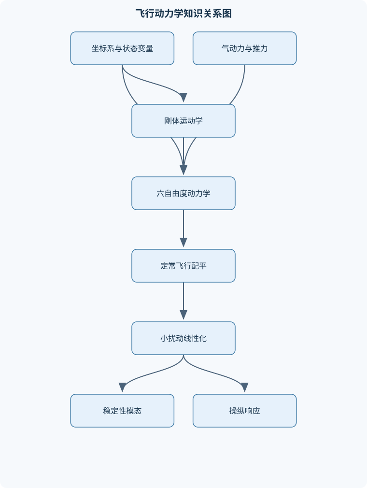
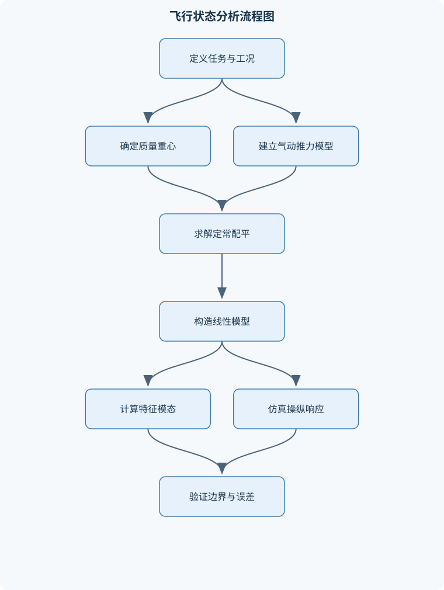

# 飞行器飞行动力学

## 一、课程整体知识框架

### 课程边界与先修知识

《飞行器飞行动力学》研究飞行器在大气或近地空间环境中的运动规律、受力与力矩、姿态与轨迹响应、配平、稳定性及操纵特性。课程边界覆盖刚体六自由度运动学与动力学、飞行器气动导数、发动机推力与重力模型、飞行状态方程、定常飞行配平、线性化、小扰动稳定性、纵向与侧向运动模态、操纵响应、飞行品质基础和数值仿真。重点对象为固定翼飞行器，也可将旋翼飞行器、导弹或再入飞行器作为模型扩展，但不系统展开旋翼气动、弹性飞行器气动弹性、结构强度、发动机内部循环和完整飞行控制律设计。先修知识包括高等数学与常微分方程、线性代数、理论力学与刚体动力学、流体力学基础、空气动力学基础、坐标变换与向量运算，以及基本数值计算。课程应明确区分理想刚体、定常流、平面运动、小扰动、定常质量和常值重力等理想假设与真实飞行中的非定常气动、质量变化、结构弹性、风场、传感器误差和执行机构限制。





### 1. 研究对象、任务与基本边界

飞行动力学研究飞行器作为整体在大气或近地空间环境中的运动规律，核心问题包括：飞行器受到哪些力和力矩；这些外部作用如何改变速度、位置、姿态和角速度；在给定速度、高度、质量和操纵状态下是否能够配平；扰动发生后运动是否恢复、衰减或发散；操纵输入如何转化为轨迹和姿态响应。固定翼飞行器是课程的主要对象，旋翼飞行器、导弹和再入飞行器可用于说明模型扩展，但不系统展开旋翼诱导速度、弹性气动弹性、结构强度、发动机内部循环和完整飞行控制律设计。

课程通常把飞行器近似为刚体，即任意两点间距离在运动中保持不变。该假设使飞行器只具有三个平动自由度和三个转动自由度，共六个自由度。刚体假设适用于结构变形相对于飞行器尺度很小、变形对气动力和惯量影响可以忽略的情况；当机翼大挠度、液体晃荡、阵风载荷或高速气动弹性显著时，需要引入柔性结构模态，刚体六自由度模型只能作为低阶近似。

课程先修内容包括高等数学与常微分方程、线性代数、理论力学和刚体动力学、流体力学、空气动力学、向量运算与坐标变换，以及基本数值计算。飞行动力学并不是单纯的受力平衡计算：静力学给出某一状态的平衡条件，动力学还必须描述加速度、角速度耦合、惯量效应和时间响应。

### 2. 坐标系、状态量与符号约定

课程采用右手正交坐标系。惯性坐标系记为 $I$，地固或导航坐标系记为 $N$，机体坐标系记为 $B$，风轴系记为 $W$。机体系 $x$ 轴指向机头，$y$ 轴指向机体右侧，$z$ 轴指向机体下方。位置向量记为 $\boldsymbol r$，速度向量记为 $\boldsymbol V$，加速度向量记为 $\boldsymbol a$；机体系速度分量为 $u,v,w$，单位为 $\mathrm{m/s}$。滚转、俯仰、偏航角速度分别为 $p,q,r_\omega$，单位为 $\mathrm{rad/s}$；使用 $r_\omega$ 表示偏航角速度，以免与位置向量 $\boldsymbol r$ 混淆。

姿态采用常见的 3-2-1 欧拉角顺序，滚转角为 $\phi$，俯仰角为 $\theta$，偏航角为 $\psi$。航迹倾角为 $\gamma$，航向角为 $\chi$，迎角为 $\alpha$，侧滑角为 $\beta$。姿态角描述机体相对于参考坐标系的方向，航迹角和航向角描述速度方向，迎角与侧滑角描述相对气流方向，四者不能混同。例如，飞机可以保持机头水平而沿下降航迹飞行，此时俯仰角与航迹倾角不必相等；有风时，航向角也不必等于地面航迹角。

状态向量记为 $\boldsymbol x$，控制输入记为 $\boldsymbol u_c$，外部扰动记为 $\boldsymbol d$，非线性模型写为

$$
\dot{\boldsymbol x}=\boldsymbol f(\boldsymbol x,\boldsymbol u_c,\boldsymbol d,t),
$$

输出方程写为

$$
\boldsymbol y=\boldsymbol h(\boldsymbol x,\boldsymbol u_c,\boldsymbol d,t).
$$

这里的 $\boldsymbol u_c$ 是控制输入向量，不应与机体系前向速度分量 $u$ 混淆。常见状态包括位置、速度、姿态角和角速度，也可根据分析目的选用速度、迎角、侧滑角、角速度和姿态变量。

### 3. 外力、外力矩与气动量

飞行器主要受到重力、气动力和推力。质量为 $m$，重力加速度为 $g$，重量为

$$
W=mg,
$$

其中 $W$ 的单位为 $\mathrm N$。基础模型通常将重力视为常值，并忽略地球自转和重力随高度的变化；在远程弹道、再入或高精度导航问题中，这些效应不能继续忽略。重力在导航系中通常沿竖直方向，转换到机体系后会随滚转角和俯仰角变化，不能直接把重力全部写入机体 $z$ 轴。

机体系中的力分量记为 $X,Y,Z$，分别沿机体 $x,y,z$ 轴；力矩记为 $L,M,N$，分别表示滚转、俯仰和偏航力矩。为避免与升力符号混淆，升力可写为 $L_{\mathrm{aero}}$，而滚转力矩仍记为 $L$。在风轴系中，气动力通常分解为升力、阻力和侧力；转换到机体系后，迎角和侧滑角会使各分量发生耦合。升力方向也不总是等同于机体竖直方向，尤其在大迎角、侧滑或非定常运动中，必须先声明分解坐标系。

相对气流速度的大小为 $V$，空气密度为 $\rho$，动压定义为

$$
q_\infty=\frac{1}{2}\rho V^2,
$$

单位为 $\mathrm{Pa}$。参考面积为 $S$，平均气动弦长为 $c$，翼展为 $b$。气动力系数 $C_L,C_D,C_Y$ 无量纲，气动力矩系数 $C_l,C_m,C_n$ 也无量纲。相应关系为

$$
L_{\mathrm{aero}}=q_\infty S C_L,\qquad
D=q_\infty S C_D,\qquad
Y_{\mathrm{aero}}=q_\infty S C_Y,
$$

以及

$$
L=q_\infty S b C_l,\qquad
M=q_\infty S c C_m,\qquad
N=q_\infty S b C_n.
$$

这些式子的适用前提是参考面积、参考长度、系数定义和参考点已经统一。若气动矩从机翼气动中心换算到质心，必须增加力臂叉乘项；更换参考面积或参考长度后，系数不能原样沿用。

马赫数和雷诺数分别描述可压缩性和黏性相似性：

$$
M_\infty=\frac{V}{a},\qquad
Re=\frac{\rho V L}{\mu},
$$

其中 $a$ 为当地声速，$\mu$ 为动力黏度，$L$ 为特征长度。动压主要反映速度造成的压力尺度，马赫数决定压缩性影响，雷诺数反映黏性效应的相似程度，三者不能互相替代。

### 4. 六自由度运动学与动力学

质心平动满足牛顿第二定律。若在惯性系中表示，基本形式为

$$
m\left(\frac{d\boldsymbol V}{dt}\right)_I=\sum\boldsymbol F.
$$

若速度分量在旋转机体系中表示，则必须使用旋转坐标系导数关系

$$
\left(\frac{d\boldsymbol V}{dt}\right)_I
=
\left(\frac{d\boldsymbol V}{dt}\right)_B+
\boldsymbol\omega\times\boldsymbol V,
$$

其中 $\boldsymbol\omega=(p,q,r_\omega)^T$。因此，机体系力方程中会出现角速度与速度的乘积项。例如，在忽略质量变化且采用体轴分量时，平动方程具有如下结构：

$$
m(\dot u+q w-r_\omega v)=X+X_g+X_T,
$$

$$
m(\dot v+r_\omega u-pw)=Y+Y_g+Y_T,
$$

$$
m(\dot w+p v-q u)=Z+Z_g+Z_T.
$$

其中 $X_g,Y_g,Z_g$ 为重力分量，$X_T,Y_T,Z_T$ 为推力分量。这些乘积项不是额外外力，而是由于机体系正在旋转，速度分量的坐标表示随时间变化。

转动动力学来自角动量定理：

$$
\boldsymbol J\dot{\boldsymbol\omega}
+\boldsymbol\omega\times(\boldsymbol J\boldsymbol\omega)
=
\boldsymbol M.
$$

$\boldsymbol J$ 必须相对于同一参考点和同一坐标系给出。若机体轴是主惯量轴，惯量矩阵为对角矩阵，则三轴方程可展开为

$$
I_x\dot p+(I_z-I_y)q r_\omega=L,
$$

$$
I_y\dot q+(I_x-I_z)p r_\omega=M,
$$

$$
I_z\dot r_\omega+(I_y-I_x)pq=N.
$$

当惯性积不为零时，$\boldsymbol J$ 不是对角矩阵，惯性耦合项还会通过矩阵乘法产生附加项。把惯量矩阵取错参考点，或把机体惯量与质心惯量混用，会直接造成角加速度错误。

姿态运动学把角速度与姿态参数联系起来。欧拉角形式可写成

$$
\begin{bmatrix}
\dot\phi\\
\dot\theta\\
\dot\psi
\end{bmatrix}
=
\boldsymbol T(\phi,\theta)
\begin{bmatrix}
p\\q\\r_\omega
\end{bmatrix},
$$

矩阵 $\boldsymbol T$ 含有 $\tan\theta$ 和 $\sec\theta$ 项，在 $\theta$ 接近 $\pm90^\circ$ 时出现奇异性。方向余弦矩阵没有欧拉角奇异性，但数值积分后需要维持正交性；四元数能避免欧拉角奇异性，适合大机动姿态积分，但必须保持单位范数。方向余弦矩阵从机体系到导航系还是反向转换，必须在定义时明确；其正交性应满足

$$
\boldsymbol C^T\boldsymbol C=\boldsymbol I,\qquad
\det(\boldsymbol C)=1.
$$

### 5. 气动、推进与环境耦合

升力通常随迎角增加而增加，但线性升力曲线只在附着流和有限迎角范围内成立。超过失速边界后，流动分离会使升力斜率下降，阻力快速增加，简单的 $C_L=C_{L0}+C_{L\alpha}\alpha$ 模型失效。阻力极线常写为

$$
C_D=C_{D0}+kC_L^2,
$$

其中 $C_{D0}$ 为零升阻力系数，$kC_L^2$ 表示诱导阻力的简化项。由平飞升力条件可得

$$
C_L=\frac{W}{q_\infty S}.
$$

在极线模型成立且未进入失速区时，最大升阻比对应的条件为

$$
C_{L,\mathrm{opt}}=\sqrt{\frac{C_{D0}}{k}}.
$$

该结论不适用于强可压缩流动、明显分离流或气动构型随速度变化显著的情况。

推进模型应给出推力随速度、高度、发动机状态和操纵量的变化。推力线不经过质心时会产生附加俯仰、偏航或滚转力矩；双发推力不对称还会形成偏航耦合。喷气发动机和螺旋桨推进的推力变化规律不同，不能仅用一个常值推力覆盖全部飞行状态。发动机转子或螺旋桨旋转还可能产生陀螺效应，其力矩方向取决于转动方向和机体角速度。

风场和阵风通过相对气流影响气动力。地速是飞行器相对于地面的速度，相对气流速度是飞行器相对于空气的速度；风不一定改变瞬时相对气流的定义方式，但会改变地面轨迹、航向修正和导航结果。阵风导致迎角、侧滑角和动压快速变化，定常气动模型只能提供近似。

### 6. 定常飞行、性能与配平

配平不是速度、姿态和操纵量都为零，而是选定飞行状态下状态导数满足规定平衡条件。定常直线平飞通常要求

$$
L_{\mathrm{aero}}=W,\qquad T=D,
$$

并且俯仰、滚转和偏航力矩平衡。由升力方程可得

$$
C_L=\frac{W}{\frac12\rho V^2S}.
$$

若在附着流范围内采用

$$
C_L=C_{L0}+C_{L\alpha}\alpha+C_{L\delta_e}\delta_e,
$$

则可由升力平衡求迎角或升降舵偏角；还必须同时满足俯仰力矩平衡，不能只使用一个升力方程决定两个未知量。

定常爬升时，沿航迹方向和法向分别有

$$
T-D-W\sin\gamma=0,
$$

$$
L-W\cos\gamma=0.
$$

小爬升角且单位为弧度时，$\sin\gamma\approx\gamma$，因此可近似写成 $T-D\approx W\gamma$。当爬升角较大、速度较低或需要高精度性能评估时不能使用该近似。协调定常转弯、忽略侧滑和风时，垂向与水平受力给出

$$
n=\frac{L_{\mathrm{aero}}}{W}=\frac{1}{\cos\phi},
$$

$$
R=\frac{V^2}{g\tan\phi},\qquad
\Omega=\frac{g\tan\phi}{V}.
$$

滚转角接近 $90^\circ$ 时，理论载荷因子会急剧增大，结构、失速、发动机推力和操纵限制会使理想公式不再代表可实现状态。

重心位置影响静稳定、配平和阻力。重心前移通常增加纵向静稳定裕度，但需要更大的尾翼配平力矩，可能增加配平阻力；重心后移可降低配平阻力并提高操纵灵敏度，却可能减小恢复力矩，甚至导致静不稳定。配平求解必须检查力和力矩残差、迎角是否超过失速范围、舵面是否饱和、推力是否在可用范围内。

### 7. 线性化、稳定性、操纵性与响应

在配平点 $(\boldsymbol x_0,\boldsymbol u_{c0})$ 附近令

$$
\boldsymbol x=\boldsymbol x_0+\delta\boldsymbol x,\qquad
\boldsymbol u_c=\boldsymbol u_{c0}+\delta\boldsymbol u_c.
$$

对非线性方程作一阶泰勒展开，若配平点满足 $\boldsymbol f(\boldsymbol x_0,\boldsymbol u_{c0})=0$，则得到

$$
\delta\dot{\boldsymbol x}
=
\boldsymbol A\delta\boldsymbol x+
\boldsymbol B\delta\boldsymbol u_c,
$$

其中

$$
\boldsymbol A=
\left.\frac{\partial\boldsymbol f}{\partial\boldsymbol x}\right|_0,
\qquad
\boldsymbol B=
\left.\frac{\partial\boldsymbol f}{\partial\boldsymbol u_c}\right|_0.
$$

二阶及以上扰动项被忽略的前提是扰动足够小、模型在配平点附近连续可微，且气动、推力和执行机构没有发生不连续切换。大迎角失速、舵面饱和和结构非线性状态下，线性模型只能作为局部近似。

纵向运动常选择速度、迎角、俯仰角速度、俯仰角或航迹倾角等变量；侧向运动常选择侧滑角、滚转角速度、偏航角速度和滚转角。对称飞行、惯量和气动导数满足相应对称条件且输入不破坏对称性时，纵向与侧向运动可以近似解耦；存在侧滑、推力线偏置、非对称挂载或强机动时，不能强行分开。

线性系统的特征值由

$$
\det(\lambda\boldsymbol I-\boldsymbol A)=0
$$

确定。所有特征值实部小于零时，局部线性模型渐近稳定；存在正实部时局部不稳定；实部为零时不能仅凭线性特征值判断非线性系统稳定性。二阶模态的特征根可写成

$$
\lambda_{1,2}=-\zeta\omega_n
\pm
\mathrm i\omega_n\sqrt{1-\zeta^2},
$$

其中 $\omega_n$ 为自然频率，$\zeta$ 为阻尼比。短周期模态主要表现为迎角和俯仰角速度快速变化，长周期或短语为 phugoid 的模态主要表现为速度与高度、航迹倾角之间的缓慢交换。侧向运动通常包含滚转模态、荷兰滚模态和螺旋模态，但不能只按名称判断，必须结合特征值、特征向量和状态参与度识别。

稳定性描述扰动是否具有恢复趋势，操纵性描述控制输入能否以足够快、足够大的幅度改变状态。升降舵、副翼和方向舵的操纵效率受气动速度、舵面面积、铰链力矩、执行机构速率和舵偏限制影响。传感器延迟、噪声、坐标安装误差和执行机构饱和会改变实际响应，因此开环飞行动力学模型必须明确与传感器、执行机构和闭环控制器的接口。

### 8. 仿真、试验与模型可信度

六自由度仿真的基本链条是：读取质量、惯量、气动和推进模型；根据姿态和位置计算坐标变换；计算相对气流、马赫数、雷诺数和动压；求气动力和力矩；代入平动与转动方程；数值积分更新状态。无外力无力矩时，平动和转动方程应退化到相应的自由运动形式；方向余弦矩阵应保持正交；所有角度单位、长度单位和力矩单位必须一致。

欧拉法每一步使用当前斜率，局部截断误差为较低阶；四阶龙格—库塔法通过多个中间斜率提高精度，但计算量增加。数值稳定性与物理稳定性不是同一个概念：物理系统可能稳定，而过大的积分步长使数值解发散；物理系统可能不稳定，而高精度积分仍会正确显示发散。时间尺度差异大或模型具有刚性时，应采用具有相应稳定性的积分方法。

风洞试验、飞行试验和参数辨识用于检验气动导数、推力模型和响应预测。数据处理应包括时间同步、单位校准、坐标系确认、传感器延迟补偿、异常点筛查和独立验证。训练数据与验证数据必须分离；若模型只在单一速度、单一迎角下拟合良好，不能据此声称其在全包线内有效。

## 二、章节和模块划分

### 核心知识覆盖清单

本清单用于检查正文是否覆盖本课程的主要知识模块：

- **飞行动力学基本概念与坐标系**：飞行器质心与刚体假设、惯性坐标系与地固坐标系、机体轴系与风轴系、航迹角、航向角与姿态角、欧拉角与方向余弦矩阵、角速度与姿态运动学、质量、重心与转动惯量、飞行状态变量和输入变量。
- **飞行器外力与外力矩模型**：重力及其坐标分量、升力、阻力与侧力、推力方向和推力矩、气动力作用点与气动焦点、压心、重心和气动中心、动压与马赫数、气动力系数和参考量、气动导数及其物理含义、风场、阵风与相对气流。
- **刚体六自由度运动学**：质心平动运动学、机体速度分量与地速关系、机体角速度与欧拉角速率、方向余弦矩阵变换、地理坐标系中的位置运动、欧拉角奇异性、四元数姿态表示、平动与转动耦合关系。
- **刚体六自由度动力学**：牛顿第二定律在机体系中的表达、欧拉转动方程、惯性积和惯量矩阵、体轴力方程、体轴力矩方程、质量变化对动力学的影响、推力和发动机陀螺效应、六自由度非线性状态方程、动力学方程的建模假设。
- **空气动力学与推进耦合**：升力曲线与失速边界、阻力极线与诱导阻力、侧力和方向舵效应、纵向力矩系数、横侧向力矩系数、发动机推力模型、螺旋桨或喷气推力变化、推力线偏置与偏航滚转耦合、雷诺数、马赫数和相似准则。
- **定常飞行与飞行性能**：定常直线平飞条件、爬升和下降平衡、转弯飞行受力平衡、过载与载荷因子、失速速度与限制因素、最大平飞速度、爬升率和剩余推力、航程与续航的能量关系、滑翔性能与滑翔比。
- **配平与飞行状态求解**：配平状态定义、纵向配平变量、侧向方向配平、配平方程组、配平点存在性与多解性、配平对重心位置的影响、配平对推力和升降舵的影响、数值配平方法、配平结果的物理校验。
- **小扰动线性化与气动导数**：非线性状态方程线性化、扰动变量与基准状态、雅可比矩阵、纵向与侧向解耦条件、稳定性导数的定义、控制导数的定义、无量纲化与量纲一致性、线性模型适用范围、时变和非定常线性模型。
- **纵向运动稳定性与响应**：纵向状态变量选择、短周期模态、长周期或 phugoid 模态、纵向特征方程、静稳定与动稳定、升降舵输入响应、速度和迎角响应、俯仰角与航迹角响应、阻尼和自然频率。
- **侧向与方向运动稳定性**：侧向状态变量选择、滚转模态、荷兰滚模态、螺旋模态、方向舵输入响应、副翼输入响应、侧滑角与侧力、滚转角速度和偏航角速度耦合、侧向静稳定条件。
- **操纵性、飞行品质与控制接口**：操纵性与稳定性的区别、升降舵操纵效率、副翼和方向舵操纵效率、舵面铰链力矩、静操纵稳定性、飞行品质指标的物理含义、执行机构动态与饱和、传感器坐标和测量误差、开环响应与闭环接口。
- **仿真、试验与模型验证**：状态方程数值积分、初始条件和输入定义、线性模型与非线性模型对比、时域响应和频域响应、风洞与飞行试验数据、参数辨识基本流程、误差来源与不确定性、稳定性结果交叉验证、模型适用边界与报告规范。


### 1. 代表性计算流程一：定常飞行配平

**输入：** 高度、速度、质量、重心位置、气动系数模型、推力模型和候选操纵量。  
**输出：** 迎角、升降舵偏角、推力以及必要的滚转和方向舵配平量。  
**过程：**

1. 根据高度求空气密度 $\rho$，根据速度计算动压 $q_\infty=\frac12\rho V^2$。
2. 写出纵向力平衡、法向力平衡和俯仰力矩平衡方程。
3. 选择迎角、升降舵偏角和推力等为未知量。
4. 用牛顿法、拟牛顿法或阻尼最小二乘法迭代求解残差方程。
5. 检查力和力矩残差、迎角、舵偏、推力及失速边界。
6. 若残差无法收敛，应判断是初值不佳、方程无解、变量越界，还是气动模型存在不连续。

配平算法的终止条件应同时包括残差范数和变量增量，而不能只看迭代次数。若每次残差计算成本为 $O(C_f)$，迭代 $K$ 次时总计算量约为 $O(KC_f)$。配平点可能不存在，也可能存在多个，例如高升力低速支路和高速低迎角支路；必须结合物理边界筛选，而不能只接受数值求解器返回的任意根。

### 2. 代表性计算流程二：非线性六自由度仿真

**输入：** 初始位置、速度、姿态和角速度；质量与惯量；重力模型；气动和推进模型；控制输入时间历程；仿真终止时间。  
**输出：** 位置、速度、姿态、角速度、气动力、力矩和事件记录。  
**不变量与检查量：** 单位一致、方向余弦矩阵近似正交、无外力无力矩极限正确、状态没有超出模型适用域。  
**流程：**

1. 用姿态变量把机体系速度转换到导航系，更新位置。
2. 计算风场下的相对气流速度、迎角和侧滑角。
3. 计算 $M_\infty$、$Re$、$q_\infty$ 和气动系数。
4. 根据参考面积、弦长和翼展计算气动力与力矩。
5. 将重力、推力和气动力转换到统一坐标系。
6. 代入平动和转动动力学方程。
7. 用数值积分器更新状态，并监测高度、速度、姿态、失速和舵面饱和事件。

以下为不依赖外部文件或联网的四阶龙格—库塔伪代码，状态方程函数 `f` 返回 $\dot{\boldsymbol x}$。

```python
import numpy as np

def rk4_step(f, t, x, dt, control):
    """对 x_dot = f(t, x, control) 做一个四阶龙格—库塔步进。"""
    k1 = f(t, x, control)
    k2 = f(t + 0.5 * dt, x + 0.5 * dt * k1, control)
    k3 = f(t + 0.5 * dt, x + 0.5 * dt * k2, control)
    k4 = f(t + dt, x + dt * k3, control)
    return x + (dt / 6.0) * (k1 + 2.0 * k2 + 2.0 * k3 + k4)

def simulate(f, x0, t0, tf, dt, control_function):
    """返回时间数组和状态数组；不执行文件、网络或系统操作。"""
    times = [t0]
    states = [np.asarray(x0, dtype=float).copy()]
    t = t0
    x = states[0]

    while t < tf - 1e-12:
        h = min(dt, tf - t)
        control = control_function(t, x)
        x = rk4_step(f, t, x, h, control)
        t += h
        times.append(t)
        states.append(x.copy())

    return np.asarray(times), np.asarray(states)
```

该流程适用于状态方程连续可计算、刚体模型有效且时间步长满足精度和稳定性要求的情况。若使用欧拉角且 $\theta$ 接近 $\pm90^\circ$，应改用四元数或方向余弦矩阵；若质量随时间显著变化，则必须采用变质量动力学，不能只在定质量方程中把 $m$ 替换为 $m(t)$。

### 3. 代表性计算流程三：数值线性化与模态分析

**输入：** 非线性状态方程、已验证的配平状态 $(\boldsymbol x_0,\boldsymbol u_{c0})$ 和扰动步长。  
**输出：** 状态矩阵 $\boldsymbol A$、输入矩阵 $\boldsymbol B$、特征值、自然频率和阻尼比。  
**步骤：**

1. 先验证 $\boldsymbol f(\boldsymbol x_0,\boldsymbol u_{c0})$ 接近零。
2. 对每个状态分量施加正负扰动，用中心差分估算偏导。
3. 对每个控制输入重复该过程，形成 $\boldsymbol B$。
4. 检查矩阵维数、单位和不同步长下的收敛性。
5. 求解特征值，检查复根是否成共轭对。
6. 根据时间尺度、特征向量和主要状态参与度识别模态。

若状态维数为 $n$、输入维数为 $m$，中心差分通常需要约 $2(n+m)$ 次函数评价。步长过大时会引入非线性截断误差，过小时会放大舍入误差；应通过多组步长比较矩阵变化，而不能盲选一个步长。

### 4. 代表性例题

#### 例题一：平飞所需升力系数与迎角

**题干：** 某固定翼飞行器质量为 $1200\ \mathrm{kg}$，翼面积为 $16\ \mathrm{m^2}$，高度处空气密度为 $1.225\ \mathrm{kg/m^3}$，速度为 $50\ \mathrm{m/s}$，取 $g=9.81\ \mathrm{m/s^2}$。已知附着流范围内 $C_L=0.25+5.2\alpha$，其中 $\alpha$ 用弧度表示。求平飞所需 $C_L$ 和迎角。

**分析：** 平飞且无垂向加速度时，升力等于重量。假设无侧滑、忽略风、气动模型在该迎角范围内有效。

**解答：**

1. 重量为
   $$
   W=mg=1200\times9.81=11772\ \mathrm N.
   $$
2. 动压为
   $$
   q_\infty=\frac12\rho V^2
   =\frac12\times1.225\times50^2
   =1531.25\ \mathrm{Pa}.
   $$
3. 平飞所需升力系数为
   $$
   C_L=\frac{W}{q_\infty S}
   =\frac{11772}{1531.25\times16}
   \approx0.481.
   $$
4. 由升力曲线求迎角：
   $$
   \alpha=\frac{C_L-0.25}{5.2}
   \approx0.0444\ \mathrm{rad}
   \approx2.54^\circ.
   $$

**结果验证：** 将 $C_L$ 代回 $q_\infty S C_L$ 可恢复约 $11772\ \mathrm N$。若该迎角低于失速迎角，线性模型可接受；若超过失速迎角，数值结果虽满足代数方程，但不代表真实平飞状态。

**变式：** 若速度降低，动压按 $V^2$ 下降，为保持同样重量所需 $C_L$ 增大，迎角上升；达到最大升力系数时，继续减速将无法维持平飞。

#### 例题二：阻力极线与最大升阻比

**题干：** 已知阻力极线为 $C_D=0.025+0.045C_L^2$。求最大升阻比对应的升力系数和最大升阻比。

**分析：** 在极线模型有效、未失速且忽略压缩性变化时，最大升阻比等价于最小化 $C_D/C_L$。

**解答：**

$$
\frac{C_D}{C_L}=\frac{C_{D0}}{C_L}+kC_L.
$$

对 $C_L$ 求导并令其为零：

$$
-\frac{C_{D0}}{C_L^2}+k=0,
$$

因此

$$
C_{L,\mathrm{opt}}
=
\sqrt{\frac{C_{D0}}{k}}
=
\sqrt{\frac{0.025}{0.045}}
\approx0.745.
$$

此时

$$
C_D=0.025+0.045(0.745)^2\approx0.050.
$$

所以

$$
\left(\frac{L}{D}\right)_{\max}
=
\frac{C_L}{C_D}
\approx\frac{0.745}{0.050}
\approx14.9.
$$

**结果验证：** 在最优点，零升阻力项与诱导阻力项相等，即 $C_{D0}=kC_L^2$，本题两项均约为 $0.025$。

**变式：** 最大航程速度不一定等于最大升阻比速度，因为推进系统效率、重量变化和风场会改变航程目标；最大续航还涉及单位时间耗油率或功率需求。

#### 例题三：协调定常转弯

**题干：** 飞行速度为 $80\ \mathrm{m/s}$，滚转角为 $30^\circ$，忽略侧滑、风和推力对水平向心力的直接贡献，取 $g=9.81\ \mathrm{m/s^2}$。求载荷因子、转弯半径和转弯率。

**解答：**

1. 载荷因子：
   $$
   n=\frac{1}{\cos30^\circ}\approx1.155.
   $$
2. 转弯半径：
   $$
   R=\frac{V^2}{g\tan30^\circ}
   =\frac{80^2}{9.81\times0.577}
   \approx1131\ \mathrm m.
   $$
3. 转弯率：
   $$
   \Omega=\frac{g\tan30^\circ}{V}
   \approx0.0708\ \mathrm{rad/s}.
   $$

**分析与验证：** 升力的竖直分量平衡重量，水平分量提供向心力。滚转角增大时载荷因子和转弯率增加，但转弯半径在速度不变时减小。实际飞行还受失速速度、结构载荷、方向舵协调和发动机推力限制。

**变式：** 有风时，空速决定瞬时气动力和理想转弯关系，地速轨迹还会受到风矢量影响，地面转弯半径不能直接套用无风结果。

#### 例题四：爬升所需推力

**题干：** 飞行器以 $V=100\ \mathrm{m/s}$、$\gamma=5^\circ$ 定常爬升，重量为 $20000\ \mathrm N$，阻力为 $3500\ \mathrm N$。求所需推力。

**解答：** 沿航迹方向平衡：

$$
T-D-W\sin\gamma=0.
$$

因此

$$
T=D+W\sin5^\circ
=3500+20000\times0.0872
\approx5244\ \mathrm N.
$$

法向平衡要求

$$
L=W\cos5^\circ\approx19924\ \mathrm N.
$$

**结果验证：** 若可用推力小于 $5244\ \mathrm N$，该速度和爬升角不能保持定常爬升；若可用推力大于此值，剩余推力可转化为更大的爬升角或加速。

**变式：** 俯仰角不等于航迹倾角。两者之差近似与迎角有关，不能用俯仰角直接代替 $\gamma$。

#### 例题五：线性系统特征根

**题干：** 某二阶纵向模态特征根为 $\lambda_{1,2}=-0.8\pm2.4\mathrm i$。求自然频率、阻尼比，并判断局部稳定性。

**解答：**

自然频率为

$$
\omega_n=\sqrt{(-0.8)^2+2.4^2}
=\sqrt{6.4}
\approx2.53\ \mathrm{rad/s}.
$$

阻尼比为

$$
\zeta=\frac{0.8}{2.53}\approx0.316.
$$

由于特征根实部为 $-0.8<0$，该线性模态局部渐近稳定，并表现为衰减振荡。

**结果验证：** 特征根必须满足共轭关系，且 $\zeta$ 位于 $0$ 与 $1$ 之间，说明是欠阻尼振荡模态。

**变式：** 若实部变为正值，振荡幅值会随时间增长；若实部为零，则还需考察非线性项和高阶效应，不能直接断言稳定。

### 5. 实验与项目一：刚体六自由度仿真验证

**输入数据：** 质量、惯量矩阵、参考面积、弦长、翼展、简化气动系数、推力模型、初始状态和控制输入。  
**步骤：**

1. 明确坐标轴方向、角度单位和力矩正方向。
2. 建立重力坐标转换、气动力计算和平动转动方程。
3. 使用欧拉法和四阶龙格—库塔法分别积分。
4. 设置无外力无力矩、恒定推力和阶跃舵面等工况。
5. 比较不同步长下的位置、姿态、速度和角速度响应。
6. 对照线性模型和非线性模型在小扰动下的差异。

**评价标准：** 单位一致；方向余弦矩阵正交性误差受控；无外力无力矩极限符合理论；减小步长后结果收敛；小扰动范围内线性与非线性响应趋势一致。

**排错方法：**

- 若静止状态出现加速度，检查重力方向和配平条件；
- 若无力矩却出现异常角加速度，检查惯量矩阵和叉乘项；
- 若姿态矩阵逐渐失去正交性，检查更新方法和归一化处理；
- 若舵面输入方向相反，检查控制导数符号和舵偏正方向；
- 若减小步长后结果不收敛，检查模型不连续、单位错误或积分器实现。

### 6. 实验与项目二：气动导数辨识与线性模型验证

**输入数据：** 时间同步的速度、迎角、侧滑角、角速度、姿态角、舵面偏角、发动机状态和环境数据。  
**步骤：**

1. 将所有数据统一为国际单位制，并确认机体系和风轴系定义。
2. 剔除传感器失真、明显丢样和时间不同步片段。
3. 选取具有足够舵面激励的试验段。
4. 建立包含迎角、角速度和舵面偏角的气动力矩模型。
5. 用最小二乘或最大似然方法估计气动导数。
6. 使用独立数据验证预测力、力矩和状态响应。
7. 按速度、高度、迎角和侧滑角划分适用范围。

**评价标准：** 参数符号与坐标约定一致；训练数据残差不能掩盖系统性趋势；验证数据误差处于预先设定范围；改变扰动步长或数据子集后参数不应发生无物理依据的剧烈变化；估计结果应通过量纲、对称性和稳定性检查。

**排错方法：**

- 参数高度相关时，增加激励类型或缩小同时估计的参数集合；
- 残差有明显周期性时，检查传感器延迟和未建模动态；
- 纵向参数符号异常时，重新确认迎角正方向和俯仰力矩正方向；
- 训练误差很小而验证误差很大时，检查过拟合、工况变化和数据泄漏；
- 在失速或舵面饱和区辨识失败时，应使用分段非线性模型，不能继续套用单一线性导数。

## 三、核心概念的详细解释

### 1. 飞行动力学的建模对象与基本假设

飞行动力学研究飞行器质心的平动、绕质心的转动，以及外力和外力矩对这些运动的影响。固定翼飞行器的六自由度状态通常包括三个位置变量、三个速度变量、三个姿态变量和三个角速度变量。刚体假设认为飞行器内部任意两点间的距离保持不变，因此不单独描述机翼弯曲、机身扭转和舵面弹性变形。

刚体模型并不等于飞行器没有结构变形，而是把结构变形对气动力、惯量和控制响应的影响视为可以忽略。该假设适用于低阶飞行动力学分析、配平计算和小扰动稳定性分析；当结构模态频率接近飞行器短周期模态、机翼挠度显著改变局部迎角，或燃油晃荡显著改变质心位置时，应采用刚柔耦合模型或至少增加等效修正。

常见基础假设包括：质量和惯量在研究时间内近似不变；重力加速度为常值；大气流场在飞行器尺度内可用当地相对气流表示；气动力可由速度、密度、迎角、侧滑角、角速度和舵面偏角计算；地球自转和曲率在局部飞行分析中忽略。每一项假设都有适用边界。例如，燃料消耗明显时不能继续使用定质量方程；高超声速飞行或大高度变化时，重力、声速和空气密度不宜视为常值；失速、分离和强阵风条件下，气动力通常不再是迎角的单值线性函数。

### 2. 坐标系、姿态与飞行方向

惯性坐标系 $I$ 用于表达牛顿定律，地固或导航坐标系 $N$ 用于表达位置、高度和地面航迹，机体坐标系 $B$ 固连于飞行器，风轴系 $W$ 则随相对气流方向变化。本文采用右手坐标系，机体系 $x_B$ 轴指向机头，$y_B$ 轴指向机体右侧，$z_B$ 轴指向机体下方。机体系速度分量为 $u,v,w$，分别沿 $x_B,y_B,z_B$ 轴，单位为 $\mathrm{m/s}$。

迎角 $\alpha$ 描述机体纵向轴线与相对气流之间的夹角，侧滑角 $\beta$ 描述相对气流偏离机体对称面的程度。若忽略侧滑，常用关系为

$$
\alpha=\arctan\frac{w}{u}.
$$

在存在侧滑时，相对气流速度大小为

$$
V=\sqrt{u^2+v^2+w^2},
$$

而 $\alpha$、$\beta$ 的具体符号取决于相对气流和风轴的定义。工程计算中必须先固定约定，不能把“速度方向”“机头方向”和“来流方向”混用。

姿态角采用 3-2-1 欧拉角顺序：先绕参考系 $z$ 轴转偏航角 $\psi$，再绕中间轴转俯仰角 $\theta$，最后绕机体轴转滚转角 $\phi$。姿态角表示机体方向，而航迹倾角 $\gamma$ 和航向角 $\chi$ 表示速度方向。例如，水平定常飞行时若无风，机体俯仰角、航迹倾角和迎角之间通常满足近似关系

$$
\theta\approx\gamma+\alpha.
$$

该关系不是普遍恒等式。存在侧滑、风场、角速度或较大姿态变化时，应由速度向量和姿态变换直接计算。

### 3. 方向余弦矩阵与姿态运动学

设 $\boldsymbol v_B$ 是某向量在机体系中的分量，$\boldsymbol v_N$ 是同一向量在导航系中的分量，定义从机体系到导航系的方向余弦矩阵为 $\boldsymbol C_N^B$，则

$$
\boldsymbol v_N=\boldsymbol C_N^B\boldsymbol v_B.
$$

矩阵的第 $i$ 行表示导航系第 $i$ 个单位轴在机体系中的投影，或等价地表示机体系单位轴在导航系中的方向余弦，具体解释必须与矩阵下标约定保持一致。方向余弦矩阵满足

$$
(\boldsymbol C_N^B)^{\mathsf T}\boldsymbol C_N^B
=\boldsymbol I,
\qquad
\det(\boldsymbol C_N^B)=1.
$$

因此，逆变换为

$$
\boldsymbol v_B=(\boldsymbol C_N^B)^{\mathsf T}\boldsymbol v_N.
$$

正交性是数值仿真的重要检查量。若积分更新后矩阵不再满足正交性，说明姿态更新方法产生了累积误差，需要重新正交化，或改用四元数并在每一步归一化。

机体角速度在机体系中的分量为

$$
\boldsymbol\omega_B=
\begin{bmatrix}
p\\q\\r_\omega
\end{bmatrix},
$$

其中 $p,q,r_\omega$ 单位为 $\mathrm{rad/s}$。欧拉角速率与机体角速度的关系为

$$
\begin{bmatrix}
\dot\phi\\
\dot\theta\\
\dot\psi
\end{bmatrix}
=
\begin{bmatrix}
1 & \sin\phi\tan\theta & \cos\phi\tan\theta\\
0 & \cos\phi & -\sin\phi\\
0 & \sin\phi/\cos\theta & \cos\phi/\cos\theta
\end{bmatrix}
\begin{bmatrix}
p\\q\\r_\omega
\end{bmatrix}.
$$

当 $\cos\theta=0$ 时，矩阵出现奇异性，即俯仰角接近 $\pm90^\circ$ 时欧拉角不能稳定表示姿态。此时应采用四元数或方向余弦矩阵。四元数没有这种局部奇异性，但必须满足单位模约束。

### 4. 外力、外力矩与气动力参数

飞行器所受外力通常包括重力、气动力和推力。机体系力分量记为 $X,Y,Z$，分别沿机体 $x,y,z$ 轴；由于 $z_B$ 轴向下，传统飞行动力学中升力向上通常对应负的机体系 $Z$ 分量。滚转、俯仰、偏航力矩分别记为 $L,M,N$，单位为 $\mathrm{N\cdot m}$。为避免与升力 $L$ 混淆，具体推导中应通过上下文或使用“滚转力矩”明确说明。

重力在导航系中通常沿竖直向下方向，在机体系中的分量必须通过姿态变换得到。若导航系采用北—东—地坐标并令竖直向下为正，则重力向量可写成

$$
\boldsymbol W_N=
\begin{bmatrix}
0\\0\\mg
\end{bmatrix},
\qquad
\boldsymbol W_B=(\boldsymbol C_N^B)^{\mathsf T}\boldsymbol W_N.
$$

因此，滚转或俯仰变化会改变重力在机体系三个方向上的分量。把重力始终直接写成机体 $z$ 轴方向，是常见的坐标错误。

相对气流速度为 $V$ 时，动压定义为

$$
q_\infty=\frac12\rho V^2,
$$

其中 $\rho$ 为空气密度，单位为 $\mathrm{kg/m^3}$，$V$ 单位为 $\mathrm{m/s}$，因此 $q_\infty$ 单位为 $\mathrm{Pa}$。以参考面积 $S$、翼展 $b$ 和平均气动弦长 $c$ 定义无量纲气动力系数：

$$
L=q_\infty S C_L,
\qquad
D=q_\infty S C_D,
\qquad
Y=q_\infty S C_Y,
$$

$$
L_{\mathrm{roll}}=q_\infty S b C_l,
\qquad
M=q_\infty S c C_m,
\qquad
N=q_\infty S b C_n.
$$

这里 $C_l$ 是滚转力矩系数，不是升力系数。上述公式要求参考面积、参考长度、参考点和系数定义保持一致。若气动数据库从机翼参考点改为质心参考点，俯仰力矩系数不能直接沿用原值，必须进行力矩平移。

马赫数和雷诺数分别为

$$
M_\infty=\frac{V}{a},
\qquad
Re=\frac{\rho V L}{\mu},
$$

其中 $a$ 为当地声速，单位为 $\mathrm{m/s}$；$L$ 为特征长度，$\mu$ 为动力黏度，单位为 $\mathrm{Pa\cdot s}$。马赫数主要反映可压缩性，雷诺数反映黏性和流动尺度相似性，动压则主要反映速度和密度决定的压力尺度，三者不能相互替代。

### 5. 气动导数、静稳定与操纵性

在给定参考状态附近，气动力系数可以展开为迎角、侧滑角、无量纲角速度和舵面偏角的函数。例如纵向俯仰力矩可近似写为

$$
C_m=C_{m0}+C_{m\alpha}\alpha+C_{m q}\frac{qc}{2V}
+C_{m\delta_e}\delta_e.
$$

其中 $\delta_e$ 为升降舵偏角，$q$ 为俯仰角速度；为避免动压符号混淆，此处 $q$ 是角速度分量，动压仍记为 $q_\infty$。$C_{m\alpha}$ 是静稳定导数，$C_{mq}$ 是俯仰阻尼导数，$C_{m\delta_e}$ 是升降舵控制导数。

纵向静稳定的基本思想是：迎角受到正扰动后，应产生使迎角减小的恢复俯仰力矩。在常见符号约定下，若正迎角增大产生抬头力矩为正，则静稳定通常要求

$$
C_{m\alpha}<0.
$$

质心位于中性点之前通常有利于满足这一条件。重心后移会减小静稳定裕度，使配平所需升降舵偏角和配平阻力可能下降，但会降低恢复能力，并增加操纵和控制要求。该结论不能脱离速度、尾翼效率、推力线和气动非线性单独使用。

侧向方向运动中，侧滑角 $\beta$ 会引起侧力、偏航力矩和滚转力矩。方向稳定通常要求侧滑产生使机头回到相对气流方向的恢复偏航力矩。上反角、后掠翼和垂尾布局会改变侧滑—滚转耦合。由于不同教材对 $\beta$ 正方向、侧力正方向和偏航正方向可能采用不同约定，不能机械记忆导数符号，必须从“正侧滑产生何种恢复力矩”重新判断。

稳定性与操纵性是不同概念。稳定性描述扰动后系统是否具有恢复和衰减趋势，操纵性描述操纵输入能否产生足够、可控且不过度的运动响应。增大稳定裕度可能使飞行器更易恢复，但也可能降低升降舵操纵效率；减小稳定裕度可以提高机动性，却增加控制系统和飞行员工作负荷。

### 6. 配平、性能与运动模态

配平是指在给定环境、速度、质量和操纵条件下，所选状态变量的时间导数为零。配平不意味着所有速度、姿态和角速度都为零。例如，稳定爬升可以具有非零速度和非零航迹角，但速度大小、航迹角和姿态角保持不变。

定常直线平飞的主要平衡条件为

$$
L=W,\qquad T=D.
$$

定常爬升时，沿航迹方向和垂直航迹方向分别平衡：

$$
T-D-W\sin\gamma=0,
$$

$$
L-W\cos\gamma=0.
$$

小爬升角时 $\sin\gamma\approx\gamma$，可得

$$
T-D\approx W\gamma,
$$

其中 $\gamma$ 必须用弧度。若爬升角较大，该近似会产生明显误差。

协调定常转弯中，升力向量分解为竖直分量和水平向心分量。在无侧滑、无风、推力不参与水平向心支撑且滚转角为 $\phi$ 的条件下，

$$
L\cos\phi=W,
\qquad
L\sin\phi=\frac{mV^2}{R}.
$$

于是载荷因子、转弯半径和转弯率分别为

$$
n=\frac{L}{W}=\frac{1}{\cos\phi},
$$

$$
R=\frac{V^2}{g\tan\phi},
$$

$$
\Omega=\frac{V}{R}=\frac{g\tan\phi}{V}.
$$

当 $\phi$ 接近 $90^\circ$ 时，公式预测的载荷因子和转弯率急剧增大，但实际飞行受失速、结构载荷、推力和操纵限制，不能把该极限外推为可实现状态。

阻力极线常用模型为

$$
C_D=C_{D0}+kC_L^2.
$$

其中 $C_{D0}$ 为零升阻力系数，$kC_L^2$ 表示诱导阻力近似项。该模型适用于未失速、附着流占主导且压缩性不强的范围。由平飞条件

$$
C_L=\frac{W}{q_\infty S}
$$

可知，速度降低时所需 $C_L$ 增大，诱导阻力上升；速度升高时零升阻力对应的阻力增大。令总阻力最小，可得

$$
C_{L,\min D}=\sqrt{\frac{C_{D0}}{k}},
$$

并且最大升阻比满足

$$
\left(\frac{L}{D}\right)_{\max}
=\frac{1}{2\sqrt{C_{D0}k}}.
$$

这些结果在失速区、强可压缩流动和推力随速度显著变化时需要修正。

纵向线性模型通常包含短周期和长周期模态。短周期模态主要表现为迎角、俯仰角速度和俯仰姿态的快速变化；长周期模态，即 phugoid，主要表现为速度、高度和航迹角之间的缓慢交换。侧向运动常见滚转模态、荷兰滚模态和螺旋模态。滚转模态快速衰减或响应，荷兰滚表现为滚转与偏航耦合振荡，螺旋模态则通常是较慢的方向发散或衰减过程。模态名称不能只由振荡频率判断，还应结合特征向量中主要参与的状态。

## 四、重要定义、公式、定理和推导

### 专业审校补充：关键定义与适用边界

纵向静稳定性的核心判据是重心相对于中性点的位置。定义静稳定裕度为 $H_n=(x_{NP}-x_{CG})/\bar c$，其中 $x_{NP}$ 为中性点位置，$x_{CG}$ 为重心位置，$\bar c$ 为平均气动弦长，三者均沿机身纵向并采用同一参考点、同一正方向；无量纲量 $H_n>0$ 表示重心位于中性点前方，通常具有正的纵向静稳定性。在线性、小扰动、定常速度和固定构型条件下，纵向静稳定性通常要求 $C_{m_\alpha}=\partial C_m/\partial\alpha<0$。但 $H_n>0$ 不是动态稳定的充分条件，它只说明迎角发生微小增加时产生恢复俯仰力矩；短周期阻尼、质量惯量、气动阻尼导数和控制系统仍决定扰动是否随时间衰减。重心后移会减小静稳定裕度，可能降低配平阻力和升降舵需求，却增大操纵敏感性，并可能使 $C_{m_\alpha}$ 接近零甚至变号。该判据不宜直接用于大迎角、失速、强非定常流、构型变化或柔性结构显著的情形。


### 1. 六自由度刚体动力学推导

质心平动定理在惯性系中写为

$$
m\left(\frac{d\boldsymbol V}{dt}\right)_I=\sum\boldsymbol F.
$$

对任意向量，惯性系导数与机体系导数满足运输定理

$$
\left(\frac{d\boldsymbol V}{dt}\right)_I
=
\left(\frac{d\boldsymbol V}{dt}\right)_B
+\boldsymbol\omega_B\times\boldsymbol V.
$$

将

$$
\boldsymbol V_B=
\begin{bmatrix}
u\\v\\w
\end{bmatrix},
\qquad
\boldsymbol\omega_B=
\begin{bmatrix}
p\\q\\r_\omega
\end{bmatrix}
$$

代入叉乘式，有

$$
\boldsymbol\omega_B\times\boldsymbol V_B
=
\begin{bmatrix}
qw-r_\omega v\\
r_\omega u-pw\\
pv-qu
\end{bmatrix}.
$$

因此体轴力方程为

$$
m(\dot u+qw-r_\omega v)=X,
$$

$$
m(\dot v+r_\omega u-pw)=Y,
$$

$$
m(\dot w+pv-qu)=Z.
$$

这些乘积项不是新的外力，而是由于速度分量是在旋转机体系中表示，机体系本身的转动导致坐标分量发生变化。若误把机体系导数直接当作惯性系导数，就会遗漏这些耦合项。

绕质心的角动量定理为

$$
\boldsymbol M
=
\left(\frac{d\boldsymbol H}{dt}\right)_I,
\qquad
\boldsymbol H=\boldsymbol J\boldsymbol\omega_B.
$$

应用运输定理得到

$$
\boldsymbol J\dot{\boldsymbol\omega}_B
+\boldsymbol\omega_B\times(\boldsymbol J\boldsymbol\omega_B)
=\boldsymbol M.
$$

若机体系沿主惯量轴，惯量矩阵为

$$
\boldsymbol J=
\begin{bmatrix}
I_x&0&0\\
0&I_y&0\\
0&0&I_z
\end{bmatrix},
$$

则三轴欧拉方程为

$$
I_x\dot p+(I_z-I_y)qr_\omega=L,
$$

$$
I_y\dot q+(I_x-I_z)r_\omega p=M,
$$

$$
I_z\dot r_\omega+(I_y-I_x)pq=N.
$$

这些角速度乘积项反映转动惯量和角动量方向变化造成的陀螺耦合，不是额外施加的力矩。若惯性积不为零，$\boldsymbol J$ 不再是对角矩阵，三个轴的角加速度会进一步耦合。惯量必须相对于同一参考点和同一坐标系给出；将质心惯量直接用于任意参考点会违反平行轴定理。

### 2. 从非线性方程到线性小扰动模型

设非线性状态方程为

$$
\dot{\boldsymbol x}
=\boldsymbol f(\boldsymbol x,\boldsymbol u_c,\boldsymbol d,t),
$$

在定常配平点 $(\boldsymbol x_0,\boldsymbol u_{c0},\boldsymbol d_0)$ 附近定义

$$
\boldsymbol x=\boldsymbol x_0+\delta\boldsymbol x,
\qquad
\boldsymbol u_c=\boldsymbol u_{c0}+\delta\boldsymbol u_c.
$$

若配平条件满足

$$
\boldsymbol f(\boldsymbol x_0,\boldsymbol u_{c0},\boldsymbol d_0,t)=0,
$$

并且函数在该点附近一阶可微，则泰勒展开为

$$
\delta\dot{\boldsymbol x}
=
\boldsymbol A\delta\boldsymbol x
+\boldsymbol B\delta\boldsymbol u_c
+\boldsymbol E\delta\boldsymbol d
+\mathcal O(\|\delta\|^2),
$$

其中

$$
\boldsymbol A=
\left.\frac{\partial\boldsymbol f}{\partial\boldsymbol x}\right|_0,
\qquad
\boldsymbol B=
\left.\frac{\partial\boldsymbol f}{\partial\boldsymbol u_c}\right|_0.
$$

忽略二阶及更高阶项后，得到线性模型

$$
\delta\dot{\boldsymbol x}
=\boldsymbol A\delta\boldsymbol x
+\boldsymbol B\delta\boldsymbol u_c.
$$

若基准点并未配平，则常值残差会出现在方程右端，不能将其误认为扰动响应。线性模型只在扰动足够小、气动导数变化不大、执行机构未饱和且模型无强不连续时有效。进入失速、发生大舵偏或姿态接近欧拉角奇异点时，应回到非线性模型或使用分段线性模型。

### 3. 特征根、阻尼和稳定性

线性定常系统的零输入响应满足

$$
\delta\dot{\boldsymbol x}
=\boldsymbol A\delta\boldsymbol x.
$$

设响应形式为

$$
\delta\boldsymbol x=\boldsymbol v e^{\lambda t},
$$

代入可得

$$
(\lambda\boldsymbol I-\boldsymbol A)\boldsymbol v=0.
$$

存在非零特征向量的条件为

$$
\det(\lambda\boldsymbol I-\boldsymbol A)=0.
$$

若所有特征值满足 $\operatorname{Re}(\lambda_i)<0$，则线性系统局部渐近稳定；若存在实部大于零的特征值，则系统局部发散；若实部等于零，仅凭线性特征值不能确定非线性系统稳定性，还需研究高阶项、阻尼和非线性约束。

一对复特征根可写成

$$
\lambda_{1,2}=-\zeta\omega_n
\pm j\omega_n\sqrt{1-\zeta^2},
$$

其中 $\omega_n$ 为自然频率，单位为 $\mathrm{rad/s}$，$\zeta$ 为阻尼比。由根的实部和模可得

$$
\omega_n=\sqrt{\sigma^2+\omega_d^2},
\qquad
\zeta=-\frac{\sigma}{\omega_n},
$$

其中 $\lambda=\sigma\pm j\omega_d$。阻尼比描述振荡衰减相对于自然频率的程度，但不能单独代表全部飞行品质；实际响应还受输入通道、观测量、执行机构和结构限制影响。

### 4. 代表性算法与流程

#### 4.1 六自由度非线性仿真流程

**输入：** 质量与惯量、气动系数模型、推力模型、重力模型、初始位置和速度、初始姿态、初始角速度、控制输入时间历程及仿真终止时间。

**过程：**

1. 由姿态表示计算 $\boldsymbol C_N^B$，并检查矩阵正交性。
2. 根据机体速度和风场计算相对气流速度 $V$、$\alpha$、$\beta$、$M_\infty$ 和 $q_\infty$。
3. 由气动模型计算气动力和气动力矩，由推进模型计算推力及其力矩。
4. 将重力从导航系转换到机体系。
5. 代入体轴平动方程和欧拉转动方程，求得状态导数。
6. 用数值积分器更新位置、速度、姿态和角速度。
7. 检查速度、姿态、方向余弦矩阵、力矩和单位是否合理。

**输出：** 位置、地速、机体速度、姿态角、角速度、气动力、推力、力矩和载荷因子时间历程。

**终止条件：** 达到设定仿真终点，或触发高度、速度、迎角、姿态角等事件。单步模型计算在状态维数固定时通常为 $O(1)$；若使用四阶龙格—库塔法，每一步需要四次状态导数评价。

#### 4.2 定常飞行配平流程

**输入：** 高度、速度、质量、重心、发动机状态、气动模型以及待求变量。

**过程：**

1. 选择未知量，例如 $\alpha$、$\delta_e$、推力 $T$，必要时增加 $\beta$、$\delta_a$ 或 $\delta_r$。
2. 建立纵向或六自由度平衡残差：
   $$
   \boldsymbol R(\boldsymbol z)=
   \begin{bmatrix}
   X\\Z\\M
   \end{bmatrix}
   $$
   或采用沿航迹方向和法向方向的残差。
3. 采用牛顿法、拟牛顿法或阻尼最小二乘法迭代。
4. 当残差范数和变量增量同时小于容差时停止。
5. 检查迎角是否越过失速边界、舵面是否饱和、推力是否可实现、力矩参考点是否一致。

该流程适用于气动模型连续可微且初值接近可行解的情况。若配平方程存在多个解，应使用不同初值寻找多个分支，再依据失速、舵面、结构和任务约束筛选。

#### 4.3 数值线性化流程

可采用解析偏导、中心差分或复步长法计算雅可比矩阵。中心差分形式为

$$
\frac{\partial\boldsymbol f}{\partial x_i}
\approx
\frac{\boldsymbol f(\boldsymbol x_0+h_i\boldsymbol e_i,\boldsymbol u_0)
-\boldsymbol f(\boldsymbol x_0-h_i\boldsymbol e_i,\boldsymbol u_0)}
{2h_i}.
$$

**输入：** 非线性状态方程、配平点、扰动步长。

**输出：** $\boldsymbol A$、$\boldsymbol B$ 以及差分误差评估。

**检查：** 首先验证 $\|\boldsymbol f(\boldsymbol x_0,\boldsymbol u_0)\|$ 足够小；然后改变 $h_i$，若矩阵元素随步长变化剧烈，应检查数值舍入、模型不连续、单位和配平误差。若状态维数为 $n$、输入维数为 $m$，中心差分约需 $2(n+m)$ 次函数评价。

#### 4.4 状态方程数值积分示例代码

```python
import numpy as np

def rk4_step(f, t, x, dt, u):
    """对 x_dot = f(t, x, u) 进行一个四阶龙格—库塔步进。"""
    k1 = f(t, x, u)
    k2 = f(t + 0.5 * dt, x + 0.5 * dt * k1, u)
    k3 = f(t + 0.5 * dt, x + 0.5 * dt * k2, u)
    k4 = f(t + dt, x + dt * k3, u)
    return x + dt * (k1 + 2*k2 + 2*k3 + k4) / 6.0

def linear_model(t, x, u, A, B):
    return A @ x + B @ u

# 示例：二阶稳定系统，状态单位可按具体模型解释
A = np.array([[0.0, 1.0],
              [-4.0, -0.8]])
B = np.array([[0.0],
              [1.0]])

x = np.array([0.1, 0.0])
u = np.array([0.0])
t = 0.0
dt = 0.01

for _ in range(1000):
    x = rk4_step(
        lambda time, state, control:
        linear_model(time, state, control, A, B),
        t, x, dt, u
    )
    t += dt
```

该代码的输入为状态方程函数、初始状态、输入和步长，输出为更新后的状态。它只适用于右端函数在当前时间段内可计算且步长足够小的系统。数值稳定不等于物理稳定：即使系统物理上稳定，步长过大也可能使显式欧拉法产生发散；反过来，数值曲线平滑也不能证明气动模型正确。

### 5. 代表性例题

#### 例题一：平飞所需升力系数

**题干：** 飞行器质量 $m=1200\ \mathrm{kg}$，翼面积 $S=16\ \mathrm{m^2}$，速度 $V=50\ \mathrm{m/s}$，当地密度 $\rho=1.225\ \mathrm{kg/m^3}$，取 $g=9.81\ \mathrm{m/s^2}$，求定常直线平飞所需 $C_L$。

**分析：** 平飞要求 $L=W=mg$，先求动压，再由 $L=q_\infty S C_L$ 求系数。

**解答：**

$$
W=mg=1200\times9.81=11772\ \mathrm N,
$$

$$
q_\infty=\frac12\rho V^2
=\frac12\times1.225\times50^2
=1531.25\ \mathrm{Pa},
$$

$$
C_L=\frac{W}{q_\infty S}
=\frac{11772}{1531.25\times16}
\approx0.481.
$$

**结果验证：** $C_L$ 无量纲，且在常规未失速范围内通常是可行数量级。若气动模型给出的失速迎角对应最大升力系数小于 $0.481$，则该速度不能维持平飞。

**变式：** 若速度降为 $40\ \mathrm{m/s}$，在重量和密度不变时，所需 $C_L$ 按 $1/V^2$ 增大，结果为原来的 $(50/40)^2=1.5625$ 倍。这说明低速飞行更接近失速边界。

#### 例题二：极线模型下的最大升阻比

**题干：** 已知 $C_{D0}=0.025$，$k=0.045$，求最大升阻比对应的升力系数和最大升阻比。

**分析：** 极线为 $C_D=C_{D0}+kC_L^2$，有

$$
\frac LD=\frac{C_L}{C_D}.
$$

对 $C_L$ 求极值，或利用零升阻力与诱导阻力相等的条件。

**解答：**

$$
C_{L,\max L/D}=\sqrt{\frac{C_{D0}}{k}}
=\sqrt{\frac{0.025}{0.045}}
\approx0.745.
$$

最大升阻比为

$$
\left(\frac LD\right)_{\max}
=\frac{1}{2\sqrt{C_{D0}k}}
=\frac{1}{2\sqrt{0.025\times0.045}}
\approx21.08.
$$

**结果验证：** 在该点有 $C_{D0}=kC_L^2$，即两类阻力相等，符合极线模型的极值条件。

**变式：** 若翼面结冰导致 $C_{D0}$ 增大，则最大升阻比降低，最佳滑翔性能变差；若同时最大升力系数降低，原极线结果还可能落入不可实现的失速区域。

#### 例题三：协调定常转弯

**题干：** 飞行速度为 $V=100\ \mathrm{m/s}$，滚转角 $\phi=30^\circ$，求载荷因子、转弯半径和转弯率。取 $g=9.81\ \mathrm{m/s^2}$。

**分析：** 假定无侧滑、无风、推力不提供水平向心力，使用协调转弯公式。

**解答：**

$$
n=\frac1{\cos30^\circ}\approx1.155,
$$

$$
R=\frac{100^2}{9.81\tan30^\circ}
\approx1765\ \mathrm m,
$$

$$
\Omega=\frac{9.81\tan30^\circ}{100}
\approx0.0566\ \mathrm{rad/s}.
$$

**结果验证：** 由于滚转后升力只有 $L\cos\phi$ 支撑重量，必须增大总升力，所以 $n>1$。同时，若速度不变，滚转角增大，转弯半径减小而载荷因子增大。

**变式：** 若存在明显侧滑或阵风，升力方向不再由单一滚转角决定，上述公式只能作为初步估算；若 $\phi$ 接近 $90^\circ$，还必须考虑失速速度、结构载荷和发动机剩余推力。

#### 例题四：纵向线性系统模态参数

**题干：** 某纵向模态特征根为

$$
\lambda_{1,2}=-0.6\pm j\,2.0\ \mathrm{s^{-1}},
$$

求自然频率和阻尼比，并判断稳定性。

**解答：**

令 $\sigma=-0.6$，$\omega_d=2.0\ \mathrm{rad/s}$，则

$$
\omega_n=\sqrt{(-0.6)^2+2.0^2}
=\sqrt{4.36}
\approx2.088\ \mathrm{rad/s},
$$

$$
\zeta=-\frac{\sigma}{\omega_n}
=\frac{0.6}{2.088}
\approx0.287.
$$

由于特征根实部为负，该线性模态渐近稳定；由于虚部非零，响应表现为衰减振荡。仅凭频率不能判断稳定性，若实部改为 $+0.6$，振荡频率相同但响应会发散。

**变式：** 若一对特征根的实部接近零，模型参数误差、执行机构延迟和非线性项可能显著改变实际响应，不能只依据四舍五入后的特征根下结论。

#### 例题五：爬升平衡与剩余推力

**题干：** 飞行器重量为 $W=20000\ \mathrm N$，定常爬升角 $\gamma=5^\circ$，阻力为 $D=3000\ \mathrm N$，求所需推力和升力。

**解答：**

由航迹方向平衡，

$$
T=D+W\sin\gamma.
$$

因此

$$
T=3000+20000\sin5^\circ
\approx3000+1743
=4743\ \mathrm N.
$$

垂直航迹方向平衡为

$$
L=W\cos\gamma
=20000\cos5^\circ
\approx19924\ \mathrm N.
$$

若发动机可提供 $T_{\mathrm{avail}}=6000\ \mathrm N$，剩余推力为

$$
T_{\mathrm{excess}}=6000-4743=1257\ \mathrm N.
$$

**结果验证：** 爬升时所需推力大于平飞阻力，升力略小于重量；这与航迹方向分解一致。

**变式：** 有风时，若风速不随高度和位置剧烈变化，上述相对气流平衡仍成立，但地面爬升轨迹、地速和地面航程会改变。不能用地速直接替代空速代入动压公式。

### 6. 实验与项目流程

#### 6.1 六自由度仿真与守恒检查实验

**输入数据：** 质量、惯量矩阵、参考面积和长度、重力参数、初始位置与速度、初始姿态、气动力和推力模型，以及控制输入时间历程。

**步骤：**

1. 用一个已知配平状态初始化模型，确认初始力和力矩残差接近零。
2. 在无外力、无外力矩测试中检查体轴速度和角速度方程，确认没有非物理加速。
3. 施加小升降舵阶跃，比较非线性模型与纵向线性模型的短时间响应。
4. 逐步增大扰动，观察线性模型何时明显偏离非线性模型。
5. 改变积分步长，比较欧拉法和四阶龙格—库塔法的收敛性。
6. 检查方向余弦矩阵的正交误差、单位一致性、速度范围和迎角边界。

**评价标准：** 配平残差、姿态变换正交误差和积分收敛误差均应小于预设容差；减小步长后关键峰值和特征时间应趋于稳定；线性模型只应在小扰动范围内与非线性模型一致。

**排错方法：** 若自由运动出现无外力加速，检查运输定理中的叉乘项；若姿态逐渐失去正交性，检查矩阵更新方法；若升降舵响应方向相反，检查舵偏正方向、$C_{m\delta_e}$ 符号和力矩参考点；若减小步长仍不收敛，检查模型不连续、角度单位和状态变量排列。

#### 6.2 气动导数辨识与线性模型验证项目

**输入数据：** 时间同步的速度、迎角、侧滑角、角速度、姿态角、升降舵、副翼、方向舵、发动机状态和环境数据。

**步骤：**

1. 将角度统一为弧度、速度统一为 $\mathrm{m/s}$、力和力矩分别统一为 $\mathrm N$ 与 $\mathrm{N\cdot m}$。
2. 明确机体系、风轴系、力矩正方向和参考面积、参考长度。
3. 筛除时间不同步、传感器饱和、丢样和明显异常数据。
4. 选取具有充分舵面激励且未进入失速和严重饱和的试验段。
5. 建立包含 $\alpha$、$\beta$、$p$、$q$、$r_\omega$ 和舵面偏角的气动系数模型。
6. 用最小二乘或最大似然方法估计导数。
7. 使用独立数据验证力、力矩和状态响应，并按速度、高度和迎角划分适用范围。

**评价标准：** 参数符号必须符合坐标约定；训练集与验证集严格分离；残差不应存在未解释的系统趋势；改变扰动步长或数据子集后，参数不应无物理依据地剧烈变化；导数应通过量纲、对称性和稳定性检查。

**排错方法：** 参数高度相关时增加激励类型或减少同时估计的参数；残差有周期性时检查传感器延迟和未建模动态；纵向力矩导数符号异常时重新核对迎角正方向；训练误差小而验证误差大时检查过拟合和工况变化；失速或舵面饱和区辨识失败时，应采用分段非线性模型，而不能继续套用单一线性气动导数。

## 五、算法、流程和实现思路

### 方法与流程覆盖索引

下列方法或流程应在正文中说明输入、步骤、适用条件、结果检查和边界：

- 六自由度非线性仿真流程：输入为质量与惯量、气动和推力模型、重力模型、初始状态及时间历程控制量；过程为计算相对气流、马赫数和动压，转换姿态与速度，计算气动力和力矩，代入平动与转动方程，再用数值积分更新状态；输出为位置、速度、姿态、角速度和受力历史；不变量或检查量包括方向余弦矩阵正交性、单位一致性和无外力无力矩极限；终止条件为达到仿真终点或触发高度、速度、姿态等事件；适用于刚体六自由度且模型函数可计算的飞行状态，基础实现可用四阶龙格—库塔法，单步计算复杂度通常为 O(1)。
- 定常飞行配平算法：输入为给定高度、速度、质量、重心位置、发动机状态和待求操纵量；过程为建立平动和转动加速度为零的残差方程，选择迎角、升降舵、推力及滚转或方向舵等未知量，使用牛顿法、拟牛顿法或阻尼最小二乘法迭代；输出为配平状态、操纵量和残差；不变量为配平残差应接近零且力矩、力的正方向约定一致；终止条件为残差范数和变量增量同时小于容差，或达到最大迭代次数；适用于连续可微且初值接近可行解的模型，若每次残差计算成本为 O(Cf)，迭代 K 次则总成本约为 O(KCf)。
- 数值线性化流程：输入为非线性状态方程、配平状态、输入状态和扰动步长；过程为采用解析偏导、复步长法或中心差分分别计算各状态和输入方向的导数，形成 A 和 B，并用不同步长重复计算检查收敛；输出为线性状态矩阵及误差评估；不变量为平衡点满足 f(x0,u0)=0、矩阵维度匹配、单位一致；终止条件为步长变化导致的矩阵变化低于设定阈值；适用于函数连续且无不连续切换，中心差分若状态维数为 n、输入维数为 m，需要约 2(n+m) 次函数评价。
- 特征值与模态分析流程：输入为线性状态矩阵 A；过程为求解 det(λI−A)=0 的特征值和特征向量，按频率、阻尼和状态参与度识别短周期、长周期、滚转、荷兰滚和螺旋模态；输出为特征根、自然频率、阻尼比和模态分类；不变量为特征值数量等于矩阵阶数且复根成共轭对；终止条件为完成全部特征值计算并通过残差校验；适用于局部线性时不变模型，稠密矩阵标准特征值计算复杂度约为 O(n³)，大型稀疏系统可采用迭代方法。
- 定常飞行性能计算流程：输入为重量、气动极线、推力曲线、密度、速度范围和飞行路径角；过程为逐点计算升力需求、升力系数、阻力和可用推力，判断 T−D 与爬升所需推力的关系，定位失速、最大速度、最大爬升率和最佳滑翔点；输出为速度—阻力—推力—爬升率数据及性能边界；不变量为每个状态满足定义的力平衡和单位一致；终止条件为速度扫描覆盖指定区间或达到性能边界；适用于准定常、点质量或简化刚体模型，若扫描 N 个速度点且单点模型计算为常数，复杂度为 O(N)。
- 线性时域响应分析流程：输入为 A、B、初始扰动和控制输入时间历程；过程为构造状态空间模型，采用解析矩阵指数或数值积分计算状态和输出，提取峰值、稳态值、上升时间、超调量和衰减时间；输出为响应曲线及性能指标；不变量为零输入时响应应符合特征根稳定性判断；终止条件为达到时间窗口或响应进入稳态容差；适用于小扰动线性模型，直接矩阵指数方法的主要矩阵运算复杂度约为 O(n³)。
- 飞行试验数据参数辨识流程：输入为时间同步的姿态、速度、舵面、发动机和环境数据；过程为坐标和单位校准、传感器延迟处理、异常点筛查、选择激励充分的试验段、建立参数化气动模型、最小二乘或最大似然估计、用独立数据验证；输出为气动导数及置信误差、残差和适用范围；不变量为训练数据与验证数据严格分离且参数符号约定一致；终止条件为参数变化和验证误差满足要求或确认数据不可辨识；适用于输入具有足够激励且测量噪声模型合理的情况，线性最小二乘核心求解复杂度取决于样本数和参数数目。





### 1. 六自由度非线性仿真流程

六自由度仿真的目标，是在给定初始状态、外部环境、气动模型、推力模型和控制输入后，逐时刻求得飞行器的位置、速度、姿态、角速度以及受力和受矩历史。刚体定质量模型可写为

$$
\dot{\boldsymbol{x}}=\boldsymbol{f}(\boldsymbol{x},\boldsymbol{u}_c,\boldsymbol{d},t),
$$

其中 $\boldsymbol{x}$ 为状态向量，$\boldsymbol{u}_c$ 为操纵输入，$\boldsymbol{d}$ 为风场、阵风等外部扰动。典型状态包括导航系位置、机体系速度、姿态参数和机体系角速度。

**输入：** 质量 $m$、惯量矩阵 $\boldsymbol J$、重心位置、气动力和力矩模型、推力模型、空气密度模型、初始状态、控制输入时间历程和仿真终止时间。

**输出：** 位置、地速、机体系速度 $u,v,w$、迎角 $\alpha$、侧滑角 $\beta$、姿态角 $\phi,\theta,\psi$、角速度 $p,q,r_\omega$、力和力矩，以及事件触发记录。

每个积分步应按以下顺序执行：

1. 根据当前位置和环境模型计算空气密度 $\rho$、声速 $a$、风速和相对气流速度。
2. 将地速或惯性系速度转换到机体系，得到 $u,v,w$，并计算
   $$
   V=\sqrt{u^2+v^2+w^2},\qquad
   q_\infty=\frac{1}{2}\rho V^2,\qquad
   M_\infty=\frac{V}{a}.
   $$
3. 根据速度分量计算迎角、侧滑角和角速度无量纲量。若 $u$ 接近零，不能直接使用 $\arctan(w/u)$，应使用能正确处理象限的反正切函数，并检查速度状态是否已超出模型适用范围。
4. 由气动系数计算气动力和力矩。例如
   $$
   L=q_\infty S C_L,\qquad
   D=q_\infty S C_D,\qquad
   M=q_\infty S c C_m.
   $$
   其中 $S$ 为参考面积，$c$ 为平均气动弦长，$L,D$ 的单位为 $\mathrm N$，$M$ 的单位为 $\mathrm{N\,m}$。
5. 将风轴系中的升力、阻力和侧力转换到机体系，并叠加重力、推力、发动机安装力和其他外力。
6. 使用平动和转动方程计算状态导数。定质量刚体在机体系中的力方程可写成
   $$
   m
   \begin{bmatrix}
   \dot u\\
   \dot v\\
   \dot w
   \end{bmatrix}
   =
   \begin{bmatrix}
   X\\Y\\Z
   \end{bmatrix}
   -
   m
   \begin{bmatrix}
   q w-r_\omega v\\
   r_\omega u-pw\\
   p v-q u
   \end{bmatrix},
   $$
   其中 $X,Y,Z$ 是所有外力在机体系中的分量。右侧的乘积项来自旋转坐标系导数，不是额外外力。
7. 使用欧拉转动方程计算角加速度：
   $$
   \boldsymbol J\dot{\boldsymbol\omega}
   =
   \boldsymbol M-\boldsymbol\omega\times(\boldsymbol J\boldsymbol\omega),
   $$
   其中 $\boldsymbol\omega=[p,q,r_\omega]^{\mathsf T}$，$\boldsymbol M=[L,M,N]^{\mathsf T}$。
8. 用方向余弦矩阵或四元数更新姿态，用导航系速度更新位置。若使用欧拉角，必须监视 $\cos\theta$ 是否接近零；接近俯仰角九十度时应改用四元数或方向余弦矩阵。
9. 记录状态、输入、气动量和诊断量，并检查事件条件，如高度小于阈值、速度超出范围、姿态翻转或数值异常。

实现时可使用四阶龙格—库塔法。其单步形式为

```python
import numpy as np

def rk4_step(rhs, t, x, dt, control, disturbance):
    k1 = rhs(t, x, control, disturbance)
    k2 = rhs(t + 0.5 * dt, x + 0.5 * dt * k1,
             control, disturbance)
    k3 = rhs(t + 0.5 * dt, x + 0.5 * dt * k2,
             control, disturbance)
    k4 = rhs(t + dt, x + dt * k3,
             control, disturbance)
    return x + dt * (k1 + 2*k2 + 2*k3 + k4) / 6.0
```

该代码只负责积分，不负责坐标变换、气动计算和状态合法性检查。实际实现中，`rhs` 必须明确所有输入的单位、坐标系和正方向。四阶龙格—库塔法在光滑非刚性模型中具有较好的精度；单步右端函数评价次数固定，若一次评价成本为 $O(1)$，单步成本也可视为 $O(1)$。当模型含有强时间尺度分离、舵机高频动态或刚性热气动过程时，应采用适合刚性问题的积分方法。

**不变量和排错量：** 方向余弦矩阵应满足 $\boldsymbol C^{\mathsf T}\boldsymbol C\approx\boldsymbol I$；四元数应保持单位范数；所有力的单位应为 $\mathrm N$、力矩的单位应为 $\mathrm{N\,m}$；在无外力、无力矩且无重力的极限下，惯性系速度和角动量应保持不变。数值结果平滑并不能证明模型正确，还必须检查极限工况和守恒趋势。

### 2. 定常飞行配平算法

配平不是“所有速度和角度为零”，而是选定飞行状态下相关状态导数为零。例如定常直线平飞通常要求速度大小、迎角、俯仰角和角速度保持不变，但飞行器可以具有非零前向速度。配平未知量可包括 $\alpha$、升降舵偏角、推力、侧滑角、副翼偏角和方向舵偏角。

设未知量为

$$
\boldsymbol z=
[\alpha,\delta_e,T,\beta,\delta_a,\delta_r]^{\mathsf T},
$$

根据任务可删去不需要的变量。建立残差函数

$$
\boldsymbol R(\boldsymbol z)=
\begin{bmatrix}
R_X\\R_Y\\R_Z\\R_L\\R_M\\R_N
\end{bmatrix},
$$

其中每个残差是相应方向的力或力矩平衡误差。定常直线平飞常见条件为

$$
L-W=0,\qquad T-D=0,\qquad M=0,
$$

但在机体系中必须先把重力和气动力转换到同一坐标系，不能直接把风轴升力等同于机体系 $-Z$。

**过程：**

1. 给定高度、速度、质量、重心位置、发动机状态和大气参数。
2. 选择未知量和初值，初值应接近可行飞行状态。
3. 计算气动系数、推力、重力分量和力矩。
4. 形成力和力矩残差。
5. 用牛顿法、拟牛顿法或阻尼最小二乘法更新未知量。
6. 检查残差范数和变量增量。
7. 对结果作物理校验：迎角是否超过失速边界，舵偏是否饱和，推力是否超出可用范围，配平点是否位于气动模型覆盖区域。

牛顿迭代的基本形式为

$$
\boldsymbol z_{k+1}
=
\boldsymbol z_k-
\left[
\frac{\partial\boldsymbol R}{\partial\boldsymbol z}
\right]^{-1}_{k}
\boldsymbol R(\boldsymbol z_k).
$$

若雅可比矩阵病态或解受变量边界限制，应采用阻尼更新或带边界的最小二乘法。每次残差计算成本为 $O(C_f)$，迭代 $K$ 次时总成本约为 $O(KC_f)$。配平不存在、存在多个解或对初值极其敏感，都可能是物理结果，而不一定是程序错误。例如在接近失速区，升力曲线可能不再单调，同一速度下可能有多个迎角解，也可能没有满足推力和力矩约束的可行解。

### 3. 数值线性化与模态分析流程

在配平点 $(\boldsymbol x_0,\boldsymbol u_{c0})$ 附近定义

$$
\boldsymbol x=\boldsymbol x_0+\delta\boldsymbol x,\qquad
\boldsymbol u_c=\boldsymbol u_{c0}+\delta\boldsymbol u_c.
$$

若满足

$$
\boldsymbol f(\boldsymbol x_0,\boldsymbol u_{c0})=\boldsymbol 0,
$$

并且模型在该点附近光滑，则一阶泰勒展开为

$$
\delta\dot{\boldsymbol x}
=
\boldsymbol A\delta\boldsymbol x+
\boldsymbol B\delta\boldsymbol u_c,
$$

其中

$$
\boldsymbol A=
\left.\frac{\partial\boldsymbol f}{\partial\boldsymbol x}\right|_0,
\qquad
\boldsymbol B=
\left.\frac{\partial\boldsymbol f}{\partial\boldsymbol u_c}\right|_0.
$$

若配平残差不为零，线性模型中会出现常值项，不能把它误认为扰动响应。数值求导可使用中心差分：

$$
A_{ij}\approx
\frac{f_i(\boldsymbol x_0+h_j\boldsymbol e_j,\boldsymbol u_{c0})
-f_i(\boldsymbol x_0-h_j\boldsymbol e_j,\boldsymbol u_{c0})}
{2h_j}.
$$

步长过大产生截断误差，过小则容易受到舍入误差影响，因此应使用多个步长重复计算，检查矩阵是否趋于稳定。若状态维数为 $n$、输入维数为 $m$，中心差分通常需要约 $2(n+m)$ 次函数评价。

得到 $\boldsymbol A$ 后求解

$$
\det(\lambda\boldsymbol I-\boldsymbol A)=0.
$$

连续时间局部渐近稳定要求全部特征值满足 $\operatorname{Re}(\lambda_i)<0$。若存在实部为正的特征值，扰动会在局部发散；若实部为零，仅凭线性特征值不能判定非线性系统稳定性，还需研究高阶项、非线性阻尼和外部输入。

### 4. 性能扫描与试验数据辨识

性能计算可把速度作为扫描变量。对每个速度点计算

$$
C_L=\frac{W\cos\gamma}{q_\infty S},
$$

再由气动极线、推力模型和路径角条件求得阻力、剩余推力及爬升率。对于准定常爬升，

$$
T-D-W\sin\gamma=0,\qquad
L-W\cos\gamma=0.
$$

扫描过程应同时检查失速边界、最大可用推力、舵面限制和马赫数范围。若计算点数为 $N$ 且单点计算成本近似固定，复杂度为 $O(N)$；这只是计算量估计，不代表模型误差也随之减小。

参数辨识流程包括：统一单位和坐标约定；处理传感器延迟；剔除异常点；选择具有足够输入激励的试验段；建立含 $\alpha,\beta,p,q,r_\omega$ 及舵偏的参数模型；用最小二乘或最大似然估计；使用独立数据验证。训练误差小而验证误差大，通常说明过拟合、工况变化或未处理的测量延迟。参数不可辨识时，增加算法复杂度不能替代激励设计。

### 5. 代表性计算例题与验证

#### 例题一：平飞所需升力系数

**题干：** 已知质量 $m$、速度 $V$、空气密度 $\rho$ 和参考面积 $S$，求定常平飞所需 $C_L$。

**分析：** 平飞且无明显垂向加速度时，$L=W=mg$。

**解答：**

$$
q_\infty=\frac12\rho V^2,
$$

$$
C_L=\frac{L}{q_\infty S}
=\frac{mg}{\frac12\rho V^2S}.
$$

将质量用 $\mathrm{kg}$、速度用 $\mathrm{m/s}$、密度用 $\mathrm{kg/m^3}$、面积用 $\mathrm{m^2}$ 代入，结果为无量纲系数。若由线性升力曲线 $C_L=C_{L0}+C_{L\alpha}\alpha$ 求迎角，则

$$
\alpha=\frac{C_L-C_{L0}}{C_{L\alpha}}.
$$

**验证与变式：** 所得迎角必须低于失速迎角，且应处于线性升力曲线的实验范围内。若飞机转弯，升力需求变为 $L=nW$，不能继续使用 $L=W$。

#### 例题二：阻力极线与最大升阻比

**题干：** 已知

$$
C_D=C_{D0}+kC_L^2,
$$

求最大升阻比对应的升力系数。

**分析：**

$$
\frac{L}{D}=\frac{C_L}{C_D}
=\frac{C_L}{C_{D0}+kC_L^2}.
$$

对 $C_L$ 求导并令其为零：

$$
\frac{d(L/D)}{dC_L}=0
\quad\Longrightarrow\quad
C_{L,\,(L/D)_{\max}}=\sqrt{\frac{C_{D0}}{k}}.
$$

代回极线可得

$$
\left(\frac{L}{D}\right)_{\max}
=\frac{1}{2\sqrt{C_{D0}k}}.
$$

**验证与变式：** 该结果要求极线模型有效，并且未进入失速、强分离或强可压缩区。密度变化会改变达到该 $C_L$ 所需的速度，但在该理想极线模型中不直接改变最大升阻比的系数值。

#### 例题三：协调定常转弯

**题干：** 已知速度 $V$ 和滚转角 $\phi$，求协调定常转弯的载荷因子、转弯半径和转弯率。

**解答：** 忽略侧滑、风和推力垂向分量时，

$$
L\cos\phi=W,\qquad
L\sin\phi=\frac{mV^2}{R}.
$$

由第一式得到

$$
n=\frac{L}{W}=\frac{1}{\cos\phi}.
$$

将两式相除：

$$
\tan\phi=\frac{V^2}{gR},
\qquad
R=\frac{V^2}{g\tan\phi}.
$$

转弯率为

$$
\Omega=\frac{V}{R}=\frac{g\tan\phi}{V}.
$$

**验证与变式：** $\phi$ 接近九十度时，理想公式给出的载荷因子和敏感性急剧增

## 六、概念之间的关系与对比

### 1. 坐标系、运动学与动力学：同一运动的不同描述层次

飞行器飞行动力学中的坐标系不是形式上的符号选择，而是决定速度、力、力矩和状态方程如何表达的基础。惯性坐标系 $I$ 用于描述不随飞行器转动的参考运动，导航坐标系 $N$ 通常用于表达位置、地速、高度和航迹方向，机体坐标系 $B$ 固连于飞行器质心或规定的机体参考点，风轴系 $W$ 则根据相对气流方向确定，适合表达升力、阻力和侧力。

机体系的 $x$ 轴指向机头，$y$ 轴指向右侧，$z$ 轴指向下方。因此，若采用体轴力分量 $X,Y,Z$，升力在低侧滑条件下通常主要表现为负的 $Z$ 分量，而不是直接等于 $Z$。这正是“升力方向”和“机体 $z$ 轴正方向”不能混用的原因。风轴中的阻力沿相对气流反方向，升力垂直于相对气流；当存在迎角 $\alpha$ 时，风轴与机轴之间发生俯仰方向旋转，必须通过方向余弦矩阵或相应三角关系转换。

速度分量 $u,v,w$ 是速度向量在机体系中的投影，不等同于地速的北向、东向和垂向分量。若姿态采用 3-2-1 欧拉角 $\phi,\theta,\psi$，则机体系速度变换到导航系的关系可写成

$$
\boldsymbol V_N=\boldsymbol C_{N\leftarrow B}(\phi,\theta,\psi)
\begin{bmatrix}
u\\v\\w
\end{bmatrix},
$$

其中 $\boldsymbol C_{N\leftarrow B}$ 表示“将机体系分量转换为导航系分量”的方向余弦矩阵。该矩阵的每一行可理解为导航系一个坐标轴在机体系中的投影；在理想正交坐标系中应满足

$$
\boldsymbol C_{N\leftarrow B}^{\mathsf T}
\boldsymbol C_{N\leftarrow B}
=\boldsymbol I,
\qquad
\det(\boldsymbol C_{N\leftarrow B})=1.
$$

如果将转换方向写反，位置、速度和重力分量都会出现系统性错误。仿真中可用正交性作为不变量检查姿态更新程序。

运动学描述“位置和姿态如何由速度与角速度变化”，动力学描述“速度和角速度为什么变化”。例如，欧拉角速率并不等于机体角速度分量。机体角速度为

$$
\boldsymbol\omega_B=
\begin{bmatrix}
p\\q\\r_\omega
\end{bmatrix},
$$

而欧拉角速率满足

$$
\begin{bmatrix}
\dot\phi\\
\dot\theta\\
\dot\psi
\end{bmatrix}
=
\boldsymbol T(\phi,\theta)
\begin{bmatrix}
p\\q\\r_\omega
\end{bmatrix}.
$$

矩阵 $\boldsymbol T$ 与滚转角、俯仰角有关。当 $\theta$ 接近九十度时，欧拉角参数化出现奇异性，即使真实角速度有限，欧拉角速率也可能变得很大。因此，低机动、远离奇异姿态时可使用欧拉角；高机动仿真、姿态传播或长时间积分时，宜使用四元数或方向余弦矩阵。

在机体系中写平动动力学时，惯性系导数与旋转坐标系导数不能混同。若总外力在机体系中的分量为 $X,Y,Z$，则常见定质量刚体方程为

$$
\begin{aligned}
m(\dot u+q w-r_\omega v)&=X-mg\sin\theta,\\
m(\dot v+r_\omega u-pw)&=Y+mg\cos\theta\sin\phi,\\
m(\dot w+pv-q u)&=Z+mg\cos\theta\cos\phi.
\end{aligned}
$$

其中 $p,q,r_\omega$ 是机体角速度，$g$ 是重力加速度。式中的 $qw-r_\omega v$ 等乘积项不是额外外力，而是由于机体坐标轴本身在转动，速度向量在旋转坐标系中的分量发生变化。考试中若要求推导体轴方程，关键步骤是先使用旋转坐标导数关系，再进行分量展开；直接把惯性系中的 $m\dot{\boldsymbol V}$ 当作体轴分量，必然遗漏这些耦合项。

### 2. 气动力、推力与重力：受力模型和飞行状态的对应关系

升力、阻力、侧力是相对气流条件下定义的气动力；推力由发动机或推进器产生；重力则主要由地球引力决定。三者的方向、作用点和随状态变化的规律不同，不能简单合并为一个“总力系数”。

动压定义为

$$
q_\infty=\frac{1}{2}\rho V^2,
$$

其中 $\rho$ 为空气密度，单位为 $\mathrm{kg/m^3}$，$V$ 为相对气流速度，单位为 $\mathrm{m/s}$，因此 $q_\infty$ 的单位为 $\mathrm{Pa}$。在规定参考面积 $S$、平均气动弦长 $c$ 和翼展 $b$ 后，有

$$
L=q_\infty S C_L,\qquad
D=q_\infty S C_D,\qquad
M=q_\infty S c C_m.
$$

这里 $C_L,C_D,C_m$ 无量纲，$M$ 是俯仰力矩而不是马赫数。气动力系数还依赖迎角、侧滑角、马赫数、雷诺数、舵面偏角和参考点。若将力矩参考点从气动中心换到质心，$C_m$ 不能继续使用原数值，因为力臂发生了变化。

动压与马赫数反映不同物理因素。马赫数为

$$
M_\infty=\frac{V}{a},
$$

其中 $a$ 是当地声速，主要用于判断可压缩性影响；雷诺数

$$
Re=\frac{\rho V L}{\mu}
$$

反映惯性效应与黏性效应的相对关系；动压反映速度和密度造成的压力尺度。不能因为动压相同，就认为两个不同高度、不同马赫数和雷诺数的飞行状态具有完全相同的气动特性。

定常直线平飞是受力模型与性能模型之间的典型连接。在理想条件下，速度大小和航迹方向不变，且忽略侧滑，有

$$
L=W,\qquad T=D.
$$

给定质量、速度和高度后，平飞所需升力系数为

$$
C_L=\frac{W}{q_\infty S}
=\frac{mg}{\frac12\rho V^2S}.
$$

若低迎角范围内采用线性升力模型

$$
C_L=C_{L0}+C_{L_\alpha}\alpha,
$$

则可估算迎角

$$
\alpha=\frac{C_L-C_{L0}}{C_{L_\alpha}}.
$$

该计算只有在所得迎角处于线性段、尚未接近失速、马赫数和雷诺数处于模型适用范围内时才可靠。若计算出的迎角超过失速边界，不能继续把线性升力曲线外推，而应使用非线性气动数据或判定该平飞状态不可实现。

推力与气动力的区别还体现在作用线和作用点上。推力线相对质心存在偏置时，推力不仅改变平动，还会产生俯仰、偏航或滚转力矩。例如发动机安装位置偏高，推力变化可能引起俯仰力矩；左右发动机推力不对称会形成偏航力矩，并通过惯性和气动耦合影响滚转。因而“增加推力只改变速度”只适用于推力线通过质心、推力方向恒定且其他耦合可以忽略的理想模型。

### 3. 定常飞行、配平与性能：相互关联但不能互相替代

定常飞行强调运动状态的时间变化条件，配平强调所选状态变量的导数为零，飞行性能则关注速度、高度、航程、爬升率和转弯能力等结果。三者相关，但概念不相同。

定常并不意味着所有变量都为零。例如定常爬升可以保持速度、航迹角和姿态角不变，但高度持续增加。若航迹倾角为 $\gamma$，在忽略侧滑、推力垂向分量和速度变化的条件下，沿航迹方向和垂直航迹方向的平衡为

$$
T-D-W\sin\gamma=0,
\qquad
L-W\cos\gamma=0.
$$

当 $\gamma$ 较小时，$\sin\gamma\approx\gamma$，可得到

$$
T-D\approx W\gamma.
$$

这里的 $\gamma$ 必须用弧度，且小角度近似只适用于较小爬升角。迎角 $\alpha$ 描述相对气流与机体纵轴的夹角，俯仰角 $\theta$ 描述机体与参考水平面的夹角，二者不应直接当作航迹角。无风、平面纵向运动且飞行路径较简单时，常有近似关系 $\theta\approx\alpha+\gamma$，但在有侧滑、阵风、姿态变化或坐标定义不同时必须重新推导。

配平是求解特定工况下的平衡状态。以纵向配平为例，未知量可包括迎角 $\alpha$、升降舵偏角 $\delta_e$、推力 $T$ 和俯仰姿态。配平残差通常由纵向力、法向力和俯仰力矩构成：

$$
\boldsymbol R(\alpha,\delta_e,T)=
\begin{bmatrix}
R_X\\
R_Z\\
R_M
\end{bmatrix}
=\boldsymbol 0.
$$

在直线平飞中，$R_X=0$ 表示推力与阻力平衡，$R_Z=0$ 表示升力与重量的法向分量平衡，$R_M=0$ 表示绕质心的俯仰力矩平衡。配平不要求速度为零，也不要求舵面偏角为零；只要相应状态导数和角加速度为零，高速平飞、爬升和下降都可以是配平状态。

配平与性能计算的区别在于，性能计算常先假定某种运动条件，再求所需力和功率；配平则通常同时求解姿态、迎角、推力和舵偏，使完整动力学方程满足平衡。一个速度可能满足升力需求，却因俯仰力矩无法平衡而不存在可行配平。相反，存在配平也不代表性能良好，因为该状态可能接近失速、推力不足、舵面饱和或动态不稳定。

协调定常转弯进一步说明平飞公式的边界。在忽略侧滑和风、且推力主要沿水平航迹方向时，有

$$
L\cos\phi=W,\qquad
L\sin\phi=\frac{mV^2}{R}.
$$

因此

$$
n=\frac{L}{W}=\frac{1}{\cos\phi},
\qquad
R=\frac{V^2}{g\tan\phi},
\qquad
\Omega=\frac{g\tan\phi}{V}.
$$

其中 $n$ 为载荷因子，$R$ 为转弯半径，$\Omega$ 为转弯率。滚转角增大时，所需升力和载荷因子增加，失速速度也随之提高。若平飞失速速度为 $V_s$，在满足相同气动条件且载荷因子为 $n$ 时，失速速度近似为

$$
V_{s,n}=V_s\sqrt n.
$$

该关系不适用于强侧滑、阵风、推力显著倾斜、失速后非线性气动或结构载荷受限的情况。

### 4. 静稳定、动稳定与操纵性：恢复趋势和响应能力的区别

稳定性回答“扰动后系统会怎样”，操纵性回答“施加控制后系统能否按要求运动”。一个飞行器可以静稳定但操纵迟钝，也可以操纵效率很高但开环动态不稳定。

纵向静稳定主要考察迎角发生小变化后，俯仰力矩是否产生恢复趋势。若质心位于中性点之前，通常迎角增大时产生使机头下沉的恢复力矩，因此满足基本静稳定趋势。用力矩系数表示时，常见判据是

$$
C_{m_\alpha}<0,
$$

但该符号依赖俯仰力矩正方向和迎角正方向的约定。实际 $C_{m_\alpha}$ 还受机翼、机身、水平尾翼、推力线和重心位置影响。重心后移通常减小静稳定裕度，使升降舵操纵更灵敏、配平阻力可能减小，但也可能使动态阻尼下降、配平范围缩小。

静稳定只说明初始恢复方向，不能保证扰动随时间衰减。在线性模型

$$
\delta\dot{\boldsymbol x}
=\boldsymbol A\delta\boldsymbol x
+\boldsymbol B\delta\boldsymbol u
$$

中，若所有特征值 $\lambda_i$ 满足

$$
\operatorname{Re}(\lambda_i)<0,
$$

则该局部线性模型在配平点附近渐近稳定；若存在实部为正的特征值，扰动会局部发散。实部为零时，不能仅凭特征值实部下结论，还需考察非线性项、阻尼、参数变化和高阶效应。

纵向短周期模态通常由迎角、俯仰角速度和俯仰力矩主导，时间尺度较快；长周期模态主要涉及速度、航迹角、动能和势能交换，变化较慢。对复特征根

$$
\lambda=\sigma\pm j\omega_d,
$$

自然频率和阻尼比为

$$
\omega_n=\sqrt{\sigma^2+\omega_d^2},
\qquad
\zeta=-\frac{\sigma}{\omega_n}.
$$

自然频率大不一定意味着响应品质好；若阻尼很小，可能出现明显超调和长时间振荡。飞行品质还需结合峰值迎角、超调量、操纵力、舵面行程和驾驶员或控制系统负担判断。

侧向运动中，副翼主要直接产生滚转力矩，方向舵主要改变侧力和偏航力矩，但二者均会通过侧滑、上反角效应和惯性耦合影响另一方向。滚转模态通常响应较快，荷兰滚表现为滚转与偏航的耦合振荡，螺旋模态则是较慢的航向和滚转组合运动。不能仅凭“方向舵控制偏航、副翼控制滚转”进行独立分析，应检查控制导数、稳定导数和特征向量。

### 5. 线性化、模态分析与非线性仿真的适用边界

非线性六自由度模型可写为

$$
\dot{\boldsymbol x}
=\boldsymbol f(\boldsymbol x,\boldsymbol u_c,\boldsymbol d,t).
$$

在配平点 $(\boldsymbol x_0,\boldsymbol u_{c0})$ 附近令

$$
\boldsymbol x=\boldsymbol x_0+\delta\boldsymbol x,\qquad
\boldsymbol u_c=\boldsymbol u_{c0}+\delta\boldsymbol u,
$$

对函数作一阶泰勒展开，得到

$$
\delta\dot{\boldsymbol x}
=\boldsymbol A\delta\boldsymbol x
+\boldsymbol B\delta\boldsymbol u,
$$

其中

$$
\boldsymbol A=
\left.
\frac{\partial\boldsymbol f}{\partial\boldsymbol x}
\right|_{0},
\qquad
\boldsymbol B=
\left.
\frac{\partial\boldsymbol f}{\partial\boldsymbol u_c}
\right|_{0}.
$$

该过程忽略二阶及更高阶扰动项，前提是基准状态确实配平、函数在该点附近足够光滑，且扰动相对于基准状态足够小。若基准点存在明显配平残差，线性模型会把原本的常值加速度误认为扰动响应。

线性模型适合分析局部稳定性、模态、频率响应和小舵面阶跃响应；非线性模型适合分析大迎角、失速、强机动、舵面限幅、推力非线性、风场变化和质量变化。两者不是互相替代的关系，而是分层使用：先由非线性模型求配平，再在线性模型上分析局部特性，最后将小扰动结果与非线性时域仿真交叉验证。

例如，可在同一配平点施加 $1^\circ$ 升降舵阶跃，分别计算线性和非线性响应。如果两者在初始阶段接近而后逐渐偏离，可能是二阶气动项、舵面限幅、执行机构动态或状态变化超出局部范围；如果从第一步就明显不一致，则应优先检查坐标变换、舵偏正方向、状态顺序、配平残差和单位。仿真曲线平滑不等于模型正确，必须同时检查方向余弦矩阵正交性、无外力无力矩极限、步长收敛性和物理边界。

常见考法是给定一个线性状态矩阵，求特征值并识别短周期、长周期、滚转、荷兰滚和螺旋模态。完整判断不能只按特征值虚部大小分类，还应结合特征向量中各状态的参与程度、阻尼比和时间尺度。常见工程工作则是改变质量、重心、速度或高度，重复求解配平和线性模型，比较模态随工况的迁移。若重心后移导致静稳定裕度减小，通常会使纵向力矩导数和模态阻尼发生变化，但具体变化仍取决于尾翼、推力线、气动导数和惯量的共同作用，不能脱离完整模型作绝对判断。

## 七、典型例题和应用场景

### 专业审校补充：综合例题

题干：某固定翼飞行器平均气动弦长为 $\bar c=2.0\ \mathrm m$，重心位于气动弦前缘后方 $x_{CG}=0.60\ \mathrm m$，中性点位于前缘后方 $x_{NP}=0.90\ \mathrm m$。在某一飞行状态附近，纵向俯仰力矩系数满足 $C_m=C_{m0}+C_{m_\alpha}\alpha$，其中 $C_{m0}=0.04$、$C_{m_\alpha}=-0.80\ \mathrm{rad^{-1}}$。求静稳定裕度，判断静稳定性，并求 $C_m=0$ 时的配平迎角。分析：各位置必须相对于同一弦线前缘测量，且迎角用弧度。静稳定裕度为 $H_n=(x_{NP}-x_{CG})/\bar c$。代入得 $H_n=(0.90-0.60)/2.0=0.15$，即重心位于中性点前方 $15\%$ 平均气动弦长处。由于 $H_n>0$ 且给定 $C_{m_\alpha}=-0.80<0$，该局部线性模型具有纵向静稳定性。配平要求俯仰力矩为零，因此 $0=0.04-0.80\alpha$，得到 $\alpha=0.05\ \mathrm{rad}=2.86^\circ$。结果验证：$C_m(0.05)=0.04-0.80\times0.05=0$；静稳定裕度无量纲，位置差与弦长单位相同，量纲正确。该结果仅说明局部配平和静稳定，不能据此断定短周期模态一定稳定，也没有检验升力是否等于重量、舵面是否达到限制。变式：若重心后移至 $x_{CG}=0.86\ \mathrm m$，则 $H_n=(0.90-0.86)/2.0=0.02$，静稳定裕度显著减小；若继续后移到 $0.94\ \mathrm m$，则 $H_n=-0.02$，在线性模型下可能出现静不稳定。若同时存在升降舵偏角项 $C_{m_\delta}\delta_e$，应将 $C_m=0$ 与升力平衡联立求解，不能只由 $C_{m_\alpha}$ 单独确定迎角。


### 典型题型与应用覆盖索引

建议通过下列题型或应用检查概念是否能够迁移：

- 给定质量、翼面积、速度、高度和重力加速度，计算动压、平飞所需升力系数，并依据线性升力曲线估算迎角；完整解答应先列假设、统一单位，再检查所得迎角是否低于失速迎角。
- 给定零升阻力系数、诱导阻力因子、重量和翼面积，推导并计算最小阻力速度与最大升阻比速度；完整解答应说明极线模型、密度影响以及不考虑压缩性和失速的边界。
- 给定速度、滚转角和重量，计算协调定常转弯的载荷因子、转弯半径和转弯率；完整解答应从三个方向的受力平衡开始，并说明滚转角接近九十度时模型和结构载荷限制。
- 给定纵向气动系数随迎角、升降舵偏角的线性关系，以及重心和尾力矩参数，求指定速度下的迎角、升降舵偏角和推力配平值；完整解答应建立三个独立平衡方程并验证力矩残差。
- 给定六自由度状态和外力矩，计算某一时刻的体轴加速度与角加速度；完整解答应先写惯量矩阵和叉乘项，再代入数值，检查加速度单位和正负号。
- 给定一组纵向状态矩阵，求特征值、自然频率和阻尼比，识别短周期与长周期模态；完整解答应说明复特征根成对出现的原因，并避免仅依据振荡频率而忽略阻尼。
- 给定一组侧向状态矩阵和副翼、方向舵输入矩阵，比较滚转阶跃与方向舵阶跃响应；完整解答应解释侧滑、滚转和偏航耦合，并区分直接控制效应与模态间接响应。
- 给定初始俯仰扰动和升降舵输入，分别用欧拉法和四阶龙格—库塔法积分线性模型；完整解答应展示首个时间步的中间量、比较步长误差，并说明数值稳定性与物理稳定性不是同一概念。
- 给定不同重心位置，计算纵向静稳定导数和配平升降舵需求；完整解答应说明重心后移对静稳定裕度、配平阻力和操纵性的同时影响。
- 给定爬升角、速度、重量、升阻特性和推力曲线，计算爬升所需推力、升力系数和剩余推力；完整解答应区分航迹角、迎角和俯仰角，并说明风场不改变相对气流方程但会改变地面轨迹。


### 1. 平飞配平与升力系数计算

#### 题干

某固定翼飞行器质量为 $m=1200\ \mathrm{kg}$，飞行速度为 $V=60\ \mathrm{m/s}$，飞行高度处空气密度为 $\rho=1.225\ \mathrm{kg/m^3}$，机翼参考面积为 $S=16\ \mathrm{m^2}$。假设飞行器进行定常直线平飞，忽略侧滑、推力垂向分量和风，求动压及所需升力系数。若低迎角范围内满足

$$
C_L=0.25+5.2\alpha,
$$

其中 $\alpha$ 使用弧度，求对应迎角。

#### 分析与解答

定常直线平飞的垂向加速度为零，因此升力等于重量：

$$
L=W=mg.
$$

动压为

$$
q_\infty=\frac12\rho V^2
=\frac12\times1.225\times60^2
=2205\ \mathrm{Pa}.
$$

重量为

$$
W=mg=1200\times9.81=11772\ \mathrm N.
$$

由升力系数定义

$$
L=q_\infty S C_L,
$$

得到

$$
C_L=\frac{W}{q_\infty S}
=\frac{11772}{2205\times16}
\approx0.334.
$$

代入升力曲线：

$$
0.334=0.25+5.2\alpha,
$$

所以

$$
\alpha=\frac{0.334-0.25}{5.2}
\approx0.0162\ \mathrm{rad}
\approx0.93^\circ.
$$

#### 结果验证与适用边界

首先，$C_L$ 无量纲，$q_\infty S$ 的单位为 $\mathrm N$，单位关系正确。其次，迎角必须处于线性升力曲线的适用范围内，并且低于失速迎角。若飞行器处于大坡度转弯，平衡条件变为 $L=nW$，此时所需升力系数应乘以载荷因子 $n$，不能继续使用 $L=W$。若存在明显爬升角 $\gamma$，则应使用 $L=W\cos\gamma$，而不是直接令升力等于重量。

---

### 2. 阻力极线、最小阻力与最大升阻比

#### 题干

某飞行器在一定马赫数范围内可用阻力极线表示为

$$
C_D=C_{D0}+kC_L^2,
$$

其中 $C_{D0}=0.025$，$k=0.045$。求最大升阻比对应的升力系数、最大升阻比以及在平飞重量为 $W=15000\ \mathrm N$、空气密度为 $\rho=1.225\ \mathrm{kg/m^3}$、参考面积为 $S=20\ \mathrm{m^2}$ 时的近似速度。

#### 分析与解答

升阻比为

$$
\frac{L}{D}=\frac{C_L}{C_D}
=\frac{C_L}{C_{D0}+kC_L^2}.
$$

令其对 $C_L$ 的导数为零：

$$
\frac{\mathrm d}{\mathrm d C_L}
\left(
\frac{C_L}{C_{D0}+kC_L^2}
\right)=0.
$$

整理可得

$$
C_{L,(L/D)_{\max}}
=\sqrt{\frac{C_{D0}}{k}}
=\sqrt{\frac{0.025}{0.045}}
\approx0.745.
$$

将该结果代入阻力极线：

$$
C_D=0.025+0.045\times0.745^2
\approx0.050.
$$

因此

$$
\left(\frac LD\right)_{\max}
=\frac{0.745}{0.050}
\approx14.9.
$$

平飞时 $L=W$，由

$$
W=\frac12\rho V^2SC_L
$$

得到

$$
V=
\sqrt{\frac{2W}{\rho S C_L}}
=
\sqrt{
\frac{2\times15000}
{1.225\times20\times0.745}
}
\approx36.3\ \mathrm{m/s}.
$$

#### 结果验证与变式

该速度只是极线模型下的近似结果。若速度降低到接近失速速度，实际升力曲线和阻力极线会受到分离、失速和非定常效应影响；若速度升高到可压缩性明显的范围，$C_{D0}$ 和 $k$ 也不再是常数。需要注意，最大升阻比对应的是滑翔效率最优点或理想航程相关点，并不等同于最小功率速度。最小阻力条件与最大升阻比在上述抛物线极线模型中对应同一 $C_L$，但最小功率还需考虑功率需求 $P=DV$，因此对应速度不同。

---

### 3. 协调定常转弯

#### 题干

飞行器以 $V=80\ \mathrm{m/s}$ 的真空速进行协调定常转弯，滚转角为 $\phi=30^\circ$。忽略侧滑、风和推力在法向方向上的分量，取 $g=9.81\ \mathrm{m/s^2}$。求载荷因子、转弯半径和转弯率。

#### 分析与解答

协调定常转弯时，升力分解为垂向和水平向心分量：

$$
L\cos\phi=W,
$$

$$
L\sin\phi=\frac{mV^2}{R}.
$$

由第一式和 $W=mg$ 得

$$
n=\frac LW=\frac1{\cos\phi}.
$$

当 $\phi=30^\circ$ 时，

$$
n=\frac1{\cos30^\circ}
\approx1.155.
$$

将两方向方程相除：

$$
\tan\phi=\frac{V^2}{gR},
$$

因此

$$
R=\frac{V^2}{g\tan\phi}
=\frac{80^2}{9.81\tan30^\circ}
\approx1131\ \mathrm m.
$$

转弯率为

$$
\Omega=\frac VR
=\frac{g\tan\phi}{V}
\approx0.0708\ \mathrm{rad/s}.
$$

换算为角度每秒：

$$
\Omega\approx4.06^\circ/\mathrm{s}.
$$

#### 结果验证与适用边界

滚转角增加时，载荷因子增大，结构载荷和失速速度也随之增加。由 $V_s\propto\sqrt n$ 可知，在相同构型下，$1.155$ 载荷因子使失速速度约增加到平飞失速速度的 $\sqrt{1.155}$ 倍。滚转角接近 $90^\circ$ 时，理想公式给出的载荷因子趋于无穷大，实际飞行受到结构强度、发动机推力、舵面效率和失速边界限制。存在强风时，上式仍可近似描述相对气流坐标中的转弯，但地面转弯半径和地面转弯率会因风速而改变。

---

### 4. 爬升性能与剩余推力

#### 题干

某飞行器以 $V=100\ \mathrm{m/s}$、航迹倾角 $\gamma=5^\circ$ 定常爬升，重量为 $W=20000\ \mathrm N$，阻力为 $D=3200\ \mathrm N$。求爬升所需推力、升力以及剩余推力。若可用推力为 $T_{\mathrm{avail}}=5200\ \mathrm N$，求爬升率。

#### 分析与解答

沿航迹方向的平衡条件为

$$
T-D-W\sin\gamma=0,
$$

所以所需推力为

$$
T_{\mathrm{req}}
=D+W\sin\gamma.
$$

代入数值：

$$
T_{\mathrm{req}}
=3200+20000\sin5^\circ
\approx4943\ \mathrm N.
$$

垂直航迹方向的平衡条件为

$$
L-W\cos\gamma=0,
$$

因此

$$
L=W\cos\gamma
=20000\cos5^\circ
\approx19924\ \mathrm N.
$$

剩余推力为

$$
T_{\mathrm{excess}}
=T_{\mathrm{avail}}-D-W\sin\gamma
=5200-4943
\approx257\ \mathrm N.
$$

定常爬升率为

$$
\dot h=V\sin\gamma.
$$

若直接使用给定航迹角，则

$$
\dot h=100\sin5^\circ
\approx8.72\ \mathrm{m/s}.
$$

也可由剩余功率计算：

$$
\dot h=\frac{T_{\mathrm{excess}}V}{W}
=\frac{257\times100}{20000}
\approx1.29\ \mathrm{m/s}.
$$

两者不一致，说明题目给定的 $5^\circ$ 爬升角与可用推力不相容。若可用推力为 $5200\ \mathrm N$，实际定常爬升角应由

$$
\sin\gamma
=\frac{T_{\mathrm{avail}}-D}{W}
=\frac{5200-3200}{20000}=0.1
$$

求得：

$$
\gamma\approx5.74^\circ,
\qquad
\dot h=100\sin5.74^\circ\approx10.0\ \mathrm{m/s}.
$$

#### 结果验证与关键结论

该例说明不能同时任意指定速度、爬升角、阻力和推力。定常爬升状态必须满足力平衡。小爬升角近似

$$
T-D\approx W\gamma
$$

只有在 $\gamma$ 使用弧度且角度足够小时才可使用；本例中 $5^\circ$ 约为 $0.0873\ \mathrm{rad}$，近似误差尚可接受，但精确计算应使用正弦函数。航迹角 $\gamma$ 不是俯仰角 $\theta$，通常还存在近似关系 $\theta\approx\gamma+\alpha$。

---

### 5. 六自由度体轴加速度与角加速度

#### 题干

某刚体飞行器质量为 $m=1000\ \mathrm{kg}$，机体系速度为

$$
u=50\ \mathrm{m/s},\quad v=2\ \mathrm{m/s},\quad w=5\ \mathrm{m/s},
$$

角速度为

$$
p=0.10\ \mathrm{rad/s},\quad q=0.20\ \mathrm{rad/s},\quad r_\omega=0.05\ \mathrm{rad/s}.
$$

外力在机体系中的分量为

$$
X=1000\ \mathrm N,\quad Y=500\ \mathrm N,\quad Z=-9000\ \mathrm N.
$$

惯量矩阵为对角矩阵：

$$
\boldsymbol J=
\operatorname{diag}(8000,10000,12000)\ \mathrm{kg\,m^2},
$$

外力矩为

$$
L=100\ \mathrm{N\,m},\quad M=200\ \mathrm{N\,m},\quad N=300\ \mathrm{N\,m}.
$$

求体轴速度导数和角加速度。

#### 逐步解答

体轴力方程为

$$
m\dot u=X-m(qw-r_\omega v),
$$

$$
m\dot v=Y-m(r_\omega u-pw),
$$

$$
m\dot w=Z-m(pv-qu).
$$

先计算耦合项：

$$
qw-r_\omega v
=0.20\times5-0.05\times2
=0.9,
$$

$$
r_\omega u-pw
=0.05\times50-0.10\times5
=2.0,
$$

$$
pv-qu
=0.10\times2-0.20\times50
=-9.8.
$$

因此

$$
\dot u=\frac{1000}{1000}-0.9=0.1\ \mathrm{m/s^2},
$$

$$
\dot v=\frac{500}{1000}-2.0=-1.5\ \mathrm{m/s^2},
$$

$$
\dot w=\frac{-9000}{1000}-(-9.8)=0.8\ \mathrm{m/s^2}.
$$

对角惯量下的欧拉方程为

$$
I_x\dot p=L-(I_z-I_y)q r_\omega,
$$

$$
I_y\dot q=M-(I_x-I_z)r_\omega p,
$$

$$
I_z\dot r_\omega=N-(I_y-I_x)pq.
$$

代入：

$$
\dot p=
\frac{100- (12000-10000)\times0.20\times0.05}{8000}
=0.01125\ \mathrm{rad/s^2},
$$

$$
\dot q=
\frac{200-(8000-12000)\times0.05\times0.10}{10000}
=0.022\ \mathrm{rad/s^2},
$$

$$
\dot r_\omega=
\frac{300-(10000-8000)\times0.10\times0.20}{12000}
\approx0.0247\ \mathrm{rad/s^2}.
$$

#### 验证与变式

速度耦合项的单位为 $\mathrm{m/s^2}$，角动量耦合项的单位为 $\mathrm{N\,m}$，单位一致。若角速度全部为零，平动方程退化为 $\dot u=X/m$、$\dot v=Y/m$、$\dot w=Z/m$；若惯量相等，则惯性耦合项消失。若惯量矩阵存在惯性积，不能使用上述对角形式，而必须直接求解

$$
\dot{\boldsymbol\omega}
=\boldsymbol J^{-1}
\left[
\boldsymbol M-\boldsymbol\omega\times(\boldsymbol J\boldsymbol\omega)
\right].
$$

---

### 6. 线性模型特征根与模态判读

#### 题干

某纵向线性模型的一个模态特征根为

$$
\lambda_{1,2}=-0.8\pm3.0\mathrm i\ \mathrm{s^{-1}}.
$$

求该模态的自然频率、阻尼比和振荡周期，并判断其局部稳定性。

#### 解答

连续时间二阶模态特征根通常写成

$$
\lambda_{1,2}
=-\zeta\omega_n
\pm\mathrm i\omega_n\sqrt{1-\zeta^2},
$$

其中 $\omega_n$ 为自然频率，$\zeta$ 为阻尼比。由特征根实部和虚部：

$$
\omega_n=\sqrt{(-0.8)^2+3.0^2}
=\sqrt{9.64}
\approx3.105\ \mathrm{rad/s},
$$

$$
\zeta=\frac{0.8}{3.105}
\approx0.258.
$$

阻尼振荡频率为 $3.0\ \mathrm{rad/s}$，振荡周期为

$$
T=\frac{2\pi}{3.0}
\approx2.09\ \mathrm s.
$$

由于特征根实部为负，该模态在局部线性模型中渐近稳定。若该模态主要由迎角、俯仰角速度和俯仰角状态参与，则可能属于短周期模态；但不能仅凭频率命名，还应检查特征向量和各状态参与度。若另一对特征根实部接近零且虚部很小，通常表现为长周期或速率变化较慢的模态。

---

### 7. 配平计算流程与伪代码

#### 输入、输出与适用条件

配平算法输入为高度、速度、质量、重心位置、发动机状态、气动模型和待求变量。纵向配平可选择迎角 $\alpha$、升降舵偏角、推力 $T$ 和俯仰姿态为未知量，建立纵向力平衡、法向力平衡和俯仰力矩平衡残差。输出包括配平状态、操纵量和残差。

算法适用于气动和推力模型在所求工况附近连续可微、初值接近可行解、舵面和推力未超出限制的情况。失速区、舵面饱和区或存在多个平衡支路时，单次牛顿迭代可能收敛到非物理解，应采用多初值搜索和边界检查。

```python
import numpy as np

def trim_residual(z, data):
    # z = [alpha, elevator, thrust]
    alpha, elevator, thrust = z
    rho = data["rho"]
    V = data["V"]
    S = data["S"]
    c = data["c"]
    mass = data["mass"]
    g = data["g"]

    q_dyn = 0.5 * rho * V**2

    # 示例线性气动模型；系数和导数必须由具体飞行器数据提供
    CL = data["CL0"] + data["CL_alpha"] * alpha \
         + data["CL_elevator"] * elevator
    CD = data["CD0"] + data["k"] * CL**2
    Cm = data["Cm0"] + data["Cm_alpha"] * alpha \
         + data["Cm_elevator"] * elevator

    lift = q_dyn * S * CL
    drag = q_dyn * S * CD
    weight = mass * g

    # 残差：法向力、航迹方向力、俯仰力矩
    return np.array([
        lift - weight,
        thrust - drag,
        q_dyn * S * c * Cm
    ])

def numerical_jacobian(fun, z, data, step=1e-6):
    base = fun(z, data)
    J = np.zeros((len(base), len(z)))
    for i in range(len(z)):
        dz = np.zeros_like(z)
        dz[i] = step
        J[:, i] = (fun(z + dz, data) - fun(z - dz, data)) / (2 * step)
    return J

def trim_newton(z0, data, tol=1e-7, max_iter=30):
    z = np.array(z0, dtype=float)

    for _ in range(max_iter):
        residual = trim_residual(z, data)
        if np.linalg.norm(residual) < tol:
            return z, residual, True

        J = numerical_jacobian(trim_residual, z, data)
        try:
            dz = np.linalg.solve(J, -residual)
        except np.linalg.LinAlgError:
            return z, residual, False

        # 阻尼步长，避免一次迭代跳出物理范围
        step_scale = 1.0
        while step_scale > 1e-4:
            candidate = z + step_scale * dz
            if np.linalg.norm(trim_residual(candidate, data)) < \
               np.linalg.norm(residual):
                z = candidate
                break
            step_scale *= 0.5
        else:
            return z, residual, False

    return z, trim_residual(z, data), False
```

不变量和检查量包括：残差范数接近零；升力、阻力和力矩单位一致；迎角、舵偏角、推力处于规定范围；改变有限差分步长后雅可比矩阵不应发生异常剧烈变化。若算法达到最大迭代次数，应区分初值不佳、方程无解、雅可比奇异和模型不连续，而不能简单把结果当作配平点。

---

### 8. 常见笔试问题与解答思路

#### 问题一：为什么机体系力方程中会出现 $qw-r_\omega v$ 等项？

这些项来自旋转坐标系中的导数变换。对于任意向量 $\boldsymbol V$，

$$
\left(\frac{\mathrm d\boldsymbol V}{\mathrm dt}\right)_I
=
\left(\frac{\mathrm d\boldsymbol V}{\mathrm dt}\right)_B
+\boldsymbol\omega\times\boldsymbol V.
$$

它们不是额外外力，而是用机体系分量描述惯性加速度时产生的坐标耦合项。

#### 问题二：静稳定与动稳定有何区别？

静稳定只讨论扰动刚发生时，恢复力矩的方向是否与扰动相反；动稳定还要求扰动随时间衰减。静稳定并不保证动稳定，阻尼不足时可能出现振幅不衰减或增长的振荡。

#### 问题三：为什么重心后移通常会减小纵向静稳定裕度？

重心后移会缩短重心到尾翼等效升力作用线的力臂，使尾翼产生的恢复俯仰力矩变化减弱。若重心越过中性点，迎角增大可能产生继续抬头的力矩，静稳定性丧失。但具体结论还受到机翼、机身、尾翼和推力线贡献影响。

#### 问题四：短周期模态和长周期模态如何区分？

短周期模态通常时间尺度短，主要表现为迎角和俯仰角速度快速变化；长周期模态变化较慢，速度、俯仰角和高度能量交换更明显。应结合特征根的时间尺度和特征向量判断，不能只看模态名称。

#### 问题五：为什么线性化前必须先验证配平？

若 $\boldsymbol f(\boldsymbol x_0,\boldsymbol u_{c0})\ne0$，泰勒展开中的零阶项不为零，计算出的响应包含基准状态自身的运动趋势，不能把它误认为小扰动响应。配平条件是

$$
\boldsymbol f(\boldsymbol x_0,\boldsymbol u_{c0})=0
$$

或满足所定义运动状态的恒定导数条件。

#### 问题六：方向余弦矩阵为什么需要保持正交？

方向余弦矩阵表示刚体坐标轴之间的纯旋转。若矩阵不满足

$$
\boldsymbol C^{\mathsf T}\boldsymbol C=\boldsymbol I,
$$

则轴不再保持正交，转换后的向量长度和角度会逐渐失真。数值积分后应通过重新正交化、四元数归一化或使用指数映射等方法控制误差。

#### 问题七：马赫数、雷诺数和动压分别影响什么？

马赫数 $M_\infty=V/a$ 主要反映可压缩性和激波效应；雷诺数 $Re=\rho VL/\mu$ 反映黏性和边界层相似性；动压 $q_\infty=\frac12\rho V^2$ 是气动力量级的压力尺度。三者物理含义不同，不能用提高动压代替满足雷诺数或马赫数相似。

#### 问题八：为什么仿真中减小步长后结果仍可能错误？

步长误差只是数值误差的一部分。若坐标变换方向错误、重力符号错误、气动系数参考点不一致或单位混乱，减小步长只能更精确地重复错误。应同时检查极限工况、量纲、能量趋势、矩阵正交性和独立数据。

---

### 9. 常见面试问题与回答要点

#### 问题一：如何建立一个六自由度飞行仿真模型？

参考答案应包括：定义状态、输入和扰动；明确惯性系、导航系、机体系和风轴系；建立相对气流、动压、马赫数和气动系数模型；计算重力、推力、气动力和力矩；用平动及转动方程求导数；选择积分器并设计事件终止条件。深入追问时，应说明如何处理欧拉角奇异性、质量变化、风场和执行机构限制。

#### 问题二：如何判断某个气动导数符号是否合理？

先固定 $\alpha$、$\beta$、滚转、俯仰和偏航的正方向，再说明导数定义。例如纵向静稳定通常要求迎角增加引起恢复俯仰力矩，因此在常见符号约定下 $C_{m\alpha}$ 通常为负。随后用小扰动试验、对称性、量纲和独立仿真验证。深入追问时应指出更换坐标约定后符号可能改变，不能脱离约定背诵。

#### 问题三：配平算法不收敛时如何排查？

检查配平残差是否连续、初值是否接近可行解、雅可比是否奇异、舵面和推力是否超限、气动模型是否进入失速区，并用多初值或阻尼最小二乘法搜索。若残差长期下降但变量越界，应判断物理上不存在满足约束的配平，而不是无限增加迭代次数。

#### 问题四：如何验证线性模型的适用范围？

在多个扰动幅值下比较线性和非线性模型响应。若扰动加倍后线性模型响应近似按比例加倍，且两者在预设误差范围内一致，说明局部适用性较好。还应按速度、高度、迎角和舵偏角分区验证。深入追问时需说明失速、舵面饱和和强非定常条件下，线性模型通常失效。

#### 问题五：如何设计气动导数辨识试验？

输入必须具有足够激励，并覆盖待辨识参数对应的动态方向。应同步记录速度、姿态、角速度、舵面偏角、发动机状态和环境数据，处理时间延迟与传感器偏置，再将数据划分为训练集和验证集。验收不只看训练残差，还要看独立数据预测、参数稳定性和物理符号。

#### 问题六：仿真曲线出现高频振荡可能是什么原因？

可能是积分步长过大、模型刚性、传感器或执行机构延迟未建模、气动导数符号错误、状态反馈重复计算，或单位不一致。排查时先关闭气动和控制耦合，使用简单初值和已知解析解验证，再逐项恢复模型。不能仅通过低通滤波掩盖模型错误。

#### 问题七：如何区分操纵性差和稳定性差？

稳定性描述扰动后是否恢复或衰减，操纵性描述控制输入能否产生足够、可预测且不过度的响应。飞行器可能静稳定但舵面效率低，表现为难以改变姿态；也可能操纵响应很快但阻尼不足，表现为容易过度振荡。评价应同时检查模态特征根、控制导数、舵面限制和响应指标。

#### 问题八：如何处理飞行试验数据和模型不一致？

先确认坐标、单位、时间戳、传感器延迟和重心数据；再比较模型输出与实测力、力矩及状态响应的残差。若残差呈系统趋势，应考虑未建模的气动非线性、推力偏置、风场或结构弹性；若残差近似随机，则评估噪声水平和参数不确定性。验收应给出误差统计、适用工况和未解释现象，而不能只提供拟合曲线。

## 八、实验、实践和项目相关知识

### 专业审校补充：实践任务

开展“重心位置对纵向配平和模态影响”的数值实验。输入材料包括一套刚体纵向线性模型、质量与惯量、平均气动弦长、基准速度和密度、$C_{m_\alpha}$、$C_{m_q}$、$C_{m_{\delta_e}}$、升力导数、推进模型，以及三个重心位置。步骤如下：先统一力矩参考点、角度单位和舵偏正方向；对每个重心位置求解 $C_m=0$ 与垂向力平衡，输出配平迎角、升降舵偏角和推力；再在各配平点计算状态矩阵，求特征值、自然频率和阻尼比；最后对相同升降舵阶跃进行时域仿真，并与非线性模型或另一积分步长结果比较。输出应包括重心—静稳定裕度表、配平残差、特征根、响应曲线和适用范围说明。评价标准：力矩与力残差低于预设容差；矩阵维度、单位和符号一致；重心后移引起的静稳定裕度变化与 $C_{m_\alpha}$ 变化方向一致；减小积分步长后关键峰值收敛。排错时先检查力矩参考点和重心符号，再检查惯量是否按新重心更新、$q$ 的无量纲化是否一致，以及舵偏正方向是否在气动模型和输入文件中统一。若特征根异常增多，检查状态排序和重复加入的运动学积分状态。


### 1. 六自由度非线性仿真实验

#### 实验目标与输入数据

实验目标是验证坐标转换、气动力计算、刚体动力学和数值积分的完整计算链路。输入包括质量 $m$、惯量矩阵 $\boldsymbol J$、参考面积 $S$、平均气动弦长 $c$、翼展 $b$、重心位置、初始位置和姿态、初始速度、初始角速度、气动系数模型、推力模型、大气参数以及控制输入时间历程。

初始测试不宜直接使用复杂的非线性气动模型，应先设置可检查的基准工况：无外力无力矩时，匀速直线运动应保持速度和姿态；静止状态受到恒定机体系力时，速度导数应等于力除以质量；角速度为零且施加单轴力矩时，应产生与对应主惯量相关的角加速度。

#### 实验步骤

1. 统一长度、质量、时间、角度和力矩单位。角度输入若为度，应在进入三角函数前转换为弧度。
2. 明确方向余弦矩阵是从机体系到导航系，还是从导航系到机体系，并用单个单位向量测试变换方向。
3. 根据导航系速度、风速和姿态计算机体系相对气流速度 $u,v,w$。
4. 计算
   $$
   V=\sqrt{u^2+v^2+w^2},\qquad
   q_\infty=\frac12\rho V^2,\qquad
   M_\infty=\frac Va.
   $$
5. 由气动模型获得 $C_L,C_D,C_Y,C_l,C_m,C_n$，再转换为机体系外力和力矩。
6. 叠加重力、推力和发动机安装偏置产生的力矩。
7. 使用四阶龙格—库塔法积分状态方程，并记录位置、速度、姿态、角速度、气动力和残差。
8. 重复计算不同积分步长，并与欧拉法结果比较。

#### 评价标准与排错方法

方向余弦矩阵应满足正交性，误差可用

$$
e_C=\left\|\boldsymbol C^{\mathsf T}\boldsymbol C-\boldsymbol I\right\|
$$

衡量。无外力无力矩测试中速度和角速度应保持不变；恒定力测试中速度应呈线性变化；减小步长后，四阶龙格—库塔法结果应收敛得更快。若姿态矩阵逐渐失去正交性，应检查姿态更新方式；若重力方向随滚转和俯仰不变化，应检查重力从导航系到机体系的转换；若升力方向反向，应核对风轴和机体系的正方向。

### 2. 定常配平与性能边界项目

#### 项目目标与输入数据

项目目标是建立给定高度和速度下的定常飞行配平程序，并计算失速边界、最大平飞速度、爬升率和滑翔性能。输入数据包括质量范围、重心位置、空气密度模型、声速模型、机翼面积、平均气动弦长、升力曲线、阻力极线、俯仰力矩模型、发动机可用推力曲线和舵面偏角限制。

项目应分别设置平飞、爬升、下降和协调转弯工况。对于每个工况，要明确未知量。例如平飞可能求 $\alpha$、升降舵偏角和推力；定常爬升还需满足

$$
T-D-W\sin\gamma=0,
\qquad
L-W\cos\gamma=0.
$$

#### 实施步骤

1. 建立参数表，明确每个气动系数的参考面积、参考长度、参考点和正方向。
2. 根据速度扫描计算动压和升力需求。
3. 由升力模型反求迎角，并检查是否超过失速迎角。
4. 根据阻力极线计算阻力，与发动机可用推力比较。
5. 对有俯仰力矩要求的工况，增加 $C_m=0$ 配平方程。
6. 对每个候选解检查迎角、舵偏角、推力、马赫数和载荷因子限制。
7. 绘制速度与阻力、可用推力、爬升率和升阻比的关系。
8. 改变重心位置和质量，比较配平舵偏角、静稳定裕度和性能边界变化。

#### 评价标准

每个配平点的力和力矩残差应低于预定容差；改变初值后若存在唯一物理解，应收敛到同一解；性能曲线应满足基本物理趋势：低速端受失速限制，高速端受推力与阻力平衡限制，爬升率在中间速度附近达到最大值。重心后移通常会减小静稳定裕度，但不能只依据这一趋势判断全部结果，还要检查尾翼力矩、推力线和舵面限制。

#### 排错方法

若低速端出现无限增大的升力系数，应检查是否越过线性升力曲线和失速边界；若最大速度随密度变化方向错误，应检查动压和发动机推力模型；若爬升率由力平衡和剩余功率计算不一致，应检查是否把指定爬升角误当成已经满足推力平衡；若重心改变却不影响俯仰配平，应检查气动作用点和力矩参考点是否真正改变。

### 3. 线性化、模态分析与响应验证项目

#### 项目内容

选定一个已验证的非线性配平点 $\boldsymbol x_0,\boldsymbol u_{c0}$，构造线性模型：

$$
\delta\dot{\boldsymbol x}
=\boldsymbol A\delta\boldsymbol x
+\boldsymbol B\delta\boldsymbol u_c.
$$

采用解析偏导或中心差分计算

$$
\boldsymbol A=
\left.\frac{\partial\boldsymbol f}{\partial\boldsymbol x}\right|_0,
\qquad
\boldsymbol B=
\left.\frac{\partial\boldsymbol f}{\partial\boldsymbol u_c}\right|_0.
$$

输入数据包括非线性状态方程、配平状态、控制输入、差分步长和输出定义。输出包括状态矩阵、输入矩阵、特征值、自然频率、阻尼比、模态分类以及线性与非线性时域响应对比。

#### 实施步骤与评价

1. 先验证配平残差接近零。
2. 选取多个差分步长，分别计算 $\boldsymbol A$ 和 $\boldsymbol B$。
3. 检查矩阵维度、单位和状态排序。
4. 求解特征值并验证复根成共轭对。
5. 根据特征向量识别短周期、长周期、滚转、荷兰滚和螺旋模态。
6. 施加小幅升降舵、副翼和方向舵输入。
7. 比较线性模型与非线性模型的姿态、速度、迎角和侧滑响应。
8. 逐步增大扰动幅值，确定线性模型误差开始明显增大的范围。

若差分步长过小，舍入误差可能占主导；若步长过大，高阶非线性项会污染导数。评价时应看不同步长下矩阵是否趋于稳定，并用独立扰动验证，而不是只检查某一个步长的结果。若线性模型在小扰动下也与非线性模型严重不符，优先检查配平、状态排序、输入符号和单位。

### 4. 飞行试验数据与气动导数辨识流程

#### 输入数据与处理步骤

输入为时间同步的空速、气压高度、迎角、侧滑角、姿态角、角速度、舵面偏角、发动机状态、环境温度和压力数据。处理流程如下：

1. 检查采样频率、时间戳和通道缺失。
2. 将角度、角速度、速度和力矩统一为国际单位制。
3. 估计传感器偏置、比例因子和时间延迟。
4. 过滤明显异常点，但不能用滤波器消除真实的短周期动态。
5. 选择具有足够激励的试验段，避免输入始终接近常值。
6. 建立参数化模型，例如含 $\alpha$、$\beta$、$p$、$q$、$r_\omega$ 和舵面偏角的气动导数模型。
7. 使用最小二乘、加权最小二乘或最大似然方法估计参数。
8. 使用未参与估计的数据验证，并报告残差、参数不确定性和适用工况。

#### 评价标准与排错方法

训练数据与验证数据必须严格分离。参数应满足符号、量纲、对称性和稳定性检查。若参数高度相关，应增加不同方向的激励或减少同时估计的参数。若训练误差很小但验证误差明显增大，应检查过拟合、工况变化、数据泄漏和执行机构延迟。若残差具有周期性，可能存在时间同步错误、未建模的执行机构动态或结构振动。若在失速区辨识单一线性导数，应改用分段或非线性模型。

### 5. 课程知识与岗位任务的对应

#### 飞行力学工程师与性能分析工程师

实际任务包括建立配平模型、计算失速速度、最大平飞速度、爬升率、航程和续航边界。主要使用定常受力平衡、阻力极线、推进模型、载荷因子和数值扫描方法。产出通常是性能曲线、工况表、假设说明和边界分析。验收标准是单位和坐标约定正确，力平衡残差满足要求，结果能在独立工况下复现，并明确模型未覆盖的失速、风场和可压缩性范围。

#### 飞行控制工程师与飞控仿真工程师

实际任务包括从非线性六自由度模型提取线性状态空间模型，分析短周期、荷兰滚和螺旋模态，并为控制器接口提供输入输出定义。主要使用线性化、特征值分析、频域和时域响应、执行机构限制及传感器误差模型。产出包括状态矩阵、模态报告、阶跃响应和接口文档。验收标准是矩阵与状态顺序明确，线性模型在规定扰动范围内与非线性模型一致，饱和和延迟未被无意省略。

#### 飞行试验工程师与参数辨识工程师

实际任务包括制定激励方案、检查传感器同步、处理飞行数据和辨识气动导数。主要使用坐标变换、刚体动力学、统计估计和模型验证。产出包括清洗后的数据集、参数估计结果、残差分析、置信范围和适用工况。验收标准是训练集与验证集分离，参数符号和量纲一致，残差不存在未解释的系统趋势，且模型能够预测独立试验段。

#### 气动设计、总体设计和无人机系统工程师

气动设计人员关注升力、阻力、侧力、力矩和气动中心随工况变化；总体设计人员关注重心、惯量、推力线和布局对配平与稳定性的影响；无人机系统工程师还需考虑低速、大侧滑、阵风和执行机构限制。产出包括气动数据表、质量与重心包线、配平边界和飞行包线。验收标准是数据参考点统一、质量和重心变化已纳入模型，极限工况经过独立检查，并能说明理想刚体模型与真实结构、传感器和环境之间的差异。

## 九、常见错误和易混淆内容

### 重点易错项核对清单

复习和回答问题时应逐项检查以下边界：

- 把升力方向、机体 z 轴方向和风轴法向方向混为一谈；必须先声明坐标正方向，再转换气动力分量。
- 把航向角、航迹角、侧滑角和偏航姿态角当作同一个角；它们分别描述地面运动方向、相对气流方向或机体姿态。
- 将重力恒沿导航系竖直方向直接写入机体系而不进行姿态变换，导致滚转和俯仰状态下力方程错误。
- 遗漏机体系动力学中的角速度与速度叉乘项，或把惯性坐标导数误当作机体系导数。
- 把滚转力矩 L 与升力 L 使用同一符号而不加上下文，公式推导中应使用明确的力矩符号或说明。
- 将气动力系数的参考面积、参考长度和参考点改变后仍沿用原数值，导致不同数据集无法直接比较。
- 把静稳定误认为动态稳定；静稳定讨论初始恢复力矩，动态稳定还要求扰动随时间衰减。
- 认为配平等于速度、姿态和操纵量都为零；配平只要求选定状态变量的时间导数为零，飞行器可以高速飞行或爬升。
- 在协调转弯公式中忽略侧滑、风和推力分量，却将结果用于大侧滑、强阵风或高攻角机动。
- 把短周期和长周期模态按名称机械识别，不检查特征向量、时间尺度和主要参与状态。
- 线性化时未先验证基准点确实配平，导致常值残差被误解释为扰动响应。
- 使用欧拉角积分时接近俯仰角九十度仍不处理奇异性；高机动姿态应考虑四元数或方向余弦矩阵。
- 把马赫数、雷诺数和动压的影响混为一谈；它们分别反映可压缩性、黏性相似性和速度压力尺度。
- 用平飞升力等于重量的关系处理大坡度转弯、强爬升或高过载机动，忽略法向加速度和路径角。
- 对变质量飞行器直接套用定质量刚体方程，遗漏质量流出携带的动量和推力定义差异。
- 只凭仿真曲线平滑就认为模型正确，没有检查单位、坐标变换、能量趋势、极限工况和独立数据。


### 1. 坐标系、角度和符号约定混用

#### 1.1 机体系、导航系与风轴系的变换方向错误

机体系 $B$ 固连于飞行器，导航系 $N$ 用于描述位置和地面运动，风轴系 $W$ 的轴向随相对气流方向变化。若定义从机体系到导航系的方向余弦矩阵为 $\boldsymbol C_N^B$，则同一向量满足

$$
\boldsymbol v_N=\boldsymbol C_N^B\boldsymbol v_B,
\qquad
\boldsymbol v_B=(\boldsymbol C_N^B)^{\mathsf T}\boldsymbol v_N.
$$

常见错误是把矩阵的上标、下标含义倒置，或者把转置矩阵误当作原矩阵使用。排错时，应检查三项性质：

1. $(\boldsymbol C_N^B)^{\mathsf T}\boldsymbol C_N^B=\boldsymbol I$；
2. $\det(\boldsymbol C_N^B)=1$；
3. 当姿态角为零时，机体系与导航系重合，矩阵应退化为单位矩阵。

若重力在导航系中为竖直向下，则不能直接把重力分量写入机体系。应先计算

$$
\boldsymbol F_{g,B}
=(\boldsymbol C_N^B)^{\mathsf T}\boldsymbol F_{g,N}.
$$

在滚转或俯仰姿态不为零时，重力通常同时出现在机体系 $x$、$y$、$z$ 三个方向。

#### 1.2 迎角、侧滑角、航向角和偏航角混淆

迎角 $\alpha$ 描述机体纵轴与相对气流之间的纵向夹角，侧滑角 $\beta$ 描述相对气流偏离机体对称面的程度；俯仰角 $\theta$、偏航角 $\psi$ 是姿态角；航迹倾角 $\gamma$、航向角 $\chi$ 描述速度方向。它们属于不同几何对象。

在无侧滑、无风且小角度条件下，常有近似关系

$$
\theta\approx\gamma+\alpha.
$$

这不是普遍恒等式。飞机可保持机头水平而沿下降航迹飞行，此时 $\theta$ 可能接近零，而 $\gamma<0$。有侧风时，机体偏航方向、空速方向和地面航迹方向也不相同，不能用 $\psi=\chi$ 代替风三角关系。

#### 1.3 机体系 $z$ 轴向下与升力方向混淆

本文约定机体系 $z$ 轴指向下方，因此在小迎角、无侧滑条件下，正升力通常对应负的机体系 $Z$ 分量。若直接把升力 $L$ 当成 $Z$，会导致力方程符号错误。

升力和阻力首先是在风轴系中定义的。将其转换到机体系时，必须明确风轴系的正方向、迎角正方向和侧滑角正方向。对于小迎角、无侧滑的近似情况，常见关系为

$$
X\approx -D,\qquad Z\approx -L,
$$

但在大迎角、侧滑或推力线偏置条件下，不能继续使用这一近似。

### 2. 平动和转动方程中的导数错误

#### 2.1 遗漏旋转坐标系产生的速度耦合项

在惯性系中，质心平动方程为

$$
m\left(\frac{\mathrm d\boldsymbol V}{\mathrm dt}\right)_I
=\sum\boldsymbol F.
$$

若速度分量用机体系表示，则利用旋转坐标系导数关系

$$
\left(\frac{\mathrm d\boldsymbol V}{\mathrm dt}\right)_I
=
\left(\frac{\mathrm d\boldsymbol V}{\mathrm dt}\right)_B
+\boldsymbol\omega\times\boldsymbol V,
$$

得到

$$
m\dot{\boldsymbol V}_B
=\boldsymbol F_B-m\boldsymbol\omega\times\boldsymbol V_B.
$$

展开后为

$$
m\dot u=X-m(qw-r_\omega v),
$$

$$
m\dot v=Y-m(r_\omega u-pw),
$$

$$
m\dot w=Z-m(pv-qu).
$$

这些乘积项不是额外外力，而是由于机体系本身在旋转。把惯性系导数直接当成机体系导数，会在滚转、俯仰或偏航运动中产生明显错误。

#### 2.2 把角动量方程写成 $J\dot{\boldsymbol\omega}=\boldsymbol M$

对于刚体，角动量定理在机体系中的形式为

$$
\boldsymbol J\dot{\boldsymbol\omega}
+\boldsymbol\omega\times(\boldsymbol J\boldsymbol\omega)
=\boldsymbol M.
$$

因此

$$
\dot{\boldsymbol\omega}
=\boldsymbol J^{-1}
\left[
\boldsymbol M-\boldsymbol\omega\times(\boldsymbol J\boldsymbol\omega)
\right].
$$

只有在角速度很小、惯量耦合项可以忽略时，才可近似写成 $J\dot{\boldsymbol\omega}\approx\boldsymbol M$。即使惯量矩阵为对角矩阵，$\boldsymbol\omega\times(\boldsymbol J\boldsymbol\omega)$ 仍然可能存在。例如滚转方程含有 $(I_z-I_y)q r_\omega$ 项。

#### 2.3 惯量矩阵参考点和坐标系不一致

惯量必须相对于同一参考点和同一坐标系给出。若力矩在质心处建立，而惯量却取自机身某安装点，必须利用平行轴定理修正。若机体系没有沿主惯量轴，惯量矩阵包含惯性积，不能直接使用三轴独立方程。

检验惯量数据时，应检查矩阵是否对称、是否正定，并确认单位为 $\mathrm{kg\,m^2}$。将长度单位从毫米误当成米，会使惯量相差 $10^6$ 倍。

### 3. 气动力、动压和气动系数的混淆

#### 3.1 把速度、动压和马赫数视为同一影响因素

动压为

$$
q_\infty=\frac12\rho V^2,
$$

马赫数为

$$
M_\infty=\frac{V}{a},
$$

雷诺数为

$$
Re=\frac{\rho V L}{\mu}.
$$

动压决定气动力的压力尺度；马赫数主要反映可压缩性；雷诺数反映黏性和边界层相似性。速度改变时，三者可能同时变化，但物理作用不同。相同马赫数不代表相同动压，相同动压也不代表相同雷诺数。

气动力定义为

$$
L=q_\infty S C_L,\qquad
D=q_\infty S C_D,
$$

力矩定义为

$$
M=q_\infty S c C_m.
$$

其中 $q_\infty$ 的单位为 $\mathrm{Pa}$，$S$ 的单位为 $\mathrm{m^2}$，$c$ 的单位为 $\mathrm m$，系数无量纲。若参考面积、平均气动弦长或参考点改变，系数也必须重新定义，不能直接比较原数值。

#### 3.2 将气动焦点、压心和重心混为一谈

重心是质量分布的等效作用点；压心是合气动力作用线与机体参考线的交点；气动焦点是在一定线性范围内气动力矩对迎角不敏感的参考点。三者不必重合。

纵向静稳定通常要求重心位于中性点之前，使迎角增大时产生恢复俯仰力矩。若把压心位置变化直接等同于中性点位置，可能错误判断稳定性。失速、流动分离或大幅舵偏时，气动焦点可能移动，线性静稳定判据不再可靠。

### 4. 配平、定常飞行和稳定性的混淆

#### 4.1 把配平误认为“所有变量为零”

配平要求选定状态变量的导数为零，或在指定参考系中保持恒定运动状态，并不要求速度、姿态角或操纵量为零。定常爬升可以配平，定常转弯也可以配平；此时速度方向或姿态角保持稳定，但位置和航向仍随时间变化。

例如定常爬升满足

$$
T-D-W\sin\gamma=0,
\qquad
L-W\cos\gamma=0.
$$

当 $\gamma\neq0$ 时，仍然可以是配平状态。若把配平方程简单写成 $L=W,T=D$，就会漏掉航迹倾角的影响。

#### 4.2 把静稳定等同于动态稳定

静稳定讨论扰动刚出现时的初始恢复趋势，例如迎角增加后是否产生减小迎角的俯仰力矩。动态稳定讨论扰动随时间的完整响应，要求模态幅值衰减或至少不发散。

线性系统

$$
\delta\dot{\boldsymbol x}
=\boldsymbol A\delta\boldsymbol x
$$

的局部渐近稳定条件是所有特征值满足

$$
\operatorname{Re}(\lambda_i)<0.
$$

若某特征值实部大于零，系统局部发散；若实部等于零，不能仅凭特征值断定稳定性，还要考虑重根、高阶非线性和阻尼机制。

#### 4.3 机械地按名称识别飞行模态

短周期模态通常以迎角、俯仰角速度和俯仰姿态的快速变化为主；长周期模态或长周期交换模态通常与速度、航迹倾角和高度能量交换有关。侧向运动中，滚转模态通常衰减快，荷兰滚表现为滚转和偏航的振荡，螺旋模态则可能缓慢发散或缓慢衰减。

模态识别不能只看振荡频率。应同时检查特征值、阻尼比、特征向量和状态参与度。若某低频模态主要包含滚转角而不是速度与俯仰变量，不能仅凭“低频”将其判为长周期模态。

### 5. 操纵、稳定与模型限制的混淆

#### 5.1 将操纵性和稳定性看成同一概念

稳定性描述扰动后的自然响应，操纵性描述操纵输入改变飞行状态的能力。升降舵效率高可能带来较快俯仰响应，但不代表飞机自然稳定；静稳定裕度过大可能提高恢复趋势，却增加配平舵偏和操纵负担。

分析舵面时，应区分稳定导数和控制导数。例如 $C_{m_\alpha}$ 反映迎角变化对俯仰力矩的影响，$C_{m_{\delta_e}}$ 反映升降舵偏角对俯仰力矩的影响，二者物理来源不同。

#### 5.2 忽略舵面、执行机构和传感器限制

线性模型常把舵面输入视为理想瞬时输入，现实系统却存在幅值限制、速率限制、死区、间隙、延迟和铰链力矩。若舵面达到饱和，继续使用无限线性控制导数会高估操纵能力。

传感器输出也不一定等于状态真值。迎角传感器可能有零偏和动态延迟，惯性测量装置可能存在轴间安装误差，空速数据受风场和测量误差影响。仿真中若直接把理想状态作为反馈量，得到的结果不能代表真实开环或闭环接口。

#### 5.3 把数值稳定性当作物理稳定性

欧拉法在步长过大时可能产生数值发散，即使物理系统本身稳定。相反，某些数值阻尼过大的算法可能掩盖物理振荡。应通过减小步长、改变积分方法和与解析解或高精度参考解比较来检查数值误差。

四阶龙格—库塔法通常比显式欧拉法具有更高精度，但并不保证在任意步长下稳定。若系统存在明显快慢时间尺度或刚性，应选择适当的积分器，而不是只提高输出采样频率。

### 6. 至少十二个具体易错点速查

1. 把升力 $L$ 与滚转力矩 $L$ 使用同一符号而不说明上下文。  
2. 把偏航角速度 $r_\omega$ 与位置向量 $\boldsymbol r$ 混淆。  
3. 将机体系速度当作地速，未扣除风速。  
4. 用 $\alpha=\arctan(w/u)$ 处理 $u\leq0$ 或大侧滑状态。  
5. 重力始终沿机体系 $z$ 轴写入。  
6. 直接使用 $L=W$ 分析大坡度转弯或高过载机动。  
7. 在定常爬升中忽略 $W\sin\gamma$。  
8. 把 $\theta$、$\gamma$ 和 $\alpha$ 当成同一个角。  
9. 忽略推力线偏置产生的俯仰、偏航或滚转力矩。  
10. 改变参考面积或参考长度后仍沿用原气动系数。  
11. 将静稳定导数符号脱离坐标约定直接记忆。  
12. 在线性化前未验证 $f(\boldsymbol x_0,\boldsymbol u_0)=0$。  
13. 把大扰动、失速和舵面饱和状态套用小扰动线性模型。  
14. 变质量飞行器直接使用定质量刚体方程。  
15. 欧拉角接近俯仰角九十度时仍不处理奇异性。  
16. 只看仿真曲线是否平滑，不检查单位、极限状态和力矩残差。  

## 十、笔试重点、题型和解题方法

### 专业审校补充：笔试题型

题型一：给定中性点、重心和平均气动弦长，计算静稳定裕度，并结合 $C_{m_\alpha}$ 判断纵向静稳定性。解题关键是统一位置参考点和正方向，先计算 $H_n=(x_{NP}-x_{CG})/\bar c$，再说明静稳定与动态稳定的区别。常见失分点是把重心后移误判为裕度增大、混用前缘和气动中心位置、漏写单位或把百分数与小数混用。题型二：给定纵向状态矩阵，要求识别短周期和长周期模态，并比较重心变化前后的特征根。解题关键是计算复特征根的自然频率与阻尼比，同时结合特征向量判断主要参与状态；不能只按振荡频率机械命名。常见失分点是阻尼比符号计算错误、忽略实特征根对应的滚转或发散型响应、把数值积分发散直接等同于物理不稳定。题型三：给定升降舵阶跃、执行机构一阶动态和舵面饱和限制，分析实际俯仰响应与理想瞬时输入的差异。解题关键是先区分指令、舵面实际偏角和气动力输入，再判断延迟、带宽和饱和对峰值及稳态值的影响，并检查小扰动模型的适用范围。常见失分点是直接把指令当作实际舵偏、忽略初始配平、把执行机构饱和造成的响应变慢误判为气动阻尼改变。


### 1. 六自由度方程推导题

#### 典型问题

从惯性系牛顿第二定律和角动量定理出发，推导机体系中的平动和转动方程，并解释速度耦合项和惯性耦合项的来源。

#### 解题方法

先写矢量形式：

$$
m\left(\frac{\mathrm d\boldsymbol V}{\mathrm dt}\right)_I
=\boldsymbol F,
$$

$$
\left(\frac{\mathrm d\boldsymbol H}{\mathrm dt}\right)_I
=\boldsymbol M.
$$

利用旋转坐标系导数关系：

$$
\left(\frac{\mathrm d\boldsymbol a}{\mathrm dt}\right)_I
=
\left(\frac{\mathrm d\boldsymbol a}{\mathrm dt}\right)_B
+\boldsymbol\omega\times\boldsymbol a,
$$

得到

$$
m\dot{\boldsymbol V}_B
=\boldsymbol F_B-\boldsymbol\omega\times(m\boldsymbol V_B),
$$

以及

$$
\boldsymbol J\dot{\boldsymbol\omega}
+\boldsymbol\omega\times(\boldsymbol J\boldsymbol\omega)
=\boldsymbol M.
$$

答题时必须说明：叉乘项不是附加外力，而是坐标系旋转造成的导数转换项；惯量矩阵必须与力矩参考点一致。

### 2. 方向余弦矩阵与姿态运动学题

#### 典型问题

给定 $\phi,\theta,\psi$ 和机体系速度 $u,v,w$，求导航系速度分量，或由角速度 $p,q,r_\omega$ 求欧拉角速率。

#### 解题方法

先明确矩阵变换方向：

$$
\boldsymbol V_N=\boldsymbol C_N^B
\begin{bmatrix}
u\\v\\w
\end{bmatrix}.
$$

再根据题目规定的 3-2-1 顺序写矩阵，不能凭记忆混用不同旋转顺序。若要求欧拉角速率，应使用

$$
\begin{bmatrix}
\dot\phi\\
\dot\theta\\
\dot\psi
\end{bmatrix}
=
\boldsymbol T(\phi,\theta)
\begin{bmatrix}
p\\q\\r_\omega
\end{bmatrix}.
$$

应指出 $\boldsymbol T$ 含有 $\tan\theta$ 和 $\sec\theta$ 项，因此 $\theta=\pm90^\circ$ 附近存在奇异性。高机动仿真可采用四元数，但仍需定期归一化。

### 3. 定常飞行配平题

#### 典型问题

给定速度、高度、质量、气动系数和发动机状态，求迎角、升降舵偏角和推力。

#### 解题方法

先列未知量，例如

$$
\boldsymbol z=
\begin{bmatrix}
\alpha&\delta_e&T
\end{bmatrix}^{\mathsf T}.
$$

再根据飞行状态列方程。定常直线平飞通常包括

$$
L-W=0,\qquad T-D=0,\qquad M=0.
$$

如果采用线性气动模型，例如

$$
C_L=C_{L0}+C_{L\alpha}\alpha+C_{L\delta_e}\delta_e,
$$

$$
C_m=C_{m0}+C_{m\alpha}\alpha+C_{m\delta_e}\delta_e,
$$

则先用力矩方程求操纵关系，再代入力平衡方程。最后检查升力、阻力和俯仰力矩残差，以及 $\alpha$、$\delta_e$ 是否处于模型和舵面限制内。

### 4. 性能推导题：阻力极线和最佳状态

#### 典型问题

已知

$$
C_D=C_{D0}+kC_L^2,
$$

求最小阻力或最大升阻比对应的 $C_L$。

#### 解题方法

最大升阻比满足

$$
\frac{L}{D}
=\frac{C_L}{C_{D0}+kC_L^2}.
$$

求导并令零：

$$
C_{L,(L/D)_{\max}}
=\sqrt{\frac{C_{D0}}{k}}.
$$

最小阻力则可写为

$$
D=q_\infty S C_{D0}
+q_\infty S kC_L^2.
$$

对平飞状态使用

$$
C_L=\frac{W}{q_\infty S},
$$

得到

$$
D=q_\infty S C_{D0}
+\frac{kW^2}{q_\infty S}.
$$

前一项随速度平方增加，后一项随速度平方减小，因此存在最小阻力点。答题必须说明该极线不适用于失速区、强分离区和显著压缩性效应区域。

### 5. 爬升和转弯受力平衡题

#### 典型问题

推导定常爬升或协调定常转弯中的推力、升力、载荷因子、半径和转弯率。

#### 解题方法

定常爬升沿速度方向和法向分别列式：

$$
T-D-W\sin\gamma=0,
$$

$$
L-W\cos\gamma=0.
$$

小爬升角时 $\sin\gamma\approx\gamma$，但必须说明 $\gamma$ 用弧度且要求角度足够小。

协调定常转弯时：

$$
L\cos\phi=W,
\qquad
L\sin\phi=\frac{mV^2}{R}.
$$

因此

$$
n=\frac{L}{W}=\frac{1}{\cos\phi},
$$

$$
R=\frac{V^2}{g\tan\phi},
\qquad
\Omega=\frac{g\tan\phi}{V}.
$$

这些式子假定无侧滑、风对局部相对气流影响可忽略、推力垂向分量可忽略，且飞行器结构和气动能力允许所需载荷因子。

### 6. 小扰动线性化题

#### 典型问题

由非线性模型

$$
\dot{\boldsymbol x}
=\boldsymbol f(\boldsymbol x,\boldsymbol u_c)
$$

推导配平点附近的线性状态空间模型。

#### 解题方法

先确定配平点 $(\boldsymbol x_0,\boldsymbol u_{c0})$，并验证

$$
\boldsymbol f(\boldsymbol x_0,\boldsymbol u_{c0})=\boldsymbol0.
$$

令

$$
\boldsymbol x=\boldsymbol x_0+\delta\boldsymbol x,
\qquad
\boldsymbol u_c=\boldsymbol u_{c0}+\delta\boldsymbol u_c.
$$

一阶泰勒展开为

$$
\delta\dot{\boldsymbol x}
=\boldsymbol A\delta\boldsymbol x
+\boldsymbol B\delta\boldsymbol u_c,
$$

其中

$$
\boldsymbol A=
\left.\frac{\partial\boldsymbol f}{\partial\boldsymbol x}\right|_0,
\qquad
\boldsymbol B=
\left.\frac{\partial\boldsymbol f}{\partial\boldsymbol u_c}\right|_0.
$$

必须说明忽略了二阶及更高阶项，因此只适用于配平点附近的小扰动，不能直接用于失速、大侧滑、舵面饱和或大姿态变化。

### 7. 特征值和模态分析题

#### 典型问题

给定状态矩阵 $\boldsymbol A$，求特征值、自然频率和阻尼比，判断稳定性并识别模态。

#### 解题方法

求解

$$
\det(\lambda\boldsymbol I-\boldsymbol A)=0.
$$

对于复特征根

$$
\lambda=\sigma\pm\mathrm i\omega_d,
$$

自然频率为

$$
\omega_n=\sqrt{\sigma^2+\omega_d^2},
$$

阻尼比为

$$
\zeta=-\frac{\sigma}{\omega_n}.
$$

当 $\sigma<0$ 时振荡幅值衰减；当 $\sigma>0$ 时发散；当 $\sigma=0$ 时需进一步分析。短周期、长周期、滚转、荷兰滚和螺旋模态的识别不能只依据频率，还要观察特征向量中各状态的相对幅值。

### 8. 侧向运动与操纵响应题

#### 典型问题

解释副翼或方向舵输入后，侧滑、滚转和偏航为何同时变化。

#### 解题方法

副翼主要产生滚转力矩，但滚转会改变侧向速度和升力方向，进而引起侧滑和偏航响应；方向舵主要产生偏航力矩，但方向稳定性、侧力和上反角效应会使偏航运动耦合到滚转运动。因此不能把副翼输入只看成 $L$ 变化，也不能把方向舵输入只看成 $N$ 变化。

答题时应结合导数的符号约定说明，例如 $C_{n_\beta}$ 的稳定符号取决于侧滑角正方向和偏航力矩正方向。若不先说明约定，仅写“导数应为正”或“应为负”是不完整的。

### 9. 数值积分与误差分析题

#### 典型问题

比较显式欧拉法和四阶龙格—库塔法积分线性飞行模型，解释减小步长后结果为何变化。

#### 解题方法

欧拉法为

$$
\boldsymbol x_{k+1}
=\boldsymbol x_k+h\boldsymbol f(\boldsymbol x_k,t_k),
$$

其中 $h$ 为时间步长。它的局部截断误差为 $O(h^2)$，全局误差通常为 $O(h)$。

四阶龙格—库塔法在一个步长内计算多个中间斜率，整体全局误差通常为 $O(h^4)$。但是误差阶数不代表任何步长都稳定。应进行步长收敛检查：分别取 $h$、$h/2$、$h/4$，比较关键输出的峰值、相位和稳态值。若结果不收敛，应检查方程不连续、单位错误、姿态奇异性和状态量尺度差异。

### 10. 面试问题一：如何判断一个六自由度模型是否可信？

#### 参考答案

应从方程、数据和边界三方面判断。方程方面检查坐标变换、力矩参考点、惯量矩阵和单位；数据方面检查气动系数、推力模型和环境输入是否覆盖目标工况；边界方面检查失速、马赫数、雷诺数、质量变化和执行机构限制是否被明确处理。还应进行无外力无力矩极限、零姿态极限、无风极限和能量趋势检查，并与独立试验或高精度模型比较。

#### 深入追问要点

若仿真结果平滑但与试验不符，应优先检查时间同步、坐标定义、传感器延迟、重心位置和气动参考点，而不是立即增加模型复杂度。模型可信度应由残差、交叉验证和适用范围共同支撑。

### 11. 面试问题二：为什么配平点对线性模型如此重要？

#### 参考答案

线性化是对非线性方程在某个状态附近的一阶近似。若基准点本身不满足配平条件，则展开式中存在非零常值项，所谓“扰动响应”会混入基准状态漂移，特征值和模态解释也会失真。

#### 深入追问要点

应说明配平点可依飞行任务不同而变化，例如平飞、爬升和协调转弯各有不同平衡方程。对时变飞行过程，可使用随时间变化的线性模型，而不能强行使用单一常系数矩阵。

### 12. 面试问题三：重心后移会带来哪些影响？

#### 参考答案

重心后移通常减小纵向静稳定裕度，使迎角变化产生的恢复力矩减弱，飞机更灵敏但自然稳定性降低。同时，尾翼配平力需求可能改变，配平阻力可能降低；但操纵灵敏度增加、动态响应更快，并不意味着所有飞行品质都改善。

#### 深入追问要点

应区分静稳定、动态稳定和操纵性。重心后移可能使 $C_{m_\alpha}$ 的恢复特性减弱，甚至导致某些模态阻尼恶化；实际结论还取决于尾翼体积、推力线、速度和质量分布。

### 13. 面试问题四：短周期和长周期模态如何区分？

#### 参考答案

短周期模态时间尺度短，主要状态是迎角、俯仰角速度和俯仰姿态，速度变化通常相对较小；长周期模态时间尺度长，表现为速度、航迹倾角和高度或能量之间的交换。应结合特征根的频率、阻尼和特征向量判断。

#### 深入追问要点

不能只凭模态名称或频率区间判断。若气动参数、速度或重心变化，两个模态的参数可能移动；还应检查输入响应中各模态的参与度。

### 14. 面试问题五：如何处理欧拉角奇异性？

#### 参考答案

3-2-1 欧拉角在俯仰角接近 $\pm90^\circ$ 时出现运动学变换奇异，导致由 $p,q,r_\omega$ 求 $\dot\phi,\dot\theta,\dot\psi$ 时矩阵病态。仿真中可采用四元数或方向余弦矩阵积分，并对四元数归一化、对方向余弦矩阵进行正交性维护。

#### 深入追问要点

四元数消除了该参数化奇异性，但不自动修复力模型、传感器模型或坐标变换错误；最终输出欧拉角时仍可能在奇异姿态附近出现表示不连续。

### 15. 面试问题六：如何解释气动导数的物理意义？

#### 参考答案

气动导数是气动力或力矩系数对状态变量或操纵变量的局部偏导。例如 $C_{m_\alpha}$ 表示迎角小变化引起的俯仰力矩系数变化，$C_{m_{\delta_e}}$ 表示升降舵偏角引起的俯仰力矩系数变化。它们依赖速度、高度、质量状态、参考点和符号约定。

#### 深入追问要点

气动导数不是固定的普适常数。失速、强非定常流动、舵面饱和和大侧滑时，局部偏导可能随状态显著变化，甚至不再能用单一线性模型描述。

### 16. 面试问题七：如何验证数值仿真的正确性？

#### 参考答案

先做解析极限检查，例如无外力无力矩时的惯性运动、零姿态下的坐标变换和静止状态下的重力平衡；再做步长收敛检查，比较不同积分步长和不同积分器的结果；最后用独立试验数据或独立高精度模型进行交叉验证。

#### 深入追问要点

应分别区分建模误差、离散误差、测量误差和参数不确定性。曲线平滑不能证明模型正确，必须检查力矩残差、单位、守恒关系和适用边界。

### 17. 面试问题八：飞行试验参数辨识中最容易失败的环节是什么？

#### 参考答案

最容易失败的是输入激励不足、时间不同步、参数高度相关和工况超出模型适用范围。若方向舵输入始终很小，就难以可靠辨识方向控制导数；若传感器存在延迟，估计出的导数可能吸收延迟效应，产生错误数值。

#### 深入追问要点

应将数据分为训练集和验证集，检查残差是否具有系统趋势，并通过改变参数子集、激励段和扰动步长评估可辨识性。失速区和明显非线性区应采用分段模型或非线性模型，而不是强行拟合一组全局线性导数。

### 18. 岗位任务、课程知识和验收标准

#### 18.1 飞行力学与性能分析岗位

实际任务包括配平求解、失速速度和最大平飞速度计算、爬升性能分析、航程续航估算以及飞行包线生成。主要使用定常受力平衡、阻力极线、推力模型、载荷因子和数值扫描。产出包括性能曲线、配平表、计算脚本和适用范围说明。验收时应检查力平衡残差、单位一致性、失速和推力边界，以及结果能否在独立工况下复现。

#### 18.2 飞行控制与飞控仿真岗位

实际任务包括从非线性六自由度模型提取线性状态矩阵，识别纵向和侧向模态，生成舵面阶跃响应并提供控制系统接口。主要使用小扰动线性化、特征值分析、状态空间模型、执行机构动态和传感器误差模型。产出包括 $A,B,C,D$ 矩阵、模态分析报告、时域响应和接口定义。验收时应确认状态顺序、输入正方向、单位、延迟、饱和和线性模型适用范围均有明确说明。

#### 18.3 飞行试验与参数辨识岗位

实际任务包括试验激励设计、数据清洗、气动导数辨识和模型验证。主要使用坐标变换、刚体方程、最小二乘估计、残差分析和不确定性评估。产出包括时间同步数据、参数估计、验证曲线、置信范围和适用工况。验收时应保证训练数据与验证数据分离，参数符号和量纲一致，残差无明显系统趋势，并能解释无法辨识或超出模型边界的情况。

#### 18.4 气动、总体和无人机系统岗位

气动设计关注升力、阻力、侧力和力矩随迎角、侧滑角、马赫数及舵偏的变化；总体设计关注重心、惯量、推力线和布局对配平与稳定性的影响；无人机系统设计还需重点处理低速、大侧滑、阵风和执行机构限制。产出包括气动数据库、重心包线、配平边界和飞行包线。验收标准是参考点统一、质量和重心变化纳入模型、极限工况经过独立检查，并明确理想刚体模型与真实结构、风场、传感器之间的差异。

## 十一、面试重点、追问方向和回答要点

### 专业审校补充：面试追问

问题一：为什么重心后移通常会降低纵向静稳定性？参考回答：重心后移使重心更接近甚至越过中性点。迎角增加时，机翼和尾翼气动力相对于重心的力臂发生变化，恢复俯仰力矩减小，因此 $C_{m_\alpha}$ 的负值绝对值通常减小；越过中性点后可能变为正值，产生发散趋势。但具体变化还取决于尾翼体积、气动中心、下洗和构型。深入追问：重心后移是否一定改善飞行性能？回答要点：不一定。它可能减小配平尾力和诱导阻力，却会降低稳定性、增大操纵敏感性，并提高控制系统和飞行员工作负荷。问题二：如何判断一个线性化模型是否能够用于飞行品质分析？参考回答：先确认非线性模型在配平点满足力和力矩平衡，再比较线性与非线性模型在多个小扰动幅值、输入频率和时间窗口内的响应；同时检查状态矩阵单位、特征根、执行机构带宽和传感器延迟是否被正确表示。深入追问：若小扰动响应吻合而大扰动明显偏离，是否说明线性化错误？回答要点：不一定，可能是线性模型的正常适用边界被超过，例如进入失速、舵面饱和、气动导数随迎角变化或出现强非定常效应。应报告适用扰动范围，而不是任意修改线性模型以消除偏差。


### 1. 如何说明飞行动力学的研究对象和建模边界

#### 参考回答

飞行动力学研究飞行器作为整体的平动和转动，以及外力、外力矩、姿态、速度、轨迹和操纵输入之间的动态关系。固定翼飞行器的基础模型通常采用刚体六自由度描述：三个平动自由度对应质心位置和速度，三个转动自由度对应姿态和角速度。典型非线性状态方程写为

$$
\dot{\boldsymbol{x}}
=
\boldsymbol{f}(\boldsymbol{x},\boldsymbol{u}_c,\boldsymbol{d},t),
$$

其中 $\boldsymbol{x}$ 是状态向量，$\boldsymbol{u}_c$ 是控制输入，$\boldsymbol{d}$ 是风场、阵风等外部扰动。

常用假设包括质量和惯量在研究时间内近似不变、飞行器为刚体、重力加速度近似常值、当地气流可以由速度和风场计算得到。上述假设适合配平、刚体六自由度仿真和小扰动稳定性分析，但不适用于结构变形显著、燃油晃荡强烈、失速分离明显、质量快速变化或高超声速热气动耦合等问题。真实项目中应明确模型适用的速度、高度、迎角、侧滑角、质量和重心范围。

#### 深入追问要点

若追问“刚体模型是否意味着结构完全不变”，应说明刚体模型只是忽略结构变形对气动力、惯量和运动响应的影响，并非认为现实结构没有变形。当结构模态频率接近短周期模态，或机翼弯曲显著改变局部迎角时，应引入柔性结构模态或气动弹性模型。

若追问“为什么不能只用质点模型”，应说明质点模型可以分析速度、位置和简单性能问题，却无法描述俯仰、滚转、偏航、惯量耦合、舵面力矩以及短周期和荷兰滚等姿态动态。

### 2. 如何区分机体坐标系、风轴系、航迹方向和姿态角

#### 参考回答

机体坐标系 $B$ 固连于飞行器，本文约定 $x_B$ 轴指向机头，$y_B$ 轴指向机体右侧，$z_B$ 轴指向机体下方。风轴系 $W$ 随相对气流方向变化，主要用于定义阻力、升力和侧力。迎角 $\alpha$ 描述机体纵向轴与相对气流之间的夹角，侧滑角 $\beta$ 描述相对气流偏离机体对称面的程度。

滚转角 $\phi$、俯仰角 $\theta$ 和偏航角 $\psi$ 是机体相对于参考坐标系的姿态角；航迹倾角 $\gamma$ 和航向角 $\chi$ 是速度方向的几何量。无侧滑、无风且角度较小时，可以近似写成

$$
\theta\approx\gamma+\alpha,
$$

但这不是普遍恒等式。有风时，空速方向和地速方向不同，航向角与航迹角也不一定相等。若把这些角度混用，会导致重力分量、气动力方向和导航结果全部错误。

#### 深入追问要点

若追问“机体系 $z$ 轴向下时升力的符号是什么”，应回答：在小迎角、无侧滑的常见状态下，升力在风轴系中指向上，转换到机体系后通常对应负的 $Z$ 分量，因此不能直接把升力数值当成机体系 $Z$ 力。

若追问“如何检查坐标变换是否正确”，可检查零姿态时方向余弦矩阵是否为单位阵，矩阵是否满足

$$
\boldsymbol C^{\mathsf T}\boldsymbol C=\boldsymbol I,
\qquad
\det(\boldsymbol C)=1,
$$

并验证向量正变换和逆变换能够互相恢复。

### 3. 如何推导机体系中的平动方程

#### 参考回答

惯性坐标系中的质心平动定理为

$$
m\left(\frac{\mathrm d\boldsymbol V}{\mathrm dt}\right)_I
=
\sum\boldsymbol F.
$$

由于机体系相对于惯性系旋转，旋转坐标系导数关系为

$$
\left(\frac{\mathrm d\boldsymbol V}{\mathrm dt}\right)_I
=
\left(\frac{\mathrm d\boldsymbol V}{\mathrm dt}\right)_B
+
\boldsymbol\omega\times\boldsymbol V.
$$

令

$$
\boldsymbol V_B=
\begin{bmatrix}
u\\v\\w
\end{bmatrix},
\qquad
\boldsymbol\omega=
\begin{bmatrix}
p\\q\\r_\omega
\end{bmatrix},
$$

可得

$$
m
\begin{bmatrix}
\dot u\\
\dot v\\
\dot w
\end{bmatrix}
=
\begin{bmatrix}
X\\Y\\Z
\end{bmatrix}
-
m
\begin{bmatrix}
qw-r_\omega v\\
r_\omega u-pw\\
pv-qu
\end{bmatrix}.
$$

其中 $X,Y,Z$ 是所有外力在机体系中的分量，单位为 $\mathrm N$。叉乘项不是新增外力，而是因为速度分量在旋转坐标系中表达而出现的运动学耦合项。

#### 深入追问要点

若追问“何时可以忽略耦合项”，应说明只有在角速度很小、速度分量变化缓慢且研究精度允许时才可近似忽略。高速飞行、快速滚转或大姿态机动时，忽略这些项会造成明显错误。

若追问“重力能否直接写成机体系固定分量”，应回答不能。重力通常在导航系或地理坐标系中方向固定，但其机体系分量随滚转角和俯仰角变化，必须经过姿态变换。

### 4. 如何解释欧拉转动方程和惯量耦合

#### 参考回答

绕质心的角动量定理在机体系中写为

$$
\boldsymbol J\dot{\boldsymbol\omega}
+
\boldsymbol\omega\times
(\boldsymbol J\boldsymbol\omega)
=
\boldsymbol M,
$$

其中 $\boldsymbol J$ 为相对于质心的惯量矩阵，单位为 $\mathrm{kg\,m^2}$；$\boldsymbol M=[L,M,N]^{\mathsf T}$ 为滚转、俯仰和偏航力矩，单位为 $\mathrm{N\,m}$。

若惯量矩阵为对角矩阵，

$$
\boldsymbol J=
\begin{bmatrix}
I_x&0&0\\
0&I_y&0\\
0&0&I_z
\end{bmatrix},
$$

则三轴方程为

$$
I_x\dot p+(I_z-I_y)qr_\omega=L,
$$

$$
I_y\dot q+(I_x-I_z)r_\omega p=M,
$$

$$
I_z\dot r_\omega+(I_y-I_x)pq=N.
$$

这些乘积项表示转动惯量和角速度之间的耦合。若惯性积不为零，惯量矩阵含有非对角元素，三个轴的角加速度还会通过惯性积进一步耦合。

#### 深入追问要点

应强调惯量必须相对于同一参考点和同一坐标系给出。若质量重心变化，不能继续无条件使用原惯量矩阵。若发动机转子或螺旋桨高速旋转，还可能出现发动机陀螺效应，需要在外力矩模型中加入相应项。

### 5. 什么是配平，配平与静稳定、动态稳定有何区别

#### 参考回答

配平是指在给定高度、速度、质量、重心、发动机状态和飞行路径条件下，使选定状态变量的时间导数为零，或满足指定的稳态运动条件。配平不意味着速度、姿态和操纵量都为零。定常爬升可以有非零速度和非零航迹角，仍然属于配平状态。

例如定常直线平飞通常满足

$$
L=W,\qquad T=D,
$$

定常爬升则满足

$$
T-D-W\sin\gamma=0,
\qquad
L-W\cos\gamma=0.
$$

配平计算通常以迎角、升降舵偏角、推力和必要的侧向舵面为未知量，建立力和力矩残差方程，再用牛顿法、拟牛顿法或阻尼最小二乘法求解。

静稳定讨论扰动刚发生时的恢复趋势。例如纵向静稳定要求迎角增大后产生恢复俯仰力矩。动态稳定则讨论扰动随时间是否衰减，需要分析线性系统特征值。若连续时间系统全部特征值实部小于零，则局部渐近稳定；若存在正实部，则局部发散。

#### 深入追问要点

重心后移通常会减小纵向静稳定裕度，使升降舵操纵效率和机动性可能提高，但也可能导致恢复力矩减弱、动态阻尼下降和配平特性变化。回答时不能简单说“重心后移一定更好”或“一定更差”，应同时讨论稳定性、操纵性、配平阻力和安全边界。

### 6. 如何识别纵向和侧向运动模态

#### 参考回答

在线性化模型

$$
\delta\dot{\boldsymbol x}
=
\boldsymbol A\delta\boldsymbol x
+
\boldsymbol B\delta\boldsymbol u
$$

中，通过求解

$$
\det(\lambda\boldsymbol I-\boldsymbol A)=0
$$

得到特征值。对于复特征根

$$
\lambda=\sigma\pm j\omega_d,
$$

自然频率和阻尼比可写为

$$
\omega_n=\sqrt{\sigma^2+\omega_d^2},
\qquad
\zeta=-\frac{\sigma}{\omega_n}.
$$

纵向运动通常包含短周期和长周期模态。短周期模态主要表现为迎角、俯仰角速度和俯仰力矩的快速变化；长周期模态，也称纵向长周期模态，主要表现为速度、高度、航迹角和动能势能之间的缓慢交换。

侧向运动通常包含滚转模态、荷兰滚模态和螺旋模态。滚转模态衰减快，主要由滚转角速度和滚转阻尼控制；荷兰滚是滚转与偏航、侧滑耦合的振荡模态；螺旋模态较慢，可能稳定、近似中性或发散。不能仅凭模态名称判断性质，还应检查特征向量、时间尺度、阻尼和主要参与状态。

#### 深入追问要点

若追问“特征值稳定是否等于飞行品质良好”，应回答不等于。特征值只反映局部线性动态稳定性，飞行品质还涉及操纵响应速度、超调、驾驶员或自动控制系统负担、舵面行程、执行机构饱和以及不同工况下的鲁棒性。

### 7. 如何选择数值积分方法并验证六自由度仿真

#### 参考回答

六自由度仿真的输入包括质量、惯量、气动模型、推力模型、环境模型、初始状态和控制输入；输出包括位置、速度、姿态、角速度、力和力矩历史。每个积分步应先计算相对气流、动压、马赫数、气动力和力矩，再代入刚体方程更新状态。

显式欧拉法计算简单，但局部截断误差较大，步长过大时可能产生数值不稳定。四阶龙格—库塔法通过多个中间斜率提高精度，适合一般非刚性飞行动力学模型。时间尺度差异很大、执行机构和结构模态引入刚性，或状态变化特别快时，应选择更合适的刚性积分器或采用自适应步长。

验证不能只看曲线是否平滑，应检查：方向余弦矩阵正交性、单位一致性、无外力无力矩极限、零输入响应是否符合特征值分析、减小步长后结果是否收敛，以及线性模型与非线性模型在小扰动范围内是否一致。

#### 深入追问要点

若减小步长后结果不收敛，应依次检查单位、坐标变换方向、姿态更新、气动力不连续、舵面限幅、状态初值和积分器实现。数值稳定不等于物理稳定：一个错误模型可能产生平滑曲线，一个真实不稳定系统也可能被过度阻尼的数值方法掩盖。

### 8. 如何解释气动导数的物理意义和辨识条件

#### 参考答案

气动导数表示气动力或力矩对状态变量、角速度或操纵量变化的局部敏感性。例如纵向俯仰力矩对迎角的导数可写为

$$
C_{m_\alpha}
=
\frac{\partial C_m}{\partial\alpha},
$$

升降舵控制导数可写为

$$
C_{m_{\delta_e}}
=
\frac{\partial C_m}{\partial\delta_e}.
$$

导数的数值与参考面积、参考长度、力矩正方向、舵偏正方向以及参考点有关。参数辨识必须统一单位和坐标约定，处理传感器延迟和时间不同步，选取具有足够激励的试验段，并用独立数据验证。

若参数高度相关，说明现有数据不能独立区分各参数；若残差呈周期性，可能存在传感器延迟、未建模执行机构动态或结构振动；若训练误差很小而验证误差很大，可能发生过拟合或工况变化。失速区通常存在明显非线性，不能用一组低迎角线性导数覆盖全部飞行包线。

#### 深入追问要点

应说明辨识结果不是脱离条件的“常数真值”，而是对应特定速度、高度、马赫数、雷诺数、质量、重心和迎角范围的局部模型。报告中必须给出导数的参考工况、符号约定、估计误差和适用边界。

### 9. 如何分析协调定常转弯和载荷因子

#### 参考答案

在忽略侧滑、风和推力垂向分量的协调定常转弯中，升力分解满足

$$
L\cos\phi=W,
\qquad
L\sin\phi=\frac{mV^2}{R}.
$$

因此载荷因子为

$$
n=\frac{L}{W}=\frac{1}{\cos\phi},
$$

转弯半径和转弯率分别为

$$
R=\frac{V^2}{g\tan\phi},
\qquad
\Omega=\frac{g\tan\phi}{V}.
$$

该结果适用于准定常、侧滑很小、速度近似恒定且升力方向和滚转姿态关系明确的情况。大侧滑、强阵风、推力倾斜、低速高迎角或滚转角接近九十度时，不能直接把这些公式当作精确结果。还必须检查失速速度、结构载荷限制和操纵面余量。

### 10. 如何把飞行动力学知识用于模型验证

#### 参考回答

模型验证应分为方程级、部件级和系统级。方程级检查坐标变换、单位、重力分量、惯量矩阵和极限情况；部件级检查气动模型、推力模型、执行机构和传感器模型；系统级则比较非线性仿真、线性模型、风洞数据或飞行试验数据。

对于线性模型，应在配平点附近施加足够小的扰动，比较线性和非线性响应。如果扰动增大后两者差异明显，不一定是程序错误，可能是二阶非线性、气动饱和、失速或执行机构限幅开始起作用。验证报告应同时提供峰值、稳态值、相位、衰减时间、残差、工况范围和不确定性解释，而不能只展示一条看似平滑的曲线。

## 十二、与岗位技能和实际工作的关联

### 1. 飞行力学工程师

#### 典型任务

飞行力学工程师负责建立和维护飞行器的刚体六自由度模型，计算配平状态，分析静态和动态稳定性，生成飞行包线，并研究质量、重心、惯量和气动参数变化对响应的影响。实际工作通常需要同时处理纵向、侧向和全机六自由度问题，而不是只计算某一个升力或阻力数值。

#### 使用的课程知识

核心知识包括坐标系和方向余弦矩阵、机体系平动方程、欧拉转动方程、气动力和力矩模型、气动导数、配平方程、线性化、特征值分析和数值积分。若分析爬升、转弯或滑翔，还要使用剩余推力、载荷因子、阻力极线和能量关系。

#### 主要产出与验收标准

产出包括六自由度仿真模型、配平数据库、稳定性报告、模态参数表和飞行包线。验收时应检查状态和输入顺序、坐标及符号约定、单位、配平残差、特征值数量、线性与非线性模型在小扰动范围内的一致性，以及质量和重心变化是否被正确纳入。

### 2. 飞行性能分析工程师

#### 典型任务

性能分析工程师计算失速速度、最小阻力速度、最大平飞速度、最大爬升率、最佳爬升角、续航和航程等指标，并评估不同高度、重量、发动机状态和外界温度下的性能变化。常见工作不是单点计算，而是对速度、高度和重量进行扫描，形成性能边界。

#### 使用的课程知识

需要掌握定常直线平飞、爬升和下降的受力平衡。平飞时常用

$$
L=W,\qquad T=D；
$$

爬升时使用

$$
T-D-W\sin\gamma=0,
\qquad
L-W\cos\gamma=0.
$$

还要结合

$$
q_\infty=\frac12\rho V^2
$$

和阻力极线计算速度变化对升力系数、阻力及剩余推力的影响。

#### 主要产出与验收标准

产出包括速度—阻力曲线、推力—速度曲线、爬升率曲线、航程续航估算和性能边界表。验收应确认密度、声速、推力和气动模型适用范围明确，扫描结果没有跨越未定义的失速或马赫数区间，关键点能够通过独立力平衡重新计算。

### 3. 飞行控制工程师

#### 典型任务

飞行控制工程师从非线性飞行动力学模型中提取配平点和线性状态空间模型，分析飞行器对升降舵、副翼、方向舵和推力变化的响应，并为控制律设计提供输入输出接口。工作重点不是单纯求特征值，而是理解状态、控制量和传感器量之间的动态路径。

#### 使用的课程知识

核心知识包括小扰动线性化：

$$
\delta\dot{\boldsymbol x}
=
\boldsymbol A\delta\boldsymbol x
+
\boldsymbol B\delta\boldsymbol u,
$$

气动稳定导数和控制导数、短周期和长周期模态、滚转和荷兰滚模态、执行机构动态、舵面饱和以及传感器延迟。需要区分开环气动响应和加入控制律后的闭环响应。

#### 主要产出与验收标准

产出包括配平点文件、$A,B,C,D$ 矩阵、模态分析报告、舵面阶跃响应和控制接口说明。验收应检查矩阵维度、状态顺序、输入单位、舵偏正方向和输出定义；还应验证模型在规定扰动范围内与非线性模型相符，并明确未包括的饱和、死区和延迟。

### 4. 飞控仿真工程师

#### 典型任务

飞控仿真工程师负责搭建实时或离线仿真环境，将飞行动力学、气动、推进、执行机构、传感器、导航和环境模块连接起来，复现起飞、爬升、转弯、扰动和异常工况。其工作要求模型既要有足够物理真实性，也要满足计算实时性和接口稳定性。

#### 使用的课程知识

需要掌握六自由度状态更新、姿态表示、四元数或方向余弦矩阵、风场和相对气流、执行机构动态、传感器测量误差、数值积分和事件终止条件。高机动姿态下应避免直接使用接近奇异位置的欧拉角积分，必要时采用四元数，并定期归一化。

#### 主要产出与验收标准

产出包括仿真模型、场景文件、接口定义、自动化测试用例和回归测试报告。验收应包括零输入、无风、无力矩、恒速、姿态变换和极限输入测试；还应检查步长改变后的收敛性、状态边界触发逻辑、单位一致性和数据记录时间戳。

### 5. 气动设计工程师

#### 典型任务

气动设计工程师建立升力、阻力、侧力及滚转、俯仰、偏航力矩随迎角、侧滑角、马赫数、雷诺数和舵面偏角变化的气动数据库，并评估失速、分离和压缩性对飞行动力学模型的影响。

#### 使用的课程知识

需要使用

$$
L=q_\infty S C_L,\qquad
D=q_\infty S C_D,
$$

$$
M=q_\infty S c C_m,
$$

并理解参考面积、参考弦长、参考翼展、参考点和气动中心的作用。气动导数不能脱离工况和符号约定解释。低迎角线性模型不能直接外推到失速区；低马赫数数据也不能不加修正地用于强可压缩流动。

#### 主要产出与验收标准

产出包括气动系数数据库、导数表、气动中心和焦点位置、失速边界以及模型插值说明。验收应检查数据连续性、对称性、参考点一致性、单位和插值边界；对于失速和分离区域，应明确采用分段模型、试验数据或其他非线性表达。

### 6. 飞行试验工程师

#### 典型任务

飞行试验工程师制定激励动作和试验工况，确认传感器、舵面、发动机和环境数据同步，检查飞行安全边界，并将试验结果与模型预测进行比较。试验动作需要在可辨识性和安全性之间取得平衡，不能只追求大幅度激励。

#### 使用的课程知识

需要掌握配平状态、扰动变量、侧滑和迎角定义、惯性坐标与机体坐标转换、气动导数、模态响应和误差来源。分析数据时必须处理传感器偏置、延迟、噪声、丢样和时间戳误差，并区分真实飞行动力学响应与测量系统响应。

#### 主要产出与验收标准

产出包括试验计划、数据质量报告、模型对比曲线、异常事件记录和试验结论。验收应确认试验覆盖目标工况，输入具有足够激励，数据时间同步，模型和实测响应的误差指标预先定义，并说明风场、结构弹性、执行机构限制等因素造成的偏差。

### 7. 参数辨识工程师

#### 典型任务

参数辨识工程师根据风洞或飞行试验数据估计气动力和力矩导数，判断参数是否可辨识，并给出不确定性、相关性和模型适用范围。工作重点不是让训练误差尽可能小，而是获得具有物理解释和预测能力的模型。

#### 使用的课程知识

需要掌握线性回归、最小二乘、状态空间模型、气动导数定义、数据分段、残差分析和独立验证。参数估计前应统一单位、坐标和符号，检查激励是否充分；参数估计后应检查量纲、对称性、稳定性趋势和在独立数据上的预测误差。

#### 主要产出与验收标准

产出包括参数表、估计协方差或误差范围、相关性分析、训练与验证结果及适用工况说明。验收标准包括训练集和验证集严格分离，残差不存在明显系统趋势，参数对合理数据子集和扰动步长不过度敏感，且在失速等非线性区域不会被错误解释为单一线性导数。

### 8. 总体设计工程师

#### 典型任务

总体设计工程师在布局、重量、重心、发动机安装位置、尾翼尺寸、翼面参数和操纵面布置之间进行权衡，判断设计方案能否配平、是否具有足够稳定性和操纵能力，并评估质量增长对性能和飞行包线的影响。

#### 使用的课程知识

需要综合使用重心与气动焦点、静稳定裕度、惯量矩阵、推力线偏置、配平阻力、升降舵效率、侧向稳定导数和载荷因子。重心移动会同时改变力矩平衡、静稳定、操纵需求和阻力，不能只从单一指标评价布局。

#### 主要产出与验收标准

产出包括重量重心包线、配平曲线、稳定性裕度、惯量数据、控制面余量和方案比较报告。验收应确认重心和质量变化覆盖所有规定工况，配平残差满足要求，舵面未超过行程和铰链力矩限制，并且结论区分理想气动模型、结构限制和试验不确定性。

### 9. 导航制导算法工程师

#### 典型任务

导航制导工程师处理位置、速度、姿态和航迹之间的关系，设计航迹跟踪、转弯、爬升和下降逻辑，并将导航输出与飞行动力学和飞行控制接口连接。实际系统中，地速、空速、风速、航迹角和航向角可能同时存在，不能直接互换。

#### 使用的课程知识

需要使用惯性系、导航系和机体系之间的坐标变换，理解空速与地速的区别、风三角关系、姿态角与航迹角关系，以及协调转弯公式的适用边界。高机动或长时间姿态传播还要考虑四元数、方向余弦矩阵归一化和地球曲率等扩展因素。

#### 主要产出与验收标准

产出包括导航状态定义、坐标转换模块、航迹和姿态接口、制导指令及仿真验证报告。验收应覆盖无风、有风、侧风、爬升、下降和转弯场景，检查姿态和航迹变量定义是否一致，并验证极限姿态下没有欧拉角奇异性导致的异常。

### 10. 无人机系统工程师

#### 典型任务

无人机系统工程师需要在低速、大侧滑、阵风、执行机构饱和和载荷变化条件下进行总体建模和系统集成。小型无人机常具有较大的相对扰动，电机推力响应、螺旋桨气动、传感器噪声和电池电量变化也可能显著影响飞行响应。

#### 使用的课程知识

需要掌握六自由度模型、侧向稳定和操纵、推力—速度耦合、风场、阵风、执行机构限制、传感器误差和数值仿真。对于旋翼或螺旋桨无人机，应根据任务引入相应推进模型，不能把固定翼定常推力曲线直接套用到所有飞行状态。

#### 主要产出与验收标准

产出包括飞行动力学模型、飞行包线、风场仿真、控制接口和系统测试报告。验收应检查低速迎角和侧滑定义、推力模型、执行机构饱和、传感器延迟、失速或失控事件触发逻辑，并通过实测数据或独立仿真场景进行交叉验证。
