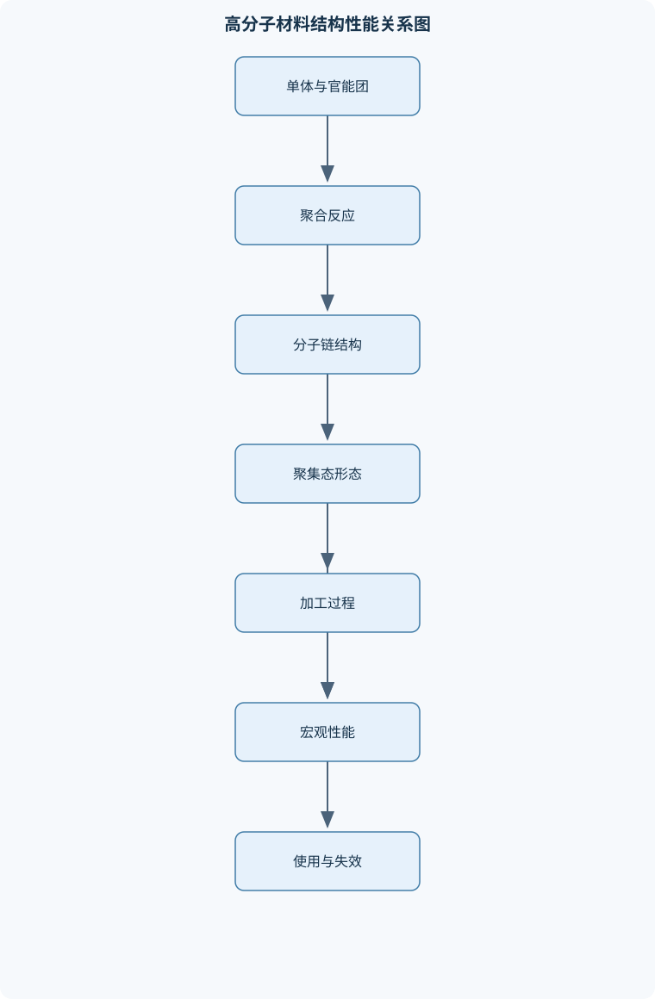
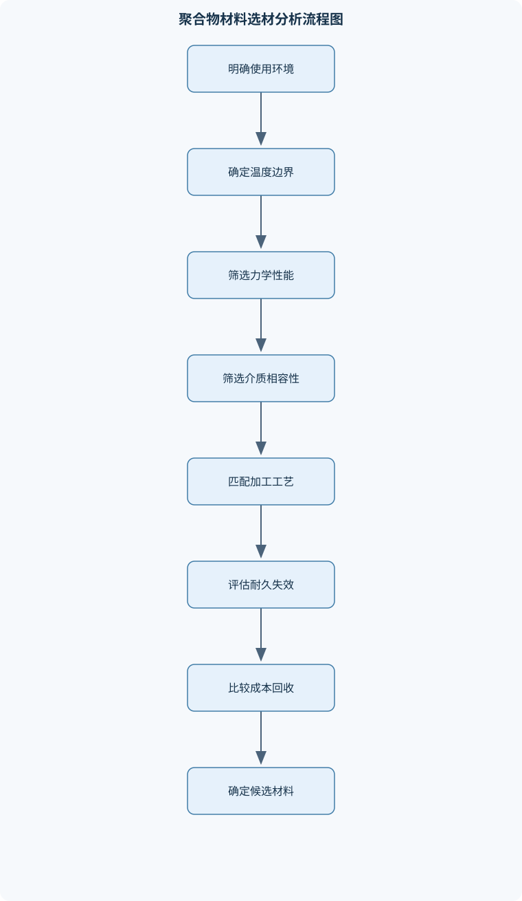

# 高分子材料

## 一、课程整体知识框架

### 课程边界与先修知识

本课程研究高分子材料的分子结构、聚合反应、聚集态结构、加工成型、性能表征、改性方法及典型材料应用。内容覆盖塑料、橡胶、纤维、涂料、胶黏剂及热塑性弹性体等材料体系，重点讨论结构—形态—加工—性能之间的关系。先修知识包括有机化学中的官能团与反应类型、物理化学中的相平衡与黏弹性基础、材料力学中的应力应变概念，以及基础化学实验安全知识。课程不以高分子合成反应机理为唯一重点，也不替代高分子物理、聚合反应工程和聚合物加工专门课程；但需达到能够解释常见聚合反应、判断材料结构和分析基本性能的深度。





### 1. 课程对象与先修基础

高分子材料是以高分子化合物为主要成分，并通过增塑、填充、增强、着色、稳定化、交联或共混等方式形成的工程材料。聚合物是物质类别，材料则通常是聚合物与多种助剂、填料、增强相及加工历史共同形成的制品体系。课程核心不是孤立记忆材料名称，而是建立“分子结构—聚集态形态—加工过程—宏观性能—使用失效”的因果链。

高分子分子由许多重复结构单元组成。单体记为 $M$，重复结构单元通常置于括号内，括号下标 $n$ 表示重复单元数或聚合度。例如聚乙烯可表示为

$$
[-\mathrm{CH_2-CH_2-}]_n
$$

实际样品的每条分子链长度不同，因此 $n$ 通常是平均意义上的量。数均聚合度记为 $X_n$，数均分子量为 $M_n$，重均分子量为 $M_w$，分散系数为

$$
Đ=\frac{M_w}{M_n}
$$

理想单分散体系的 $Đ$ 接近 1，实际聚合物通常具有分子量分布。分子量增大一般有利于缠结、强度和耐环境应力开裂，但会提高熔体黏度、降低加工流动性；因此不能把“分子量越大”简单等同于“材料性能越好”。

学习本课程需要有机化学中的官能团、加成、取代、消除和氧化还原反应基础；物理化学中的相平衡、扩散和黏弹性概念；材料力学中的应力、应变、弹性模量和屈服；还需要理解加热、溶剂、粉尘、压力和反应性化学品的基本实验安全边界。

### 2. 高分子基础分类与层级关系

按主链组成，聚合物可分为碳链聚合物和杂链聚合物。碳链聚合物的主链主要由碳原子构成，例如聚乙烯、聚丙烯、聚苯乙烯和聚氯乙烯；杂链聚合物的主链含氧、氮、硅等杂原子，例如聚酯、聚酰胺、聚氨酯和有机硅聚合物。杂原子会改变链段柔性、极性、氢键能力、耐热性和吸湿性，但不能仅凭是否含杂原子判断全部性能。

按分子形态，线型分子可相互缠结并在加热后流动；支化结构会降低链的规整堆砌能力，通常降低结晶度和密度；交联结构将不同分子链连接成网络，限制链段永久移动。热塑性材料以线型或支化结构为主，可反复加热软化和冷却硬化，但多次加工可能发生热氧降解。热固性材料在固化过程中形成三维网络，固化后通常不能重新熔融流动。弹性体具有较低玻璃化转变温度 $T_g$ 和适度交联网络，能够在较大应变下恢复形变。

塑料强调可塑加工和尺寸保持，橡胶强调室温附近的高弹性，纤维强调高取向、高强度和细长形态，涂料依靠液态施工后在基材表面形成连续膜，胶黏剂依靠界面结合和胶层内聚力连接不同材料。上述边界是功能上的，不是绝对的；例如热塑性弹性体既具有橡胶状弹性，又能像热塑性塑料一样熔融加工。

### 3. 聚合反应与分子结构控制

有机反应可按结构变化分为加成、消除、取代和重排。聚合反应的分类还要看机理。链式聚合需要活性中心连续加成，活性中心可以是自由基、阳离子或阴离子。自由基聚合通常包括引发、增长、终止和链转移四步：

1. 引发剂分解生成自由基；
2. 自由基加成到乙烯基单体双键，形成新的活性链端；
3. 活性链端连续加成单体；
4. 通过偶合、歧化或链转移终止。

因此，链式聚合在较低单体转化率时也可能形成较高分子量聚合物。自由基聚合速率的理想近似为

$$
R_p\propto [M][I]^{1/2}
$$

其中 $R_p$ 为聚合速率，单位通常为 $\mathrm{mol\,L^{-1}\,s^{-1}}$；$[M]$ 和 $[I]$ 分别为单体和引发剂浓度；该关系要求自由基浓度达到稳态、终止主要为双基终止，且没有明显扩散控制、凝胶效应和强烈链转移。高转化率时体系黏度上升，终止受扩散限制，不能机械套用该式。

阳离子聚合适合能稳定碳正离子链端的单体，给电子取代基通常有利于碳正离子稳定；阴离子聚合适合能稳定碳负离子链端的单体，吸电子基团或共轭结构可能提高适用性。乙烯、苯乙烯、丙烯腈和甲基丙烯酸甲酯的实际反应性还取决于溶剂、温度、引发体系和杂质，不能只看一个取代基作绝对判断。

逐步聚合由含两个或多个官能团的分子逐步反应形成，分子量随官能团转化率提高而逐渐增加。对于等官能团、计量比准确、无副反应和无环化的理想二元逐步聚合，Carothers 关系为

$$
X_n=\frac{1}{1-p}
$$

其中 $p$ 是官能团转化率，$X_n$ 为数均聚合度。例如 $p=0.90$ 时，$X_n=10$；$p=0.99$ 时，$X_n=100$。这说明高分子量需要极高转化率和精确计量。若存在单官能杂质、二元官能团不等量、环化或副反应，该关系会偏离。缩聚常伴随水、醇或卤化氢等小分子脱除，但不能把“有无小分子脱除”作为链式与逐步聚合的唯一判据；部分逐步聚合没有小分子脱除。

多官能单体满足 $f>2$ 且转化率足够高时可能形成交联网络。分子量调节可通过改变引发剂浓度、链转移剂用量、单体配比、温度和反应时间实现；支化和交联则与多官能单体、支化反应、凝胶效应和官能团转化程度有关。共聚物的组成和序列可以是无规、交替、嵌段或接枝结构，不同序列会改变结晶、相分离、玻璃化转变和冲击性能。

### 4. 分子结构、聚集态与相形态

构型是需要断裂化学键才能改变的空间排列，例如聚丙烯链上取代基的全同、间同和无规排列；构象则主要由单键旋转改变，不必断裂化学键。全同或间同聚丙烯具有较高规整性，较易形成晶区；无规聚丙烯堆砌能力较弱，通常更柔软。少量乙烯共聚可降低结晶缺陷敏感性、改善低温冲击，但通常会牺牲部分刚度和耐热性。

聚合物聚集态常用晶区—非晶区两相模型描述。结晶区具有较有序的链段排列，能提高刚度、密度、耐热性和阻隔性；非晶区提供链段运动和韧性。结晶度 $X_c$ 必须说明计算方法，可按质量、体积分数或熔融焓计算。结晶度不是越高越好：透明性、冲击韧性和加工流动性可能下降。冷却速率、分子量、支化、取向、退火和共聚缺陷都会影响结晶。

玻璃化转变温度 $T_g$ 是非晶链段协同运动显著增强的温度区间；晶体熔融温度 $T_m$ 是晶体有序结构破坏的温度。刚性链段、强极性作用、氢键和交联通常提高 $T_g$；柔性链段、增塑剂和较弱分子间作用通常降低 $T_g$。$T_g$ 不是绝对单一温度，测试频率、升温速率、含水率和热历史都会影响结果。结晶聚合物可同时存在 $T_g$ 和 $T_m$，非晶聚合物通常没有真正的晶体熔点。

取向会使分子链沿加工方向排列，提高该方向的强度和模量，同时产生各向异性。纤维纺丝中表层冷却、凝固或溶剂交换较快，芯部相对滞后，容易形成皮芯结构；皮层可能具有更高取向和结晶度，芯层则可能较松弛或含较多孔隙，导致染色、伸长和断裂行为不同。共混体系若组分热力学不相容，会形成分散相和连续相；相容剂可降低界面张力、细化分散相并提高界面黏结，但不能保证所有共混体系完全相容。

### 5. 热、力学和传递性能

应力定义为单位面积上的载荷，记为 $\sigma$，单位为 $\mathrm{Pa}$；应变记为 $\varepsilon$，无量纲；线性弹性范围内的弹性模量为

$$
E=\frac{\sigma}{\varepsilon}
$$

该式只适用于规定的线性弹性区间，不能用于屈服后、橡胶大变形或明显黏弹性状态。强度表示承载极限，刚度对应变抵抗能力，韧性表示吸收断裂能量，耐热性还包括高温下模量保持、热变形和热分解稳定性，四者不能相互替代。

聚合物具有黏弹性，表现为蠕变、应力松弛和滞后。恒定应力下应变随时间增加称蠕变；恒定应变下应力下降称应力松弛；加载与卸载曲线不重合形成滞后并产生能量耗散。时间—温度等效原理可在同一材料、同一形态和不发生结构变化的温度范围内，用温度改变来等效时间尺度；若发生结晶、相分离、化学降解或跨越明显 $T_g$，则不能简单平移曲线。

理想一维稳态导热满足

$$
q=-k\frac{\mathrm dT}{\mathrm dx}
$$

其中 $q$ 为热流密度，单位 $\mathrm{W\,m^{-2}}$；$k$ 为热导率，单位 $\mathrm{W\,m^{-1}\,K^{-1}}$；$x$ 为长度坐标，$T$ 必须用绝对温度或温差单位表达。实际热导率受化学组成、结晶度、分子取向、孔隙率、含水率和填料网络影响。闭孔泡沫的有效热导率可能远低于致密同材质聚合物。

玻璃化转变限制低温使用，热降解、氧化和热膨胀限制高温使用。冲击强度受缺口、分子量、橡胶相、结晶度和温度影响；疲劳与循环应力、频率和环境有关；环境应力开裂常由拉伸应力与特定介质共同诱发。吸水会改变尺寸、模量、电性能和冲击性能；聚酰胺的酰胺基可形成氢键，但也使其具有明显吸湿性。耐化学性、阻隔性和耐候性必须在明确介质、温度、时间和应力条件下评价。

### 6. 塑料与典型热塑性材料

聚乙烯的结构差异主要来自支化。LDPE含较多长支链和短支链，堆砌受阻，结晶度和密度通常较低，柔韧性和熔体延伸性较好；HDPE支化少，链段容易紧密堆砌，通常具有较高结晶度、刚度和耐化学性；LLDPE主链近似线型，通过共聚引入短支链，在强度、韧性和密封性之间取得平衡。三者差别不只是密度，还包括熔体流变、结晶速率、冲击性能和加工窗口。

聚丙烯的性能受立构规整性影响，全同和间同结构更容易结晶，无规结构结晶能力较弱。聚氯乙烯具有极性氯原子，刚性和阻燃性较好，但热稳定性和加工稳定性有限，常需热稳定剂；增塑剂可降低链间作用和 $T_g$，使硬质 PVC 转为柔性制品，但可能带来迁移、耐热下降和长期性能变化。聚苯乙烯的苯环使链段刚性较高，而非晶结构和缺口敏感性导致其脆性明显；可通过橡胶增韧或与其他组分共混改善冲击性能。

聚酰胺中的酰胺基形成氢键，带来较高强度、耐磨性和耐热性，同时增加吸湿性。PA6 的重复单元可写为 $[-\mathrm{NH-(CH_2)_5-CO-}]_n$；PA66 的重复单元可写为 $[-\mathrm{NH-(CH_2)_6-NH-CO-(CH_2)_4-CO-}]_n$。PA66 的链段规整性和晶体结构与 PA6 不同，通常具有较高熔点和耐热性，但具体差异还受分子量、含水率、结晶度和加工历史影响。PTFE 的碳氟键强、表面能低，具有低摩擦和优良耐化学性，但熔体加工困难，通常采用特殊成型路线。

### 7. 橡胶、硫化和热塑性弹性体

橡胶高弹性来自柔性链段和交联网络共同作用。交联网络限制链段永久流动，使外力撤除后依靠熵弹性恢复。交联不足会产生蠕变和永久变形，交联过度则伸长率下降、脆性增加，因此必须按用途选择交联密度。有效网络链密度记为 $\nu_e$，不能直接等同于总交联点数，还要考虑网络不均匀、悬挂链、缺陷、温度和溶胀状态。

天然橡胶以顺式结构为主，具有优良弹性和强度，但主链不饱和双键易发生氧化、臭氧和热老化。丁苯橡胶综合性能较均衡，顺丁橡胶弹性和耐低温性较好，丁腈橡胶因含腈基通常耐油性较好；EPDM 主链主要为饱和乙烯—丙烯链段，耐臭氧和耐候性较好，硫化位点主要来自第三单体引入的不饱和结构。耐油、耐燃、耐候和耐热必须分别选择对应介质与评价方法，不能混为单一指标。

硫化包括诱导期、交联速率上升阶段、正硫化阶段和过硫阶段。诱导期决定加工安全时间；交联快速生成时胶料黏弹性迅速变化；正硫化区通常获得强度、伸长、硬度和压缩永久变形的综合平衡；过硫可能出现返原或性能下降。橡胶助剂包括硫化剂、促进剂、活化剂、防老剂、增塑剂、填料和加工助剂，各自影响交联速率、网络结构、耐老化和加工流动。

热塑性弹性体通过硬段微区、可逆物理交联或结晶区固定软段。SBS 中苯乙烯硬段形成分散微区，丁二烯软段形成连续相或主要连续相；硬段提供强度和物理交联，软段提供弹性。聚氨酯热塑性弹性体由硬段和软段组成，二者微相分离，硬段微区作为物理交联点，软段负责大变形。其性能受硬段含量、氢键、分子量和热历史影响。

### 8. 纤维材料与成纤加工

成纤聚合物应具有足够高的分子量、适宜的链柔性与刚性、较强的分子间作用、可形成稳定熔体或溶液，并能在牵伸后形成较高取向。纤维性能包括强度、断裂伸长、回弹、耐磨、耐热、染色性和吸湿性，不能只用强度判断纤维质量。

熔融纺丝适合可稳定熔融且不明显分解的聚合物；干法纺丝将溶液挤出后依靠溶剂挥发成形；湿法纺丝将纺丝原液进入凝固浴，依靠溶剂交换和聚合物再生或沉淀成形。黏胶纤维属于溶液纺丝，通常经历原液制备、过滤脱泡、喷丝、凝固再生、牵伸、水洗、干燥和热处理。凝固速率过快可能形成致密皮层并造成芯部缺陷，过慢则成形稳定性不足。

PAN 纤维通常采用溶液纺丝，具有较高强度和耐候性，是碳纤维的重要前驱材料。PA6 和 PA66 均可形成高强耐磨纤维，但吸湿性会影响尺寸和模量。芳纶 1414 具有刚性棒状链结构和强分子间作用，因而具有高强高模性能，但加工和溶解要求较高。纤维牵伸提高分子取向，热定形稳定尺寸并释放部分内应力。膨体纱通过假捻、喷气或热处理形成卷曲，使纱线获得蓬松性、覆盖性和弹性。

### 9. 涂料、胶黏剂与界面材料

涂料通常由成膜物质、颜填料、溶剂和助剂组成。成膜可通过溶剂挥发、氧化聚合、缩聚反应或熔融冷却实现。干性油含较多不饱和双键，可在空气中氧化并进一步交联成膜。碘值 $I$ 定义为每 $100\,\mathrm g$ 样品吸收的碘质量：

$$
I=\frac{100m_I}{m}
$$

其中 $m_I$ 和 $m$ 必须使用相同质量单位，$I$ 的单位为 $\mathrm{g\,I_2/100\,g}$。碘值反映不饱和程度，不能单独等同于干燥速度，因为催化剂、温度、膜厚、颜料和树脂结构都会影响实际成膜。

结构型胶黏剂固化后能够承受较高结构载荷，非结构型胶黏剂主要用于定位、密封、装饰或低载荷连接。胶接强度取决于界面润湿、扩散、化学作用、胶层内聚强度和接头应力分布。破坏形式可表现为胶层内聚破坏、界面破坏或被粘物破坏；载荷形式包括拉伸、剪切、劈开和剥离。胶层过厚会增加收缩、气泡、剪切变形和残余应力，但过薄又可能缺胶和润湿不足，因此最佳厚度由胶黏剂、基材和接头几何共同决定。环氧树脂依靠环氧基与固化剂反应形成交联网络，具有较高黏结强度和尺寸稳定性，但固化收缩、脆性和残余应力需重点控制。

### 10. 加工成型、改性、表征与选材

聚合物熔体通常具有剪切变稀特征：剪切速率 $\dot{\gamma}$ 增加时，表观黏度 $\eta$ 降低。$\eta$ 的单位为 $\mathrm{Pa\cdot s}$，$\dot{\gamma}$ 的单位为 $\mathrm{s^{-1}}$，剪切应力 $\tau$ 的单位为 $\mathrm{Pa}$。挤出适合连续型材、片材和管材；注射包括塑化、充模、保压和冷却；压延用于片材和薄膜；吹塑用于中空制品；模压常用于热固性材料和橡胶。热塑性塑料经历加热、流动、充模和冷却，热固性树脂则存在流动与固化耦合，过早固化会导致充模不足。

橡胶加工包括混炼、压延、挤出和硫化；纤维加工包括喷丝、牵伸、冷却凝固和热定形。加工温度、剪切速率和停留时间会影响降解、取向、结晶度和交联状态。制品缺陷包括收缩、翘曲、熔接痕、气泡、残余应力和充模不足。填料、玻璃纤维、碳纤维和无机增强相可提高刚度、强度或尺寸稳定性，但可能降低冲击韧性、增加各向异性和加工磨损。

改性方法包括共聚、共混、增塑、填充、增强、橡胶增韧、阻燃、抗氧化、抗紫外和抗静电。相容剂通过改善界面黏结和分散相尺寸提高共混性能。红外光谱用于识别官能团；差示扫描量热用于分析 $T_g$、$T_m$、结晶温度 $T_c$ 和焓变；热重分析用于评价热分解过程；拉伸、冲击、硬度和动态力学测试分别反映强度、缺口敏感性、表面抗压入能力和温频依赖黏弹性；显微形貌和断口分析可判断分散相、孔洞、纤维拔出和脆韧断裂。

工程选材必须把使用温度、载荷、介质、寿命、加工方式、阻燃、透明、成本和回收要求同时纳入。材料生命周期还包括原料、生产能耗、使用寿命、再加工、降解和废弃处置。热塑性材料通常较易机械回收，但多次热历史可能使分子量下降、颜色变深和性能衰减；热固性材料和多相复合材料回收难度更高，不能只依据“可回收”标签判断环境优越性。

## 二、章节和模块划分

### 核心知识覆盖清单

本清单用于检查正文是否覆盖本课程的主要知识模块：

- **高分子材料基础与分类**：高分子、聚合物与高分子材料的定义、单体、重复结构单元与平均聚合度、碳链聚合物与杂链聚合物、线型、支化与交联分子结构、热塑性、热固性与弹性体、塑料、橡胶、纤维、涂料和胶黏剂的材料边界、分子量分布及其对加工性能的影响、材料结构、形态、加工和性能的层级关系。
- **聚合反应原理与分子结构控制**：加成、消除、取代和重排等有机反应类型、链式聚合与逐步聚合的判别、自由基聚合的引发、增长、终止和链转移、阳离子聚合和阴离子聚合的单体适用性、缩聚反应与官能团计量关系、加聚反应与缩聚反应的副产物差异、共聚组成、序列结构与无规共聚、聚合度、转化率和分子量的关系、分子量调节、支化和交联的形成条件。
- **聚合物分子结构与聚集态**：构型、构象和立构规整性、全同、间同和无规聚丙烯结构、结晶区、非晶区和两相模型、结晶度、晶体尺寸与熔融行为、玻璃化转变温度与熔点、分子间作用力、氢键和极性、取向结构及其对各向异性的影响、皮芯结构的形成原因和性能差异、聚合物共混体系的相容性与相分离。
- **聚合物的热、力学与传递性能**：应力、应变、弹性模量和屈服行为、黏弹性、蠕变、应力松弛和滞后、时间—温度等效原理的适用条件、玻璃化转变对使用温度的限制、热导率及分子结构、结晶度和孔隙的影响、热膨胀、热稳定性与热降解、冲击强度、疲劳和环境应力开裂、吸水率、耐化学性和阻隔性能、强度、刚度、韧性和耐热性的权衡。
- **塑料及典型热塑性材料**：聚乙烯的低密度、高密度和线型低密度结构、聚乙烯的合成原理、支化结构与性能差异、聚丙烯的立构规整性及共聚改性、聚氯乙烯的结构、增塑、稳定化和优缺点、聚苯乙烯的脆性来源及抗冲击改性、聚酰胺的氢键、吸湿性和耐磨性、聚四氟乙烯的低摩擦和耐化学性、工程塑料的耐热、耐冲击和尺寸稳定性、热塑性塑料的回收、再加工和性能衰减。
- **橡胶、硫化与热塑性弹性体**：橡胶高弹性的分子结构条件、天然橡胶的顺式结构与性能、丁苯橡胶、顺丁橡胶和丁腈橡胶的结构特点、二元乙丙橡胶的主链结构和耐老化性、耐油性、耐燃性和耐候性的比较方法、硫化的目的及交联网络形成、硫化诱导期、焦烧、正硫化和过硫阶段、橡胶助剂的种类与作用、热塑性弹性体的硬段—软段结构、聚氨酯热塑性弹性体的微相分离。
- **纤维材料与成纤加工**：成纤聚合物的分子结构要求、纤维的强度、伸长、回弹和耐磨性、熔融纺丝、干法纺丝和湿法纺丝、黏胶纤维的溶液纺丝过程、聚丙烯腈纤维的纺丝及性能、聚酰胺6和聚酰胺66的结构与性能差异、芳纶1414的刚性链结构与高强高模性能、纤维牵伸、热定形和分子取向、皮芯结构的形成及其对染色和力学性能的影响、膨体纱的加工方法和卷曲蓬松机理。
- **涂料、胶黏剂与界面材料**：涂料的成膜物质、颜填料、溶剂和助剂、氧化聚合、挥发成膜、缩聚成膜和熔融成膜、干性油与碘值的定义和判别、碘值与不饱和双键含量的定性关系、结构型胶黏剂与非结构型胶黏剂、胶接界面润湿、扩散和化学作用、拉伸、剪切、劈开和剥离破坏、胶层厚度、固化收缩和残余应力、环氧树脂的交联结构和固化机理、胶接接头的应力集中和失效分析。
- **聚合物加工成型与工艺—结构关系**：熔体黏度和剪切变稀、挤出、注射、压延、吹塑和模压、热塑性塑料的加热、流动、充模和冷却、热固性树脂的流动—固化耦合、橡胶混炼、压延、挤出和硫化、纤维纺丝中的拉伸取向和冷却固化、加工温度、剪切速率和停留时间、成型收缩、翘曲、熔接痕和内应力、加工助剂、填料和增强材料的作用、工艺参数对结晶度、取向和缺陷的影响。
- **材料改性、表征与工程选材**：共聚、共混、增塑、填充和增强改性、抗冲击改性和橡胶增韧机理、玻璃纤维、碳纤维和无机填料增强、阻燃、抗氧化、抗紫外和抗静电改性、相容剂在聚合物共混中的作用、红外光谱、差示扫描量热和热重分析、拉伸、冲击、硬度和动态力学测试、显微形貌与断口分析、性能指标、使用环境与失效模式匹配、材料生命周期、可回收性与环境限制。


### 1. 模块一至三：基础、聚合反应与聚集态

#### 代表性流程：聚合反应类型判别

**输入：** 单体结构、反应式、催化剂或引发剂、是否生成小分子副产物。  
**输出：** 链式聚合、逐步聚合或非聚合反应的判断及理由。

1. 检查是否有乙烯基、环状结构或可连续打开的反应位点；
2. 判断是否生成自由基、碳正离子或碳负离子活性中心；
3. 判断活性中心是否连续加成单体；
4. 若由双官能或多官能分子逐步反应，则归入逐步聚合；
5. 记录是否脱除水、醇或卤化氢等小分子；
6. 区分主反应、链转移、支化和交联副反应。

伪代码如下：

```text
输入：monomer, reaction_scheme, initiator, byproduct
输出：classification, reasons

if 存在连续活性链端加成证据:
    classification = "链式聚合"
    reasons += "存在引发—增长—终止过程"
else if 存在双官能或多官能基团逐步反应:
    classification = "逐步聚合"
    reasons += "分子量随官能团转化率逐步增加"
else:
    classification = "非聚合反应或信息不足"

if byproduct 不为空:
    reasons += "伴随小分子脱除，但不能单独作为分类依据"
输出 classification, reasons
```

该流程对结构片段数 $n$ 的扫描复杂度可近似写为 $O(n)$，但真实反应可能包含混合机理，必须分别分析主反应和副反应。

### 2. 模块四至六：热力学、力学与典型塑料橡胶

#### 例题一：理想逐步聚合的聚合度

**题干：** 某等官能度逐步聚合体系中，官能团转化率为 $p=0.98$，计量比准确且无副反应，求 $X_n$。

**分析：** 使用 $X_n=1/(1-p)$，因为题目明确满足理想条件。

**解答：**

$$
X_n=\frac{1}{1-0.98}=50
$$

**结果验证：** 当 $p$ 从 $0.98$ 提高到 $0.99$ 时，$X_n$ 变为 100，说明接近完全转化时，微小转化率差异会显著影响聚合度。

**变式：** 若存在单官能杂质或二元单体计量比偏离 1，不能直接使用该结果；应引入计量不平衡和封端效应重新计算或通过实验测定分子量。

#### 例题二：LDPE、HDPE 与 LLDPE 比较

**题干：** 从支化结构解释三类聚乙烯的结晶度、密度、刚度和韧性差异。

**分析：** 支化越多，链段越难紧密堆砌；堆砌能力影响结晶度，结晶度又影响密度和刚度。

**逐步解答：**

1. LDPE 含较多长支链，链间堆砌受阻；
2. 结晶度通常较低，密度和刚度较低，柔韧性较好；
3. HDPE 支化少，链段规整且易结晶；
4. 结晶度和密度通常较高，刚度、耐化学性较好；
5. LLDPE 主链近似线型，通过短支链调节结晶和韧性；
6. 其抗冲击、抗撕裂和热封性能通常较突出。

**结果验证：** 不能把三者简化为“密度从低到高”。分子量、分子量分布、冷却速率和加工取向都会改变最终性能。

**变式：** 若 LLDPE 采用不同共聚单体或支链含量不同，其密度、熔点和机械性能可能与一般趋势有偏离。

#### 例题三：PA6 与 PA66

**题干：** 写出 PA6 和 PA66 的重复结构单元，并解释性能差异。

**分析：** 两者均含酰胺基，能形成氢键；但链段组成、亚甲基间隔和晶体结构不同。

**解答：**

$$
\mathrm{PA6}=[-\mathrm{NH-(CH_2)_5-CO-}]_n
$$

$$
\mathrm{PA66}=[-\mathrm{NH-(CH_2)_6-NH-CO-(CH_2)_4-CO-}]_n
$$

酰胺基提高分子间作用、强度和耐磨性，同时吸水。PA66 的链段规整性和晶体结构通常使其熔点、耐热性较高；PA6 的加工窗口、吸湿响应和结晶行为不同。

**结果验证：** 具体强度和熔点不能仅由重复单元推断，还必须考虑分子量、含水率、取向、结晶度和热处理。

**变式：** 若样品含水率不同，PA6 和 PA66 的模量、断裂伸长和尺寸稳定性比较可能发生变化。

#### 例题四：天然橡胶与 EPDM

**题干：** 比较两者的硫化反应和老化性能。

**分析：** 天然橡胶主链含较多不饱和双键；EPDM 主链以饱和乙烯—丙烯链段为主，不饱和位点主要来自第三单体。

**逐步解答：**

1. 天然橡胶双键可参与硫化，较易形成交联网络；
2. 双键同时是氧化和臭氧攻击的反应位点；
3. EPDM 的饱和主链降低臭氧和热氧攻击；
4. EPDM 仍可通过第三单体提供硫化位点；
5. 因此 EPDM 通常耐候、耐臭氧较好，但具体硫化速率受配方影响；
6. 天然橡胶在弹性和强度方面具有优势，但需防护老化。

**结果验证：** 不能用“含双键越多越好”判断性能，因为双键既有利于硫化，也增加老化敏感性。

**变式：** 若天然橡胶添加防老剂或采用不同硫化体系，其耐老化性能可明显改善。

#### 例题五：碘值与干性判断

**题干：** $500\,\mathrm g$ 涂料吸收 $750\,\mathrm g$ 碘，求碘值并作定性判断。

**分析：** 使用定义式，先确认两个质量单位一致。

**解答：**

$$
I=\frac{100m_I}{m}
=\frac{100\times750}{500}
=150
$$

因此碘值为 $150\,\mathrm{g\,I_2/100\,g}$ 样品。较高碘值说明不饱和程度较高，通常有利于空气氧化交联，具有干性油或氧化成膜倾向。

**结果验证：** 碘值是每 $100\,\mathrm g$ 样品吸收的碘质量，不是百分数；不能把 150 写成 150%。

**变式：** 若体系中含多种树脂、颜料和催干剂，不能仅凭碘值断定干燥速度或完整成膜类别。

### 3. 模块七至九：纤维、涂料胶黏剂与界面

#### 代表性流程：纤维纺丝方案选择

**输入：** 聚合物热稳定性、熔融黏度、溶解性、目标强度和耐热要求。  
**输出：** 熔融纺丝、干法纺丝或湿法纺丝方案。

1. 若聚合物能够在不明显分解的条件下稳定熔融，优先考虑熔融纺丝；
2. 若不能安全熔融但可形成稳定溶液，考虑溶液纺丝；
3. 溶剂易挥发时可用干法纺丝，需控制气流、温度和溶剂回收；
4. 需凝固浴再生或沉淀时采用湿法纺丝；
5. 通过牵伸提高取向，再用热定形稳定尺寸；
6. 检测皮芯结构、结晶度、断裂强度和伸长率。

**排错方法：** 若纤维出现断丝，检查原液黏度、过滤脱泡和喷丝孔堵塞；若强度低，检查牵伸比、取向和凝固速率；若染色不均，检查皮芯结构和孔隙梯度。

#### 例题六：胶层厚度与施压

**题干：** 为什么胶接时需要施加一定压力，胶层又不能过厚？

**分析：** 胶接强度由界面和胶层共同决定。

**解答：**

1. 适度施压可提高胶液与基材的真实接触面积；
2. 压力可排除气泡，减少界面空洞；
3. 胶层过厚会增加固化收缩和残余应力；
4. 厚胶层在剪切载荷下变形更大，载荷传递不均；
5. 但过薄会造成缺胶、润湿不足和局部干斑；
6. 因此最佳厚度取决于胶黏剂黏度、固化收缩、接头几何和被粘材料。

**结果验证：** 破坏后若主要为界面脱粘，可能是润湿或表面处理不足；若为胶层内聚破坏，说明界面较强但胶层承载不足；若被粘物破坏，通常说明胶接强度已高于基材局部强度。

**变式：** 柔性胶黏剂允许较厚胶层以吸收位移，刚性结构胶则需重点控制胶层厚度和应力集中。

### 4. 模块十：加工、改性、表征与工程选材

#### 代表性流程：橡胶硫化阶段分析

**输入：** 混炼胶配方、硫化温度、硫化时间和流变曲线。  
**输出：** 焦烧风险、正硫化区间和过硫风险。

1. 观察诱导期，判断加工安全时间；
2. 识别扭矩或模量快速上升阶段；
3. 在性能达到综合平衡的平台附近确定候选正硫化区间；
4. 延长时间观察是否返原、硬化或强度下降；
5. 用拉伸强度、断裂伸长、硬度和压缩永久变形复核；
6. 只有测试温度、试样历史和配方可比时，才可比较不同曲线。

**评价标准：** 不能只按最高扭矩选正硫化点；还要看断裂伸长、永久变形、耐热老化和制品实际尺寸稳定性。

#### 例题七：工程选材

**题干：** 某密封件要求长期接触油品，使用温度高于室温，且需要耐候。如何在天然橡胶、丁腈橡胶、EPDM 和硅橡胶中初选？

**分析：** 先按环境约束淘汰，再比较弹性、耐热和成本。

**解答：**

1. 天然橡胶弹性和强度好，但耐油、耐臭氧通常不是优势；
2. 丁腈橡胶耐油性较好，但耐候性取决于配方和使用环境；
3. EPDM 耐候、耐臭氧和耐热水较好，但一般不适合许多油品；
4. 硅橡胶耐高低温和耐候性较好，但强度、耐磨和成本需核对；
5. 若油品是主要约束，优先评估丁腈橡胶；若高温耐候优先且油接触不强，评估硅橡胶或 EPDM；
6. 最终需进行实际介质浸泡、压缩永久变形和热老化验证。

**结果验证：** 不能以“耐热”替代“耐油”，也不能用材料通名替代具体配方和交联状态。

**变式：** 若同时要求阻燃、低压缩永久变形和长期户外使用，可能需要改性配方或更换材料体系。

#### 项目一：聚乙烯结构—性能分析

**输入数据：** 三种聚乙烯样品的密度、熔体流动指标、拉伸曲线、差示扫描量热曲线和显微形貌。  
**步骤：**

1. 在相同温度和样品状态下测定密度；
2. 通过热分析比较熔融峰、结晶峰和熔融焓；
3. 由拉伸曲线获得模量、屈服应力和断裂伸长；
4. 结合显微形貌判断结晶和支化造成的结构差异；
5. 将“支化—堆砌—结晶—密度—力学性能”逐项对应。

**评价标准：** 数据单位统一；热分析需说明升温速率；拉伸需说明试样形状和测试速度；不能只凭密度给出材料分类。  
**排错方法：** 若密度顺序异常，检查填料、孔隙、含水率和测量温度；若熔融峰重叠，检查共聚组成和热历史；若拉伸结果离散，检查试样缺口和取向。

#### 项目二：胶接接头失效分析

**输入数据：** 基材类型、表面处理方式、胶层厚度、固化条件、拉伸剪切强度和断口照片。  
**步骤：**

1. 记录基材表面粗糙度、清洁状态和处理方式；
2. 控制胶层厚度并记录施压时间；
3. 按统一固化条件制备平行试样；
4. 进行拉伸剪切或剥离试验；
5. 区分界面破坏、胶层内聚破坏和基材破坏；
6. 将失效位置与润湿、固化收缩、应力集中和胶层厚度联系起来。

**评价标准：** 试样数量、固化时间、测试速度和环境条件应一致；结果应同时报告平均值和离散程度；不能只报告最高强度。  
**排错方法：** 界面整片脱粘时检查表面污染和润湿；胶层有气泡时检查施胶和排气；强度随胶层加厚下降时检查固化收缩和剪切变形；同一批试样差异过大时检查厚度均匀性和基材缺陷。

## 三、核心概念的详细解释

### 3.1 高分子材料的组成、分类与层级关系

高分子是由大量重复结构单元连接而成的分子，聚合物是高分子物质的统称。高分子材料则是以聚合物为主要成分，并加入增塑剂、稳定剂、填料、颜料、增强纤维或交联剂后，经加工形成的具有使用功能的材料。因此，聚合物的化学结构不能完全代表最终材料性能，配方、加工历史、结晶状态和缺陷同样重要。

按主链原子组成，高分子可分为碳链聚合物和杂链聚合物。聚乙烯、聚丙烯、聚苯乙烯和聚氯乙烯的主链主要由碳原子组成，属于碳链聚合物；聚酯、聚酰胺、聚氨酯和有机硅聚合物的主链含有氧、氮或硅等杂原子，属于杂链聚合物。杂原子会引入极性、氢键或较强的偶极作用，可能提高强度、耐热性或黏附性，但也可能增加吸水性和加工敏感性。

按分子形态，聚合物可分为线型、支化和交联结构。线型分子之间主要依靠缠结和分子间作用力结合，通常可以加热软化并重新加工；支化结构会改变链的堆砌方式，长支链尤其会降低结晶能力；交联结构将不同分子链连接成网络，限制链段永久滑移。热塑性塑料通常以线型或支化结构为主，热固性塑料固化后形成三维网络，弹性体则需要低于使用温度的 $T_g$ 和适度交联网络。

塑料强调可塑加工和尺寸保持，橡胶强调大应变下的回复能力，纤维强调高取向和高强度，涂料强调在基材表面形成连续膜，胶黏剂强调界面结合和胶层内聚。热塑性弹性体处于这些类别的交界处：它依靠硬段微区、结晶区或可逆物理作用形成物理交联，既有橡胶弹性，又能像热塑性塑料一样熔融加工。

### 3.2 分子量、聚合度和分子量分布

单体记为 $M$，重复结构单元写在括号内，括号下标 $n$ 表示链中重复单元数。例如聚乙烯可写为

$$
[-\mathrm{CH_2-CH_2-}]_n
$$

实际样品中各条链的长度不同，$n$ 通常是平均意义上的聚合度。数均聚合度 $X_n$ 按分子条数加权，数均分子量 $M_n$ 对低分子链的数量较敏感；重均分子量 $M_w$ 按分子质量加权，对高分子链更敏感。分散系数为

$$
Đ=\frac{M_w}{M_n}
$$

理想单分散体系的 $Đ$ 接近 1，实际聚合物通常大于 1。分子量提高通常会增加链缠结，使拉伸强度、耐冲击性和耐环境应力开裂能力提高，但也会使熔体黏度增大、充模困难。因此材料设计不是单纯追求高分子量，而是在强度、流动性和加工周期之间折中。

### 3.3 聚合反应及分子结构控制

有机反应的结构类型包括加成、消除、取代和重排。聚合反应还要依据反应机理区分链式聚合和逐步聚合。链式聚合需要活性中心连续加成，活性中心可以是自由基、阳离子或阴离子。自由基聚合包括引发、增长、终止和链转移：引发剂生成自由基，活性自由基加成单体双键形成新的链端，链端继续加成单体，最后通过偶合、歧化或链转移失去活性。

在理想自由基聚合中，若自由基生成和消失达到稳态，且终止主要为双基终止，则聚合速率可近似表示为

$$
R_p\propto [M][I]^{1/2}
$$

其中 $R_p$ 的常用单位为 $\mathrm{mol\,L^{-1}\,s^{-1}}$，$[M]$ 和 $[I]$ 分别为单体和引发剂浓度，单位通常为 $\mathrm{mol\,L^{-1}}$。该关系不适用于强烈凝胶效应、扩散控制、显著链转移或高转化率熔体体系。

阳离子聚合要求单体能够稳定碳正离子链端，给电子取代基通常有利于阳离子稳定；阴离子聚合要求单体能够稳定碳负离子链端，吸电子基团或共轭结构常有利于阴离子聚合。苯乙烯、丙烯腈、甲基丙烯酸甲酯等单体的实际适用性还受溶剂、温度、反离子和引发剂影响，不能只按一个取代基作绝对判断。

逐步聚合由含两个或多个官能团的分子逐步反应形成。二元酸与二元醇缩聚时，羧基和羟基逐步反应并可能脱除水；二异氰酸酯与二元醇反应形成聚氨酯时，则未必脱除小分子。因而“缩聚”和“逐步聚合”不能简单等同。加聚常指单体加成到不饱和键或环状结构中，通常没有小分子副产物；缩聚强调反应伴随水、醇、氯化氢等小分子脱除。

### 3.4 聚集态结构、构型、构象和相态

构型是需要断裂化学键才能改变的空间排列，例如聚丙烯侧甲基的全同、间同和无规排列；构象是单键旋转形成的不同空间形态，不需要断裂主链化学键。全同聚丙烯和间同聚丙烯较规整，容易形成晶区；无规聚丙烯堆砌困难，通常结晶度低、材料较软。

半结晶聚合物同时含有结晶区和非晶区。晶区提供较高的刚度、耐热性和尺寸稳定性，非晶区承担部分变形并影响冲击韧性。结晶度升高通常使密度、模量和耐热性提高，但透明性、低温冲击性和熔体流动性可能下降。结晶度还受冷却速率、分子量、取向、支化和共聚缺陷影响，不能仅由化学名称确定。

玻璃化转变温度 $T_g$ 是非晶链段协同运动明显增强的温度区间；晶体熔融温度 $T_m$ 是晶体有序结构破坏的温度。增加刚性链段、强极性作用、氢键或交联通常使 $T_g$ 升高；增加柔性链段、增塑剂或降低分子间作用力通常使 $T_g$ 降低。共混体系若发生相分离，可能出现两个或多个玻璃化转变区间。

### 3.5 热、力学、流变和传递性能

应力为单位面积上承受的载荷，记为 $\sigma$，单位为 $\mathrm{Pa}$；应变为相对变形量，记为 $\varepsilon$，无量纲；在线性弹性范围内，弹性模量为

$$
E=\frac{\sigma}{\varepsilon}
$$

该式只适用于规定应变范围、加载速率和温度下的近似线性区，不能直接用于屈服后、橡胶大变形或黏弹性显著的区域。

聚合物具有黏弹性，既有瞬时弹性变形，也有随时间发展的黏性变形。恒定应力下的应变逐渐增加称为蠕变；恒定应变下的应力逐渐降低称为应力松弛；加载和卸载曲线不重合形成滞后环，环面积对应能量耗散。时间—温度等效原理可在同一材料、同一形态和相近机制下，用温度改变松弛时间尺度，但在结晶、相变、化学降解或明显塑化发生时不能简单外推。

黏度 $\eta$ 的单位为 $\mathrm{Pa\cdot s}$，剪切速率 $\dot{\gamma}$ 的单位为 $\mathrm{s^{-1}}$，剪切应力 $\tau$ 的单位为 $\mathrm{Pa}$。多数聚合物熔体表现出剪切变稀，即剪切速率升高时表观黏度下降，这有利于挤出和注射充模，但也会导致取向、熔接痕和残余应力。

理想一维稳态导热满足

$$
q=-k\frac{\mathrm{d}T}{\mathrm{d}x}
$$

其中 $q$ 为热流密度，单位为 $\mathrm{W\,m^{-2}}$；$k$ 为热导率，单位为 $\mathrm{W\,m^{-1}\,K^{-1}}$；$T$ 为绝对温度或摄氏温度差，$x$ 为传热方向坐标。负号表示热量从高温处流向低温处。实际有效热导率还受结晶度、取向、填料网络、含水率和孔隙率影响，泡沫材料即使化学组成相近，热导率也可能远低于致密材料。

### 3.6 典型热塑性塑料及结构—性能关系

聚乙烯的差异主要来自支化结构。LDPE 含较多长支链和短支链，堆砌受阻，结晶度和密度通常较低，柔韧性较好；HDPE 支化少，链段排列紧密，结晶度、刚度和耐化学性通常较高；LLDPE 主链近似线型，通过短支链调节结晶和韧性。三者差异不只是密度顺序，还包括熔体流变、耐冲击性和加工收缩。

聚丙烯的全同结构通常具有较高结晶能力和刚度，无规结构结晶能力较弱。少量乙烯共聚可破坏部分规整堆砌，降低脆性并改善低温冲击性能，但可能牺牲部分刚度、耐热性和结晶速率。

PVC 分子中含有极性氯原子，具有阻燃性、耐化学性和成本较低等优点，但热稳定性较差，加工时易脱除氯化氢，通常需要热稳定剂；增塑剂可降低链段运动阻力，使硬质 PVC 转变为柔性材料。PS 的苯环使主链刚性提高，但其非晶结构和较低的裂纹扩展阻力使其易脆断，可通过橡胶增韧或引入共聚结构改善抗冲击性。

PA6 的重复单元可写为

$$
[-\mathrm{NH-(CH_2)_5-CO-}]_n
$$

PA66 的重复单元可写为

$$
[-\mathrm{NH-(CH_2)_6-NH-CO-(CH_2)_4-CO-}]_n
$$

两者均含酰胺基，能够形成氢键，具有较高强度、耐磨性和吸湿性。PA66 的链段规整性和晶体结构与 PA6 不同，通常表现出较高熔点和耐热性；但具体性能还受含水率、分子量、结晶度和加工历史影响。PTFE 的碳氟键强、表面能低，具有优异耐化学性和低摩擦性，但熔体流动加工困难。

### 3.7 橡胶、硫化和热塑性弹性体

橡胶高弹性来自交联网络对链段的约束。交联不足会产生永久流动，交联过度则使链段运动受限、伸长率下降，因此存在与用途相关的最佳交联密度。硫化过程可分为诱导期、交联速率上升期、正硫化阶段和过硫阶段。诱导期决定加工安全时间；正硫化阶段网络结构和综合性能较适宜；过硫可能出现继续硬化，也可能发生返原和性能下降。

天然橡胶主链含不饱和双键，易硫化，但双键也是氧化、臭氧和热老化的反应位点。EPDM 主链主要由饱和乙烯—丙烯链段构成，耐臭氧和耐候性通常较好，其硫化反应位点来自第三单体引入的不饱和结构。丁腈橡胶通常具有较好的耐油性，乙丙橡胶耐候性突出，但耐油性较弱；耐油、耐燃、耐热和耐候必须分别按介质和温度评价。

SBS 由苯乙烯硬段和丁二烯软段组成。硬段形成分散微区，提供物理交联和强度；软段形成连续相或主要连续相，提供弹性。组成、溶剂挥发速率和退火历史会改变其相结构。聚氨酯热塑性弹性体则通常由硬段和软段组成，硬段之间形成微相区，软段提供柔性；微相分离程度决定强度、弹性、耐磨性和加工窗口。

### 3.8 纤维、涂料、胶黏剂和加工成型

成纤聚合物需要具有足够高的分子量、适宜的链柔性和一定的线性或规整性，熔体或溶液应具有稳定可纺性。熔融纺丝适用于能够稳定熔融且不明显分解的聚合物；干法纺丝依靠溶剂挥发；湿法纺丝依靠纺丝液进入凝固浴后发生溶剂交换和聚合物再生。黏胶纤维属于溶液纺丝，通常经历原液制备、过滤脱泡、喷丝、凝固再生、牵伸、水洗和干燥等步骤。

纤维牵伸使分子链沿轴向取向，通常提高强度和模量，但过度取向可能降低伸长率。表层先凝固、芯部溶剂交换较慢或冷却梯度明显时，会形成皮芯结构；皮层和芯层在取向度、结晶度、孔隙率及力学性能上存在差异。膨体纱通过假捻、喷气或热处理形成卷曲和蓬松结构，卷曲回复力决定其体积感和保暖性。

涂料通常含成膜物质、颜填料、溶剂和助剂。成膜可通过溶剂挥发、氧化聚合、缩聚反应或熔融冷却实现。碘值定义为每 $100\ \mathrm{g}$ 样品吸收的碘 $\mathrm{I_2}$ 质量，单位为 $\mathrm{g\,I_2/100\,g}$。碘值高表示不饱和程度较高，但不等于干燥速度必然快，因为催化剂、膜厚、温度和树脂结构也会影响成膜。

结构型胶黏剂固化后能够承受较高载荷并传递结构应力，非结构型胶黏剂主要用于定位、密封、装饰或低载荷连接。胶接强度由界面润湿、扩散、化学作用、胶层内聚强度和接头应力分布共同决定。胶层过厚会增加固化收缩、内部缺陷和剪切变形，过薄又可能缺胶和润湿不足，因此最佳厚度取决于胶黏剂、基材和接头几何。

挤出、注射、压延、吹塑和模压都包含加热、流动、成型和冷却或固化。热塑性塑料在充模和冷却过程中可能产生取向、收缩、翘曲、熔接痕和残余应力；热固性树脂则同时经历流动和固化，固化过早会导致充模不足，过晚则延长周期。加工温度、剪切速率和停留时间必须与热稳定性和黏度窗口匹配。

### 3.9 改性、表征和工程选材

共聚可改变链段序列，共混可组合不同聚合物的性能，增塑可降低 $T_g$ 和加工黏度，填充和增强可提高刚度、尺寸稳定性或热导率。橡胶增韧通常通过分散橡胶相诱发剪切屈服、银纹或裂纹偏转来耗散冲击能量；相容剂通过降低界面张力、改善界面黏附和细化分散相提高共混稳定性。

红外光谱用于识别官能团和化学结构，差示扫描量热法用于分析 $T_g$、结晶和熔融，热重分析用于评价失重和热分解过程；拉伸、冲击、硬度和动态力学测试分别反映强度—变形、瞬时抗冲击、表面抗压入和温度—频率相关的黏弹性。显微形貌和断口分析可判断相分离、填料分散、孔洞、界面脱粘和裂纹扩展路径。

工程选材应同时考虑使用温度、载荷、介质、加工方式、寿命、成本、回收性和失效模式。任何单项指标都不能替代完整验证。例如高结晶度材料可能刚度高但冲击韧性较低；高交联材料耐热耐溶剂但难以再加工；高阻燃配方可能牺牲流动性和力学性能。

## 四、重要定义、公式、定理和推导

### 专业审校补充：关键定义与适用边界

聚合物共混体系中的“相容性”不能简单等同于两种聚合物能够混合。热力学相容是指在给定温度、组成和分子量条件下，两种聚合物形成稳定均一相；若混合自由能降低不足，体系会发生宏观或微观相分离。可用Flory–Huggins模型作定性判断：ΔG_mix/(RT)=φ_1/N_1·lnφ_1+φ_2/N_2·lnφ_2+χφ_1φ_2。其中φ_i为组分体积分数，N_i为相对于重复单元的链段数，χ为相互作用参数，R为气体常数，T为绝对温度。由于聚合物的N通常很大，混合熵较小，即使小分子彼此易混，聚合物之间也可能相分离。χ受温度、极性、氢键和组成影响；降低χ或引入嵌段共聚物、接枝相容剂，可提高界面结合和分散稳定性。必须区分热力学相容、加工过程中暂时分散和长期储存稳定性。剪切可暂时细化分散相，但不能保证平衡相容；相分离形貌还受黏度比、界面张力、冷却速率和退火历史影响。


### 4.1 逐步聚合的聚合度推导

对于官能团等量、无副反应、无环化且不存在单官能杂质的理想线型逐步聚合，设初始官能团总数为 $N_0$，转化率为 $p$，未反应官能团数为 $N_0(1-p)$。每形成一条分子链平均保留两个端基，因此链数与未反应官能团数成正比。由反应前后链数关系可得 Carothers 关系：

$$
X_n=\frac{1}{1-p}
$$

当 $p=0.90$ 时，

$$
X_n=\frac{1}{1-0.90}=10
$$

当 $p=0.99$ 时，

$$
X_n=\frac{1}{1-0.99}=100
$$

可见转化率从 $90\%$ 提高到 $99\%$，聚合度提高十倍。若两种官能团不等量、加入单官能封端剂、发生环化或存在副反应，该式需要修正，不能仅根据反应时间计算分子量。

### 4.2 橡胶网络的结构—性能推导

橡胶网络的有效链密度记为 $\nu_e$。在理想、均匀、温度高于 $T_g$ 且变形较小的橡胶弹性模型中，弹性模量与有效网络链密度和绝对温度有关，可作趋势性表示：

$$
E\propto \nu_e RT
$$

其中 $R$ 为气体常数，单位为 $\mathrm{J\,mol^{-1}\,K^{-1}}$；$T$ 为绝对温度，单位为 $\mathrm{K}$。该关系说明交联网络增加通常会提高模量，但实际材料还受网络不均匀、填料、结晶、缠结和缺陷影响。交联不足时，受力后链段发生不可逆滑移；交联过度时，网络链段活动空间减少，伸长率和抗撕裂性可能下降。

### 4.3 碘值计算流程

**输入：** 样品质量 $m$，反应消耗的碘质量 $m_I$。  
**输出：** 碘值 $I$ 和不饱和程度的定性判断。

计算式为

$$
I=\frac{100m_I}{m}
$$

若 $m=500\ \mathrm{g}$，$m_I=750\ \mathrm{g}$，则

$$
I=\frac{100\times750}{500}
=150\ \mathrm{g\,I_2/100\,g}
$$

该结果表示样品具有较高不饱和程度，通常有利于氧化交联成膜，可判断其具有干性油倾向。但碘值不能单独证明样品一定属于干性油，也不能直接给出干燥速度；还需结合树脂组成、氧化催化剂、温度、膜厚和实际成膜试验。

```python
def iodine_value(sample_mass_g, iodine_mass_g):
    if sample_mass_g <= 0 or iodine_mass_g < 0:
        raise ValueError("样品质量必须大于0，碘消耗量不能为负")
    return 100 * iodine_mass_g / sample_mass_g

m = 500.0
m_i2 = 750.0
I = iodine_value(m, m_i2)
print(f"碘值：{I:.1f} g I2/100 g 样品")
```

程序的输入是质量数值，输出为碘值；终止条件是质量单位一致且样品质量为正。该程序不能替代复配涂料的成膜机理判断。

### 4.4 聚合物选材分析流程

**输入：** 使用温度、载荷、接触介质、加工方式、寿命和成本约束。  
**过程：**

1. 比较使用温度与 $T_g$、$T_m$ 及热分解温度，排除热安全边界不足的材料；
2. 根据载荷类型比较强度、模量、冲击、疲劳和蠕变性能；
3. 根据水、油、酸、碱和溶剂环境筛选耐介质性；
4. 判断是否需要阻燃、耐候、透明、导电或绝缘；
5. 检查熔融黏度、收缩、翘曲和设备适配性；
6. 结合寿命、维修、回收和成本进行多目标比较。

**输出：** 候选材料、淘汰理由、需要验证的性能项目。  
**适用边界：** 这是初步筛选流程，不能代替实际制品试验。材料牌号、填料、含水率和成型历史不同，性能可能出现明显变化。

### 4.5 代表性例题一：比较三类聚乙烯

**题干：** 比较 LDPE、HDPE 和 LLDPE 的结构、结晶度、刚度和韧性。

**分析：** 先比较支化类型，再由链段堆砌能力推断结晶度，最后联系密度、刚度和柔韧性。

**解答：** LDPE 含较多长支链，链段难以规整排列，结晶度较低，通常柔韧、透明性相对较好，但刚度较低。HDPE 支化少，链段排列紧密，结晶度和密度通常较高，刚度、耐化学性和尺寸稳定性较好。LLDPE 主链近似线型，仅含有可控短支链，结晶度介于不同牌号范围内，兼具一定刚度和较好的抗冲击、抗撕裂性能。

**结果验证：** 若某样品仅报告密度，不能直接断言其全部力学性能，因为分子量、冷却速率、取向和添加剂也会影响结果。

**变式：** 若提高冷却速率，结晶时间缩短，三类材料的结晶度可能下降，刚度和尺寸稳定性随之变化。

### 4.6 代表性例题二：比较 PA6 和 PA66

**题干：** 写出 PA6、PA66 的重复结构单元，并说明结构差异对性能的影响。

**解答：** PA6 为

$$
[-\mathrm{NH-(CH_2)_5-CO-}]_n
$$

PA66 为

$$
[-\mathrm{NH-(CH_2)_6-NH-CO-(CH_2)_4-CO-}]_n
$$

两者都含酰胺基，链间可形成氢键，因此具有较高强度和耐磨性；酰胺基也容易与水形成作用，导致吸湿、尺寸变化和湿态模量下降。PA66由二胺和二酸形成，链段规整性、氢键排列和晶体结构与 PA6 不同，通常熔点和耐热性较高。实际比较必须注明含水率、结晶度、分子量和加工历史。

**结果验证：** 不能把“PA66 熔点较高”直接等同于所有 PA66 制品耐热性都更好，填料、含水率和长期热氧老化也会改变结果。

**变式：** 若 PA6 吸水率增加，其冲击韧性可能提高，但模量、尺寸稳定性和电绝缘性可能下降。

### 4.7 代表性例题三：分析皮芯结构

**题干：** 为什么纺丝纤维会形成皮芯结构？皮层和芯层性能有何差别？

**解答：** 纺丝过程中表层与空气、凝固浴或冷却介质直接接触，传热、溶剂交换和凝固通常快于芯部。表层先固化后会限制芯部收缩和分子链运动，因而形成取向度、结晶度和孔隙率的径向梯度。若表层先形成致密结构，皮层通常更致密、取向较明显；芯层可能含较多孔隙或残余溶剂，力学性能和染色行为不同。

**结果验证：** 皮层不一定在所有指标上都高于芯层，具体结果取决于喷丝速度、凝固速率、热处理和牵伸条件，应通过显微形貌、热分析和力学测试确认。

**变式：** 增大冷却梯度或提高凝固浴浓度，可能加剧表层快速固化和皮芯差异。

### 4.8 代表性例题四：解释硫化阶段

**题干：** 说明橡胶硫化的四个阶段及其工程意义。

**解答：** 第一阶段为诱导期，交联反应尚不明显，决定混炼胶在设备中的安全加工时间；第二阶段为交联速率上升期，网络迅速形成，黏弹性和模量明显变化；第三阶段为正硫化区间，交联密度和综合性能达到适宜范围；第四阶段为过硫阶段，继续加热可能导致网络过度致密、返原或热降解。

**结果验证：** 不能只看硬度确定正硫化时间，还应结合拉伸强度、断裂伸长率、压缩永久变形和硫化曲线平台。

**变式：** 提高硫化温度会缩短达到正硫化状态的时间，但也可能缩小加工安全窗口并增加局部过硫风险。

### 4.9 代表性例题五：分析胶层厚度与施压

**题干：** 胶接时为什么需要一定压力，且胶层不能过厚？

**解答：** 施加适度压力可以提高胶液与基材的实际接触面积，排出气泡，促进润湿和界面扩散；但压力过大可能挤出过多胶液，造成缺胶。胶层过厚时，固化收缩、内部孔洞和剪切变形增加，载荷传递不均并容易产生应力集中；胶层过薄又可能无法填平基材粗糙度，导致局部缺胶。因此最佳厚度由胶黏剂黏度、固化收缩、接头几何和基材刚度共同决定。

**结果验证：** 应区分界面破坏、胶层内聚破坏和基材破坏。若整片胶层从基材脱落，应优先检查清洁、表面能和润湿；若胶层内部断裂，则应检查胶黏剂固化和内聚强度。

**变式：** 剥离接头比搭接剪切接头更容易产生应力集中，因此同一胶黏剂不能仅凭剪切强度判断其剥离耐久性。

### 4.10 实验与项目一：聚合物热性能和结构分析

**输入数据：** 待测聚合物试样、样品质量、升温程序和已知参照物。  
**步骤：**

1. 记录样品来源、干燥状态和加工历史；
2. 采用差示扫描量热法观察 $T_g$、结晶、熔融和结晶度变化；
3. 采用热重分析记录失重起始温度和主要分解阶段；
4. 结合红外光谱判断官能团和氧化产物；
5. 将热分析结果与分子结构、结晶度和添加剂联系起来。

**评价标准：** 测试条件应保持一致；报告应包括特征温度、峰形、焓变及重复性；不能把热分解温度直接当作长期使用温度。  
**排错方法：** 基线漂移时检查仪器校准和坩埚；峰位异常时检查升温速率、含水率和样品质量；重复性差时检查样品均匀性、取样位置和热历史。

### 4.11 实验与项目二：橡胶硫化曲线与性能关联

**输入数据：** 混炼胶配方、硫化温度、硫化时间、扭矩曲线及拉伸试样。  
**步骤：**

1. 记录诱导期和扭矩开始上升的时间；
2. 根据扭矩变化确定交联速率上升区间；
3. 在平台附近设置多个硫化时间制备试样；
4. 测定拉伸强度、断裂伸长率、硬度和压缩永久变形；
5. 比较继续硫化后是否出现返原或性能下降；
6. 综合确定适用的正硫化时间窗口。

**评价标准：** 温度、试样厚度、混炼历史和测试速度应一致；正硫化不能只由单一扭矩值确定，应与力学性能和使用要求对应。  
**排错方法：** 曲线无明显平台时检查配方均匀性和仪器温控；试样表面焦烧时检查局部温度和停留时间；力学数据离散过大时检查厚度、缺口和硫化均匀性。

## 五、算法、流程和实现思路

### 方法与流程覆盖索引

下列方法或流程应在正文中说明输入、步骤、适用条件、结果检查和边界：

- 碘值计算与干性判断流程：输入样品质量 m 和反应消耗的碘质量 mI；输出碘值 I 及定性判断。步骤为：①统一质量单位；②计算 I = 100mI/m；③将碘值视为不饱和程度指标；④结合是否能在空气中氧化交联成膜判断干性油倾向；⑤注明该判断不能替代完整配方分析。终止条件为单位统一且计算结果无量纲错误。适用对象为涂料、油脂或含不饱和结构的材料；复杂复配体系不能仅凭碘值确定成膜类别。
- 聚合反应类型判别流程：输入反应式、单体结构和副产物信息；输出链式聚合、逐步聚合或非聚合反应分类。步骤为：①检查是否存在乙烯基或环状可开环结构；②判断是否有活性中心连续加成；③检查是否由双官能或多官能单体逐步反应；④记录是否脱除水、醇、卤化氢等小分子；⑤依据主链结构和反应机理给出分类。复杂度为 O(n)，其中 n 为反应步骤或结构片段数量；当存在混合机理时需分别列出主反应和副反应。
- 聚合物选材分析流程：输入使用温度、载荷、介质、加工方式、寿命和成本约束；输出候选材料及淘汰理由。步骤为：①由使用温度与 Tg、Tm 或热分解温度比较确定热安全边界；②按载荷类型筛选强度、模量、冲击和疲劳性能；③按油、水、酸碱和溶剂环境筛选耐介质性；④判断是否需要阻燃、耐候、透明或电绝缘；⑤核对成型工艺和尺寸稳定性；⑥比较全寿命成本和回收限制。该流程是多目标筛选，不能用单一性能排序替代工程验证。
- 纤维纺丝工艺分析流程：输入聚合物热稳定性、溶解性、熔融黏度和目标纤维性能；输出熔融纺丝、干法纺丝或湿法纺丝方案。步骤为：①若聚合物可稳定熔融且熔体黏度适宜，优先评估熔融纺丝；②若不能安全熔融但可形成稳定溶液，选择干法或湿法溶液纺丝；③确定喷丝、凝固或溶剂挥发条件；④通过牵伸提高取向；⑤热定形稳定尺寸；⑥检测皮芯结构、结晶度、强度和伸长率。终止条件为纤维达到规定的均匀性和性能范围。
- 橡胶硫化阶段分析流程：输入混炼胶配方、温度、时间和硫化曲线；输出焦烧风险、正硫化区间和过硫风险。步骤为：①观察诱导期，判断加工安全时间；②识别交联速率上升阶段；③在扭矩或模量达到稳定平台附近确定候选正硫化区间；④检查继续加热后的返原或性能下降；⑤结合拉伸强度、伸长率、硬度和压缩永久变形确定最终工艺。适用条件是测试温度和试样历史可比；不同配方的曲线不能直接横向套用。





### 5.1 聚合反应类型判别流程

聚合反应不能只依据“是否生成高分子”判断，还要同时考察反应机理、单体官能团、链增长方式以及是否生成小分子副产物。输入为反应式、单体结构、官能团数量和副产物信息；输出为链式聚合、逐步聚合或非聚合反应，并说明主要结构变化。

具体步骤如下：

1. 检查单体是否含有乙烯基、炔基或可开环的环状结构。若存在，应进一步判断是否由活性中心连续加成。
2. 若一个活性链端在反应中连续加入多个单体，属于链式聚合。自由基、阳离子和阴离子聚合均属于链式聚合。
3. 若单体含有两个或多个反应性官能团，且任意两个分子均可逐步反应，通常属于逐步聚合。
4. 检查是否脱除水、醇、卤化氢等小分子。脱除小分子常见于缩聚，但“有无小分子脱除”不是区分链式和逐步聚合的唯一依据。
5. 若反应只发生取代、消除或重排而没有形成长链重复结构，则不能称为聚合反应。
6. 当一个体系同时存在主聚合反应和交联、副反应时，应分别列出主反应、支化反应和副反应。

该流程的结构分析复杂度可近似写为 $O(n)$，其中 $n$ 是需要检查的反应步骤或结构片段数。终止条件是已经确定活性中心变化、官能团反应方式和重复结构。其边界是：某些开环聚合既具有链式增长特征，又可能表现出逐步反应的动力学特征，不能仅依据“是否有双键”机械分类。

### 5.2 聚合物选材分析流程

工程选材是多目标约束问题。输入包括使用温度、载荷、介质、寿命、加工方式、尺寸要求、阻燃或电性能要求以及成本约束；输出为候选材料、淘汰理由和需要验证的性能。

第一步是确定热安全边界。使用温度必须与 $T_g$、$T_m$ 和热分解温度比较。非晶热塑性材料长期使用温度若接近 $T_g$，会出现模量下降和蠕变增加；半结晶材料即使温度低于 $T_m$，其非晶区也可能先软化；热固性材料没有可逆熔点，需关注玻璃化转变、热氧老化和分解。

第二步按载荷类型筛选材料。静态拉伸主要关注强度和弹性模量；冲击载荷需要冲击韧性和缺口敏感性；长期载荷必须考察蠕变和应力松弛；循环载荷则要考察疲劳裂纹和环境应力开裂。

第三步按环境筛选。水、湿热、油、酸碱和有机溶剂对材料的作用不同。例如聚酰胺的酰胺基有利于氢键和强度，但吸水后尺寸、模量和电性能会改变；丁腈橡胶通常耐油性较好，但耐候性不一定优于主链高度饱和的橡胶。

第四步核对成型工艺。材料必须在规定温度下具有可接受的熔体黏度或固化流动性。高分子熔体常表现为剪切变稀，即剪切速率 $\dot{\gamma}$ 增大时表观黏度 $\eta$ 降低；这有利于充模，但过高剪切可能造成取向、熔接痕或热积累。

第五步评估全寿命性能，包括老化、维修、回收和再加工。热塑性塑料一般可重新熔融，但多次加工可能造成分子链断裂、氧化和分散状态恶化；热固性材料和硫化橡胶难以通过简单熔融回收。

### 5.3 纤维纺丝工艺选择流程

输入为聚合物的热稳定性、熔融黏度、溶解性、分子量、目标强度和目标纤维形态；输出为熔融纺丝、干法纺丝或湿法纺丝方案。

若聚合物可在不明显降解的条件下稳定熔融，且熔体黏度适宜，优先考虑熔融纺丝。喷丝后，熔体经冷却固化，再通过牵伸提高分子取向。若聚合物不能安全熔融但能形成稳定溶液，可采用溶液纺丝。干法纺丝依靠溶剂挥发固化，湿法纺丝则使原液进入凝固浴，通过溶剂与非溶剂交换形成纤维。

黏胶纤维的典型流程包括原料预处理、纺丝原液制备、过滤脱泡、喷丝、凝固再生、水洗、牵伸、干燥和热处理。表层与芯部的溶剂交换、凝固和收缩速度不同，容易形成皮芯结构。皮层若先固化，会限制芯部后续收缩和取向；过快凝固还可能造成孔隙、皮层致密而芯部疏松。牵伸提高链段取向，热定形降低内应力并稳定尺寸，但过度牵伸可能导致纤维脆化。

### 5.4 橡胶硫化阶段分析流程

输入为混炼胶配方、硫化温度、硫化时间、硫化曲线和力学性能；输出为焦烧风险、正硫化区间和过硫风险。

首先观察诱导期。诱导期太短，加工和成型过程中可能发生焦烧；诱导期太长，则生产周期增加。随后进入交联速率上升阶段，扭矩或模量快速增加，表示网络形成速度加快。达到平台附近后，材料通常进入候选正硫化区间。继续加热时若扭矩下降、强度降低或断裂伸长率异常变化，说明可能发生返原、过度交联或热降解。

最终正硫化时间不能只由扭矩平台决定，还要结合拉伸强度、断裂伸长率、硬度和压缩永久变形。不同厚度试样的传热时间不同，因此薄片测得的最佳时间不能直接套用于厚制品。

### 5.5 碘值计算与干性判断

碘值 $I$ 定义为每 $100\ \mathrm{g}$ 样品所吸收的碘 $\mathrm{I_2}$ 质量，单位为 $\mathrm{g\ I_2/100\ g}$。若样品质量为 $m$，反应消耗碘的质量为 $m_I$，则

$$
I=\frac{100m_I}{m}
$$

例如，$500\ \mathrm{g}$ 涂料吸收 $750\ \mathrm{g}$ 碘，则

$$
I=\frac{100\times750}{500}
=150\ \mathrm{g\ I_2/100\ g}
$$

该结果表明样品具有较高的不饱和程度。若不饱和双键能够在空气中发生氧化交联，通常有利于形成干性油型氧化膜。但碘值不能直接等同于干燥速度，也不能单独证明整个复配涂料一定属于干性油涂料，因为实际成膜还受树脂组成、催干剂、颜料、膜厚、温度和氧气扩散影响。

**变式：** 若样品质量和碘质量均采用克为单位，单位在比值中抵消，但最后必须保留定义单位 $\mathrm{g\ I_2/100\ g}$，不能写成无单位百分数。

### 5.6 代表性例题一：由结构判断聚合类型

**题干：** 某反应由含两个羧基的单体和含两个羟基的单体反应，生成聚酯并脱除水。判断反应类型。

**分析：** 两种单体均为双官能团分子，任意一个羧基可以与羟基逐步反应；反应过程中脱除水，形成酯键。

**解答：** 该反应属于逐步聚合中的缩聚反应。聚合度取决于官能团转化率、酸醇计量平衡、副反应和水的移除效率，而不只是反应时间。

**结果验证：** 若引入单官能团封端剂，分子链会被提前终止，分子量下降；若酸醇计量不平衡，即使转化率较高，分子量也会受到限制。

**变式：** 二异氰酸酯与二元醇反应生成聚氨酯时可属于逐步加成，不一定脱除小分子，因此不能把“无副产物”直接等同于链式聚合。

### 5.7 代表性例题二：逐步聚合的聚合度

**题干：** 等官能度、等计量比的理想逐步聚合中，官能团转化率 $p=0.98$，求数均聚合度 $X_n$。

**解答：**

$$
X_n=\frac{1}{1-p}
=\frac{1}{1-0.98}
=50
$$

因此理想条件下数均聚合度为 $50$。

**结果验证：** 当 $p$ 从 $0.98$ 提高到 $0.99$ 时，

$$
X_n=\frac{1}{1-0.99}=100
$$

转化率只提高 $0.01$，聚合度却翻倍，说明逐步聚合对高转化率和计量平衡非常敏感。

**边界：** 存在单官能杂质、环化、支化或酸醇比例偏差时，不能直接使用该式。

### 5.8 代表性例题三：LDPE、HDPE与LLDPE比较

**题干：** 说明三种聚乙烯的支化结构如何影响密度、结晶度、刚度和韧性。

**分析与解答：** LDPE含较多长支链和短支链，链段不易紧密堆砌，结晶度和密度通常较低，材料柔软、透明性和加工性较好。HDPE支化少，链段容易规整堆砌，结晶度和密度通常较高，刚度、耐化学性和尺寸稳定性较好。LLDPE主链近似线型，通过少量共聚单体引入短支链，兼顾一定结晶能力和韧性，抗冲击及抗撕裂性能通常较好。

**结果验证：** 不能仅凭密度排序预测全部性能。分子量、分子量分布、冷却速率、取向和添加剂都会改变最终制品性能。

**变式：** 增加支链通常降低堆砌能力，但长支链还可能改变熔体强度和加工稳定性，因此“支化越多，所有性能越差”是错误结论。

### 5.9 代表性例题四：PA6与PA66结构性能

**题干：** 写出PA6和PA66的重复结构单元，并分析其性能差异。

**解答：**

PA6可表示为

$$
[-\mathrm{NH-(CH_2)_5-CO-}]_n
$$

PA66可表示为

$$
[-\mathrm{NH-(CH_2)_6-NH-CO-(CH_2)_4-CO-}]_n
$$

二者都含有酰胺基，可形成氢键，因此具有较高强度、耐磨性和耐热性，同时容易吸湿。PA66由二胺和二酸构成，链段排列和晶体结构与PA6不同，通常具有较高熔点和较好的高温尺寸稳定性。PA6的加工温度、吸湿响应和结晶行为也有自身特点，不能简单归结为“链中亚甲基越多性能越好”。

**结果验证：** 比较具体样品时还需控制分子量、含水率、结晶度、增强剂和加工历史。

### 5.10 代表性例题五：天然橡胶与EPDM

**题干：** 比较天然橡胶与EPDM的硫化和老化性能。

**解答：** 天然橡胶主链含较多不饱和双键，可参与硫化形成交联网络，但双键也是氧、臭氧和热作用的反应位点，因此耐臭氧和耐候性较弱。EPDM的主链以乙烯—丙烯饱和链段为主，耐热氧、耐臭氧和耐候性通常较好；其硫化反应位点主要由第三单体引入的不饱和结构提供。

天然橡胶适合要求高弹性、强度和抗疲劳的场合；EPDM适合户外密封、耐候和耐热环境，但通常不适合长期接触某些非极性油类。耐油、耐热、耐臭氧和耐燃不是同一个指标，必须分别比较。

### 5.11 实验或项目一：聚合物热性能与结构分析

**输入数据：** 聚合物试样、样品质量、干燥状态、加工历史、升温程序和重复测试结果。

**步骤：**

1. 记录样品来源、颜色、填料和是否吸湿；
2. 用差示扫描量热法观察 $T_g$、结晶、熔融和结晶度变化；
3. 用热重分析记录失重起始温度和主要分解阶段；
4. 用红外光谱识别酰胺、酯、羰基、羟基及氧化产物；
5. 将热峰、失重和官能团变化与分子结构联系；
6. 对不同加工历史试样进行对照。

**评价标准：** 测试条件、升温速率和样品质量应可比；报告应给出特征温度、峰形、焓变和重复性；不能把热分解起始温度直接当作长期使用温度。

**排错方法：** 基线漂移时检查仪器校准和坩埚；峰位变化异常时检查含水率和升温速率；重复性差时检查取样均匀性、填料分散和样品热历史。

### 5.12 实验或项目二：橡胶硫化曲线与性能关联

**输入数据：** 混炼胶配方、硫化温度、硫化时间、扭矩曲线和力学试样。

**步骤：**

1. 记录诱导期，评价加工安全时间；
2. 识别扭矩快速上升阶段；
3. 在平台附近设置多个硫化时间；
4. 测定拉伸强度、断裂伸长率、硬度和压缩永久变形；
5. 检查继续硫化后是否返原或性能衰减；
6. 综合确定满足使用要求的正硫化时间窗口。

**评价标准：** 温度、试样厚度、混炼历史和测试速度应一致；正硫化不能只由单一扭矩值确定。

**排错方法：** 无明显平台时检查配方均匀性和温控；表面焦烧时检查局部温度和停留时间；数据离散过大时检查试样厚度、缺口和硫化均匀性。

## 六、概念之间的关系与对比

### 6.1 分子结构—聚集态—加工—性能的层级关系

高分子材料性能不是由单一结构参数决定，而是由多层结构共同控制。第一层是化学结构，包括主链组成、侧基、极性、氢键、构型和分子量；第二层是聚集态结构，包括结晶区、非晶区、取向、相分离和交联网络；第三层是加工结构，包括冷却速率、剪切历史、牵伸、固化和残余应力；第四层才表现为宏观强度、刚度、韧性、耐热、阻隔和耐老化性能。

线型、规整、对称的链段较易结晶，通常提高密度、刚度、耐热性和耐化学性，但可能降低透明性和冲击韧性。支化、无规立构和快速冷却会抑制结晶，通常有利于柔韧和透明，却可能降低耐热和尺寸稳定性。高取向可提高纤维轴向强度和模量，但会带来明显各向异性；垂直方向的伸长和抗冲击性能可能下降。

### 6.2 链式聚合与逐步聚合

| 比较项目 | 链式聚合 | 逐步聚合 |
|---|---|---|
| 基本特征 | 活性中心连续加成单体 | 官能团之间逐步反应 |
| 主要单体 | 乙烯基、炔基或可开环单体 | 双官能或多官能单体 |
| 高分子出现时机 | 较低转化率时即可出现较长链 | 通常需很高转化率 |
| 聚合度控制 | 引发、终止、链转移和单体浓度 | 转化率、计量比、副反应和封端 |
| 分子量分布 | 受引发和终止机制影响 | 受反应程度和官能团平衡影响 |
| 典型边界 | “加成”不等于所有链式聚合 | 逐步聚合不一定脱除小分子 |

自由基聚合中，理想条件下 $R_p$ 与 $[M]$ 和 $[I]^{1/2}$ 有关，但高转化率、凝胶效应和扩散限制会使该近似失效。逐步聚合中，$X_n=1/(1-p)$ 只适用于等官能度、等计量比、无明显副反应的理想体系。

### 6.3 热塑性、热固性、橡胶与热塑性弹性体

热塑性材料主要由线型或支化分子组成，加热时黏度降低，冷却后重新固化，适合挤出、注射、吹塑和回收再加工。热固性材料在固化过程中形成三维网络，固化后不能重新熔融，通常具有较好的耐热、耐溶剂和尺寸稳定性，但加工窗口和回收性较差。

橡胶的高弹性来自低 $T_g$ 链段与适度交联网络。交联不足会造成永久流动，交联过度会降低伸长率和柔顺性。热塑性弹性体依靠硬段微区、结晶区或可逆物理作用形成物理交联，软段提供弹性，硬段提供强度和形状保持，因此可熔融加工。但长期高温或溶剂作用可能破坏物理交联，其耐久性不能直接等同于化学交联橡胶。

### 6.4 结晶、玻璃化与熔融

$T_g$ 主要表示非晶链段协同运动开始明显增强的温度区间；$T_m$ 表示晶体有序结构熔融的温度。完全非晶聚合物通常只有 $T_g$ 而无明确熔点；半结晶聚合物同时具有 $T_g$ 和 $T_m$。提高链段刚性、极性、氢键或交联程度通常提高 $T_g$；增加柔性链段、增塑剂或降低分子间作用力通常降低 $T_g$。

结晶度 $X_c$ 的计算必须说明采用质量法、焓法还是体积分数法。结晶度提高通常使刚度、密度和耐热性增加，但可能降低透明性、冲击韧性和熔体流动性。共混体系若发生相分离，可能出现两个或多个玻璃化转变区间；若两组分完全相容，则更可能表现为一个较宽的转变区间。

### 6.5 应力、应变与黏弹性

应力 $\sigma$ 的单位为 Pa，应变 $\varepsilon$ 为无量纲量。在线性弹性范围内，弹性模量为

$$
E=\frac{\sigma}{\varepsilon}
$$

该关系只适用于规定温度、加载速率和应变范围，不能用于屈服后大变形或明显黏弹性阶段。

高分子材料同时具有弹性和黏性。恒定应力下的持续变形称为蠕变；恒定应变下应力随时间降低称为应力松弛；加载与卸载曲线不重合形成滞后并产生能量损耗。提高温度或降低加载速率通常会增强链段运动，使材料更接近黏性行为。时间—温度等效原理只适用于热转变附近、结构未发生不可逆变化且材料机理相同的范围；发生结晶、交联、降解或相变时不能简单平移时间轴。

### 6.6 塑料的结构与性能对比

PVC含有极性氯原子，具有阻燃性、耐化学性和电绝缘性，但自身较硬、热稳定性有限，需要稳定剂；加入增塑剂可提高柔软性，却可能造成迁移和耐热下降。PS的苯基限制链段运动，使其刚性和透明性较好，但非晶结构和较低裂纹耗能能力导致脆性明显。抗冲击改性可引入橡胶相，通过裂纹钝化、剪切屈服或银纹耗能提高韧性，但通常会牺牲部分刚度和透明性。

PTFE具有强碳氟键、低表面能和低摩擦，耐化学性优异，但熔体流动加工困难。聚酰胺含酰胺基，氢键提高强度和耐磨性，吸湿则使尺寸和模量发生变化。工程塑料的选用必须同时考虑耐热、冲击、尺寸稳定、介质环境、加工方式和成本。

### 6.7 橡胶耐油、耐候、耐热与耐燃的区分

耐油性与橡胶的极性和溶胀倾向有关；耐候性与主链是否含易氧化双键、稳定剂和表面保护有关；耐热性涉及链段稳定性、交联键稳定性和热氧扩散；耐燃性则取决于燃烧分解、成炭、阻燃剂和热释放过程。不能用某一种性能推断另一种性能。

天然橡胶强度、弹性和疲劳性能优良，但不饱和双键使其耐臭氧和耐热氧老化较弱。EPDM主链较饱和，耐候性通常较好，但耐油性不一定占优。丁腈橡胶的极性腈基有利于耐油，却可能影响低温柔性；不同橡胶的比较必须注明油品、温度、时间和配方。

### 6.8 纤维结构与成纤性能

成纤聚合物应具有足够分子量、线型或适度支化结构、较强分子间作用力、适宜的柔韧性和可取向性。分子链过短，缠结不足，强度低；交联过早，则难以纺丝；链段过于刚性，可能难以溶解或熔融加工。

皮芯结构来自表层和芯部在传热、传质、凝固、溶剂交换和收缩速率上的差异。表层先固化时，皮层可能具有更高取向或更致密结构，芯部则可能保留较多孔隙和较低取向。皮芯差异会影响染色均匀性、断裂强度、伸长率和疲劳性能。芳纶1414的刚性链和强氢键使其具有高强高模特征，但刚性也提高了加工难度。

### 6.9 涂料、胶黏剂和复合材料的界面关系

涂料由成膜物质、颜填料、溶剂和助剂组成。成膜可以通过溶剂挥发、氧化聚合、缩聚反应或熔融冷却实现。胶黏剂的有效结合需要界面润湿、分子扩散、化学作用或机械嵌合，同时要求胶层具有足够内聚强度。

结构型胶黏剂能够承受较高的持续载荷，重视剪切、疲劳和环境耐久性；非结构型胶黏剂主要用于定位、密封、装饰或轻载连接。胶接破坏可表现为界面破坏、胶层内聚破坏和基材破坏，受力形式包括拉伸、剪切、劈开和剥离。搭接剪切通常比剥离更有利于均匀传力，剥离和劈开更容易产生应力集中。

### 6.10 课程中的具体易错点

1. 把聚合物和高分子材料完全等同，忽略增塑剂、填料和加工历史。
2. 把加成聚合等同于链式聚合，忽略逐步加成反应。
3. 把所有含乙烯基双键的单体都判定为适合阳离子或阴离子聚合。
4. 把聚合度 $n$ 当成每条链完全相同的整数。
5. 只用分子量解释强度，忽略结晶度、取向、交联和缺陷。
6. 把 $T_g$ 视为严格单一温度，忽略测试方法和升温速率。
7. 认为结晶度越高所有性能越好。
8. 混淆构型与构象；构型变化通常涉及化学键断裂，构象变化主要来自单键旋转。
9. 认为HDPE、LDPE和LLDPE只差在密度。
10. 把少量乙烯共聚的PP理解成完全无晶区材料。
11. 只把聚酰胺吸湿看成缺点，忽略吸水对柔韧性和使用舒适性的影响。
12. 把硫化理解为单纯加热，忽略交联剂、促进剂、焦烧和返原。
13. 把耐油、耐燃、耐热和耐候混为一个指标。
14. 认为胶层越薄越强，忽略缺胶、粗糙度和固化收缩。
15. 把碘值直接等同于干燥速度。
16. 把热塑性弹性体等同于未硫化橡胶。
17. 只根据密度顺序判断强度或耐热性。
18. 忽略纤维皮芯结构对染色、取向和断裂性能的影响。
19. 把实验室材料性能直接外推到有焊接线、缺口和残余应力的制品。
20. 把提高交联密度简单等同于所有性能提高，忽略伸长率、疲劳和脆性的变化。

### 6.11 典型笔试问题及解答思路

#### 问题一：比较碳链聚合物与杂链聚合物

**解答思路：** 先说明主链组成，再举聚乙烯、聚丙烯与聚酯、聚酰胺为例，分析杂原子对极性、氢键、柔性、吸水性和耐热性的影响。结论不能写成“杂链一定优于碳链”。

#### 问题二：解释黏胶纤维的溶液纺丝

**解答思路：** 按原液制备、过滤脱泡、喷丝、凝固再生、牵伸、水洗和热处理顺序回答，并说明溶剂交换和皮芯结构形成原因。

#### 问题三：写出热固性塑料与热塑性塑料的差异

**解答思路：** 从线型或支化结构与三维交联网络出发，比较熔融再加工、耐热、耐溶剂、尺寸稳定、脆性和回收方式。

#### 问题四：解释PVC的优缺点

**解答思路：** 优点可从阻燃、耐化学、电绝缘和成本方面回答；缺点应涉及热稳定性、增塑剂迁移、低温冲击和加工分解，不能只列材料名称。

#### 问题五：比较PA6与PA66

**解答思路：** 先写重复结构单元，再联系酰胺氢键、亚甲基间隔、结晶结构、熔点、吸湿、强度和加工温度，最后注明具体性能受含水率和牌号影响。

#### 问题六：说明硫化的目的和四个阶段

**解答思路：** 先说明通过交联网络抑制链段永久滑移，使橡胶获得高弹性、强度和耐热稳定性；再按诱导期、交联上升期、正硫化区和过硫或返原阶段说明工艺意义。

#### 问题七：比较天然橡胶与EPDM的老化性

**解答思路：** 对比主链不饱和程度和第三单体反应位点，说明天然橡胶硫化方便但耐臭氧较弱，EPDM主链较饱和、耐候较好，但耐油性能需要单独评价。

#### 问题八：说明胶层不能过厚且需要施压

**解答思路：** 施压用于提高接触、排泡和促进润湿；过厚胶层会增加固化收缩、内部缺陷和剪切变形；过薄则可能缺胶。最后联系界面破坏、内聚破坏和应力集中。

#### 问题九：分析SBS浇铸材料的相结构

**解答思路：** 说明苯乙烯硬段形成微区，丁二烯软段形成连续相或主要连续相；硬段提供物理交联和强度，软段提供弹性。组成、溶剂挥发速率和退火会改变相形态。

### 6.12 典型面试问题及回答要点

#### 问题一：如何判断一个聚合物能否用于注射成型？

参考答案：应检查热稳定性、熔融温度、熔体黏度、剪切变稀特征、分子量分布、结晶行为和成型收缩。深入追问时应说明高分子量有利于强度但可能增加充模压力，半结晶材料还需控制冷却速率和翘曲。

#### 问题二：如何处理塑料制品出现翘曲？

参考答案：从结晶收缩、取向收缩、模具温度、保压、冷却均匀性和壁厚设计排查。若制品有明显流动方向，应进一步检查取向和浇口位置，而不能只提高保压压力。

#### 问题三：如何判断橡胶是否正硫化？

参考答案：结合硫化曲线平台、拉伸强度、断裂伸长率、硬度和压缩永久变形。深入追问时要区分焦烧、欠硫、正硫化和过硫返原，并说明厚制品内部可能硫化不足。

#### 问题四：为什么聚酰胺制品在湿热环境中性能变化明显？

参考答案：酰胺基能够形成氢键，也能与水作用；吸水会增加链段运动，使模量和尺寸稳定性下降，并影响电性能。实际评价需要报告含水率、调湿条件和测试温度。

#### 问题五：如何选择天然橡胶、丁腈橡胶和EPDM？

参考答案：天然橡胶偏重高弹性和抗疲劳，丁腈橡胶偏重耐油，EPDM偏重耐候、耐臭氧和耐热水。深入追问时需补充油品种类、温度、增塑剂、交联体系和寿命要求。

#### 问题六：如何判断共混体系是否相容？

参考答案：结合宏观透明性、力学性能、显微形貌、玻璃化转变数量和界面层情况判断。单一测试不能证明完全相容；若出现粗大分散相和明显界面脱粘，应考虑加入相容剂。

#### 问题七：胶黏剂强度下降应如何排查？

参考答案：先区分界面破坏、胶层内聚破坏和基材破坏，再检查表面清洁、润湿、胶层厚度、混合比例、固化温度和残余应力。若批次间差异大，还应检查基材表面能和环境湿度。

#### 问题八：如何评价一种材料是否适合回收？

参考答案：考察热塑性或热固性结构、是否含多种不可分离组分、加工后分子量变化、填料污染和再生料性能衰减。不能只根据“可熔融”判断可持续性，还需评估收集、分选、再加工和最终用途。

### 6.13 岗位任务、知识使用与验收标准

材料研发工程师需要根据温度、载荷和介质建立需求矩阵，选择聚合物、助剂和增强相，并通过热分析、力学测试和形貌观察验证结构—性能关系。产出包括配方记录、工艺窗口和性能报告；验收应关注重复性、批次稳定性和失效模式闭环。

塑料改性工程师主要处理共混、填充、玻璃纤维或碳纤维增强、阻燃和抗冲击改性。需要使用相容性、界面结合、结晶和流变知识。产出为配方、粒料和成型试片；验收不仅看强度，还要看分散均匀性、加工流动性、翘曲、缺口冲击和老化后保持率。

橡胶配方与硫化工程师需要设计交联体系、评价焦烧安全性和正硫化窗口。产出包括混炼胶配方、硫化曲线和力学性能数据；验收标准应覆盖硬度、拉伸、压缩永久变形、耐油或耐候性，并确认不同厚度制品的硫化均匀性。

纤维纺丝工程师需要控制原液黏度、喷丝条件、凝固或冷却、牵伸和热定形。应使用分子取向、结晶度、皮芯结构和断裂机理知识。产出为纤维断裂强度、伸长率、均匀性和染色性能报告；验收要同时检查线密度波动、毛丝、断丝和批间差异。

涂料与胶黏剂工程师需要评价润湿、成膜、固化、界面结合和耐久性。产出包括施工黏度、固化条件、胶层厚度窗口、剪切或剥离数据和失效照片。验收不能只采用最高强度，应记录破坏模式、环境老化后的保持率和接头几何对应关系。

材料测试与失效分析工程师需要建立取样、调湿、测试、断口观察和数据复核流程。其核心知识包括黏弹性、热分析、显微形貌、缺陷效应和环境应力开裂。最终产出应给出失效起点、可能机理、证据链和改进建议，而不是只报告一个测试数值。

## 七、典型例题和应用场景

### 专业审校补充：综合例题

题干：某半结晶聚合物经差示扫描量热测试，第一次升温熔融峰面积为72 J/g，样品含有20%质量分数的无机填料；同一聚合物完全结晶参考熔融焓取210 J/g。试计算聚合物相对于聚合物自身质量的结晶度，并判断若忽略填料修正会产生什么误差。分析：DSC测得的焓变按整个样品质量归一化，而结晶度应以聚合物组分质量为基准。设样品总质量为m，则聚合物质量为0.80m。测试得到的总熔融焓为72m J，因此按聚合物质量折算的熔融焓为72m/(0.80m)=90 J/g。结晶度应以实际聚合物熔融焓与完全结晶参考焓之比表示。步骤一，扣除填料质量：m_p=0.80m。步骤二，修正熔融焓：ΔH_m,p=72/0.80=90 J/g。步骤三，计算质量结晶度：X_c=ΔH_m,p/ΔH_m^0×100%=90/210×100%=42.86%。因此聚合物组分的结晶度约为42.9%。结果验证：若错误地直接用72/210×100%，得到34.3%，比修正值低约8.6个百分点；原因是填料不参与聚合物晶体熔融，却稀释了按总样品质量表示的焓值。该计算还假设填料在熔融区没有明显吸放热峰，参考焓与材料化学组成相匹配，并且熔融峰已扣除基线。若填料表面诱导结晶、样品存在残余结晶或发生冷结晶，还应分别处理冷结晶焓，常用修正式为X_c=(ΔH_m-ΔH_cc)/(w_pΔH_m^0)×100%，其中ΔH_cc为冷结晶焓，w_p为聚合物质量分数。变式：若样品不含填料但在升温过程中出现12 J/g冷结晶峰，熔融焓仍为72 J/g，则X_c=(72-12)/210×100%=28.6%；不能把全部熔融焓都视为原始加工后已形成的晶体。


### 典型题型与应用覆盖索引

建议通过下列题型或应用检查概念是否能够迁移：

- 例题一：给定500 g涂料与750 g碘反应，计算碘值并判断干性。完整解答应写出碘值定义、代入 I = 100 × 750/500、得到150 g I2/100 g样品，并说明高不饱和度有利于氧化成膜，但不能仅凭该数值断言全部配方均属于干性油。
- 例题二：比较LDPE、HDPE和LLDPE的合成原理、支化结构、结晶度、密度、刚度、韧性和加工特点。解答应从催化聚合条件和共聚方式出发，建立支化程度—堆砌能力—结晶度—性能的因果链，并说明冷却速率和分子量对结果的影响。
- 例题三：写出PA6和PA66的重复结构单元，分析酰胺基、亚甲基间隔、氢键和结晶结构对熔点、耐热、吸湿、强度和加工温度的影响。解答应区分结构趋势与具体牌号数据，避免把所有性能差异归因于单一因素。
- 例题四：判断乙烯、苯乙烯、丙烯腈和甲基丙烯酸甲酯在阳离子或阴离子聚合中的相对适用性。解答应先判断取代基的给电子或吸电子作用，再分析链端碳正离子或碳负离子的稳定性，并说明溶剂、温度和引发体系会改变实际反应性。
- 例题五：解释热固性酚醛树脂与热塑性塑料的结构和性能差异。解答应从多官能单体形成三维交联网络出发，说明热固性材料固化后不能再次熔融流动，通常具有较高耐热、尺寸稳定和耐溶剂性，但再加工困难、脆性可能较大。
- 例题六：比较天然橡胶与EPDM的硫化和老化性能。解答应分析天然橡胶主链不饱和结构、EPDM饱和主链和第三单体反应位点，分别讨论硫化反应、耐臭氧、耐热氧老化和适用环境，不能简单以“含双键越多越好”判断性能。
- 例题七：分析黏胶纤维湿法纺丝流程。解答应包括纺丝原液制备、过滤脱泡、喷丝、凝固再生、牵伸、水洗、干燥和热处理，并解释溶剂交换、再生速率和牵伸取向对皮芯结构、强度和伸长率的影响。
- 例题八：分析SBS浇铸材料的相结构。解答应根据嵌段组成和体积分数判断苯乙烯硬段微区与丁二烯软段连续相的可能形态，说明硬段提供物理交联和强度、软段提供弹性，并指出组成、溶剂挥发速率和退火历史会影响最终相结构。
- 例题九：解释胶层不能过厚且胶接时需要施加压力。解答应分别从界面润湿、气泡排除、胶层内聚强度、固化收缩、剪切变形和应力集中进行分析，并区分结构胶和非结构胶在承载能力、耐久性和允许胶层厚度上的差异。
- 例题十：依据使用温度、耐油性、耐候性和加工方式，在天然橡胶、丁腈橡胶、EPDM和硅橡胶中进行初步选材。解答应建立需求矩阵，逐项淘汰不满足约束的材料，并注明最终选择还需结合配方、交联体系、温度范围和实际测试。


### 7.1 碘值计算与涂料成膜判断

**题目：**某涂料试样质量为 $500\ \mathrm{g}$，与碘反应所吸收的碘 $\mathrm{I_2}$ 质量为 $750\ \mathrm{g}$，求该涂料的碘值，并判断其是否具有干性油倾向。

**分析：**碘值 $I$ 定义为每 $100\ \mathrm{g}$ 样品所吸收的碘质量，单位为 $\mathrm{g\ I_2/100\ g}$。它主要反映样品中可与碘发生加成反应的不饱和结构含量。不饱和双键越多，通常越容易发生氧化、交联和成膜，但碘值不等同于干燥速度，也不能单独确定涂料的完整成膜类别。

**解答：**

$$
I=\frac{100m_I}{m}
$$

其中，$m_I=750\ \mathrm{g}$ 为吸收的碘质量，$m=500\ \mathrm{g}$ 为样品质量。因此

$$
I=\frac{100\times750}{500}
=150\ \mathrm{g\ I_2/100\ g}
$$

所以该试样的碘值为

$$
I=150\ \mathrm{g\ I_2/100\ g}
$$

该数值表明样品具有较高的不饱和程度，若其不饱和结构位于干性油或类似树脂的分子链中，并且配方中具备适合空气氧化的条件，则通常具有较强的氧化成膜倾向，可初步判断为具有干性油倾向。但实际成膜还受氧化催化剂、温度、膜厚、颜料、溶剂挥发和树脂结构影响。

**结果验证与边界：**计算时必须统一质量单位；碘值的单位不是百分数。若样品是含有多种树脂、溶剂和颜填料的复杂涂料，碘值只能作为不饱和程度指标，不能单独证明整个涂料属于干性油涂料。

**应用场景：**在涂料配方筛选中，碘值可用于比较含不饱和植物油、醇酸树脂或改性油树脂的相对反应活性；若要求快速表干，还需结合实际涂膜干燥时间、硬度增长和耐溶剂性进行判断。

### 7.2 LDPE、HDPE与LLDPE的结构—性能分析

**题目：**比较低密度聚乙烯（LDPE）、高密度聚乙烯（HDPE）和线型低密度聚乙烯（LLDPE）的合成原理、支化结构、结晶度和主要性能。

**分析：**三者的基本重复结构均来源于乙烯：

$$
[-\mathrm{CH_2-CH_2-}]_n
$$

性能差别主要不是来自基本化学组成，而是来自支化程度、支链长度和分子量分布。支化会妨碍链段规整堆砌，使结晶度下降；结晶度下降通常会降低密度和刚度，却有利于柔韧性和抗冲击性。

**逐步比较：**

1. **LDPE。**  
   LDPE通常通过自由基高压聚合制备，聚合过程中容易发生链转移和回咬，形成较多长支链和短支链。支链使分子链难以紧密堆砌，因此结晶度和密度相对较低。LDPE柔软、透明性较好、熔体强度较高，适合薄膜、挤出涂覆和电缆绝缘等用途，但刚度和耐热尺寸稳定性通常不如HDPE。

2. **HDPE。**  
   HDPE通常采用配位催化聚合，分子链较线型，支化较少，链段能够较规整地排列形成晶区。较高的结晶度使其具有较高刚度、强度、耐化学性和耐环境应力开裂能力，但透明性通常降低，低温冲击性能和柔软性也可能不如支化较多的聚乙烯。

3. **LLDPE。**  
   LLDPE通常通过乙烯与少量$\alpha$-烯烃共聚引入短支链，分子主链总体保持线型。短支链长度和分布会影响结晶片层的形成。LLDPE在薄膜中常表现出较好的抗穿刺、抗撕裂和韧性，同时保持一定刚度；其熔体加工行为与LDPE不同，不能仅依据密度判断加工参数。

**因果链：**

$$
\text{支化增加}
\rightarrow \text{链段堆砌受阻}
\rightarrow \text{结晶度下降}
\rightarrow \text{密度、刚度下降}
$$

但这一趋势受冷却速率、分子量、共聚组成、取向和加工历史影响。例如快速冷却会抑制晶体生长，取向又可能促进局部有序排列，因此实际制品的结晶度不能仅由材料名称推断。

**应用：**LDPE适合柔性薄膜和绝缘层；HDPE适合管材、容器和结构承载部件；LLDPE适合要求抗撕裂和抗穿刺的包装薄膜。工程选材时还应比较熔体流动性、长期蠕变、焊接性能和再加工后的性能保持率。

### 7.3 PP立构规整性与共聚改性

**题目：**说明聚丙烯按立构规整性的分类，并解释为什么部分排水管用聚丙烯会与少量乙烯共聚。

**解答：**聚丙烯侧基甲基在链上的空间排列不同，可分为全同聚丙烯、间同聚丙烯和无规聚丙烯。全同结构的甲基大体位于链的一侧，间同结构呈较规则交替排列，两者均比无规结构更容易形成有序晶区。无规聚丙烯的甲基排列缺乏长程规整性，结晶能力较弱，通常较柔软、熔点较低。

少量乙烯共聚会打乱聚丙烯链段的规整排列，降低部分结晶度和晶区脆性，从而改善低温冲击性能、抗脆裂能力和柔韧性。其代价可能是刚度、熔点和耐热尺寸稳定性下降。若乙烯含量过高或相结构控制不当，还可能出现相分离和性能不均匀。

因此，共聚改性的实质是以部分刚度和耐热性换取韧性，而不是简单地使所有性能同时提高。排水管的配方还需考虑长期内压、温度循环、焊接接头、紫外老化和环境应力开裂。

### 7.4 PA6与PA66的结构和性能比较

**题目：**写出PA6和PA66的重复结构单元，并根据分子结构比较其性能差异。

**结构表示：**

PA6的重复结构单元为

$$
[-\mathrm{NH-(CH_2)_5-CO-}]_n
$$

PA66的重复结构单元为

$$
[-\mathrm{NH-(CH_2)_6-NH-CO-(CH_2)_4-CO-}]_n
$$

PA6可由己内酰胺开环聚合制备，PA66通常由己二胺和己二酸逐步缩聚制备。两者主链都含有酰胺基，酰胺基之间能够形成氢键，使分子链间作用力较强，因此具有较高强度、耐磨性和成纤能力。

PA66的链段由二胺和二酸交替构成，酰胺基排列和亚甲基间隔具有特定周期性，通常有利于形成较规整的晶体结构，并表现出较高的熔点和耐热性。PA6的重复结构较为连续，结晶行为、晶型和吸水后的性能变化与PA66不同。两者都具有明显吸湿性，吸水后会产生塑化作用，使模量和强度下降、断裂伸长率增加，并可能引起尺寸变化。

**结论边界：**不能把PA66在所有性能上都判定为优于PA6。实际性能还受相对分子质量、含水率、结晶度、增强填料、成型温度和后处理条件影响。干燥状态下的拉伸数据不能直接代表潮湿环境中的使用性能。

**应用：**PA6常用于工程塑料、纤维和耐磨部件；PA66常用于需要较高耐热性和尺寸稳定性的结构件、工业丝和电气部件。选材时必须规定调湿状态，否则不同实验结果不可直接比较。

### 7.5 热固性酚醛树脂与热塑性塑料

**题目：**解释热固性塑料的概念，并结合酚醛树脂说明其与热塑性塑料的性能差异。

**解答：**热固性塑料在成型或固化过程中，低分子或线型预聚物通过多官能反应形成三维交联网络。酚醛树脂中，苯酚环与羟甲基等反应基团逐步发生缩合，形成含有亚甲基桥的交联结构。交联密度达到一定程度后，分子链之间不能再进行整体滑移，材料固化后通常不能重新熔融流动。

热固性材料通常具有较好的耐热性、耐溶剂性、尺寸稳定性和抗蠕变能力，适合电绝缘件、摩擦材料、模塑料和胶黏剂。但三维网络限制了链段运动，材料可能较脆；固化后不能像热塑性塑料那样通过加热重新塑化，因此加工窗口、固化程度和废料处理尤为重要。

热塑性塑料以线型或支化分子为主，加热时分子链间相对运动增强，能够熔融流动，冷却后重新固化。它适合挤出、注射和吹塑，并具有较好的再加工可能性，但多次热加工可能引起氧化、分子链断裂和性能衰减。

### 7.6 橡胶硫化及天然橡胶与EPDM比较

**题目：**说明硫化的目的、四个阶段，并比较天然橡胶与EPDM的结构和老化性能。

**解答：**硫化通过交联剂、促进剂、活化剂和热作用，在橡胶分子链之间建立交联网络。未交联橡胶在载荷下容易发生永久流动；适度交联后，链段受到网络约束，形变回复能力提高；交联过度则链段运动受限，伸长率和耐疲劳性可能下降。

硫化过程可分为：

1. **诱导期。**交联反应尚未明显加速，决定混炼胶的加工安全时间。诱导期过短会产生焦烧，即胶料在成型前提前交联。
2. **交联增长期。**扭矩或模量迅速上升，交联网络快速形成。
3. **正硫化阶段。**交联程度达到适宜范围，拉伸强度、硬度、伸长率和压缩永久变形之间取得较好平衡。
4. **过硫阶段。**继续加热可能导致交联网络过度致密、热降解或返原，性能反而下降。

天然橡胶主链含有较多不饱和双键，可参与硫化，但双键也是氧、臭氧和热作用的反应位点，因此天然橡胶通常需要抗氧化、抗臭氧和防老化措施。EPDM的主链主要由饱和乙烯—丙烯链段组成，耐臭氧、耐候和耐热氧老化性能通常较好；其硫化反应位点主要由第三单体引入的不饱和结构提供。

**应用判断：**天然橡胶适合要求高弹性、耐疲劳和较高撕裂强度的场合；EPDM适合户外密封条、建筑防水和耐候制品。若要求耐油，应重点比较丁腈橡胶等材料，不能仅凭耐候性判断耐油性。

### 7.7 SBS浇铸材料的相结构

SBS是苯乙烯—丁二烯—苯乙烯嵌段共聚物。苯乙烯嵌段刚性较高，容易聚集形成硬段微区；丁二烯嵌段具有橡胶态柔性，通常形成连续相或主要连续相。硬段微区相当于物理交联点，为材料提供强度和尺寸约束；软段提供大变形能力和弹性。

在一定组成范围内，苯乙烯体积分数较低时，苯乙烯硬段更可能以分散微区存在，丁二烯相作为连续相。若组成、溶剂选择、挥发速率或退火历史改变，微区形态也会变化，可能出现双连续结构或连续相反转。因此不能只根据“SBS”三个字母绝对判断哪一相连续。

SBS的典型应用包括改性沥青、鞋底、密封材料和热熔胶。其优势是可热塑加工，但长期高温下硬段微区可能软化，材料的承载和回复能力随温度升高而下降。

### 7.8 胶接压力、胶层厚度与破坏模式

胶接强度由界面润湿、界面结合、胶层内聚强度和接头应力分布共同决定。施加适度压力可以排除部分气泡，使胶液进入基材表面微观凹陷并提高真实接触面积；但压力过大可能把胶液过度挤出，造成局部缺胶。

胶层过厚时，固化收缩、内部孔洞和剪切变形增加，载荷传递路径变长，残余应力和应力集中加剧。胶层过薄又可能无法填平表面粗糙度，导致局部接触不足。因此“越薄越强”不是普遍规律，最佳厚度应由胶黏剂黏度、固化收缩、接头形式和基材刚度共同确定。

常见破坏形式包括拉伸、剪切、劈开和剥离。一般而言，搭接剪切比剥离更有利于均匀传递载荷；剥离载荷集中在胶层边缘，容易产生较高局部应力。但四种破坏形式不存在脱离接头几何、材料和测试速度的固定强度顺序。评价胶接质量时还要区分：

- **界面破坏：**胶层从基材表面脱离，通常提示表面污染、润湿不足或界面化学作用弱；
- **内聚破坏：**胶层内部断裂，说明界面结合可能强于胶层本体；
- **基材破坏：**基材先发生断裂，通常说明胶接区强度已超过基材局部承载能力。

### 7.9 多目标选材流程及伪代码

工程选材不能只依据某一个最高强度值，而应同时考虑温度、载荷、介质、成型方式、寿命和成本。输入为使用温度 $T_u$、载荷类型、接触介质、加工方式和目标寿命；输出为候选材料、淘汰理由及待验证项目。

```text
# 伪代码：聚合物工程选材
输入：材料集合 S，使用温度 Tu，载荷类型 L，介质 E，
      成型方式 P，寿命要求 Life，附加要求 A
输出：候选材料列表 C 及验证计划 V

C ← 空集合
对 S 中每种材料 m：
    若 m 的长期使用温度边界不满足 Tu：
        记录“热稳定性不足”，跳过
    若 m 在载荷类型 L 下的强度、蠕变或疲劳能力不足：
        记录“力学约束不满足”，跳过
    若 m 与介质 E 发生明显溶胀、降解或应力开裂：
        记录“耐介质性不足”，跳过
    若 m 不能采用加工方式 P 成型：
        记录“工艺不匹配”，跳过
    若 m 不满足附加要求 A：
        记录“功能要求不满足”，跳过
    将 m 加入 C

对 C 中每种材料：
    建立性能—成本—寿命—可回收性评价表
    根据关键失效模式制定验证项目
返回 C 和 V
```

该流程的终止条件是每个候选材料均已完成热、力学、介质和工艺约束检查。它适用于初步筛选，不替代长期老化、实际制品测试和安全评估。若有多种材料均满足约束，应进一步比较全寿命成本、批次稳定性和失效后果。

## 八、实验、实践和项目相关知识

### 专业审校补充：实践任务

项目任务：用动态力学分析比较热塑性聚合物在玻璃化转变前后的黏弹性变化，并考察增塑或吸湿对转变温度的影响。输入材料包括同种聚合物的干燥试样、经规定条件吸湿或加入增塑组分的试样、尺寸相近的条状样品、动态力学分析仪和温度校准材料。步骤：先记录配方、含水状态、加工历史和试样厚度；再在小应变、固定频率下进行温度扫描，连续记录储能模量E′、损耗模量E″和损耗因子tanδ=E″/E′；随后比较E′快速下降区、tanδ峰值位置和峰宽，判断玻璃化转变区间及分子运动的分布；最后在相同温度下改变频率，观察转变温度随频率变化的趋势，并将结果与链段柔性、自由体积和分子间作用力联系起来。输出应包括原始曲线、测试条件、各试样的转变温度判据、模量变化比例、重复测试结果和结构解释。评价标准：试样尺寸和应变在线性黏弹范围内，温度速率、频率和夹具模式一致；报告必须区分E′下降区与tanδ峰值，不能把二者机械地视为同一个温度；至少说明含水或增塑是否使链段运动提前，并讨论测试频率影响。排错方法：曲线噪声大时检查夹持、样品厚度和信号幅值；转变峰异常宽时检查含水率、共混相分离或样品不均匀；高温模量突然上升时检查结晶、交联或热氧化；重复性差时重新核对热历史、预处理和试样方向。该实验只能表征规定频率和升温条件下的黏弹响应，不能直接替代长期承载寿命评价。


### 8.1 聚合物热性能与结构表征项目

**项目目的：**分析分子结构、结晶度和加工历史对$T_g$、$T_m$、结晶行为及热分解的影响。

**输入材料：**至少两种结构不同或热历史不同的聚合物试样，例如无规聚合物与半结晶聚合物，或同种材料的快速冷却试样与退火试样。记录样品来源、质量、含水状态、加工温度和冷却条件。

**实验步骤：**

1. 对试样进行编号，记录外观、颜色、尺寸和可能的填料或增强相；
2. 采用红外光谱识别主要官能团，判断是否存在羰基、酰胺、羟基或氧化结构；
3. 采用差示扫描量热法观察玻璃化转变、结晶峰和熔融峰；
4. 若采用焓法计算结晶度，应明确质量基准、熔融焓和完全结晶参考值，不能把峰面积直接称为结晶度；
5. 采用热重分析观察失重起始、分解阶段和残余物；
6. 将测试结果与支化、分子间作用力、结晶度、填料含量和热历史联系起来。

**结果解释：**刚性链段、强极性作用和交联通常会提高$T_g$；柔性链段和增塑剂通常降低$T_g$。半结晶聚合物可同时出现$T_g$和$T_m$，其中$T_g$主要对应非晶区链段运动增强，$T_m$对应晶体有序结构熔融。快速冷却可能减少结晶，退火可能促进晶体完善，但过度热处理也可能造成氧化或降解。

**评价标准：**报告应给出测试条件、特征温度、峰形、重复性和结构解释；不能将热分解起始温度直接当作长期使用温度。长期使用温度还受载荷、氧气、湿热、应力集中和时间影响。

**排错方法：**若出现异常吸热峰，应检查样品是否含有残余溶剂或水分；若重复性差，应检查取样位置、样品均匀性和热历史；若基线漂移，应检查仪器校准、坩埚密封和升温程序。

### 8.2 聚合物拉伸、冲击与断口分析项目

**项目目的：**建立分子结构、聚集态形貌和宏观力学性能之间的联系。

**输入数据：**不同配方或加工条件制备的标准试样，记录试样厚度、缺口状态、调湿条件和加工方向。

**步骤：**

1. 测量试样尺寸，检查缺口、气泡、熔接痕和翘曲；
2. 在相同温度、湿度和加载速度下进行拉伸试验，得到应力—应变曲线；
3. 计算规定线性范围内的弹性模量：

$$
E=\frac{\sigma}{\varepsilon}
$$

其中$\sigma$为应力，单位通常为$\mathrm{Pa}$；$\varepsilon$为无量纲应变。该公式只适用于线性弹性区，不能用整条非线性曲线的任意两点代替；
4. 测定屈服强度、断裂伸长率和断裂能等指标；
5. 对缺口试样进行冲击测试，比较缺口敏感性；
6. 观察断口形貌，判断脆性断裂、韧性撕裂、界面脱粘、填料拔出或孔洞扩展；
7. 将性能差异与结晶度、取向、橡胶相粒径、界面结合和残余应力联系起来。

**评价标准：**不能只比较拉伸强度。高刚度材料可能冲击韧性较低；高结晶度通常提高刚度和耐热性，但可能降低透明性和某些冲击性能；橡胶增韧可能提高缺口冲击强度，却降低模量和耐热性。结果应报告平均值、离散程度和破坏模式。

**排错方法：**若断裂位置总在夹具附近，应检查夹持应力和试样加工缺陷；若同批数据离散很大，应检查厚度、含水率、缺口加工和取向；若强度提高但伸长率急剧下降，应检查过度取向、填料团聚或交联过度。

### 8.3 橡胶硫化曲线与正硫化窗口项目

**项目目的：**确定混炼胶的加工安全时间和适宜硫化时间，并将交联程度与力学性能联系起来。

**输入数据：**混炼胶配方、试样厚度、硫化温度、硫化时间、硫化仪扭矩曲线以及拉伸、硬度和压缩永久变形数据。

**步骤：**

1. 记录扭矩开始明显上升的时间，评估诱导期和焦烧风险；
2. 记录扭矩上升速率，分析交联增长阶段；
3. 在平台附近设置多个硫化时间点制备试样；
4. 测定拉伸强度、断裂伸长率、硬度和压缩永久变形；
5. 延长硫化时间，观察是否出现返原、强度下降或伸长率异常变化；
6. 综合硫化曲线与力学性能确定正硫化时间窗口，而不是只选择扭矩最高点。

**评价标准：**硫化温度、试样厚度、混炼历史、升温方式和测试速度必须可比。正硫化时间应同时满足加工安全、综合力学性能和使用寿命要求。厚制品还需考虑热传导造成的内外硫化不均。

**排错方法：**曲线无明显平台时，检查配方分散、仪器温控和试样装填；表面焦烧而内部未充分硫化时，检查局部温度和加热方式；硫化时间稍变性能就大幅波动时，检查促进剂分散和试样厚度一致性。

### 8.4 纤维纺丝与皮芯结构观察项目

**项目目的：**分析熔融纺丝或溶液纺丝中传热、传质、凝固和牵伸对纤维结构的影响。

**实验输入：**可熔融聚合物或稳定纺丝原液、喷丝组件、冷却或凝固介质、牵伸装置和显微观察条件。

**基本流程：**

1. 检查聚合物分子量、熔融稳定性、溶液黏度和过滤脱泡状态；
2. 若聚合物能在不明显降解的条件下稳定熔融，采用熔融纺丝；若不能安全熔融但能形成稳定溶液，则评估干法或湿法纺丝；
3. 通过喷丝孔形成细流；
4. 通过冷却固化或溶剂—非溶剂交换使纤维成形；
5. 进行牵伸，提高分子取向；
6. 进行热定形，降低内应力并稳定尺寸；
7. 测量纤维线密度、强度、断裂伸长率和均匀性，观察横截面皮芯结构。

皮层与芯层的差异来自表面与内部在冷却、凝固、溶剂扩散和收缩速率上的不同。表层先固化会限制芯部继续收缩和取向，造成取向度、结晶度、孔隙率和力学性能的径向梯度。皮层较致密时，可能影响染色和溶剂进入；芯部孔隙较多时，可能降低强度并增加断裂离散性。

**评价标准：**纤维应具有稳定线密度、较少毛丝和断丝，强度与伸长率应满足目标用途；不能只看单根纤维最高强度，还要考察批次均匀性和横截面结构。

### 8.5 胶黏剂胶接接头评价项目

**项目目的：**比较表面处理、施压条件和胶层厚度对胶接强度及破坏模式的影响。

**输入数据：**相同基材、胶黏剂、表面处理方法、胶层厚度、施压时间、固化温度和固化时间。至少设置不同胶层厚度或不同表面清洁程度的对照组。

**步骤：**

1. 清洁并干燥基材，记录是否进行打磨、等离子处理或底涂；
2. 控制胶液用量和胶层厚度，避免只凭目测判断；
3. 施加适度压力，使胶液润湿表面并排出气泡；
4. 按统一时间和温度固化；
5. 进行搭接剪切、拉伸、劈开或剥离测试；
6. 记录最大载荷、有效粘接面积、破坏模式和断口照片；
7. 比较界面破坏、胶层内聚破坏和基材破坏的比例。

**评价标准：**应报告平均强度和离散程度，并说明接头几何、胶层厚度和固化条件。结构型胶黏剂固化后通常具有较高承载能力、耐久性和应力传递能力；非结构型胶黏剂主要用于定位、密封、装饰或低载荷连接，不能按结构胶的承载边界使用。

**排错方法：**整片脱粘时优先检查表面污染、润湿和固化不足；胶层内部出现孔洞时检查混胶、脱泡和施压；胶层过厚导致强度降低时检查固化收缩和剪切变形；若剥离强度很低而剪切强度较高，应从接头几何和边缘应力集中解释，不能据此断定胶黏剂完全失效。

## 九、常见错误和易混淆内容

### 重点易错项核对清单

复习和回答问题时应逐项检查以下边界：

- 把高分子、聚合物和高分子材料完全等同；聚合物是物质类别，高分子材料还包括配方中的增塑剂、填料、稳定剂和增强相。
- 把加成聚合等同于链式聚合；部分链式聚合属于加成聚合，但逐步聚合也可能没有小分子脱除，分类依据应同时看机理和结构变化。
- 把所有有乙烯基双键的单体都判断为适合阳离子或阴离子聚合；取代基对活性链端稳定性的影响是关键。
- 把聚合度 n 当作每条分子链都相同的整数；实际聚合物具有分子量分布，n 多为平均意义上的数值。
- 只用分子量解释材料强度；结晶度、取向、交联、缺陷、含水率和加工历史同样重要。
- 把Tg当作严格单一温度；真实聚合物常在一定温度区间发生玻璃化转变，测试方法和升温速率会影响结果。
- 认为结晶度越高所有性能越好；结晶度提高通常有利于刚度和耐热，但可能降低透明性、冲击韧性和加工流动性。
- 混淆构型与构象；构型改变通常需要化学键断裂，构象变化主要由单键旋转产生。
- 认为HDPE、LDPE和LLDPE只是密度不同；三者的支化类型、结晶结构、熔体流变和力学性能均存在系统差异。
- 把聚丙烯无规共聚理解为完全无规且没有晶区；少量共聚单体会破坏部分规整性，但仍可能保留结晶相。
- 把聚酰胺的吸湿性只看作缺点；吸水会影响尺寸、模量和电性能，但在某些纤维应用中也会影响柔韧性和舒适性。
- 把橡胶硫化理解为简单加热；硫化涉及交联剂、促进剂、活化剂、温度和时间共同作用，并存在焦烧和过硫风险。
- 把耐油性、耐燃性和耐热性混为一谈；不同橡胶的耐油、阻燃和耐热评价介质及测试条件不同。
- 认为胶层越薄强度越高；过薄可能造成缺胶、润湿不足和界面缺陷，最佳厚度需由胶黏剂和接头结构共同确定。
- 把碘值直接等同于干燥速度；碘值反映不饱和程度，实际干燥还受氧化催化剂、温度、膜厚、颜料和树脂组成影响。
- 将结构胶和非结构胶仅按颜色或黏度区分；核心差异在于固化后承载能力、耐久性、应力传递和使用边界。


### 9.1 概念、分类与结构层级的混淆

#### 高分子、聚合物与高分子材料不能完全等同

“聚合物”是物质类别，强调由大量重复结构单元组成的长链或网络分子；“高分子”通常强调相对分子质量很大的分子；“高分子材料”则是以聚合物为主要成分，加入增塑剂、稳定剂、颜料、填料、增强纤维、交联剂等，并经过加工形成的工程材料。同一种聚合物，由于分子量、结晶度、添加剂和加工历史不同，最终制品的性能可能明显不同。

因此，分析材料性能时不能只写“聚合物分子量大”，还应说明分子量分布、链结构、聚集态、配方和加工缺陷。例如玻璃纤维增强聚酰胺的强度不能直接归因于聚酰胺分子链，还与玻璃纤维含量、长度、取向及界面黏结有关。

#### 不要把加聚、缩聚、链式聚合和逐步聚合混为一谈

“加聚”和“缩聚”主要描述反应过程中结构单元如何形成以及是否脱除小分子；“链式聚合”和“逐步聚合”主要描述反应机理和分子量增长方式。乙烯基单体的自由基聚合通常既属于链式聚合，也常被归入加成聚合；二元酸和二元醇反应生成聚酯，通常属于逐步聚合和缩聚。

但“逐步聚合必然脱除小分子”并不正确。某些逐步反应可通过加成方式进行而不脱除水、醇等小分子。判断时应依次检查：是否存在活性中心连续增长、单体是否含有两个或多个反应性官能团、是否有小分子副产物以及主链中是否形成新的连接键。

#### 不要把聚合度 $n$ 当作每条链都相同的整数

实际聚合物具有分子量分布。括号下标 $n$ 可以表示某一条链的重复单元数，也可以在平均意义上表示聚合度。数均聚合度 $X_n$ 受分子条数加权，重均分子量 $M_w$ 对高分子链更敏感。分散系数为

$$
Đ=\frac{M_w}{M_n}
$$

其中 $M_n$ 和 $M_w$ 的单位通常为 $\mathrm{g\,mol^{-1}}$，$Đ$ 无量纲。不能由一个平均分子量推断所有链的加工和力学行为，也不能把 $Đ$ 接近 1 作为一般工业聚合物的默认条件。

### 9.2 聚合反应与分子量关系中的错误

#### 把转化率与分子量简单等同

链式聚合在较低转化率时即可生成较高分子量的链，因为活性链端一旦形成，就能连续加入多个单体。逐步聚合则不同：在理想等官能度、计量平衡且无副反应时，

$$
X_n=\frac{1}{1-p}
$$

其中 $p$ 为官能团转化率，无量纲；$X_n$ 为数均聚合度。若 $p=0.90$，则 $X_n=10$；若 $p=0.99$，则 $X_n=100$。这说明逐步聚合在高转化率区间对微小计量误差非常敏感。

该式要求两类官能团等量、单官能杂质可忽略、无明显环化和副反应，并且反应活性近似相同。若二元酸和二元醇的官能团比例不为 1，或加入单官能封端剂，实际聚合度会低于理想值。

#### 机械套用自由基聚合速率关系

理想自由基聚合常写为

$$
R_p\propto [M][I]^{1/2}
$$

其中 $R_p$ 是单体消耗速率，常用单位为 $\mathrm{mol\,L^{-1}\,s^{-1}}$；$[M]$ 和 $[I]$ 分别为单体、引发剂浓度，单位通常为 $\mathrm{mol\,L^{-1}}$。该关系建立在自由基稳态、终止以双基终止为主、体系均匀且无明显扩散控制的条件下。

高转化率时，体系黏度升高，双基终止受到扩散限制，可能出现凝胶效应；此时自由基寿命延长，实际速率可能明显偏离平方根关系。若存在显著链转移、氧阻聚、传热不均或引发剂分解速率变化，也不能直接用该式进行定量预测。

#### 不能只凭双键判断阳离子或阴离子聚合适用性

阳离子聚合要求链端碳正离子得到稳定，给电子取代基或能形成共振的结构通常有利于稳定碳正离子；阴离子聚合要求链端碳负离子得到稳定，吸电子基团或共轭结构可能有利于稳定碳负离子。实际反应还受溶剂极性、温度、反离子、引发剂纯度和杂质影响。

因此，不能把所有乙烯基单体都判为既能阳离子聚合又能阴离子聚合，也不能仅凭“有双键”推断聚合速率和可控性。

### 9.3 构型、构象、结晶和玻璃化转变的混淆

#### 构型改变与构象改变不同

构型是由化学键连接方式或空间排列决定的结构，改变构型通常需要断裂并重新形成化学键，例如聚丙烯的全同、间同和无规立构。构象则主要由单键旋转产生，不一定发生化学键断裂。拉伸、加热和溶剂作用可以改变链段构象，但不等于改变立构构型。

#### 结晶度越高不代表所有性能都更好

线型、规整和对称的链段容易紧密堆砌，通常有利于结晶并提高密度、刚度、耐热性和耐化学性。但晶区增多也可能使材料透明性下降、熔融加工温度升高、冲击韧性降低。结晶度还受冷却速率、退火、分子量、共聚缺陷和取向影响。

半结晶聚合物同时含有晶区和非晶区。$T_m$ 主要对应晶体有序结构的熔融，$T_g$ 主要对应非晶链段协同运动增强。真实材料的玻璃化转变通常是温度区间而非绝对单一温度，并会受升温速率、频率、含水率和增塑剂影响。

#### 不能把取向直接当作结晶

牵伸可使分子链沿纤维轴方向排列，提高轴向强度和模量，但取向不一定立即形成完善晶体。取向结构会造成各向异性：沿取向方向强度通常提高，横向伸长和抗撕裂性能可能降低。热定形可降低内应力并稳定尺寸，但过高温度可能导致退取向或热降解。

### 9.4 典型材料的易错比较

#### LDPE、HDPE和LLDPE不只是密度不同

三者基本重复结构均可写为

$$
[-\mathrm{CH_2-CH_2-}]_n
$$

但支化类型不同。LDPE通常含较多长支链和短支链，堆砌受阻，结晶度和密度较低，柔软性和熔体强度较好；HDPE支化较少，链段更易规整堆砌，结晶度、刚度和耐化学性通常较高；LLDPE主链近似线型，通过引入短支链调节结晶和韧性，薄膜抗穿刺和抗撕裂性能通常较好。

实际性能还受分子量分布、共聚单体含量、冷却速率和加工取向影响，不能仅凭密度顺序推断全部性能。

#### PP的立构规整性不能只写“有规更好”

全同和间同聚丙烯具有较高规整性，较易形成晶区；无规聚丙烯规整堆砌能力较弱，通常更柔软、黏性或低结晶。少量乙烯共聚可降低晶区缺陷敏感性并改善低温冲击性能，但可能降低刚度、熔点和耐热尺寸稳定性。无规共聚并不等于完全没有晶区，具体结果取决于共聚单体含量和序列分布。

#### PVC的性能不能归因于“含氯”一个因素

PVC具有阻燃性、耐化学性、电绝缘性和成本优势，但纯PVC较硬、加工温度窗口窄，受热易脱除氯化氢并发生变色和降解。增塑剂可降低链段间作用力和$T_g$，使PVC柔软化，但可能带来迁移、挥发和长期性能变化。因此应区分硬质PVC和增塑软质PVC，并说明稳定剂、增塑剂和加工历史。

#### PA6与PA66的差异不能只写“PA66熔点高”

PA6重复单元可写为

$$
[-\mathrm{NH-(CH_2)_5-CO-}]_n
$$

PA66重复单元可写为

$$
[-\mathrm{NH-(CH_2)_6-NH-CO-(CH_2)_4-CO-}]_n
$$

二者均含酰胺基，可形成氢键，具有较高强度、耐磨性和吸湿性。PA66由二胺和二酸构成，链段排列和晶体结构不同，通常具有较高熔点和耐热性；但具体性能还受分子量、含水率、结晶度、增强相和加工条件影响。吸湿不是单纯缺点：它会降低模量并引起尺寸变化，却也可能提高某些纤维制品的柔韧性和舒适性。

### 9.5 橡胶、热塑性弹性体与纤维中的混淆

#### 橡胶硫化不是简单加热

橡胶高弹性来自低于使用温度的$T_g$与适度交联网络共同作用。硫化过程中，交联剂、促进剂、活化剂、温度和时间共同决定网络结构。交联不足会产生永久变形和强度不足；交联过度会限制链段运动，使伸长率和韧性下降，甚至出现返原或热降解。

硫化曲线通常可分为诱导期、交联速率上升期、正硫化区间和过硫阶段。诱导期关系到焦烧安全性；正硫化区间不能只由扭矩平台确定，还应结合拉伸强度、断裂伸长率、硬度和压缩永久变形评价。

#### 天然橡胶与EPDM的比较应同时看硫化和老化

天然橡胶含有较多不饱和双键，便于硫化，但双键也容易受到氧、臭氧、热和光作用，耐臭氧、耐候和耐热氧老化通常受限。EPDM主链主要为饱和乙烯—丙烯结构，耐臭氧和耐候性通常较好；其硫化反应位点主要来自第三单体引入的不饱和结构。不能简单认为双键越多性能越好或越差，应区分加工反应性与使用环境稳定性。

#### 热塑性弹性体不等于未硫化橡胶

SBS等嵌段共聚物通过苯乙烯硬段微区形成物理交联，丁二烯软段提供橡胶弹性；升温后硬段微区软化，材料可熔融加工。聚氨酯热塑性弹性体则通常由硬段和软段组成，硬段之间形成氢键、结晶区或强相互作用，软段提供柔性。未硫化橡胶缺乏稳定使用网络，受热可能流动或产生永久变形，不能直接当作热塑性弹性体使用。

#### 纤维的皮芯结构不能忽略

皮芯结构通常源于表层与芯部在传热、传质、冷却、凝固或溶剂交换方面的速率差异。表层先固化时，会限制芯部后续收缩、取向和结晶，形成结构梯度。皮层可能更致密、取向度更高，芯层可能含有较多孔隙或残余溶剂；但具体趋势随纺丝方式和工艺条件变化，不能固定写成“皮层所有性能都高于芯层”。

### 9.6 涂料、胶黏剂、加工和测试中的错误

#### 碘值不等于干燥速度

碘值定义为每$100\ \mathrm{g}$样品吸收的碘质量：

$$
I=\frac{100m_I}{m}
$$

其中$m_I$和$m$必须使用同一质量单位，$I$的单位为$\mathrm{g\ I_2/100\ g}$。若$500\ \mathrm{g}$样品吸收$750\ \mathrm{g}$碘，则

$$
I=\frac{100\times750}{500}=150\ \mathrm{g\ I_2/100\ g}
$$

该数值说明不饱和程度较高，可能有利于空气氧化成膜，但实际干燥还受催化剂、温度、膜厚、颜料、溶剂挥发和树脂骨架影响。

#### 结构胶和非结构胶不能按颜色或黏度区分

结构胶固化后通常需要传递较大载荷，并具有较高的内聚强度、耐久性和环境稳定性；非结构胶主要用于密封、定位、装饰或低载荷连接。判断依据应是承载能力、应力传递方式、失效模式和使用边界，而不是颜色、气味或施工黏度。

胶接时施加适度压力可以提高接触面积、排出气泡并改善润湿，但压力过大可能挤出胶液造成缺胶。胶层过厚会增加固化收缩、孔洞和剪切变形；过薄则可能无法填平表面粗糙度。最佳厚度必须结合胶黏剂类型、接头几何、基材刚度和固化条件确定。

#### 不要把熔体黏度当作固定材料常数

聚合物熔体通常具有剪切变稀行为，剪切速率$\dot{\gamma}$增大时表观黏度$\eta$可能降低。温度、分子量、分子量分布、填料、含水率和停留时间都会改变黏度。注射和挤出中，过高温度可能导致降解，过高剪切可能产生取向、焦烧或热积累，因此不能只追求低黏度。

#### 热导率、密度和强度都必须说明条件

理想一维稳态导热满足

$$
q=-k\frac{\mathrm{d}T}{\mathrm{d}x}
$$

其中$q$为热流密度，单位$\mathrm{W\,m^{-2}}$；$k$为热导率，单位$\mathrm{W\,m^{-1}\,K^{-1}}$；$x$为空间坐标，单位$\mathrm{m}$。聚合物的有效热导率受结晶度、取向、孔隙率、含水率和填料网络影响。密度比较也必须说明温度、结晶度、填料含量和是否发泡，不能用密度单独代替刚度、耐热性或耐化学性。

## 十、笔试重点、题型和解题方法

### 专业审校补充：笔试题型

题型一：给出含填料聚合物的DSC熔融焓、填料质量分数和完全结晶参考焓，要求计算结晶度并解释质量基准。解题关键是先用聚合物质量分数修正焓值；若存在冷结晶，还应从熔融焓中扣除冷结晶焓。必须注明参考焓对应的化学组成和测试条件。常见失分点是直接用总样品焓除以参考焓、遗漏填料修正、把熔融峰面积直接称为结晶度，或把热分解峰误判为熔融峰。题型二：给出毛细管流变或挤出过程中不同剪切速率下的表观黏度，要求判断剪切变稀并分析对充模和熔接痕的影响。解题关键是区分剪切应力、剪切速率和表观黏度，说明高分子链在流动方向取向、缠结部分解缠和黏度下降的原因；还要指出低剪切区、加工温度和停留时间会改变数据。常见失分点是把剪切变稀写成材料受热熔融、认为黏度越低成型质量必然越好，或忽略取向冻结导致的各向异性和熔接痕强度下降。题型三：分析两种热塑性聚合物共混后出现脆化或分层的原因，并提出相容化方案。解题关键是按热力学相容性、界面张力、分散相尺寸、黏度比和加工历史逐层论证；可提出嵌段或接枝相容剂、反应性共混、优化剪切与冷却条件，并说明需用显微形貌、力学性能和热分析验证。常见失分点是把“充分搅拌”等同于相容、只写加入相容剂而不说明其界面作用、忽略相容剂过量可能造成塑化或成本增加，也不能把一次加工后的均匀外观当作长期稳定性的证明。


### 10.1 概念辨析题

#### 题型一：比较碳链聚合物和杂链聚合物

**参考解题方法：**先写定义，再列结构特征和代表材料。碳链聚合物主链主要由碳原子组成，如PE、PP、PS、PVC；杂链聚合物主链含氧、氮、硅等杂原子，如聚酯、聚酰胺、聚氨酯。随后说明杂原子可能引入极性、氢键或较强偶极作用，从而影响$T_g$、强度、吸湿性和耐热性。结论不能写成“杂链一定比碳链性能好”，因为链柔性、结晶度和分子量同样重要。

#### 题型二：解释热塑性、热固性和弹性体

**参考解题方法：**以分子结构为主线。线型或支化结构的热塑性材料加热可软化，冷却后再固化；热固性材料固化后形成三维交联网络，通常不能再次熔融流动；弹性体要求$T_g$低于使用温度，并具有适度交联网络。最后补充性能边界：交联提高尺寸稳定和耐溶剂性，但过度交联会降低伸长率和韧性。

#### 题型三：解释$T_g$、$T_m$和结晶度

**参考解题方法：**分别说明对应的结构变化。$T_g$主要涉及非晶链段协同运动，$T_m$对应晶体有序结构熔融。提高刚性、极性或交联程度通常提高$T_g$；增加柔性链段、增塑剂通常降低$T_g$。提高结晶度通常提高刚度、密度和耐热性，但可能降低透明性、冲击韧性和加工流动性。必须指出真实转变受升温速率、含水率和热历史影响。

### 10.2 结构式和结构—性能分析题

#### 题型四：写出天然橡胶、芳纶1414、环氧树脂、PTFE和PA6的结构简式

**参考解题方法：**先确定重复结构单元，再由官能团解释性能。天然橡胶主要为顺式聚异戊二烯，主链含不饱和双键；芳纶1414含刚性芳香环和酰胺键，链段难以旋转，具有高强高模特征；双酚A型环氧树脂含环氧基，固化后形成交联网络；PTFE主链为$[-\mathrm{CF_2-CF_2-}]_n$，具有低摩擦和高耐化学性；PA6含酰胺基，可形成氢键，具有较高强度和吸湿性。结构式不完整时，至少要标出决定性能的主链、侧基和官能团。

#### 题型五：比较PA6和PA66

**参考解题方法：**先写：

$$
\mathrm{PA6}: [-\mathrm{NH-(CH_2)_5-CO-}]_n
$$

$$
\mathrm{PA66}: [-\mathrm{NH-(CH_2)_6-NH-CO-(CH_2)_4-CO-}]_n
$$

然后从四个层次作答：第一，二者都有酰胺基和氢键，因此具有较高强度、耐磨性和吸湿性；第二，PA66由二胺和二酸构成，链段规整性和晶体结构不同，通常熔点和耐热性较高；第三，吸水会影响两者的模量、尺寸和电性能；第四，具体差异还受含水率、分子量、结晶度和增强改性影响。

#### 题型六：分析聚氨酯热塑性弹性体

**参考解题方法：**先说明聚氨酯由硬段和软段构成。软段通常提供柔性和低温弹性，硬段通过氢键、结晶或强相互作用形成物理交联微区，提供强度和耐磨性。硬段微区受热软化后可以流动，因此材料具有热塑性；使用温度下硬段微区又能约束软段，形成弹性回复。应补充：硬段、软段比例和微相分离程度会影响硬度、强度、伸长率和加工温度。

### 10.3 聚合物和典型材料综合题

#### 题型七：比较LDPE、HDPE和LLDPE

**参考解题方法：**按“合成原理—支化结构—堆砌能力—结晶度—性能—用途”作答。LDPE常由自由基高压聚合形成较多支化；HDPE通常通过配位催化聚合获得较线型链；LLDPE通过乙烯与少量$\alpha$-烯烃共聚引入短支链。支化增加会阻碍堆砌，使结晶度和密度下降；线型程度提高则通常增强刚度、耐化学性和尺寸稳定性。最后说明冷却速率、分子量和加工取向会改变实际结果。

#### 题型八：说明PP的立构规整性及少量PE共聚的作用

**参考解题方法：**先区分全同、间同和无规结构。全同和间同结构较规整，易结晶；无规结构规整性较低，通常较柔软。PP中引入少量乙烯单元会破坏局部规整堆砌，降低结晶完善程度，从而改善低温冲击和韧性；代价是刚度、熔点和部分耐热性下降。不能把“无规共聚”解释为完全无晶区，应结合共聚比例和序列结构判断。

#### 题型九：说明PS脆性来源及改性方法

**参考解题方法：**PS主链和苯基使链段运动受限，玻璃化温度较高；在室温下其非晶相处于玻璃态，缺乏有效的塑性耗能机制，因此缺口冲击性能较低。常见改性包括橡胶增韧和共聚改性。橡胶相可诱发银纹、剪切屈服等耗能机制，但会降低刚度、透明性或耐热性；共聚可调节链段极性、相容性和冲击性能。答题时必须说明改性带来的性能权衡。

#### 题型十：说明PVC的优缺点

**参考解题方法：**优点至少从阻燃、耐化学、电绝缘、成本和可配方调节等方面作答；缺点包括热稳定性较差、加工窗口窄、受热易脱除氯化氢、增塑剂可能迁移、低温冲击或热老化性能受配方影响。最后区分硬质PVC和软质PVC，说明增塑剂改变了链段运动和使用性能。

### 10.4 橡胶和加工成型题

#### 题型十一：解释硫化的目的和四个阶段

**参考解题方法：**先写硫化使橡胶分子链之间形成交联网络，减少链段永久滑移，从而提高弹性回复、强度、耐热性和耐溶剂性。然后按诱导期、交联速率上升期、正硫化区间、过硫阶段说明特征。诱导期过短会造成焦烧；正硫化应由扭矩、硬度、拉伸和压缩永久变形共同确定；过硫可能导致返原、脆化或热降解。

#### 题型十二：比较天然橡胶与EPDM的硫化和老化

**参考解题方法：**天然橡胶含不饱和双键，硫化反应性较强，但双键容易被氧、臭氧和热攻击；EPDM主链以饱和乙烯—丙烯链段为主，耐臭氧和耐候性通常较好，硫化位点来自第三单体。答题时应分成两条因果链：一条解释硫化反应性，另一条解释老化稳定性，不能把“易硫化”和“耐老化”混为同一指标。

#### 题型十三：分析挤出、注射和吹塑中的工艺—结构关系

**参考解题方法：**挤出主要是连续塑化、混合和成型；注射包括加热塑化、充模、保压和冷却；吹塑利用型坯或熔体管坯在气压下贴合模壁。加工温度过低会造成熔合不足、充模困难和熔接痕，过高会引起热降解；剪切和流动会产生分子取向，冷却收缩会造成翘曲和内应力。半结晶材料的冷却速率还会改变结晶度和尺寸稳定性。

### 10.5 纤维、涂料和胶黏剂题

#### 题型十四：结合黏胶纤维说明溶液纺丝

**参考解题方法：**按“原液制备—过滤脱泡—喷丝—凝固再生—水洗—牵伸—干燥—热处理”展开。黏胶不能依靠稳定熔融直接纺丝，因此先制成纺丝原液，再通过凝固浴中的溶剂交换和再生形成纤维。表层凝固快、芯部扩散慢会产生皮芯结构；牵伸提高分子取向，热定形稳定尺寸。评价时应联系强度、伸长率、染色均匀性和皮芯缺陷。

#### 题型十五：成膜物质按成膜机理分类

**参考解题方法：**可按挥发成膜、氧化聚合成膜、缩聚或交联成膜、熔融成膜等分类。挥发成膜主要依靠溶剂或水分离开，聚合物本身不一定发生化学反应；氧化成膜依靠不饱和结构与空气氧反应并形成交联；缩聚成膜通过官能团反应形成网络并可能脱除小分子；熔融成膜则依靠加热软化、流平和冷却固化。碘值只能反映不饱和程度，不能单独决定成膜类别。

#### 题型十六：解释胶接压力、胶层厚度和失效模式

**参考解题方法：**施加适度压力可提高润湿、排出气泡和扩大真实接触面积，但压力过大会挤出胶液。胶层过厚会增加固化收缩、孔洞和剪切变形；过薄则无法补偿基材粗糙度。胶接破坏形式包括拉伸、剪切、劈开和剥离，实际接头还可能发生界面破坏、胶层内聚破坏或基材破坏。不能直接比较四种载荷的“强弱顺序”，必须说明接头几何、受力面积、缺口和应力集中条件。

### 10.6 计算题和流程题

#### 碘值计算流程

**输入：**样品质量$m$和吸收碘质量$m_I$。  
**过程：**

1. 统一$m$和$m_I$的质量单位；
2. 使用$I=100m_I/m$；
3. 检查$I$的单位为$\mathrm{g\ I_2/100\ g}$；
4. 将结果解释为不饱和程度指标；
5. 结合氧化成膜条件判断干性油倾向。

**结果验证：**若样品质量扩大为原来的两倍，而碘吸收量也同比扩大，碘值不变；若只增加样品质量而碘量不变，碘值应下降。若计算得到百分数却未标注碘质量单位，通常是单位表达错误。

#### 逐步聚合聚合度计算流程

**输入：**官能团转化率$p$。  
**过程：**

1. 确认反应属于理想等官能度逐步聚合；
2. 检查两类官能团是否等量；
3. 判断是否存在单官能杂质、计量偏差或环化；
4. 在理想条件下使用$X_n=1/(1-p)$；
5. 分析$p$接近1时的敏感性。

**结果验证：**当$p=0$时，$X_n=1$；当$p$逐渐接近1时，$X_n$快速增大。若存在计量不平衡，不能继续使用该式而不作修正。

#### 聚合物选材流程

**输入：**使用温度、载荷、介质、寿命、加工方式、阻燃或电性能要求、成本和回收约束。  
**过程：**

1. 比较使用温度与$T_g$、$T_m$或热分解边界；
2. 按静态、冲击、循环或长期载荷筛选强度、模量、韧性、疲劳和蠕变性能；
3. 检查水、油、酸碱和溶剂环境；
4. 判断透明、阻燃、耐候、绝缘或导热等附加要求；
5. 核对成型流动性、收缩、翘曲和焊接线风险；
6. 评估老化、回收和全寿命成本。

**输出：**候选材料、淘汰理由、待验证项目和推荐工艺窗口。该流程不能用单一强度或密度排序替代工程验证。

### 10.7 实验和项目题的分析方法

#### 项目一：DSC、TGA与红外光谱联合判断材料结构

**输入数据：**材料样品、干燥状态、加工历史、升温程序、热流曲线、质量损失曲线和红外谱图。  
**步骤：**

1. 记录样品来源、质量、干燥和热历史；
2. 由DSC识别$T_g$、结晶、熔融峰及焓变；
3. 由TGA识别挥发物、增塑剂或主要分解阶段；
4. 由红外光谱确认羰基、羟基、酰胺、卤素或氧化结构；
5. 将峰位、峰面积和失重阶段与分子结构、结晶度及添加剂联系；
6. 使用重复试验检查结果稳定性。

**评价标准：**测试条件一致，报告特征温度、峰形、焓变、失重阶段和重复性；不能把热分解起始温度直接当作长期使用温度。  
**排错方法：**基线漂移检查校准和坩埚；峰位异常检查升温速率和含水率；重复性差检查样品均匀性、取样位置和残余热历史。

#### 项目二：橡胶硫化曲线与力学性能关联

**输入数据：**混炼胶配方、硫化温度、硫化时间、扭矩曲线、硬度、拉伸强度、断裂伸长率和压缩永久变形。  
**步骤：**

1. 记录焦烧诱导期；
2. 识别扭矩快速上升区间；
3. 在平台附近设置多个硫化时间；
4. 制备并测试不同时间的试样；
5. 比较强度、伸长率、硬度和压缩永久变形；
6. 检查继续硫化后的返原或性能下降；
7. 确定与实际用途匹配的正硫化时间窗口。

**评价标准：**温度、试样厚度、混炼历史和测试速度一致；正硫化不能由单一扭矩值确定。  
**排错方法：**曲线无平台时检查配方均匀性和温控；表面焦烧时检查局部过热和停留时间；力学数据离散过大时检查试样厚度、缺口和硫化均匀性。

#### 项目三：胶接接头失效分析

**输入数据：**基材种类、表面处理、胶黏剂类型、胶层厚度、固化条件、剪切或剥离强度及断口照片。  
**步骤：**

1. 检查基材表面清洁度和粗糙度；
2. 记录施胶量、胶层厚度和施压时间；
3. 控制固化温度、时间和湿度；
4. 进行剪切、拉伸、劈开或剥离测试；
5. 判断界面破坏、胶层内聚破坏或基材破坏；
6. 将失效位置与润湿、扩散、固化收缩和应力集中联系；
7. 通过改变表面处理或胶层厚度进行验证。

**评价标准：**试样数量、几何尺寸、固化历史和测试速度一致；报告平均值、离散程度和破坏模式。  
**排错方法：**整片脱粘优先检查污染和润湿；气泡多检查混胶和排气；胶层过厚强度下降检查收缩和剪切变形；批次差异大检查基材表面能和环境湿度。

### 10.8 常见面试问题及参考回答

#### 问题一：为什么分子量增大不一定使材料更好？

**参考回答：**分子量增大通常提高缠结程度、拉伸强度和抗环境应力开裂能力，但会提高熔体黏度，导致充模困难、混合和脱泡变差。实际选材需要在强度、韧性、流动性和加工周期之间平衡。  
**深入追问要点：**还应提到分子量分布、结晶度、交联、取向和缺陷；同样的$M_n$而分散系数不同，流变和加工稳定性也可能不同。

#### 问题二：如何判断一种塑料适合注射成型？

**参考回答：**需要考察熔融温度窗口、热稳定性、熔体黏度、剪切变稀、充模能力、收缩率、结晶行为和制品尺寸要求。材料既要能在规定温度下流动，也不能因停留时间过长而明显降解。  
**深入追问要点：**应进一步分析熔接痕、翘曲、取向、保压和冷却速率对结构与性能的影响。

#### 问题三：如何解释玻璃纤维增强塑料强度提高但各向异性增加？

**参考回答：**玻璃纤维承担主要载荷，并通过界面将应力传递给纤维；注射流动会使纤维沿流动方向取向，因此流动方向强度和模量提高，而横向性能可能提高有限。  
**深入追问要点：**应检查纤维长度保持、界面处理、纤维含量、取向分布、断口拔出和制品焊接线。

#### 问题四：为什么PA材料加工前通常需要干燥？

**参考回答：**聚酰胺含有酰胺基，容易吸水。加工时水分会造成水解、分子量下降、熔体黏度降低和气泡缺陷，并改变成品的尺寸、模量和电性能。  
**深入追问要点：**需要说明干燥温度、时间不能脱离牌号和设备条件；干燥后还要防止重新吸湿，并通过含水率或熔体状态验证。

#### 问题五：如何选择耐油橡胶？

**参考回答：**先明确油品种类、温度、浸泡时间、压力和是否伴随臭氧或燃料蒸气，再比较体积变化、硬度变化、拉伸保持率和压缩永久变形。通常丁腈橡胶具有较好的耐矿物油倾向，但耐油性不能脱离配方和具体介质；耐油性也不等于耐燃性或耐热性。  
**深入追问要点：**应考虑丙烯腈含量对耐油、低温柔性和弹性的权衡，以及EPDM不适合某些矿物油环境的原因。

#### 问题六：硫化曲线中如何确定正硫化时间？

**参考回答：**先由诱导期判断加工安全窗口，再观察扭矩上升和平台区间，最后结合拉伸强度、断裂伸长率、硬度和压缩永久变形确定实际时间。若继续加热出现返原或性能下降，应避开过硫区。  
**深入追问要点：**不同温度、厚度和配方的曲线不能直接套用；还要关注制品内部传热导致的硫化不均匀。

#### 问题七：如何判断共混体系是否相容？

**参考回答：**可从宏观透明性、力学性能、热分析、动态力学、显微形貌和界面破坏观察。单一$T_g$常提示两相相容性较好，两个明显$T_g$可能表明相分离，但测试频率、相区尺寸和组成也会影响判断。  
**深入追问要点：**应说明相容剂通过降低界面张力、改善界面黏结或限制相区长大来提高性能；相容不等于完全均相。

#### 问题八：如何分析聚合物制品的脆性断裂？

**参考回答：**先确定断裂发生的温度、载荷速度、缺口和环境，再观察断口。低于$T_g$、高应变速率、尖锐缺口、结晶缺陷、焊接线或环境应力开裂都可能促进脆断。  
**深入追问要点：**需要结合断口形貌、残余应力、结晶度、增韧相分散和老化历史，不能仅凭“材料强度低”下结论。

### 10.9 岗位任务、知识使用、产出与验收

#### 材料研发和配方工程

实际任务包括选择基体树脂、设计共混或填充体系、调整增塑剂和稳定剂、建立结构—性能关系。使用的知识包括分子结构、相容性、结晶、热分析、黏弹性、流变和老化。主要产出为配方表、工艺窗口、性能矩阵、失效分析和改进方案。验收不能只看单项强度，还应包括批次稳定性、加工流动性、耐候或耐介质保持率以及成本边界。

#### 塑料改性与加工成型

实际任务包括玻璃纤维、碳纤维、无机填料、橡胶粒子和相容剂的选择，以及挤出造粒、注射成型和翘曲控制。使用的知识包括界面黏结、填料分散、剪切变稀、结晶、取向和成型收缩。产出为粒料、试片、加工参数和缺陷报告。验收应同时检查拉伸、冲击、尺寸稳定、熔接痕、外观和重复性。

#### 橡胶配方与硫化工程

实际任务包括设计交联剂、促进剂、活化剂、防老剂和填料体系，分析焦烧、正硫化和过硫。使用的知识包括交联网络、橡胶高弹性、硫化动力学、耐油、耐臭氧和压缩永久变形。产出包括混炼记录、硫化曲线、力学性能和环境老化报告。验收标准应覆盖硬度、强度、伸长率、压缩永久变形和实际介质浸泡后的性能保持率。

#### 纤维纺丝与后处理

实际任务包括控制原液黏度、过滤脱泡、喷丝、凝固或冷却、牵伸和热定形。使用的知识包括分子取向、结晶度、皮芯结构、溶剂交换和热历史。产出为纤维线密度、断裂强度、伸长率、均匀性、染色性和断丝记录。验收需关注轴向和横向性能差异、皮芯缺陷、毛丝、批间波动及长期尺寸稳定性。

#### 涂料、胶黏剂和界面工程

实际任务包括选择成膜物质、颜填料、溶剂和助剂，调整润湿、流平、固化和胶层厚度。使用的知识包括碘值与不饱和结构、氧化成膜、缩聚交联、界面扩散、内聚强度和应力集中。产出包括施工黏度、干燥或固化曲线、剪切和剥离数据、断口照片及环境老化结果。验收不能只报告最大强度，还必须说明破坏模式、接头几何、胶层厚度和老化后保持率。

#### 测试与失效分析

实际任务包括样品取样、调湿、热分析、拉伸、冲击、动态力学、显微观察和断口分析。使用的知识包括应力—应变、黏弹性、蠕变、应力松弛、时间—温度等效、结晶和环境应力开裂。产出应包括原始数据、重复性、统计离散、失效起点、机理证据链和改进建议。验收标准是测试条件可追溯、结论与证据一致，并能区分材料本征问题、加工缺陷和使用环境造成的失效。

## 十一、面试重点、追问方向和回答要点

### 专业审校补充：面试追问

问题一：为什么同一种聚合物在不同加载频率下会表现出不同的玻璃化转变温度？参考回答：玻璃化转变对应非晶链段协同运动。当加载频率提高时，分子链可响应的时间缩短，链段需要在更高温度下才能完成与外场相匹配的运动，因此表观转变温度通常升高；频率降低则有利于链段松弛，转变可能向低温移动。实际判断还受升温速率、分子量分布、含水率、结晶度和仪器判据影响，不能把Tg视为完全固定的材料常数。深入追问：能否用时间—温度等效原理外推长期性能？回答要点是：对热流变简单、在测试温区内机理不变的均一聚合物，可用移位因子建立主曲线；若发生结晶、相分离、物理老化、交联或降解，单一移位因子不再可靠。问题二：注射制品表面出现银丝、翘曲和熔接痕，如何建立分析流程？参考回答：先记录树脂含水率、干燥条件、熔体温度、模具温度、注射速度、保压和冷却时间，再按缺陷形貌区分原因。银丝优先检查水分、挥发物和剪切过热；翘曲通常与收缩不均、取向、结晶度差异和冷却不均有关；熔接痕则与多股熔体汇合时的温度、排气和界面取向有关。改进应先控制原料和设备条件，再调整充模、保压、冷却和排气，并用尺寸、偏光取向、断面形貌和力学测试验证。深入追问：为什么提高保压不一定消除翘曲？回答要点是，保压只能改变局部补缩和密度，若根本原因是模具温差、纤维取向或两侧收缩不对称，过高保压还可能增加残余应力、飞边和脱模变形。


### 11.1 面试回答的基本组织方法

高分子材料面试中的有效回答，不应停留在材料名称、性能形容词或孤立结论，而应沿着“分子结构—聚集态结构—加工过程—宏观性能—使用失效”的因果链展开。回答一种材料时，通常应先说明其主链和侧基结构，再说明线型、支化、交联、结晶或相分离状态，随后联系加工方式和使用环境，最后指出性能优势、限制条件及验证方法。

例如，回答“为什么高密度聚乙烯比低密度聚乙烯刚硬”时，不能只说“HDPE密度高、结晶度高”。完整逻辑是：HDPE分子链支化较少，链段更容易规整堆砌，晶区比例通常较高；晶区限制链段运动并承担部分载荷，因此刚度、强度和耐化学性通常提高；但较高结晶度可能降低透明性和柔韧性，实际性能还受分子量、冷却速率、取向和加工缺陷影响。

涉及性能比较时，应先明确比较条件。耐热性至少要区分 $T_g$、$T_m$、热分解温度和长期热氧老化；强度要区分拉伸、冲击、疲劳和蠕变；耐介质性要说明介质种类、温度、时间和应力状态。若条件不足，应使用“通常”“在相同配方和测试条件下倾向于”，而不能把经验趋势说成绝对规律。

### 11.2 聚合物结构与分类类问题

#### 问题一：如何区分碳链聚合物和杂链聚合物？这种分类对性能分析有什么意义？

**参考答案：**碳链聚合物的主链主要由碳原子组成，如PE、PP、PS、PVC；杂链聚合物的主链含氧、氮、硅等杂原子，如聚酯、聚酰胺、聚氨酯。有机硅聚合物、聚酰胺等主链中的杂原子会引入极性、偶极作用或氢键，可能提高分子间作用力、强度、耐热性和黏附性，同时也可能增加吸湿性、介质敏感性和加工难度。

**深入追问要点：**不能仅凭“含杂原子”判断材料一定耐热或强度高。聚酰胺虽有氢键，但吸水会使其增塑，导致模量下降、尺寸变化和电性能改变；具体性能还受分子量、结晶度、取向和含水率影响。

#### 问题二：热塑性、热固性和弹性体的结构差异是什么？

**参考答案：**热塑性材料通常为线型或支化结构，链间主要依靠缠结和分子间作用力结合，加热时可软化或熔融，冷却后重新固化。热固性材料在固化过程中形成三维交联网络，固化后不能再次熔融流动，通常具有较好的耐热、耐溶剂和尺寸稳定性，但再加工困难。弹性体具有较低的 $T_g$ 和适度交联网络，受力时链段可发生较大可逆构象变化，卸载后依靠网络约束恢复形状。

**深入追问要点：**交联并非越多越好。交联不足会造成永久变形和强度不足，交联过度会限制链段运动，使伸长率、抗撕裂性或低温柔性下降。热塑性弹性体依靠硬段微区、结晶区或可逆物理作用形成物理交联，因此兼具弹性和热塑性加工能力。

### 11.3 聚合反应与分子量控制类问题

#### 问题三：链式聚合和逐步聚合有什么本质区别？

**参考答案：**链式聚合依靠活性中心连续加成，通常经历引发、增长、终止和链转移。活性链端形成后，可在较低转化率阶段连续加入许多单体，因此较早就可能产生高分子量链。逐步聚合则由带有两个或多个反应性官能团的分子逐步反应，任意两个分子或低聚物都可能发生反应，分子量通常在高转化率阶段才显著增加。

对于理想等官能度逐步聚合，有

$$
X_n=\frac{1}{1-p}
$$

其中 $X_n$ 为数均聚合度，$p$ 为官能团转化率。该关系要求两类官能团计量接近、无明显单官能杂质、环化和副反应可以忽略。

**深入追问要点：**不要把“有无小分子副产物”作为唯一分类标准。缩聚通常脱除水、醇等小分子，但有些逐步加成反应不脱除小分子；分类还必须看增长机理和官能团反应方式。

#### 问题四：自由基聚合速率为什么常与引发剂浓度的平方根相关？

**参考答案：**在理想条件下，引发剂分解生成自由基，单体与活性链端反应形成增长；若自由基生成速率与双基终止速率达到稳态，则自由基浓度近似与引发剂浓度的平方根成正比。增长速率与单体浓度及自由基浓度相乘，因此常写为

$$
R_p\propto [M][I]^{1/2}
$$

其中 $R_p$ 为聚合速率，常用单位为 $\mathrm{mol\,L^{-1}\,s^{-1}}$；$[M]$ 和 $[I]$ 的单位通常为 $\mathrm{mol\,L^{-1}}$。

**深入追问要点：**该关系要求稳态自由基浓度、双基终止占主导、体系没有明显扩散控制和强烈链转移。高转化率时熔体黏度升高，终止受到扩散限制，可能出现凝胶效应，不能机械套用平方根关系。

### 11.4 聚集态结构与热性能类问题

#### 问题五：$T_g$ 和 $T_m$ 有什么区别？为什么增塑剂能降低 $T_g$？

**参考答案：**$T_g$ 是非晶相链段协同运动显著增强的温度区间，玻璃态材料在接近或高于该区间时模量和抗蠕变能力会明显下降。$T_m$ 是晶体有序结构熔融的温度。非晶聚合物通常没有严格意义上的晶体熔点，但会发生玻璃化转变和黏流。

增塑剂插入聚合物链段之间，削弱分子间作用力并增加局部自由体积，使链段更容易运动，因此通常降低 $T_g$。但增塑剂还可能迁移、挥发或改变相分离状态，实际效果取决于相容性、用量和使用环境。

**深入追问要点：**$T_g$ 不是材料可长期使用的唯一上限；还要考虑热氧降解、蠕变、介质作用和载荷。半结晶材料中，晶区可在一定程度上支撑形状，但非晶区仍可能先发生软化和蠕变。

#### 问题六：取向和结晶度如何影响纤维性能？

**参考答案：**纤维牵伸使分子链沿纤维轴向排列，提高有效承载链段比例，通常使轴向强度和模量提高，但也会造成各向异性，横向变形能力可能下降。结晶度增加通常有利于刚度、强度、耐热性和尺寸稳定性，但可能降低透明性、染色性或冲击韧性。成纤聚合物还需要足够分子量、适当链柔性、较强分子间作用力和可形成稳定取向结构的能力。

**深入追问要点：**牵伸不一定总能提高综合性能。过度牵伸会造成缺陷和脆化；冷却过快、凝固不均或皮芯结构明显时，表层与芯层的取向和结晶度不同，可能导致断裂、染色不匀和强度离散。

### 11.5 典型材料比较类问题

#### 问题七：如何比较PA6和PA66？

**参考答案：**PA6的重复结构单元可写为

$$
[-\mathrm{NH-(CH_2)_5-CO-}]_n
$$

PA66的重复结构单元可写为

$$
[-\mathrm{NH-(CH_2)_6-NH-CO-(CH_2)_4-CO-}]_n
$$

两者均含酰胺基，可形成氢键，具有较好的强度、耐磨性和成纤能力，也都具有吸湿性。PA66由二胺和二酸构成，链段排列和晶体结构与PA6不同，通常表现出较高的熔融温度和耐热性；PA6加工窗口、韧性和吸湿行为具有自身特点。实际比较必须控制分子量、含水率、结晶度、取向和加工历史。

**深入追问要点：**吸湿不能简单归类为“只有缺点”。吸水会降低模量、改变尺寸和电性能，但也可能提高某些纤维制品的柔韧性和舒适性。注塑前的干燥状态对性能和表观质量十分重要。

#### 问题八：天然橡胶和EPDM的结构差异如何影响老化和硫化？

**参考答案：**天然橡胶主链主要为顺式结构的聚异戊二烯，具有较好的弹性和结晶诱导强化能力，但主链中不饱和双键较多，容易受到氧、臭氧、热和光的作用。EPDM主链主要由乙烯—丙烯饱和链段构成，耐臭氧、耐候和耐热氧老化性通常较好；其硫化反应位点主要来自第三单体引入的不饱和结构。

天然橡胶的双键既有利于硫化，也构成老化反应位点。EPDM主链较稳定，但硫化体系、第三单体种类和配方会影响交联效率。选择材料时不能只说“EPDM一定比天然橡胶好”，还要结合耐油性、耐低温性、动态疲劳、成本和制品结构。

**深入追问要点：**耐候性、耐油性、耐燃性和耐热性不是同一个指标。EPDM通常耐水、耐蒸汽和耐臭氧较好，但对某些油类并不占优势；丁腈橡胶通常耐油较好，但耐臭氧和耐候性需要通过配方改善。

### 11.6 橡胶、共混和加工类问题

#### 问题九：硫化的目的是什么？如何判断正硫化？

**参考答案：**硫化通过交联剂、促进剂、活化剂和热作用，在橡胶分子链之间建立网络结构，使未交联或弱交联的黏流状态转变为具有高弹性、强度、耐磨性和尺寸稳定性的使用状态。交联不足会出现永久变形和强度不足；交联过度则会使链段运动受限、伸长率下降，继续加热还可能发生返原或热降解。

硫化过程可分为诱导期、交联速率上升期、正硫化区间和过硫阶段。诱导期关系到加工安全时间；正硫化不能只看扭矩平台，还要结合拉伸强度、断裂伸长率、硬度、压缩永久变形及实际制品厚度确定。

**深入追问要点：**不同配方、温度和试样厚度的硫化曲线不能直接横向套用。若表面已过硫而芯部不足，应检查传热、硫化时间和制品尺寸，而不是简单提高温度。

#### 问题十：如何解释聚合物共混中的相容性和相容剂作用？

**参考答案：**两种聚合物共混后可能形成均相体系、部分相容体系或明显相分离体系。相容性取决于分子间作用、极性匹配、界面张力和混合过程。明显相分离会导致界面结合弱、冲击断裂和性能离散。相容剂通常位于两相界面，降低界面张力、促进分散并提高界面黏结，使外力能够更有效地从连续相传递到分散相。

**深入追问要点：**相容剂并非越多越好。过量相容剂可能导致黏度变化、成本增加、热稳定性下降或形成新的弱相；还要通过显微形貌、冲击断口、流变和老化试验验证其效果。

### 11.7 加工缺陷与测试分析类问题

#### 问题十一：注塑制品为什么会出现翘曲、熔接痕和内应力？

**参考答案：**翘曲通常来自冷却收缩不均、结晶收缩差异、分子取向和模具温度分布不均。熔接痕是在两个或多个熔体流动前沿汇合处形成的结合线，汇合时若温度低、表面氧化或取向不利，局部强度会下降。内应力来自充模剪切取向、保压、冷却收缩受限和脱模约束，后续退火或环境作用可能使其释放，引起开裂或尺寸变化。

**深入追问要点：**排查应同时考虑材料、模具和工艺。加工温度过低可能造成充模不足和熔接痕，过高则可能热降解；保压、冷却时间、浇口位置、壁厚和纤维取向都可能影响结果。

#### 问题十二：如何判断聚合物失效是材料问题还是加工问题？

**参考答案：**应先确认失效位置、载荷历史、环境条件和制品加工记录，再结合断口形貌、热分析、红外光谱、分子量变化、显微分散状态和力学数据判断。若失效起点位于熔接痕、气泡、夹杂、纤维团聚或尖锐缺口，可能主要是加工或结构缺陷；若多个位置均出现氧化、增塑剂迁移或分子链降解，则需考虑材料和老化问题。

**深入追问要点：**实验室试片性能高，不代表制品一定可靠。制品中的缺口、壁厚、取向、残余应力、焊接线、尺寸效应和长期介质暴露都会改变实际失效模式。

## 十二、与岗位技能和实际工作的关联

### 12.1 高分子材料研发工程师

实际任务包括根据目标使用温度、载荷、介质、寿命和成本约束选择树脂体系，设计共聚、共混、增塑、填充、增强或交联方案，并建立结构—性能关系。需要综合使用分子结构、$T_g$、$T_m$、结晶度、分子量分布、黏弹性、热降解和相容性知识。

典型产出包括配方设计表、样品制备记录、热分析和力学测试报告、性能矩阵、失效分析及下一轮改性方案。验收标准不是单一强度达到目标，而是强度、刚度、韧性、耐热、耐介质、加工流动性和批次稳定性同时满足约束。若材料用于长期承载，还必须考虑蠕变、疲劳、环境应力开裂和老化后的性能保持率。

### 12.2 聚合反应与配方工程师

该岗位需要分析单体结构、官能度、链式或逐步聚合机理，控制转化率、分子量、分子量分布、支化和交联程度。逐步聚合中应特别关注官能团计量比、单官能杂质和副产物移除；自由基聚合中要关注引发速率、放热、氧阻聚、链转移和高转化率凝胶效应。

实际产出包括反应配方、温度和加料程序、反应过程记录、黏度或分子量变化报告、凝胶含量和批次一致性报告。验收时需检查反应是否稳定、分子量是否落在目标范围、残余单体是否受控、产品是否存在局部交联或凝胶颗粒。不能仅凭最终黏度判断聚合物质量，因为相同黏度可能来自不同分子量分布或支化状态。

### 12.3 塑料改性与配色工程师

实际任务包括聚合物共混、相容剂选择、橡胶增韧、无机填充、玻璃纤维或碳纤维增强，以及阻燃、抗氧化、抗紫外、抗静电和着色。需要理解分散相尺寸、界面黏结、填料网络、剪切分散、结晶诱导、纤维取向和成型收缩。

主要产出为改性粒料、颜色配方、挤出工艺窗口、注塑试片和性能报告。验收应包含拉伸、弯曲、缺口冲击、硬度、热变形、阻燃或耐候指标，同时检查色差、分散均匀性、表面缺陷、翘曲和熔接痕。玻璃纤维含量提高可能提高模量和强度，却也可能增加各向异性、翘曲和缺口敏感性，因此必须结合制品几何与纤维取向评价。

### 12.4 橡胶配方与硫化工程师

该岗位负责天然橡胶、丁苯橡胶、顺丁橡胶、丁腈橡胶、EPDM及其复配体系的配方设计，选择交联剂、促进剂、活化剂、防老剂、补强填料和软化剂。需要根据耐油、耐臭氧、耐热、耐低温、耐磨和动态疲劳要求调整配方。

实际工作包括混炼、停放、硫化曲线分析、正硫化时间确定和制品性能验证。产出包括混炼记录、焦烧安全时间、硫化曲线、硬度、拉伸、撕裂、压缩永久变形、耐油或耐候结果。验收标准应同时覆盖加工安全性和服役性能：焦烧时间过短会导致加工事故，硫化不足会造成永久变形，过硫或返原则会使强度和弹性下降。

### 12.5 纤维纺丝与后处理工程师

实际任务包括纺丝原液制备、过滤脱泡、喷丝、熔融或溶液纺丝、凝固、牵伸、热定形、卷曲和膨体纱加工。需要使用熔体黏度、溶液黏度、分子取向、结晶度、皮芯结构、溶剂交换和热传递知识。

熔融纺丝中，聚合物必须能够在不明显降解的条件下稳定熔融；干法纺丝依靠溶剂挥发，湿法纺丝依靠凝固浴中的溶剂交换和再生。牵伸提高轴向取向，热定形降低内应力并稳定尺寸。若表层先凝固而芯部溶剂交换较慢，就会形成皮芯结构，导致强度、伸长率、染色性和孔隙率沿径向不同。

验收指标包括线密度均匀性、断裂强度、断裂伸长率、毛丝和断丝率、卷曲度、染色均匀性及热收缩率。膨体纱还需评价卷曲蓬松度、覆盖性和热定形稳定性，不能只看单丝强度。

### 12.6 涂料配方与应用工程师

该岗位需要选择成膜物质、颜填料、溶剂和助剂，分析挥发成膜、氧化聚合、缩聚成膜及熔融成膜过程。涂料配方中，碘值可作为不饱和程度指标，但不能代替实际干燥、硬度、耐溶剂和耐候测试。应同时控制施工黏度、润湿、流平、表干、实干、固化收缩和涂膜缺陷。

主要产出包括配方表、施工参数、干燥或固化曲线、涂膜厚度记录、附着力、硬度、耐介质和耐候报告。验收要关注涂膜是否连续、是否存在针孔、缩孔、橘皮、开裂和失光，并将缺陷与基材清洁度、颜填料分散、溶剂挥发梯度和固化应力联系起来。

### 12.7 胶黏剂研发与界面工程师

实际任务包括结构胶、非结构胶、密封胶和复合材料界面体系的设计与应用。核心知识包括润湿、界面扩散、化学作用、胶层内聚、固化收缩、残余应力和应力集中。环氧树脂固化后形成交联网络，通常具有较高的粘接强度、耐溶剂性和尺寸稳定性，但交联密度过高可能造成脆性增加。

工程中需要确定表面处理、混胶比例、开放时间、施压方式、胶层厚度和固化温度。产出包括搭接剪切、拉伸、劈开、剥离及环境老化结果，并标明界面破坏、胶层内聚破坏或基材破坏。验收不能只看最大载荷，还应检查破坏模式、胶层均匀性、气泡、边缘应力集中以及湿热、油浸和循环载荷后的强度保持率。

### 12.8 聚合物加工成型工程师

该岗位负责挤出、注射、压延、吹塑、模压、橡胶压延和硫化等工艺。需要掌握熔体黏度、剪切变稀、温度—时间历史、充模、冷却、收缩、取向和残余应力。热塑性塑料的工艺重点是加热塑化、流动充模、保压补缩和冷却定型；热固性树脂则必须协调流动与固化，既要保证充模，又要避免过早凝胶。

实际产出包括工艺参数卡、缺陷分析报告、模具或设备调整记录、试制样件和尺寸检测结果。验收标准包括外观、尺寸、重量、力学性能、翘曲、缩痕、熔接痕、气泡和批次稳定性。若出现流痕、短射、烧焦或翘曲，应分别从材料干燥、熔体温度、剪切速率、排气、保压和冷却均匀性排查，而不能只提高加工温度。

### 12.9 材料测试与失效分析工程师

实际任务包括红外光谱、差示扫描量热、热重分析、动态力学测试、拉伸、冲击、硬度、蠕变、应力松弛、显微形貌和断口分析。测试前必须明确样品来源、取样方向、含水率、加工历史和环境调节条件。

测试产出应包括原始数据、平均值、离散程度、测试条件、特征温度、破坏模式和解释证据。热分析中要区分 $T_g$、结晶、熔融和分解；力学测试中要区分线性弹性模量、屈服、断裂、冲击和长期蠕变；显微分析中要观察裂纹起点、分散相尺寸、填料界面、孔洞和纤维拔出。

验收标准是结论可追溯、重复性合理、测试条件一致，并能区分材料本征性能、配方问题、加工缺陷和使用环境造成的失效。最终报告应回答“何处失效、何时开始、受何种载荷和环境影响、有哪些证据、如何改进”，而不是只罗列测试数值。

### 12.10 技术销售与应用支持工程师

该岗位需要把客户需求转化为材料指标和验证方案。例如客户提出“耐热、耐油、抗冲击”，应进一步追问使用温度和时间、油品种类、静态或动态载荷、缺口状态、尺寸限制和加工设备。随后建立候选材料矩阵，比较热边界、耐介质性、强度、韧性、加工方式、成本和可回收性。

实际产出包括选材建议、试样方案、加工窗口、问题闭环报告和客户现场失效分析。验收标准是推荐材料能够在实际几何、实际介质和实际加工条件下通过验证，而不是仅引用树脂牌号的目录性能。需要明确理想试片性能与最终制品性能的差异，并提醒客户关注焊接线、取向、残余应力、含水率、老化和批次波动。
